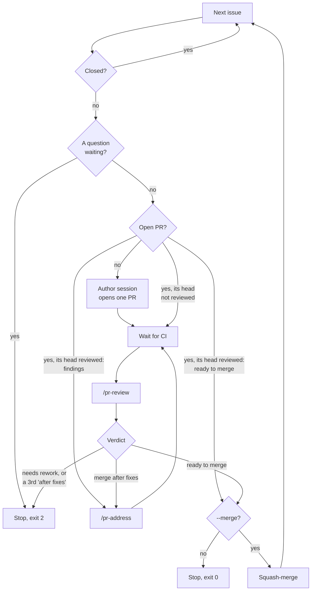

# AI-DLC: development automation

**Experimental.** This is a trial of auto-implementation: Claude sessions take issues through the whole [pull request workflow](CONTRIBUTING.md#branches-and-pull-requests) while nobody watches, from opening the PR through review and fixes to the merge. It may change a lot or be dropped, so it's kept out of CONTRIBUTING. [#124](https://github.com/alanbickel/wind-tunnel/issues/124) tracks the experiment.

[`scripts/ai-dlc.js`](scripts/ai-dlc.js) is the driver. It takes a list of issues, and runs each step (start, review, address) as its own fresh headless `claude -p` session, at medium effort. An issue's sessions run on Sonnet 5.5, or on Opus 5.5 if the issue has the `opus` label: add it to an issue whose design needs the stronger model. The label doesn't cover reviews, which always run on Sonnet. No session's transcript carries over to the next step; GitHub is the only state the steps share. The sessions talk to each other and to the maintainer as [the review protocol](.claude/review-protocol.md) says.

## Setup

Use a separate clone, in a folder of its own. The driver switches branches in its checkout, and its sessions create worktrees beside it (`../wind-tunnel-review-<n>`, `../wind-tunnel-address-<n>`). In the folder that holds your own checkout, they could collide with your interactive work.

```sh
mkdir wind-tunnel-auto && cd wind-tunnel-auto
git clone https://github.com/alanbickel/wind-tunnel.git
cd wind-tunnel && npm ci
```

It needs `gh` signed in and Claude Code. The driver passes each session's allowed and denied tools itself, so the clone needs no local settings. No session may merge a PR or push to `main`; the author pushes only branches named for an issue (`feat/issue-<n>-...`).

## Running it

From the clone, on a clean `main`:

```sh
node scripts/ai-dlc.js 120 121 122 --merge --defer-manual-checks
```

It works through the issues in the order given, not the Roadmap's:



Each session (author, review, address) can also end by asking the maintainer a question. The driver then stops with exit code 2, as it does at the top.

- **`--merge`** squash-merges a PR once all of the review protocol's "ready to merge" conditions for a script hold, then goes on to the next issue. Without it, the driver stops at the first ready PR, because the next issue may build on it.
- **`--defer-manual-checks`** is an exception for this experiment. The rule in CONTRIBUTING's [Reviews](CONTRIBUTING.md#reviews) doesn't change. Authors don't do the "Done when" checks that need a person. They list them in a `🤖 Claude deferred checks:` comment on the issue, and the reviewer counts a listed check as met. When the whole list is done, the driver collects the checks into one checklist comment on each issue's parent.

## When it stops

It stops and leaves the rest to you, and never skips ahead, when:

- the working tree isn't clean before a step. It names the step that left it that way.
- a session ends with an error
- a session goes past 150 turns. The driver counts each model response in the session's main conversation, not a subagent's, and ends the session at the 151st. It passes `--max-turns 150` too, but that didn't stop a session in the first run.
- CI fails: a check run or a commit status (such as Snyk's) failed
- the author session opens no PR, or more than one
- a review says "needs rework", or still says "merge after fixes" after three rounds. The driver posts its own question on the PR.
- a question is waiting for you

Exit code 1 means something failed. Exit code 2 means a question is waiting: the driver prints it with its link and rings the terminal bell.

## Resuming

Answer the question on GitHub, either in a comment after it or in its thread, then run the same command again. The driver goes on once a maintainer comment is newer than the newest question. The session that acts on your answer removes `needs-decision`.

A rerun:

- skips closed issues
- starts any issue that has no open PR
- takes an open PR to review, unless the latest review is of its head commit. Then it goes on from that review's verdict.

## Afterward

Read:

- each issue's `🤖 Claude decisions:` comments: the choices sessions made without asking
- the PRs' review threads
- with `--defer-manual-checks`, the checklist on the parent issue

To look into a step, use its session id. The terminal shows it when the session starts and again when it ends, and `claude --resume <id>` reopens that session. The logs are in `ai-dlc-logs/` (gitignored):

- each session's stream, as JSON lines
- `steps.jsonl`: one line per step, with its session id, cost, turns (Claude Code's count and the driver's), time, and the 5-hour usage before and after

## What runs have shown

- **Cost.** The first run took #119 to "ready to merge": start, one review, one address round, and a follow-up review. It cost about $11.40 and 28 points of the 5-hour cap. The start step was two-thirds of that, at $7.44 and 210 turns. [#127](https://github.com/alanbickel/wind-tunnel/issues/127) has the step-by-step numbers.
- **What the cost is made of.** The run of #120–#122, all on Opus, cost about $18 and a whole 5-hour window for three issues. The start steps were 59% of it, the first reviews 22%, the address rounds 13%, and the follow-up reviews 6%. Most of a session's cost is cache reads: every call re-reads the whole conversation, so cost grows with the number of calls times the context's size. The start sessions reached 70–120k tokens of docs and source files before their first edit, then made 35–71 edits, one call each, and peaked at 120–215k tokens. [#142](https://github.com/alanbickel/wind-tunnel/issues/142) has the breakdown and the changes it led to: Sonnet by default, an author told to survey code through a subagent and batch its edits, and a reviewer that reads the diff a file at a time.
- **Small issues are cheaper per change**, not just faster to review. #120's start step alone took 31 minutes and a quarter of a 5-hour window, because a long session pays for its growing context on every call. Split an issue whose start step would make dozens of edits.
- **`--max-turns` isn't a dependable cap.** The start session above ran 210 turns under `--max-turns 150` and still finished as a success, so the driver now counts turns itself. `steps.jsonl` records both counts, `turns` (Claude Code's) and `driverTurns`, so later runs can show what `--max-turns` counts.
- **CI time varies.** The same checks took 3 minutes on one push and 21 minutes on the next.
