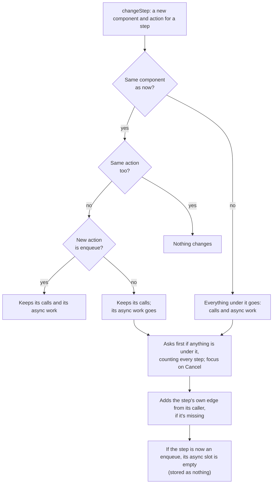

# ADR-0021: Edit async work through the same commands, tied to its `enqueue`

- **Status:** Proposed
- **Date:** 2026-11-10

## Context

A workflow is a tree of calls, with one exception. A step whose action is `enqueue` may have an `async` step: the user's request is answered once the message is queued, and a second tree runs later, when a consumer takes the message off the queue ([domain model](../architecture/domain-model.md), [engine](../architecture/simulation-engine.md)). Without a way to edit it, a user can't model a queue in front of a slow component ([UX design §2.6](../design/user-experience.md#26-sketch-put-a-queue-in-front-of-a-slow-component)). [#162](https://github.com/alanbickel/wind-tunnel/issues/162) builds that editor. This is its design, for the maintainer to review before any code ([#163](https://github.com/alanbickel/wind-tunnel/issues/163)).

### What the model already says

- **The engine.** An `enqueue` step visits its queue (SQS), which holds the message for its send latency, then keeps it in an unbounded backlog until one of `consumerMaxConcurrency` slots is free. It then *dispatches* the message: the engine calls the step's `async` step from the queue, along the edge from the queue to the consumer. That edge's latency, timeout and retries apply to the delivery like any call's. When the async tree ends, the slot frees; if it failed, the message goes back to the backlog. A step with no `async` has nothing to deliver, so the delivery succeeds at once and nothing runs. Nothing in the engine limits how deep it goes: an `enqueue` inside async work dispatches the same way.
- **The validator** (`findStepIssues`) already says the rules: the async root follows an edge from the queue's component; only an `enqueue` step has `async` (`async-not-on-enqueue`); and its component must deliver async work (`async-not-delivered`). It checks async work to any depth, so an `enqueue` under async work is valid.
- **The findings** read the run, not the tree. *Backlog* reads the queue's `consumerConcurrency` use and its depth. *Failed deliveries* counts failed deliveries by cause, noted at the component that refused. *Late async work* finds each queue a workflow enqueues into, at any depth (`asyncTargets`), and compares the delivery latency (counted from the request's start) with the timeout on the workflow's entry edge. None of them depends on how the tree was edited, so none changes.
- **The read side of the editor** (#115, #136) already treats async work as part of the workflow: a step is selected by its id, unique across the project ([ADR-0020](0020-give-workflow-steps-stable-ids.md)); `stepLinksOf` pairs the async root with its queue; the path and a step's ring follow the queue's edge; `selectionAfterUndo` keeps an async step by id; the outline shows async work under "Async work, done when a consumer takes the message"; and each run issue finds its step.

### What the editor can't do

Every edit command finds its step by `stepInCalls` or `holderOf`, which follow `calls` only. A step in async work isn't found, so each command returns the record unchanged for it, and the outline offers it nothing. The action picker is locked on a step that has async work ([#161](https://github.com/alanbickel/wind-tunnel/issues/161)). There is no command that gives an `enqueue` step an `async` step.

Edits to the async tree are the same edits as to the main one, on steps the commands can't reach yet. The design questions are how they reach them, what an action change does to async work, and how the screen and the announcements describe two trees.

## Decision

### 1. The model

1. **Async work is a slot on an `enqueue` step, not a list.** An `enqueue` step has zero or one async root. Its root is a call from the queue, along the queue's edge to the consumer, so everything about a call applies to it: the edge supplies its latency, timeout and retries; the queue type's `edgeDefaults` are the defaults of a new one; the consumer's component must have an edge from the queue, or the step shows `missing-edge`. There is no new kind of edge and no new field.
2. **An empty slot is a valid state, and it's not stored.** An `enqueue` step with no `async` runs: each message is taken and nothing happens. The slot is empty because `async` is absent, so changing a step *to* `enqueue` stores nothing more than its component and action. The screen offers the slot because the step's action is `enqueue` and it has none. The outline says so: "No async work yet. A message is taken off the queue and nothing runs." There's no run issue for it: a user can point a step at an SQS queue and leave its outbound edge empty (decided in review).
3. **Async work lives and dies with `enqueue`.** The command that changes a step enforces the validator's rule, so the editor never produces `async-not-on-enqueue`: after a change, the step has `async` only if its action is `enqueue`. The two issues about async work can still arrive from a stored project, and the editor can fix them (decision 5).
4. **Async work may nest.** An `enqueue` under async work gets a slot like any other: the model, the engine and the validator allow it, and a rule against it would be a new restriction with no reason in the model. A chain of queues is a real pattern (SQS to Lambda to SQS).

### 2. How the commands reach the async tree

1. **A step is still named by its id, and nothing else is.** Ids are unique in the project, so a command doesn't need to say which tree: `{ workflowId, stepId }`, as now. No path and no "async" flag go into a command's input. Commands stay pure and take step ids.
2. **One search, over both children.** `stepInCalls` and `holderOf` become searches over `calls` and `async` (the names say "calls", so they're renamed). `holderOf` returns the step that holds the step, whichever child it is: for the async root, the queue. The existing commands then reach the async tree with no other change:

| Command | On the async tree |
|---|---|
| `addCall` | Works under the async root and anywhere below it. Adds the edge from the caller through `connectIfMissing`, as now. |
| `changeStep` | Changes the async root's component and action. Its caller is the queue, so a missing edge from the queue is added, as it is for any call. |
| `moveStep` | A step under the async root moves among its siblings. The async root has none: it's the slot's only step, so move is unavailable, as for a workflow's first step. |
| `removeStep` | Removes the async root, leaving the slot empty: the holder's `async` goes, its `calls` stay. A step below it goes as any step does, with everything under it. No edge goes. |

3. **One new command: `addAsyncWork`.** It sets `async` on an `enqueue` step that has none, to a new step with the given id, component and action, and adds the queue's edge to the consumer through `connectIfMissing`, so the slot and its edge are one undo step. It returns the record unchanged if the step isn't an `enqueue`, already has async work, or isn't in the workflow. It's the counterpart of `addCall`, not a variant of it, because a slot holds one step and a list holds many, and because a call is appended where this one is set.
4. **Dropping `async` rebuilds a step.** `withCalls` rebuilds a step field by field and must name `async` ([Gotchas](../../CONTRIBUTING.md#gotchas)); the new code that drops `async` must name `calls` the same way. `mapSteps` says its callback "shouldn't add or remove" `calls` or `async`; `changeStep` will, when it drops async work, so the new code either changes that note or does the drop outside `mapSteps`. Either is the implementer's call.
5. **No command removes an edge**, async work included ([ADR-0019](0019-edit-projects-with-commands-and-save-each-change.md) decision 3). Removing async work leaves `orders-queue → fn-writer` in the architecture, and its Details says no step calls along it.

### 3. Changing a step's component or action

`changeStep` changes a step's component and action together, and today keeps its id, `calls` and `async` whatever it changes to. That has to end, because a step's children were chosen for the component it had: a database's `read` under one Lambda means nothing under another, and a consumer's edge starts at one particular queue. So, decided in review:

**A step keeps what's under it only while its component stays the same. Changing to a different component, even one of the same type, drops everything under the step, `calls` and `async` alike, after asking.** Within that, `async` also goes when the new action isn't `enqueue`, which is the validator's rule, so the command can't produce what the validator rejects. The step keeps its id.

| The change | Becomes |
|---|---|
| A different component | Everything under the step goes, `calls` and `async`. The user is asked first, and told how many steps (below). |
| The same component, a different action | The step keeps its `calls`; its `async` goes if the new action isn't `enqueue`, and the user is asked. |
| To `enqueue` | The step gets an empty slot, which is nothing in the record (decision 1.2). It's a different component, so anything under it goes, after asking. |
| `enqueue` to `enqueue` on another queue | A different component, so its async work goes, after asking. The consumer's edge belonged to the old queue, so no `missing-edge` is left on a step the user didn't touch. |
| The same component and action | Nothing changes, as today. |

The same rule as a flow. It's a picture of the table, which is the contract:



- **The question.** A change that drops steps asks before saving, with the focus on Cancel, as a remove does. It counts every step under the step, async work and nested steps included: "Change fn-orders · invoke to fn-writer · invoke? The 3 steps under it go." A step with nothing under it changes at once, as today.
- **The step's own edge** is unchanged: if its caller has no edge to the new component, the same command adds one (`connectIfMissing`), as `addCall` does. Only what's *under* the step is dropped.
- **No calls under an `enqueue`.** The editor stops offering "Add a call from orders-queue", since a queue's follow-up work is its async work. The validator doesn't change, so a stored project with such calls still opens. (Assumed from the answer to the first question, not separately confirmed.)
- **The pickers.** The action picker is no longer locked, and the component picker no longer filters by the step's action: both offer every component. A component whose type accepts one action (SQS only accepts `enqueue`) still takes it at once.
- **One undo step.** The command does the whole change, so Undo restores the component, the action and everything under it together, because the history keeps the record from before.
- **Names and words.** The undo name says what went, as the add's says its edge: "Change fn-orders · invoke to fn-writer · invoke, and remove the 3 steps under it". The announcement: "Changed fn-orders · invoke to fn-writer · invoke. The 3 steps under it are gone." Changing to `enqueue` says there's a slot to fill: "Changed orders-db · write to orders-queue · enqueue. Added the edge from fn-orders to orders-queue. It has no async work yet."
- **This changes what #161 shipped.** `changeStep` keeps a step's calls today, and the workflow-editor guide and CONTRIBUTING's Gotchas say so. #164 changes the command, its words, its tests, and those two passages.

### 4. What the screen shows

Two trees, one outline. The outline keeps its form, which already shows them:

```text
1  API Gateway · invoke
   1.1  fn-orders · invoke
        1.1.1  orders-queue · enqueue
               Async work, done when a consumer takes the message
               1.1.1.1  fn-writer · invoke
                        1.1.1.1.1  orders-db · write
```

- **Numbering** continues down the async tree as it does down calls, so a step's number says where it is, and the outline reads top to bottom as the request does, then as the delivery does.
- **The empty slot** shows the same heading, with "No async work yet. A message is taken off the queue and nothing runs." and a button **New** "Add async work, done when a consumer takes the message". It opens a draft with a component picker, then an action picker, as a new call does: the same pickers, and the same `NewCall` use case, which already puts the caller's neighbours first and marks a component with no edge from the caller "No edge from orders-queue yet; choosing it adds one." Nothing saves until both are chosen, and Escape drops it.
- **The async root's line** has Remove, and Change (the pickers, as any step's). It has no Move up or Move down. Its accessible description says what it is: "Runs when a consumer takes the message from orders-queue." Remove asks first only if something is under it, as for a call: "Remove fn-writer · invoke and the 1 call under it?".
- **The diagram** shows nothing new. Edges belong to the architecture, so the queue's edge to the consumer is drawn like any edge. A workflow's path already includes it, and selecting the async root rings the consumer and that edge. Nothing marks an edge as asynchronous, because an edge isn't: only a call along it is.
- **The text version** already says it: "… → orders-queue (enqueue), then fn-writer → orders-db (write)." An `enqueue` with no async work ends the line as any last step does: "… → orders-queue (enqueue)."
- **A screen reader** hears the heading as the name of the async list (the outline's `<ol>` is labelled by it); the root's description; and an announcement for each edit.
- **The focus and the selection** follow #117's. An add selects the new step and focuses its line. Removing the async root selects the `enqueue` that held it and focuses its line, where the slot's **New** button now is. A change keeps the selection and the focus on the picker. An undo that takes the selected step away clears the selection (`selectionAfterUndo`, which follows a step by id through both trees, needs no change).

### 5. Issues from an older project

The editor can't produce `async-not-on-enqueue` or `async-not-delivered`, but a stored project, and later an imported one ([#21](https://github.com/alanbickel/wind-tunnel/issues/21)), can have them. Each shows on the step that has the async work (`stepPathOf` already does this). The user fixes them with the same controls: Remove on the async root, or changing the step's action (which asks, and drops it). Neither needs a special case.

### 6. Announcements and undo names

| Edit | Undo name | Announcement |
|---|---|---|
| Add async work | "Add async work from orders-queue to fn-writer", or "…, and its edge" | "Added async work from orders-queue to fn-writer. Added the edge from orders-queue to fn-writer." |
| Change to a different component | "Change fn-orders · invoke to fn-writer · invoke, and remove the 3 steps under it" | "Changed … The 3 steps under it are gone." |
| Change to `enqueue` | "Change orders-db · write to orders-queue · enqueue", or "…, and its edge" | "Changed … It has no async work yet." |
| Remove the async root | "Remove fn-writer · invoke" | "Removed fn-writer · invoke. orders-queue · enqueue has no async work now." |
| Add, change, move, remove below it | As in the main tree | As in the main tree |

An id never appears in any of them.

### 7. Tests each sub-issue needs

Each with a `// Fails if` comment, as [testing.md](../contributing/testing.md) says.

**#164, change an action in place**

- `changeStep`: the step keeps its id; a change to a different component, even of the same type, drops everything under it, `calls` and `async`; the same component with another action keeps its `calls`, and drops `async` only if the action isn't `enqueue`; the same component and action change nothing; a change to `enqueue` stores nothing more than its component and action; a change along a missing edge still adds the step's own edge, and nothing for what was under it. Undo (the history, over the same record) restores the step and everything under it.
- The words: the question counts every step under the step, nested async work and calls included; none is asked when nothing is under it; the undo name and the announcement say how many went.
- The screen: the picker is unlocked; the question has the focus on Cancel, and Cancel changes nothing; confirming announces what went; Undo restores all of it; no "Add a call" under an `enqueue`.

**#165, the async slot and the async tree**

- The search: `stepInCalls` and `holderOf` find a step in both trees; the async root's holder is the queue.
- `addAsyncWork`: sets the slot and adds the edge when it's missing, in one command; adds none when it's there; returns the record unchanged for a step that isn't an `enqueue`, has async work already, or isn't in the workflow; leaves the input alone.
- Each existing command on the async tree: `addCall` under the async root; `changeStep` on the root along a missing edge from the queue; `moveStep` among siblings below the root, and unchanged for the root; `removeStep` on the root leaves the slot empty and the queue's `calls` as they were, and takes nothing from the architecture.
- The slot: shown only on an `enqueue` with none; the draft saves when both are chosen, and Escape saves nothing; the words for an empty slot.
- The older project's issues: `async-not-on-enqueue` is fixed by Remove on the root, and by changing the action; `async-not-delivered` shows on the step.
- **The acceptance test:** the §2.6 sketch in a copy of Template A, through the same edit history the screen keeps: three calls and their three edges (`fn-orders → orders-queue`, `orders-queue → fn-writer`, `fn-writer → orders-db`), each undone in turn, with each announcement. The result has no run issues, and a run of it delivers messages.

**#166, docs** are checked by the sequence test's output, as the guide's other worked example is.

## Decided in review

The maintainer settled the four questions this design raised (2026-11-10):

1. **A step with calls, changed to `enqueue`:** ask, then drop them. The maintainer generalized it: the same rule holds for any change of a step's component to a different one, same type or not ([decision 3](#3-changing-a-steps-component-or-action)).
2. **`enqueue` under async work:** allowed; chained queues are modeled ([decision 1.4](#1-the-model)).
3. **Changing an `enqueue` to another queue while it has async work:** not left as a step with a missing edge. It follows the same ask-then-drop rule.
4. **An `enqueue` with no async work:** valid, with no run issue ([decision 1.2](#1-the-model)).

## Consequences

- **The editor finishes M6's workflow editing.** A user can model a queue in front of a slow component, and the findings, which read the run, work on what they build.
- **No schema, engine, validator or detector change.** The model already had the concept; the editor reaches it. A stored project opens as before.
- **The commands grow one function and a rule.** `addAsyncWork` is new; `changeStep` gains the keep-or-drop rule, for `calls` as well as `async`; two search helpers change their scope and name. The step's id is still the only address.
- **Re-pointing a step can now lose work**, so it asks, as a remove does, and #161's behavior changes with it: a step keeps what's under it only while its component stays. A leaf changes at once; re-pointing a step in the middle of a tree costs a confirmation and a rebuild of what was under it.
- **The empty slot is derived, not stored**, so there's nothing to migrate and nothing to get out of step; the cost is that the screen derives the state from two fields.
- **Nesting is allowed**, so the outline, the path and the findings have to keep working at any depth. They already do: they walk the tree recursively.
- **Sub-issues change.** #164 and #165 take the rules above, and #166 gains the changes in its list ([#162](https://github.com/alanbickel/wind-tunnel/issues/162)'s sub-issues are adjusted once this is reviewed).
