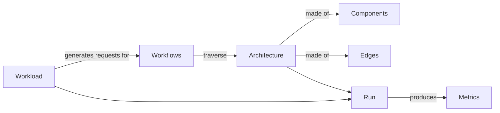
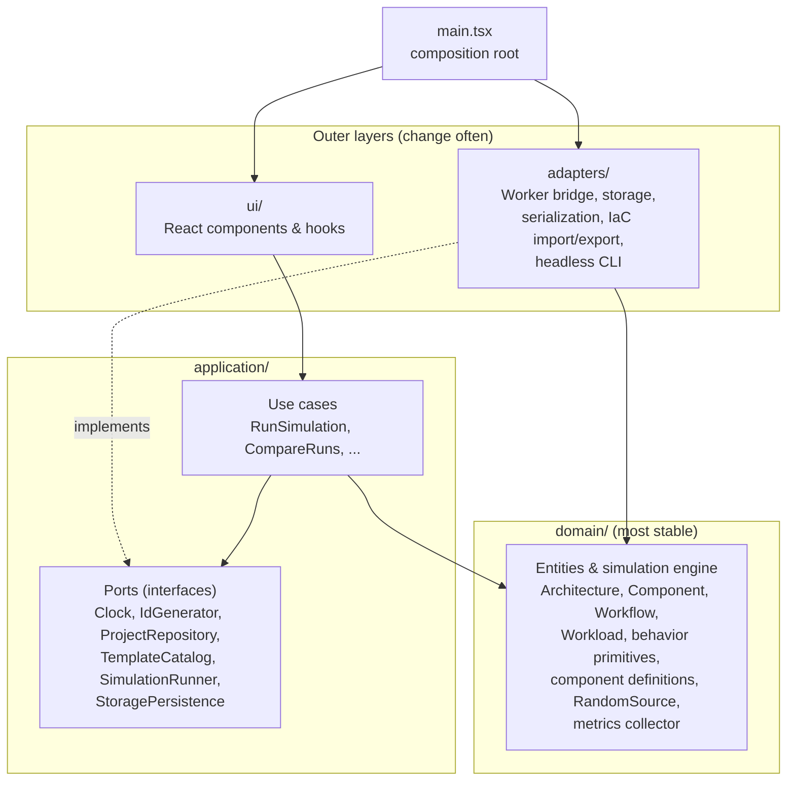
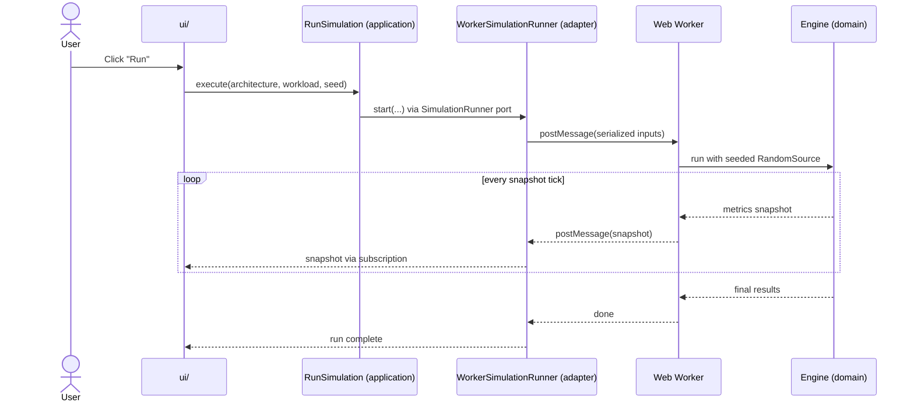

# Wind Tunnel Architecture Overview

> **Status: draft.** The project scaffolding exists, and `domain/` has its first building blocks (`model/`, `random/`, `behaviors/`, `components/` with the five AWS types, the simulation loop in `engine/`, and `metrics/`), `adapters/persistence/` migrates and loads project documents, maps them to and from `ProjectRecord`s, and stores them in IndexedDB (`IndexedDbProjectRepository`), `adapters/templates/` holds the two starter templates, the `TemplateCatalog` adapter over them, and the scenario tests that check their lessons, `adapters/cli/` runs templates headlessly (`npm run simulate`), `application/ports/` defines the ports, with in-memory fakes and a repository contract check in `application/testing/`, and `application/use-cases/` holds the MVP use cases; the UI is still to come. This describes the intended structure and will be updated as the code is written. Decisions behind it are recorded in [`docs/adr/`](../adr/).

Start here if you're new to the codebase.

## What Wind Tunnel does

Wind Tunnel lets you model a cloud application's architecture (e.g. API Gateway → Lambda → DynamoDB), describe what users do with it, and simulate concurrent load to see where bottlenecks form.

## Core concepts

The vocabulary below is used throughout the code and docs.

| Term | Meaning | Example |
|---|---|---|
| **Component** | One cloud service instance in the model, with capacity behavior | A Lambda function, a DynamoDB table |
| **Edge** | A connection between two components, with latency, timeout, and retry policy | Lambda → DynamoDB |
| **Architecture** | The graph of components and edges | The whole diagram |
| **Workflow** | A named, ordered list of steps a request takes through the architecture | "Checkout": API GW → OrderFn → DynamoDB write ×2 → SQS publish |
| **Workload** | Which workflows run, in what mix, at what rate over time | 80% browse / 20% checkout, ramping 100 → 5,000 users |
| **Run** | One execution of a workload against an architecture, producing metrics | p99 latency, throttles, queue depth over time |

For how these fit together in code, including workflows as call trees and the validation rules, see [The domain model](domain-model.md).

## Layers and the dependency rule

The code follows Clean Architecture ([ADR-0002](../adr/0002-use-clean-architecture-layering.md)). **Imports may only point inward.** Tooling enforces this in CI.

## Where does my code go?

| If you're writing… | Put it in | Notes |
|---|---|---|
| A new field or consistency rule on projects, workflows, or workloads | `src/domain/model/` | Update `validateProject`, the document schema and mapper in `src/adapters/persistence/`. A change old documents can't satisfy needs a new `schemaVersion` and a migration in `document-migrations.ts`, which `loadProject` runs before the schema. See [The domain model](domain-model.md). |
| A new cloud service type (e.g. Kinesis) | `src/domain/components/aws/` | Register it in `createAwsComponentRegistry`; don't edit the engine. Must pass `checkComponentContract`. See [Component definitions](component-definitions.md). |
| A new metric for one service type (e.g. Lambda warm instances) | That type's definition in `src/domain/components/aws/` | Expose it as a gauge or counter on the behavior; the engine and collector pass it through. See [How metrics work](metrics.md). |
| A new capacity behavior (e.g. token bucket variant) | `src/domain/behaviors/` | Keep it small and composable. |
| A new user action (e.g. "duplicate architecture") | `src/application/use-cases/` | Depend on ports, not concrete adapters. |
| Something that needs time, storage, or a Worker | Define a port in `src/application/ports/`, implement it in `src/adapters/` | Never call `Date.now` in `domain`/`application`. Add an in-memory fake to `src/application/testing/` for use case tests. |
| A new field about a project that the engine doesn't use (like `layout`) | `ProjectRecord` in `src/application/ports/`, plus the document schema and mapper in `src/adapters/persistence/` | Add it to `sampleRecord` so the repository contract checks it round-trips ([ADR-0008](../adr/0008-ports-exchange-project-records.md)). |
| Something that needs randomness | Use the `RandomSource` passed in from `src/domain/random/` | Never call `Math.random`; runs must stay reproducible from a seed. |
| A new template, or a change to one | `src/adapters/templates/` | List a new template in `BUNDLED_TEMPLATES` (`bundled-template-catalog.ts`); raise a template's `version` when a change alters what users see in a run. Record each non-default setting and its reason in [MVP design §7](../design/mvp-design.md#template-files-and-their-settings). Keep `template-scenarios.test.ts` asserting the template's lesson, and refresh the report snapshots (`npx vitest run -u src/adapters/cli`). |
| A new IndexedDB store or index (e.g. `runs`) | `project-database.ts` in `src/adapters/persistence/` | Raise `PROJECT_DATABASE_VERSION` and add an upgrade step for it; keep the old steps, so a database at any older version catches up. This is separate from a document's `schemaVersion` ([ADR-0004](../adr/0004-persist-projects-in-indexeddb.md)). |
| A CloudFormation/CDK/Terraform importer or exporter | `src/adapters/iac/` | Converts between file formats and domain objects. |
| A React component | `src/ui/` | Ordinary React patterns are fine here. Get use cases via context, not by importing adapters. |
| Wiring adapters to ports | `src/main.tsx` | The only place that knows about every layer. |

## How the rules are enforced

The layer rules are checked by tooling, so a mistake fails `npm run check` (and CI) instead of waiting for code review.

| Rule | Enforced by | Where |
|---|---|---|
| Imports point inward only; `ui` imports only *types* from `domain`; nothing imports `main.tsx` | `@typescript-eslint/no-restricted-imports`, configured per layer | [`eslint.config.js`](../../eslint.config.js) |
| `domain` and `application` use only approved pure libraries (currently `zod` in `domain`, [ADR-0005](../adr/0005-use-zod-for-schema-validation.md)); tests there may also import `vitest` | Same rule, with an allowlist of packages | [`eslint.config.js`](../../eslint.config.js) |
| No DOM, `Worker`, timers, or Node APIs in `domain` and `application` | TypeScript: these folders are checked without the DOM lib or Node types | [`tsconfig.core.json`](../../tsconfig.core.json) |
| No `Math.random`, `Date.now`, `new Date()`, or `Date()` in `domain` and `application` | `no-restricted-properties` and `no-restricted-syntax` | [`eslint.config.js`](../../eslint.config.js) |

[`tests/architecture/layer-rules.test.ts`](../../tests/architecture/layer-rules.test.ts) lints sample snippets in each layer and asserts that the rules above fire. If you change the rules, update that test.

To approve a new library for `domain` or `application`, write an ADR, then add it to `DOMAIN_PACKAGES` or `APPLICATION_PACKAGES` in `eslint.config.js`.

### TypeScript projects

`npm run typecheck` runs `tsc -b`, which checks three projects listed in [`tsconfig.json`](../../tsconfig.json). All of them extend `tsconfig.base.json` (strict mode, `noUncheckedIndexedAccess`, `noImplicitOverride`).

| Project | Covers | Environment |
|---|---|---|
| `tsconfig.core.json` | `src/domain`, `src/application` | ECMAScript only |
| `tsconfig.app.json` | all of `src` | Browser (DOM) + Vite, JSX |
| `tsconfig.node.json` | `vite.config.ts`, `tests/` | Node |

`domain` and `application` are checked twice: once in the core project to keep browser APIs out, and once in the app project, where the rest of `src` imports them.

## Tooling

| Tool | Used for |
|---|---|
| [Vite](https://vite.dev/) | Dev server and production build |
| [Vitest](https://vitest.dev/) | Tests. Unit tests sit next to the code (`*.test.ts`); cross-cutting tests live in `tests/` |
| [ESLint](https://eslint.org/) (flat config) + [typescript-eslint](https://typescript-eslint.io/) | Linting, with the `strictTypeChecked` rules, React hooks rules, and the layer rules above |
| [Prettier](https://prettier.io/) | Code formatting. Markdown is excluded so docs stay hand-formatted. |
| GitHub Actions | CI runs `npm run check` on every push to `main` and on pull requests ([`.github/workflows/ci.yml`](../../.github/workflows/ci.yml)) |

## Planned: how a simulation run works

For how the engine itself works (the event queue and the behavior primitives, with diagrams and example timelines), see [How the simulation engine works](simulation-engine.md). For how service types plug into it, see [Component definitions](component-definitions.md). For how snapshots are built, see [How metrics work](metrics.md).

## Keeping these docs current

- Update this overview **in the same pull request** as any change that alters the structure it describes.
- Significant decisions get an ADR (see [ADR-0001](../adr/0001-record-architecture-decisions.md)).
- Diagrams are written in [Mermaid](https://mermaid.js.org/) so they live next to the code, show up in diffs, and render on GitHub. In VS Code, the "Markdown Preview Mermaid Support" extension renders them in preview.
