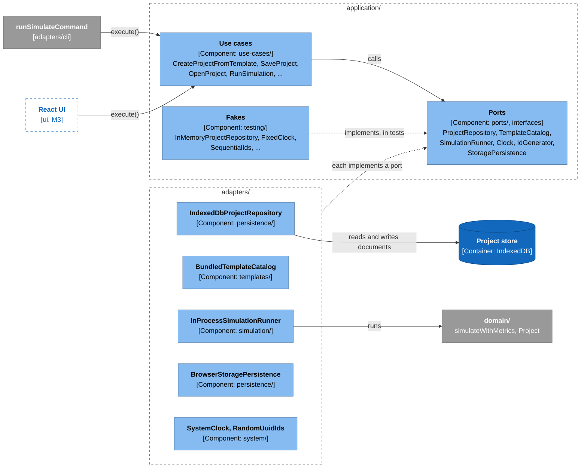
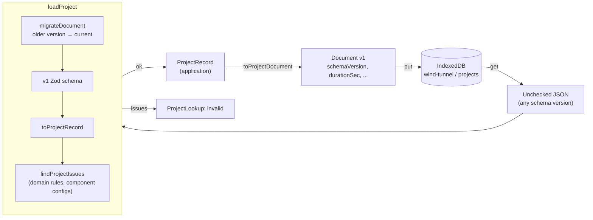

# The Application Layer and Persistence

An introduction to the use cases, the ports they work through, and the adapters that store projects, for maintainers new to the code. Read the [architecture overview](architecture-overview.md) and [the domain model](domain-model.md) first. The full design is in the [MVP design](../design/mvp-design.md) (§5 and §6).

> **Status:** the ports, the MVP use cases, the IndexedDB repository, the bundled template catalog, the in-process simulation runner, and the `Clock` and `IdGenerator` adapters exist. Nothing in the browser calls them yet: the UI and the Web Worker runner come in M3. Today the [headless runner](headless-runner.md) is the only real caller.

## The big idea: use cases talk to ports, adapters fill them in

A **use case** is one thing a user can do: create a project from a template, save it, run it. It lives in `src/application/use-cases/` and knows nothing about IndexedDB, Web Workers, or the system clock. Anything it needs from the outside world, it asks for through a **port**: an interface in `src/application/ports/`. An **adapter** in `src/adapters/` implements the port. Tests plug in in-memory fakes instead.

How the pieces connect (the [legend](architecture-overview.md#the-system-at-a-glance) explains the colors):



Because the use cases see only ports, the same use case runs against fakes in a unit test, against IndexedDB in an integration test, and inside the CLI, unchanged.

## The ports

| Port | What it does | Adapter today | Fake for tests |
|---|---|---|---|
| `ProjectRepository` | `list`, `get`, `save`, `delete` the user's projects | `IndexedDbProjectRepository` | `InMemoryProjectRepository` |
| `TemplateCatalog` | `list` the starter templates, `get` one as a record | `BundledTemplateCatalog` | `InMemoryTemplateCatalog` |
| `SimulationRunner` | Run a workload, stream per-second snapshots through `onSnapshot` | `InProcessSimulationRunner` (a Worker version in M3) | `RecordingSimulationRunner` |
| `Clock` | The current time as an ISO string (`2026-10-15T12:00:00.000Z`) | `SystemClock` | `FixedClock` |
| `IdGenerator` | New unique IDs | `RandomUuidIds` (`crypto.randomUUID()`) | `SequentialIds` (`project-1`, `project-2`, ...) |
| `StoragePersistence` | Ask the browser not to evict saved projects | `BrowserStoragePersistence` | none needed yet |

Two rules shape them:

- **`Clock` returns a string, not a `Date`.** ESLint bans `new Date` in `application/`, tests included, so nothing there can read the real clock. ISO strings in this one format also sort correctly as text, which the IndexedDB `updatedAt` index relies on.
- **The runner takes plain data.** A `SimulationRequest` is a `Project` and a workload ID, so the browser version can post it to a Web Worker. The adapter owns the component registry.

## Use cases

Each use case is a class: ports go into the constructor as one object, and the work happens in `execute`. A result that can go more than one way is a union keyed by `status`, so the caller has to handle each case.

| Use case | Ports | Returns |
|---|---|---|
| `ListProjects` | projects | Summaries, most recently updated first |
| `ListTemplates` | templates | Template summaries (ID, version, name) |
| `CreateProjectFromTemplate` | templates, projects, clock, ids | `created` with the new record, or `template-missing` |
| `OpenProject` | projects | `found`, `missing`, or `invalid` with a `reason` for the user |
| `SaveProject` | projects, clock, registry | `saved` with the new `updatedAt`, or `invalid` with the issues |
| `DeleteProject` | projects | nothing; deleting a missing project does nothing |
| `RunSimulation` | runner | `finished` with the run, or `workload-missing` |

Most are a single call on a port. The ones with logic:

- **`CreateProjectFromTemplate`** copies the template's record with a new ID from `IdGenerator` and both timestamps from `Clock`. It keeps `source` (template ID and version), so the project remembers where it came from.
- **`SaveProject`** refuses a project that fails validation (`findProjectIssues`). The repository would store it, but couldn't open it again.
- **`RunSimulation`** picks the workload (the first one by default) and applies a seed override to a copy. Nothing is saved.

## Records and documents

The application works with **`ProjectRecord`s**: a domain `Project` plus the facts the engine doesn't use (`createdAt`, `updatedAt`, `source`, `layout`). What's stored and exported is a **project document**: versioned JSON with a `schemaVersion`, checked by a Zod schema. Only the persistence adapter knows about documents ([ADR-0008](../adr/0008-ports-exchange-project-records.md)).



Things to know:

- **Units differ.** The document gives workload times in seconds (`durationSec`, `atSec`), which people find easier to write. The domain keeps every time in milliseconds (`durationMs`, `atMs`). The mapper converts both ways, and `toDocumentIssue` renames those fields in validation paths, so users see document paths.
- **Every read is checked again.** The repository reads through `loadProject`, the same function that loads templates and (later) imports. A project saved by an older build is migrated first; one that no longer passes a stricter rule comes back `invalid` with the reason.
- **An unreadable project is still listed.** `list` reads only the summary fields (`id`, `name`, `description`, `updatedAt`), so the user can see the project and open it to learn why it fails.
- **Two version numbers, two jobs.** The database version (`PROJECT_DATABASE_VERSION` in `project-database.ts`) covers stores and indexes; raise it to add a store. A document's `schemaVersion` covers the document's shape; raise `CURRENT_SCHEMA_VERSION` and add a migration in `document-migrations.ts` to change it ([ADR-0004](../adr/0004-persist-projects-in-indexeddb.md)).
- **Templates are records too.** `BundledTemplateCatalog` loads each bundled JSON through `loadProject` at startup and throws if one is broken, so a bad template fails before a user picks it.

## Worked example: one project, end to end

[`src/adapters/traces/application-layer.test.ts`](../../src/adapters/traces/application-layer.test.ts) wires the use cases to the real adapters (IndexedDB through `fake-indexeddb`), wraps each port so it records every call, and saves the timeline to [`application-layer.txt`](../../src/adapters/traces/application-layer.txt). `port` lines are calls a use case made; `result` is what it returned.

Creating a project from a template takes the template, a new ID, and the time from the ports, then saves. IndexedDB holds the document, not the record: note `schemaVersion` and the workload's duration in seconds.

```text
CreateProjectFromTemplate.execute("template-a")
  port     templates.get("template-a") → record template-a "Serverless API with RDS" (updatedAt 2026-10-14T00:00:00Z)
  port     ids.newId() → project-1
  port     clock.now() → 2026-10-15T12:00:00.000Z
  port     projects.save(record project-1 "Serverless API with RDS" (updatedAt 2026-10-15T12:00:00.000Z))
  result   created, record project-1 "Serverless API with RDS" (updatedAt 2026-10-15T12:00:00.000Z)
  IndexedDB "projects" store, key "project-1":
    schemaVersion 1
    createdAt 2026-10-15T12:00:00.000Z, updatedAt 2026-10-15T12:00:00.000Z
    source {"templateId":"template-a","templateVersion":1}
    workloads[0].durationSec 60   (the record has durationMs 60000)

SaveProject.execute(the record, renamed "Rush hour")
  port     clock.now() → 2026-10-15T12:05:00.000Z
  port     projects.save(record project-1 "Rush hour" (updatedAt 2026-10-15T12:05:00.000Z))
  result   saved
```

Running it streams a snapshot per simulated second before the run resolves. The totals add up: every request started either finished or was still in flight when the run ended.

```text
RunSimulation.execute({ project (cut to 3 s), seed: 7, onSnapshot })
  port     runner.run({ project: project-1, workloadId: "lunch-rush" })
  onSnapshot  0–1000 ms
  onSnapshot  1000–2000 ms
  onSnapshot  2000–3000 ms
  port     runner.run → 3 snapshots
  result   finished, workload "lunch-rush" with seed 7
  totals: started 619 = succeeded 613 + failed 0 + unfinished 6
```

Then the test rewrites the stored document as a newer build might (`schemaVersion: 2`). The project is still listed, but opening it explains why it can't be read:

```text
ListProjects.execute()
  port     projects.list() → [project-1 "Rush hour"]
  still listed: list() reads only the summary fields

OpenProject.execute("project-1")
  port     projects.get("project-1") → invalid
  result   invalid: "This project was saved in a form this version of Wind Tunnel can't open."
  issue    schemaVersion: Unsupported schema version 2; this version of Wind Tunnel reads version 1.
```

If the flow changes, that test fails and the diff shows the new timeline. If the change is intended, run `npx vitest run -u src/adapters/traces`, then update the excerpts on this page.

## How it's tested

| Test | Checks |
|---|---|
| `src/application/use-cases/*.test.ts` | Each use case against the fakes in `src/application/testing/` |
| `checkProjectRepositoryContract` | That a repository round-trips `sampleRecord`, lists newest first, replaces on save, and so on. Both the fake and the IndexedDB adapter must return `[]` |
| [`use-cases-with-indexeddb.test.ts`](../../src/adapters/persistence/use-cases-with-indexeddb.test.ts) | Every use case wired to IndexedDB, the bundled templates, and the in-process runner, for each template |
| `project-document-mapper.test.ts`, `load-project.test.ts`, `document-migrations.test.ts` | Records and documents convert both ways unchanged; bad documents give issues with document paths |

For an IndexedDB test, `import "fake-indexeddb/auto"`, give each test a fresh database with `vi.stubGlobal("indexedDB", new IDBFactory())` in `beforeEach`, and close it in `afterEach`.

## Wiring it together

Something has to build the adapters and hand them to the use cases. Today that's the CLI (`runSimulateCommand` in [`simulate-command.ts`](../../src/adapters/cli/simulate-command.ts)), which wires the catalog and the in-process runner to `RunSimulation`. In M3, `src/main.tsx` becomes the composition root: it opens the database, builds every adapter, and gives the use cases to the UI through React context.

## Adding to it

- **A new user action:** a class in `src/application/use-cases/` that takes ports, not adapters. Test it against the fakes; if it touches storage, add it to `use-cases-with-indexeddb.test.ts` too.
- **A new port:** an interface in `src/application/ports/`, an adapter in `src/adapters/`, and a fake in `src/application/testing/`.
- **A new field the engine doesn't use:** `ProjectRecord`, the document schema, and the mapper, and set it in `sampleRecord` so the contract checks it round-trips.
