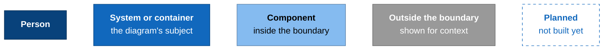
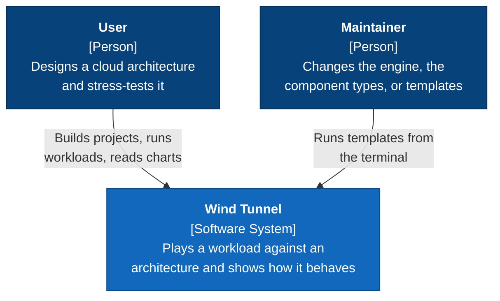
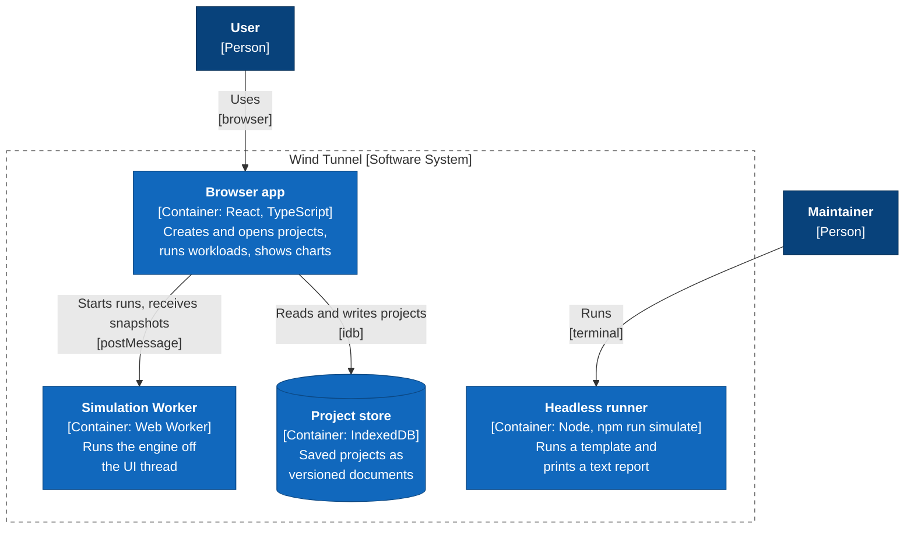
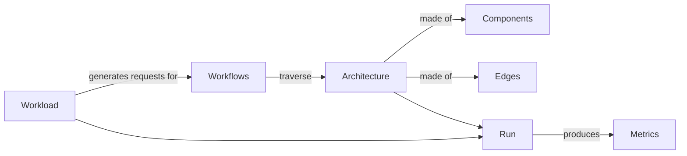
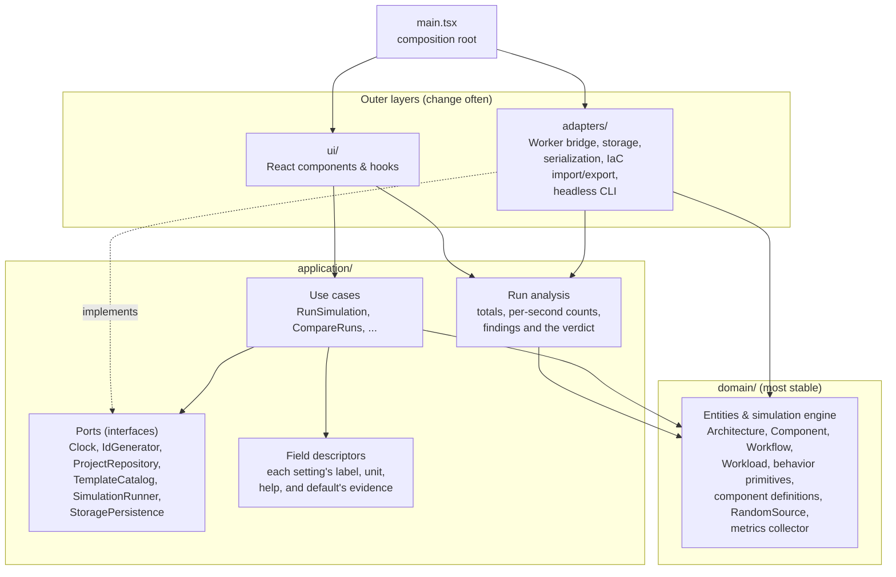

# Wind Tunnel Architecture Overview

How the code is organized: the layers, the dependency rule, where new code goes, and how tooling enforces it. Decisions behind it are recorded in the [ADRs](../adr/adr-overview.md).

## The system at a glance

These are [C4](https://c4model.com/) diagrams. The context diagram (level 1) shows who uses Wind Tunnel; the container diagram (level 2) shows the programs and data stores it's made of. There's no server and no AWS account: everything runs on the user's machine. Each [guide](#the-guides-in-this-folder) adds a component diagram (level 3) for its part of the code, and a class diagram (level 4) where a factory wires a class's collaborators.

Each box names its kind in brackets. A dashed boundary groups what's inside a system, container, or folder.

### Context

### Containers

The browser app, the Worker, and the headless runner run the same `domain/` and `application/` code, organized as in [Layers and the dependency rule](#layers-and-the-dependency-rule).

## Core concepts

A **project** describes an architecture of **components** joined by **edges**, the **workflows** a request takes through it, and the **workloads** that send requests. A **run** plays a workload against the architecture and produces metrics. Every term is defined in the [glossary](../glossary.md).

For how these fit together in code, including workflows as call trees and the validation rules, see [The domain model](domain-model.md).

## The guides in this folder

Each guide is a short, visual introduction to one part of the system, with a worked example generated by a test. [Getting started](../getting-started.md) gives the order to read them in.

| Guide | Covers |
|---|---|
| [The domain model](domain-model.md) | Entities, workflows as call trees over the architecture, loading documents (`loadProject`), `validateProject` |
| [How the simulation engine works](simulation-engine.md) | Discrete-event loop, `EventQueue`, `RateLimit`, `ConcurrencyLimit`, `Queue`, `ServiceTime`, distributions, `simulate`, `ArrivalProcess`, `backoffMs` |
| [Component definitions](component-definitions.md) | `ComponentDefinition`, the registry, `ComponentBehavior` effects, `checkComponentContract`, `validateComponents`, the five AWS types |
| [How metrics work](metrics.md) | Engine ticks, `MetricsCollector`, `MetricsSnapshot`, `simulateWithMetrics`, limits, gauges and counters, `LatencyHistogram` |
| [The application layer and persistence](application-layer.md) | Use cases, ports, `ProjectRecord` vs. the project document, `loadProject` and migrations, `IndexedDbProjectRepository`, `BundledTemplateCatalog`, the in-process and Web Worker runners, the repository and runner contracts |
| [The user interface](user-interface.md) | The composition root, `UseCasesProvider` and `useUseCases`, the screens, selection and the Details tab, `useSimulationRun` and the Worker runner, a run traced from click to chart, UI test helpers |
| [The headless runner](headless-runner.md) | `npm run simulate`, `runSimulateCommand`, the text report and how to read it, loading TypeScript through Vite |
| [Findings and detectors](finding-detectors.md) | `Finding`, `Statement` and the phrasebook that words it, `Detector`, `findRun`, the verdict and headroom, the catalog of fixes, adding a detector |

## Layers and the dependency rule

The code follows Clean Architecture ([ADR-0002](../adr/0002-use-clean-architecture-layering.md)). **Imports may only point inward.** Tooling enforces this in CI.

## Where does my code go?

| If you're writing… | Put it in | Notes |
|---|---|---|
| A new field or consistency rule on projects, workflows, or workloads | `src/domain/model/` | Update `validateProject`, the document schema and mapper in `src/adapters/persistence/`. A change old documents can't satisfy needs a new `schemaVersion` and a migration in `document-migrations.ts`, which `loadProject` runs before the schema. See [The domain model](domain-model.md). |
| A new cloud service type (e.g. Kinesis) | `src/domain/components/aws/` | Register it in `createAwsComponentRegistry`; don't edit the engine. Must pass `checkComponentContract`. See [Component definitions](component-definitions.md). |
| A new metric for one service type (e.g. Lambda warm instances) | That type's definition in `src/domain/components/aws/` | Expose it as a gauge or counter on the behavior; the engine and collector pass it through. See [How metrics work](metrics.md). |
| A new capacity behavior (e.g. token bucket variant) | `src/domain/behaviors/` | Keep it small and composable. |
| A new user action (e.g. "duplicate architecture") | `src/application/use-cases/` | Depend on ports, not concrete adapters. |
| A number or finding derived from a run's snapshots that the UI or the CLI shows (e.g. totals, work in progress) | `src/application/run-analysis/` | Pure functions of a `RunSoFar`; the UI and the CLI only format the results. Add a check to `run-analysis-reconciles.test.ts` when it adds up to something ([ADR-0013](../adr/0013-derive-run-results-in-application-run-analysis.md)). |
| What a component type's setting means to a user: its label, unit, help, and its default's evidence | That type's file in `src/application/details/fields/` | One descriptor per key of the type's `defaultConfig`, listed in `createFieldCatalog`. Cite fidelity entries by ID in the help; the evidence must match fidelity's [defaults table](../design/fidelity.md#default-values-and-their-evidence), and `field-evidence.test.ts` checks both. |
| A new detector, or a fix for a component type's limit | `src/application/run-analysis/findings/detectors/`, or that type's file in `findings/catalog/` | List a detector in `createDetectors`, with its phrases beside it; never branch on a component's type. See [Findings and detectors](finding-detectors.md). |
| Something that needs time, storage, or a Worker | Define a port in `src/application/ports/`, implement it in `src/adapters/` | Never call `Date.now` in `domain`/`application`. Add an in-memory fake to `src/application/testing/` for use case tests. |
| A new field on `Project`, the model a run runs | `src/domain/model/project.ts`, plus the document schema and mapper in `src/adapters/persistence/` | Place it in the table in `runIsCurrent` (`src/application/run-analysis/run-freshness.ts`), which doesn't compile until you do: does changing it make a run on screen out of date ([ADR-0018](../adr/0018-tie-a-run-to-the-model-it-ran.md))? |
| A new field about a project that the engine doesn't use (like `layout`) | `ProjectRecord` in `src/application/ports/`, plus the document schema and mapper in `src/adapters/persistence/` | Add it to `sampleRecord` so the repository contract checks it round-trips ([ADR-0008](../adr/0008-ports-exchange-project-records.md)). |
| Something that needs randomness | Use the `RandomSource` passed in from `src/domain/random/` | Never call `Math.random`; runs must stay reproducible from a seed. |
| A new template, or a change to one | `src/adapters/templates/` | List a new template in `BUNDLED_TEMPLATES` (`bundled-template-catalog.ts`); raise a template's `version` when a change alters what users see in a run. Record each non-default setting and its reason in [MVP design §7](../design/mvp-design.md#template-files-and-their-settings). Keep the scenario tests in `scenarios/` asserting the template's lesson, and refresh the report snapshots (`npx vitest run -u src/adapters/cli`). |
| A new IndexedDB store or index (e.g. `runs`) | `project-database.ts` in `src/adapters/persistence/` | Raise `PROJECT_DATABASE_VERSION` and add an upgrade step for it; keep the old steps, so a database at any older version catches up. This is separate from a document's `schemaVersion` ([ADR-0004](../adr/0004-persist-projects-in-indexeddb.md)). |
| A CloudFormation/CDK/Terraform importer or exporter | `src/adapters/iac/` | Converts between file formats and domain objects. |
| A React component | `src/ui/` | Ordinary React patterns are fine here. Get use cases via context, not by importing adapters. |
| A diagram or chart feature | `src/ui/diagram/` or `src/ui/charts/` | Only these folders import React Flow and Recharts ([ADR-0010](../adr/0010-draw-diagrams-with-react-flow-behind-our-own-component.md), [ADR-0011](../adr/0011-draw-charts-with-recharts-behind-our-own-components.md)). Add what you need to their props, in our own types; consumers never see a library type. |
| Wiring adapters to ports | `src/main.tsx` | The only code that knows about every layer. |
| A test that needs adapters and the UI together (e.g. the run panel on a real template run) | `src/integration/` | Tests only. Like `main.tsx`, it sits outside the layers, so it may import from any of them. |

## How the rules are enforced

The layer rules are checked by tooling, so a mistake fails `npm run check` (and CI) instead of waiting for code review.

| Rule | Enforced by | Where |
|---|---|---|
| Imports point inward only; `ui` imports only *types* from `domain`; nothing imports `main.tsx` | `@typescript-eslint/no-restricted-imports`, configured per layer | [`eslint.config.js`](../../eslint.config.js) |
| `domain` and `application` use only approved pure libraries (currently `zod` in `domain`, [ADR-0005](../adr/0005-use-zod-for-schema-validation.md)); tests there may also import `vitest` | Same rule, with an allowlist of packages | [`eslint.config.js`](../../eslint.config.js) |
| Only `src/ui/diagram/` imports `@xyflow/react`, and only `src/ui/charts/` imports `recharts` ([ADR-0010](../adr/0010-draw-diagrams-with-react-flow-behind-our-own-component.md), [ADR-0011](../adr/0011-draw-charts-with-recharts-behind-our-own-components.md)) | Same rule, with `WRAPPED_LIBRARIES` | [`eslint.config.js`](../../eslint.config.js) |
| No DOM, `Worker`, timers, or Node APIs in `domain` and `application` | TypeScript: these folders are checked without the DOM lib or Node types | [`tsconfig.core.json`](../../tsconfig.core.json) |
| No `Math.random`, `Date.now`, `new Date()`, or `Date()` in `domain` and `application` | `no-restricted-properties` and `no-restricted-syntax` | [`eslint.config.js`](../../eslint.config.js) |
| A class doesn't build its own collaborators ([ADR-0009](../adr/0009-collaborators-come-from-factories.md)) | `no-restricted-syntax`: `new` inside a class body, except built-ins and `STATE_CLASSES` | [`eslint.config.js`](../../eslint.config.js) |
| Constructor collaborators (`*Dependencies` properties) are interfaces, not classes ([ADR-0009](../adr/0009-collaborators-come-from-factories.md)) | An architecture test that resolves each property's type with the TypeScript compiler | [`dependency-types.test.ts`](../../tests/architecture/dependency-types.test.ts) |
| Colors and lengths come from the design tokens, stylesheets live only in `src/ui/`, and nothing hides the focus ring ([ADR-0012](../adr/0012-style-the-ui-with-css-tokens-and-css-modules.md)) | An architecture test that scans `src/` for literals, stray stylesheets, and `outline: none` | [`stylesheets.test.ts`](../../tests/architecture/stylesheets.test.ts) |

[`tests/architecture/layer-rules.test.ts`](../../tests/architecture/layer-rules.test.ts) lints sample snippets in each layer and asserts that the lint rules above fire. If you change the rules, update that test.

To approve a new library for `domain` or `application`, write an ADR, then add it to `DOMAIN_PACKAGES` or `APPLICATION_PACKAGES` in `eslint.config.js`.

### TypeScript projects

`npm run typecheck` runs `tsc -b`, which checks three projects listed in [`tsconfig.json`](../../tsconfig.json). All of them extend `tsconfig.base.json` (strict mode, `noUncheckedIndexedAccess`, `noImplicitOverride`). The build is incremental: `tsc -b` skips a project whose files haven't changed since its last check, which is recorded in `node_modules/.tmp/*.tsbuildinfo`.

| Project | Covers | Environment |
|---|---|---|
| `tsconfig.core.json` | `src/domain`, `src/application` | ECMAScript only |
| `tsconfig.app.json` | all of `src` | Browser (DOM) + Vite, JSX |
| `tsconfig.node.json` | `vite.config.ts`, `tests/` | Node |

`domain` and `application` are checked twice: once in the core project to keep browser APIs out, and once in the app project, where the rest of `src` imports them.

## Tooling

| Tool | Used for |
|---|---|
| [Vite](https://vite.dev/) | Dev server and production build |
| [Vitest](https://vitest.dev/) | Tests. Unit tests sit next to the code (`*.test.ts`); cross-cutting tests live in `tests/` |
| [ESLint](https://eslint.org/) (flat config) + [typescript-eslint](https://typescript-eslint.io/) | Linting, with the `strictTypeChecked` rules, React hooks rules, and the layer rules above |
| [Prettier](https://prettier.io/) | Code formatting. Markdown is excluded so docs stay hand-formatted. |
| GitHub Actions | CI runs `npm run check` on every push to `main` and on pull requests ([`.github/workflows/ci.yml`](../../.github/workflows/ci.yml)) |

## How a simulation run works in the browser

The CLI runs a simulation in-process through `RunSimulation` ([the application layer guide](application-layer.md) traces one). The browser runs it in a Web Worker, one Worker per run, so the page stays responsive; [the user interface guide](user-interface.md#a-run-from-click-to-chart) follows a run from the Run button through the Worker to the charts.
