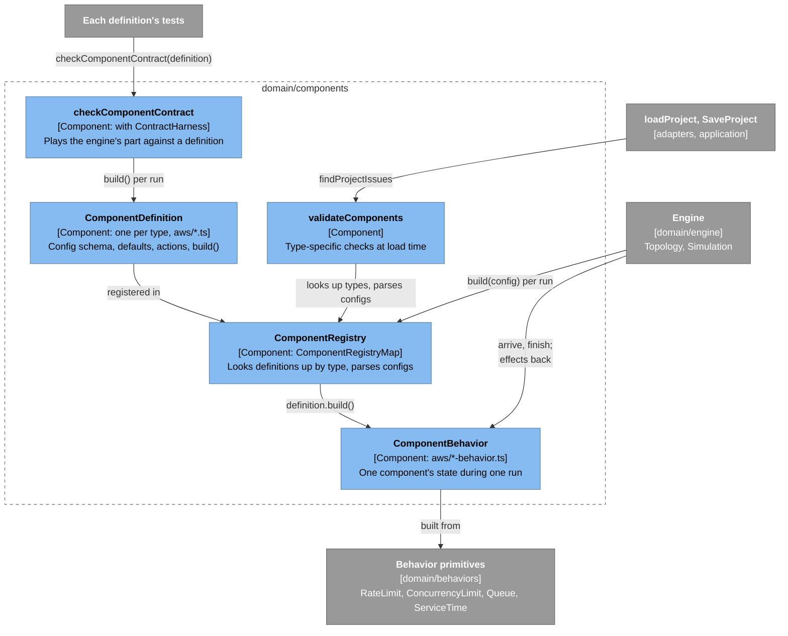
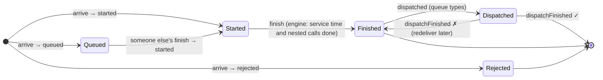
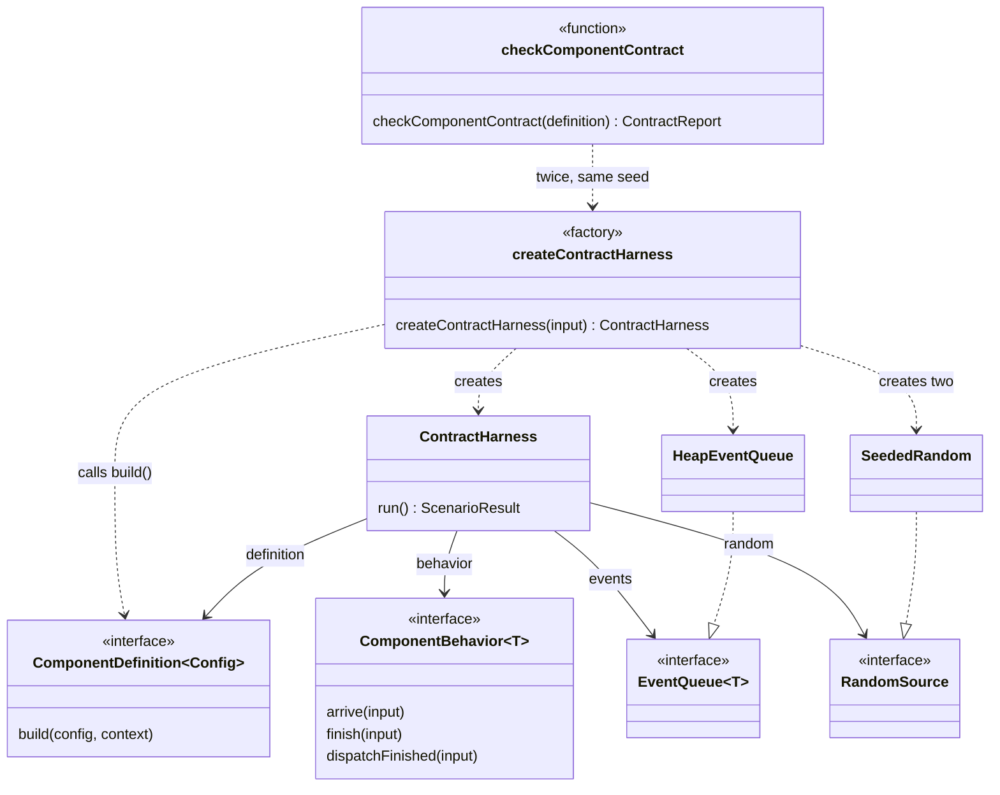

# Component Definitions: How Service Types Plug Into the Engine

A short introduction to how a cloud service type (Lambda, RDS, …) is described in code and how the engine talks to it. For maintainers new to the code. Read [How the simulation engine works](simulation-engine.md) first; this page builds on its behavior primitives. The decision behind the design is [ADR-0006](../adr/0006-components-return-effects-to-the-engine.md).

Code: [`src/domain/components/`](../../src/domain/components/).

> **Status:** the interface, registry, validation, contract checker, and the five MVP service types exist, and the [engine](simulation-engine.md#the-engine-loop-a-requests-journey) drives them.

## Three pieces

How they connect to the rest of the code (the [legend](architecture-overview.md#the-system-at-a-glance) explains the colors):



| Piece | What it is | File |
|---|---|---|
| **Definition** | Static description of one type: its config schema (Zod), defaults, the actions it accepts, and a `build` function | [`component-definition.ts`](../../src/domain/components/component-definition.ts) |
| **Registry** | Looks definitions up by `type` string. Parses configs, so callers don't need to know each type's config shape | [`component-registry.ts`](../../src/domain/components/component-registry.ts) |
| **Behavior** | The state of one component during one run: limits, wait lines, warm instances. Built fresh for each run | [`component-behavior.ts`](../../src/domain/components/component-behavior.ts) |

Adding a service type means writing a definition and registering it. The engine doesn't change.

## The conversation: calls in, effects out

A behavior never schedules events and never reads a clock. The engine calls it and it replies with **effects**, which the engine turns into events:

| Effect | Meaning | The engine then… |
|---|---|---|
| `started` (+ `serviceMs`) | This request begins work now | schedules the end of its service time, then makes its nested calls |
| `queued` | It's waiting inside the component | does nothing; a later call will return `started` for it |
| `rejected` (+ reason) | It didn't get in (e.g. `"throttled"`) | fails the call; the edge's retry policy may try again |
| `dispatched` | Start this request's `async` step now (queue types only) | runs the async step, then reports back with `dispatchFinished` |

The life of one request at one component:



Besides effects, a behavior exposes `inProgress` and `queueDepth`, and optionally its `limits` (live views of each concurrency or rate limit it enforces, e.g. RDS `connections`), type-specific `gauges` (sampled values), and `counters` (running totals, e.g. Lambda `coldStarts`). The engine reads them for [metrics](metrics.md#limits-and-their-use).

Nothing is ever cancelled. If a caller times out, the engine stops waiting for the answer, but the work here continues and is finished normally, just as a database keeps running a query after the Lambda that sent it gave up.

## Worked example

From [`component-behavior.txt`](../../src/domain/traces/component-behavior.txt), generated by a test using the two test definitions in [`testing/fake-definitions.ts`](../../src/domain/components/testing/fake-definitions.ts). They're also the simplest reference implementations to copy from.

A pool of 2 workers with room for 1 waiter. Note `finish a` returning `started c`: the freed worker goes straight to the waiter, so the engine learns that a *different* request has started.

```text
t(ms)  engine calls  effects returned        inProgress  queueDepth
0      arrive a      started a (10 ms)       1           0
0      arrive b      started b (10 ms)       2           0
0      arrive c      queued c                2           1
0      arrive d      rejected d: queue-full  2           1
10     finish a      started c (10 ms)       2           0
10     finish b      (none)                  1           0
20     finish c      (none)                  0           0
```

A queue with one consumer. Sending a message is a short piece of work (`started`, 1 ms). Once the send finishes, the message waits in the backlog until a consumer is free. A failed delivery goes back to the end of the queue:

```text
t(ms)  engine calls           effects returned   inProgress  queueDepth
0      arrive m1 (enqueue)    started m1 (1 ms)  1           0
0      arrive m2 (enqueue)    started m2 (1 ms)  2           0
1      finish m1              dispatched m1      1           0
1      finish m2              (none)             0           1
30     dispatchFinished m1 ✗  dispatched m2      0           1
55     dispatchFinished m2 ✓  dispatched m1      0           0
80     dispatchFinished m1 ✓  (none)             0           0
```

## The five AWS types

Code: [`src/domain/components/aws/`](../../src/domain/components/aws/). `createAwsComponentRegistry()` returns a registry with all five.

| `type` | Built from | Rejects with (`rejectionReasons`) | Key config | Reports limits (when full) |
|---|---|---|---|---|
| `api-gateway` | `RateLimit` → overhead | `throttled` (HTTP 429) | `ratePerSec`, `burst`, `overhead` | `requestRate` (refuses) |
| `lambda` | `ConcurrencyLimit` (reject) + warm environments → cold start + compute | `throttled` | `concurrency`, `coldStart`, `idleTimeoutSec`, `computeTime` | `concurrency` (refuses) |
| `dynamodb` | one `RateLimit` for reads, one for writes → latency | `throttled` | `readUnitsPerSec`, `writeUnitsPerSec`, `burstSec`, `latency` | `readUnits`, `writeUnits` (both refuse) |
| `rds` | `ConcurrencyLimit` on connections (reject) → `ConcurrencyLimit` on query workers (queue) → query time | `too-many-connections` | `maxConnections`, `queryWorkers`, `queryTime` | `connections` (refuses), `queryWorkers` (waits, holding `connections`) |
| `sqs` | send latency → unbounded `Queue` → at most `consumerMaxConcurrency` dispatched at once | never | `consumerMaxConcurrency`, `sendLatency` | `consumerConcurrency` (waits, holding nothing) |

Durations (`overhead`, `coldStart`, …) are distributions from [`distribution.ts`](../../src/domain/random/distribution.ts); defaults are mostly lognormal, given as a median and a p99.

A few things to know:

- **Lambda cold starts are checked lazily.** Each finished invocation leaves a warm environment. An arriving request takes the most recently used one; environments idle longer than `idleTimeoutSec` are dropped at that moment. The concurrency slot covers the cold start, the compute time, and every nested call.
- **RDS holds a connection while a query waits for a worker.** That's what turns "the database is busy" into "the database refuses connections".
- **DynamoDB's bucket starts full.** With the default `burstSec: 300`, a table can absorb a long spike before it throttles. Set `burstSec: 0` to see raw provisioned capacity.
- **SQS redelivers failed messages immediately**, to the back of the backlog. Real SQS waits for the visibility timeout (30 s by default) and can move a message to a dead-letter queue; both need a timer effect, which ADR-0006 leaves for later.

From [`aws-components.txt`](../../src/domain/traces/aws-components.txt). Lambda: two cold starts, a throttle, a warm reuse, and a cold start again after a long idle period:

```text
t(ms)  engine calls  effects returned       inProgress  queueDepth  why
0      arrive a      started a (320 ms)     1           0           cold start
0      arrive b      started b (320 ms)     2           0           cold start
0      arrive c      rejected c: throttled  2           0           2 of 2 busy
320    finish a      (none)                 1           0           a's env is warm
320    finish b      (none)                 0           0           b's env is warm
400    arrive d      started d (20 ms)      1           0           warm
420    finish d      (none)                 0           0
90000  arrive e      started e (320 ms)     1           0           idle > 60 s: cold
```

RDS with 3 connections and 1 worker. Queries b and c hold connections while they wait, so d is refused even though the database is only running one query:

```text
t(ms)  engine calls  effects returned                  inProgress  queueDepth  why
0      arrive a      started a (15 ms)                 1           0           connection 1
0      arrive b      queued b                          1           1           connection 2
0      arrive c      queued c                          1           2           connection 3
0      arrive d      rejected d: too-many-connections  1           2           no connection
15     finish a      started b (15 ms)                 1           1           worker passes to b
15     arrive e      queued e                          1           2           a's connection
30     finish b      started c (15 ms)                 1           1
45     finish c      started e (15 ms)                 1           0
60     finish e      (none)                            0           0
```

## What a type declares about rejections

When a request fails, the findings explain it from the failure's reason ([findings design §2.4](../design/findings.md#24-how-a-failure-reaches-a-finding)). They can only do that if each type says what its reasons mean, so a type declares three things ([ADR-0015](../adr/0015-findings-come-from-registered-detectors.md), [ADR-0016](../adr/0016-component-types-list-every-rejection-reason.md)):

| Declaration | Where | RDS |
|---|---|---|
| `rejectionReasons`: every reason the type may reject with. Closed: no other reason is allowed | The definition | `["too-many-connections"]` |
| A limit that **refuses** when full, and the reason it rejects with | The limit's `whenFull`, in the behavior | `connections` refuses with `too-many-connections` |
| A limit that **makes work wait** when full, and the limit its waiting work **holds**, if any | The limit's `whenFull` | `queryWorkers` waits, holding `connections` |

A listed reason that no limit declares is a rejection with no limit behind it, such as a failed validation. Keep each reason in one constant, and use it in the rejection, the limit, and the list: `rds-behavior.ts` exports `TOO_MANY_CONNECTIONS`, and `rds.ts` lists its `reason`.

What catches each mistake:

| Mistake | Caught by |
|---|---|
| A token bucket that declares it waits; a refusal that names a held limit; a wait with a reason | The types: `WhenFull` is a discriminated union, and a `RateLimitGauge` takes only a refusal |
| A rejection, or a refusing limit, whose reason isn't in `rejectionReasons` | The contract |
| `rejectionReasons` lists `timeout`, which the engine reserves | The contract |
| A limit declares a reason, but rejections with it come while that limit has room (the wrong limit declares it) | The contract |
| A declaration that changes during a run; a held limit that's missing, is the limit itself, or doesn't refuse | The contract |
| A limit that refuses but declares a wait, when its reason is listed: the rejection reads as one with no limit behind it | Not the contract. The type's own `limitValues` test, and for the template types, the rejection-reason tests in [`adapters/templates/rejection-reasons/`](../../src/adapters/templates/rejection-reasons/), which check whole runs |
| A listed reason that the behavior never uses | Nothing: the contract sees only the reasons its scenario causes |

## The contract every definition must pass

[`checkComponentContract`](../../src/domain/components/check-component-contract.ts) plays the engine's part against any definition, using the small event loop in [`ContractHarness`](../../src/domain/components/contract-harness.ts) rather than the real engine, so an engine bug can't hide a component bug. Its scenario has two overload bursts separated by a long quiet period (so warm instances go cold), random hold times standing in for nested calls, and 20% failed async deliveries. It checks that:

- every arrival gets exactly one outcome, and nothing is started twice or after a rejection;
- every queued request eventually starts, and all async work is eventually delivered;
- service times are finite and not negative;
- `inProgress` and `queueDepth` match what the effects imply, after every call;
- `gauges` and `counters` are finite, and counters never decrease;
- `limits` are the same on every read, declarations included; a limit whose waiting work holds another names a different limit of the same component, one that refuses; a concurrency limit's use stays within it; and a rate limit's bucket holds between 0 and its burst and never gives out more tokens than its burst and rate allow;
- `rejectionReasons` doesn't list `timeout`; every rejection's reason, and every refusing limit's, is on it; and a rejection whose reason a limit declares happens while one such limit is exhausted;
- the same seed produces exactly the same effects (no state shared between runs).

`checkComponentContract` runs the scenario twice through `createContractHarness`, the factory that builds each run's harness ([ADR-0009](../adr/0009-collaborators-come-from-factories.md)):



Every definition's test file includes:

```ts
expect(checkComponentContract(lambdaDefinition).violations).toEqual([]);
```

The checker has its own tests, which feed it deliberately broken definitions to show that each rule is actually enforced ([`check-component-contract.test.ts`](../../src/domain/components/check-component-contract.test.ts)).

## Type-specific validation

[`validateComponents`](../../src/domain/components/validate-components.ts) runs alongside `validateProject` (see [The domain model](domain-model.md)) and checks the rules that depend on types: the type exists, the config passes the type's schema (issues get full paths like `architecture.components.3.config.workers`), each step's action is one its target accepts, and only `deliversAsync` types carry `async` work.

## Writing a new definition: checklist

1. Write a Zod `configSchema` and a `defaultConfig` that passes it.
2. List the `actions` it accepts; set `deliversAsync` only for queue-like types.
3. Write the run-time state as a class that implements `ComponentBehavior<T>`, in its own `<type>-behavior.ts` file. It takes a `<Class>Dependencies` object of primitive interfaces (`RateLimit`, `ConcurrencyLimit`, `ServiceTime`) and doesn't construct them itself (ADR-0009). `build` creates the primitives from the config (`TokenBucket`, `CountingSemaphore`, `SampledServiceTime`) and passes them in, taking randomness only from `context.random`. See [`aws/lambda.ts`](../../src/domain/components/aws/lambda.ts) and [`aws/lambda-behavior.ts`](../../src/domain/components/aws/lambda-behavior.ts).
4. Return exactly one outcome from `arrive`; pass freed resources to waiters in `finish`. Each method takes one input object (`ArriveInput`, `FinishInput`, `DispatchFinishedInput`).
5. Declare each limit the type enforces in `limits`, built once in the constructor with `concurrencyGauge` or `rateGauge` ([`limit-gauges.ts`](../../src/domain/components/limit-gauges.ts)), and test its values with `limitValues`. The reports and the run panel then show its use without changes ([ADR-0014](../adr/0014-components-report-their-limits.md)). Give each limit its `whenFull`: `{ kind: "refuse", reason }` with the reason its `rejected` effect carries (keep both in one constant, as `rds-behavior.ts` does), or `{ kind: "wait", holds }` naming the limit that waiting work keeps a slot of, if any. The findings read these instead of the type ([ADR-0015](../adr/0015-findings-come-from-registered-detectors.md)); the metrics guide lists [each type's declarations](metrics.md#limits-and-their-use).
6. List every reason the behavior rejects with in `rejectionReasons`, from the same constants (see [What a type declares about rejections](#what-a-type-declares-about-rejections)).
7. Add a test that runs `checkComponentContract`, plus unit tests for the type's own behavior.
8. Register it in `createAwsComponentRegistry` ([`aws/index.ts`](../../src/domain/components/aws/index.ts)), or in a new registry function for another provider.
