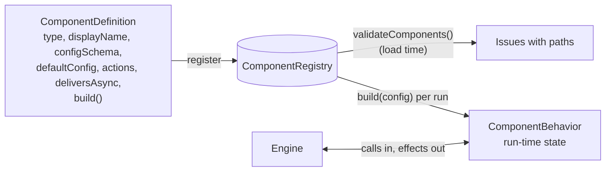
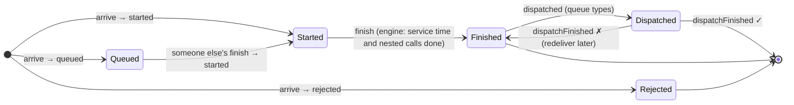

# Component Definitions: How Service Types Plug Into the Engine

A short introduction to how a cloud service type (Lambda, RDS, …) is described in code and how the engine talks to it. For maintainers new to the code. Read [How the simulation engine works](simulation-engine.md) first; this page builds on its behavior primitives. The decision behind the design is [ADR-0006](../adr/0006-components-return-effects-to-the-engine.md).

Code: [`src/domain/components/`](../../src/domain/components/).

> **Status:** the interface, registry, validation, and contract checker exist, with two small test definitions. The five MVP service types come next (M1).

## Three pieces



| Piece | What it is | File |
|---|---|---|
| **Definition** | Static description of one type: its config schema (Zod), defaults, the actions it accepts, and a `build` function | [`component-definition.ts`](../../src/domain/components/component-definition.ts) |
| **Registry** | Looks definitions up by `type` string. Parses configs, so callers don't need to know each type's config shape | [`component-registry.ts`](../../src/domain/components/component-registry.ts) |
| **Behavior** | The state of one component during one run: limits, wait lines, warm instances. Built fresh for each run | [`component-behavior.ts`](../../src/domain/components/component-behavior.ts) |

Adding a service type means writing a definition and registering it. The engine doesn't change.

## The conversation: calls in, effects out

A behavior never schedules events and never reads a clock. The engine calls it and it replies with **effects**, which the engine turns into events:

| Effect | Meaning | The engine then… |
|---|---|---|
| `started` (+ `serviceMs`) | This request begins work now | schedules the end of its service time, then makes its nested calls |
| `queued` | It's waiting inside the component | does nothing; a later call will return `started` for it |
| `rejected` (+ reason) | It didn't get in (e.g. `"throttled"`) | fails the call; the edge's retry policy may try again |
| `dispatched` | Start this request's `async` step now (queue types only) | runs the async step, then reports back with `dispatchFinished` |

The life of one request at one component:



Nothing is ever cancelled. If a caller times out, the engine stops waiting for the answer, but the work here continues and is finished normally, just as a database keeps running a query after the Lambda that sent it gave up.

## Worked example

From [`component-behavior.txt`](../../src/domain/traces/component-behavior.txt), generated by a test using the two test definitions in [`testing/fake-definitions.ts`](../../src/domain/components/testing/fake-definitions.ts). They're also the simplest reference implementations to copy from.

A pool of 2 workers with room for 1 waiter. Note `finish a` returning `started c`: the freed worker goes straight to the waiter, so the engine learns that a *different* request has started.

```text
t(ms)  engine calls  effects returned        inProgress  queueDepth
0      arrive a      started a (10 ms)       1           0
0      arrive b      started b (10 ms)       2           0
0      arrive c      queued c                2           1
0      arrive d      rejected d: queue-full  2           1
10     finish a      started c (10 ms)       2           0
10     finish b      (none)                  1           0
20     finish c      (none)                  0           0
```

A queue with one consumer. Sending a message is a short piece of work (`started`, 1 ms). Once the send finishes, the message waits in the backlog until a consumer is free. A failed delivery goes back to the end of the queue:

```text
t(ms)  engine calls           effects returned   inProgress  queueDepth
0      arrive m1 (enqueue)    started m1 (1 ms)  1           0
0      arrive m2 (enqueue)    started m2 (1 ms)  2           0
1      finish m1              dispatched m1      1           0
1      finish m2              (none)             0           1
30     dispatchFinished m1 ✗  dispatched m2      0           1
55     dispatchFinished m2 ✓  dispatched m1      0           0
80     dispatchFinished m1 ✓  (none)             0           0
```

## The contract every definition must pass

[`checkComponentContract`](../../src/domain/components/check-component-contract.ts) plays the engine's part against any definition: two overload bursts separated by a long quiet period (so warm instances go cold), random hold times standing in for nested calls, and 20% failed async deliveries. It checks that:

- every arrival gets exactly one outcome, and nothing is started twice or after a rejection;
- every queued request eventually starts, and all async work is eventually delivered;
- service times are finite and not negative;
- `inProgress` and `queueDepth` match what the effects imply, after every call;
- the same seed produces exactly the same effects (no state shared between runs).

Every definition's test file includes:

```ts
expect(checkComponentContract(lambdaDefinition).violations).toEqual([]);
```

The checker has its own tests, which feed it deliberately broken definitions to show that each rule is actually enforced ([`check-component-contract.test.ts`](../../src/domain/components/check-component-contract.test.ts)).

## Type-specific validation

[`validateComponents`](../../src/domain/components/validate-components.ts) runs alongside `validateProject` (see [The domain model](domain-model.md)) and checks the rules that depend on types: the type exists, the config passes the type's schema (issues get full paths like `architecture.components.3.config.workers`), each step's action is one its target accepts, and only `deliversAsync` types carry `async` work.

## Writing a new definition: checklist

1. Write a Zod `configSchema` and a `defaultConfig` that passes it.
2. List the `actions` it accepts; set `deliversAsync` only for queue-like types.
3. In `build`, compose primitives from `src/domain/behaviors/`, and take randomness only from `context.random`.
4. Return exactly one outcome from `arrive`; pass freed resources to waiters in `finish`.
5. Add a test that runs `checkComponentContract`, plus unit tests for the type's own behavior.
6. Register it where the engine's registry is assembled.
