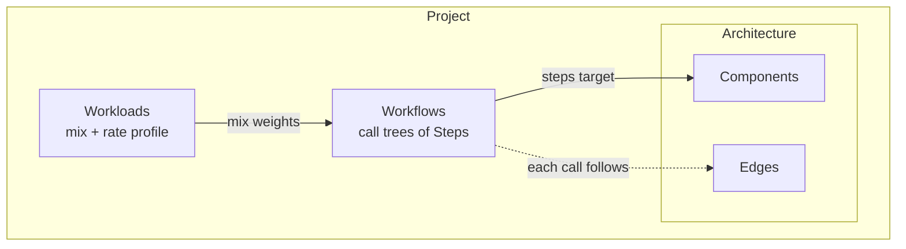
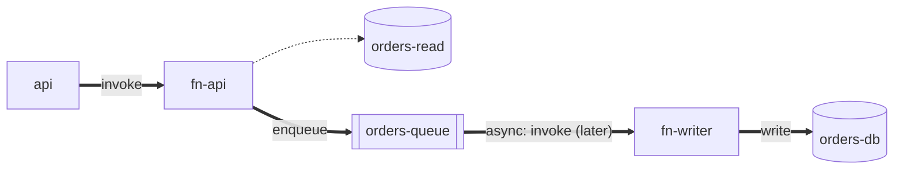
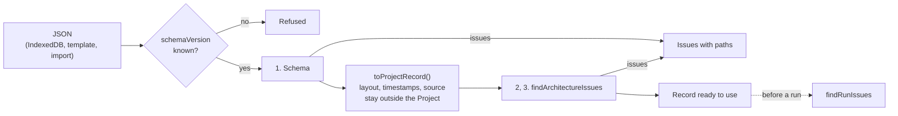

# The Domain Model

A short introduction to the entities that describe a project, and the rules that keep them consistent. For maintainers new to the code. The full design is in [MVP design §3](../design/mvp-design.md#3-domain-model); this page explains the shape and the reasoning.

Code: [`src/domain/model/`](../../src/domain/model/).

## The entities

A **project** holds three things: an **architecture** (what exists), **workflows** (what one request does), and **workloads** (how many requests arrive, and when).



The entities are plain readonly data with no methods, defined in [`project.ts`](../../src/domain/model/project.ts). Behavior lives elsewhere: in the behavior primitives, component definitions, and the engine. Layout positions and timestamps are not part of the domain; they stay in the stored project document ([ADR-0004](../adr/0004-persist-projects-in-indexeddb.md)).

## Workflows are call trees laid over the architecture

The key idea: the architecture is a map of **who can call whom**, and a workflow is **one route through that map**. Each step targets a component, and its nested `calls` are made while that step is still running and holding its resources.

Template B's "Create order", with the workflow's calls drawn over the architecture's edges:



Thick arrows are this workflow's calls; the dotted one is an edge this workflow doesn't use ("Get order" does). Every thick arrow must sit on an edge, because the edge supplies the call's latency, timeout, and retry policy. The `async` step is different from a nested call: the user's request completes once the message is enqueued, and the queue calls `fn-writer` later.

## Validation: who checks what

A project's checks come in two groups ([ADR-0019](../adr/0019-edit-projects-with-commands-and-save-each-change.md), decision 2):

- **Architecture checks** cover the components, their settings and names, and the edges. A project that fails one can't be saved or opened, so nothing invalid in the architecture is ever stored.
- **Run checks** cover the workflows' steps and the workloads' mixes and profiles. A project that fails one saves and opens; only a run of the workloads it affects is refused. An edit can make one: removing a component that a step calls, for example. Their problems are **run issues**.

Projects are stored as JSON documents ([ADR-0004](../adr/0004-persist-projects-in-indexeddb.md)). [`loadProject`](../../src/adapters/persistence/load-project.ts) turns one into a `ProjectRecord` (the domain `Project` plus timestamps, `source`, and `layout`; [ADR-0008](../adr/0008-ports-exchange-project-records.md)), checking the shape first, then the architecture:

| Stage | Where | Checks |
|---|---|---|
| 1. Shape | [`projectDocumentV1Schema`](../../src/adapters/persistence/project-document-v1.ts) in `adapters/` | The schema version is one this build reads; fields exist and have the right types; numbers are in range (e.g. timeouts are positive); no unknown keys |
| 2. Architecture | [`validateArchitecture`](../../src/domain/model/validate-architecture.ts) in `domain/` | Unique IDs and edges, and each edge's settings in range, listed below |
| 3. Component types | [`validateComponents`](../../src/domain/components/validate-components.ts) in `domain/` | Known types, valid configs, names unique among a type's components |



Stages 2 and 3 together are [`findArchitectureIssues`](../../src/domain/components/find-architecture-issues.ts), which `SaveProject` runs too. The run checks are [`findRunIssues`](../../src/domain/components/find-run-issues.ts), which assumes the architecture passed. It gives each workflow's issues and each workload's own; [`workloadRunChecks`](../../src/application/run-checks/workload-run-checks.ts) in `application/` puts them together per workload, and `RunSimulation` refuses a workload that has any.

The document's structure mirrors the domain's, so an issue's path, like `["architecture", "edges", 2, "to"]`, points at the same place whichever stage found it. The one difference is units: the document gives workload times in seconds (`durationSec`, `atSec`), which are easier to write by hand, and the domain keeps every time in milliseconds (`durationMs`, `atMs`). The [document mapper](../../src/adapters/persistence/project-document-mapper.ts) converts them in both directions (`toProjectRecord`, `toProjectDocument`), and `loadProject` renames those fields in issue paths (`toDocumentIssue`), so the user always sees a path into the document. Run issues keep their paths into the domain `Project`, which is what the screen edits. Objects in the schema are **strict**: an unknown key such as `latencyMS` is an error rather than being silently dropped, which catches typos in hand-written templates.

Architecture rules (`validateArchitecture`):

- IDs are unique within components, edges, workflows, and workloads. Workflows and workloads aren't the architecture, but every reference to one is by ID, so the run checks need them unique.
- Edges connect two different, existing components, and there's at most one edge per direction between a pair.
- Each edge's latency, timeout, and retry policy pass [`edgeSettingsSchema`](../../src/domain/model/edge-settings.ts), the schema the document's edges build on. The document schema has checked them by the time a project opens, but an edited edge reaches `SaveProject` without it, so the save checks them here.

Run rules (`findStepIssues` for steps, `findWorkloadIssues` for workloads):

- Every step targets an existing component, and every call (including `async` ones) follows an edge in the right direction.
- The target's type accepts the step's action, and only an `enqueue` step on a queue-like (`deliversAsync`) component has `async` work.
- A workload's mix is non-empty, names existing workflows once each, and has positive weights.
- A workload's profile is non-empty, its times strictly increase, and its rates aren't negative.

Both groups return **every** problem with a path to it, rather than throwing on the first, so the UI can show them all. An architecture issue is a message; a run issue is a value ([`run-issue.ts`](../../src/domain/model/run-issue.ts)) with the IDs it's about, so `application/run-checks/` can word it with names rather than IDs. From [`validate-project.txt`](../../src/domain/traces/validate-project.txt):

```text
check         path                          message or kind
architecture  architecture.edges.2.to       Edge "fn->cache" refers to unknown component "cache".
run           workflows.0.root.calls.0      missing-edge
run           workloads.0.mix.0.workflowId  unknown-workflow
run           workloads.0.profile.1.atMs    profile-time-not-increasing
```

Rules that depend on a component's type (for example, "only queues accept `enqueue`" or "this Lambda's config is valid") ask the registry, so neither group changes when a new component type is added; see [Component definitions](component-definitions.md#type-specific-validation).

