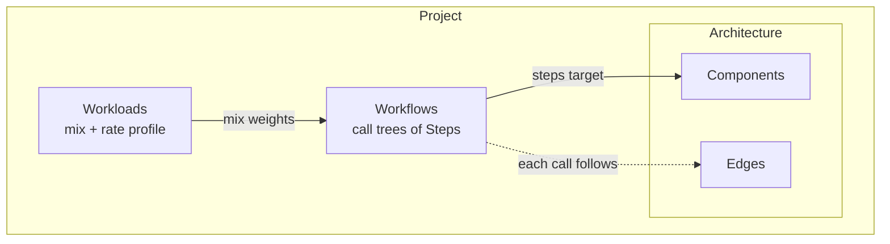
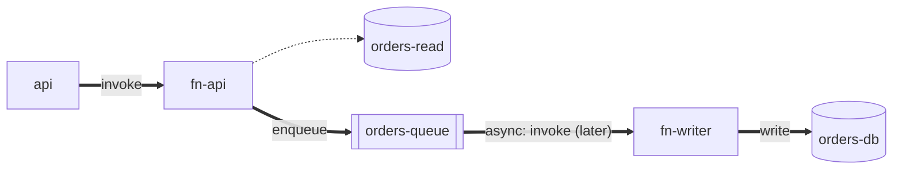
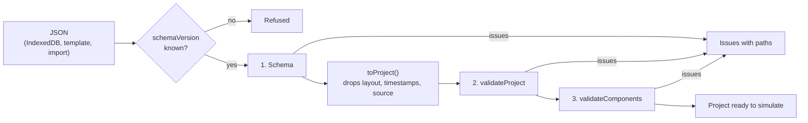

# The Domain Model

A short introduction to the entities that describe a project, and the rules that keep them consistent. For maintainers new to the code. The full design is in [MVP design §3](../design/mvp-design.md#3-domain-model); this page explains the shape and the reasoning.

Code: [`src/domain/model/`](../../src/domain/model/).

## The entities

A **project** holds three things: an **architecture** (what exists), **workflows** (what one request does), and **workloads** (how many requests arrive, and when).



The entities are plain readonly data with no methods, defined in [`project.ts`](../../src/domain/model/project.ts). Behavior lives elsewhere: in the behavior primitives, component definitions, and the engine. Layout positions and timestamps are not part of the domain; they stay in the stored project document ([ADR-0004](../adr/0004-persist-projects-in-indexeddb.md)).

## Workflows are call trees laid over the architecture

The key idea: the architecture is a map of **who can call whom**, and a workflow is **one route through that map**. Each step targets a component, and its nested `calls` are made while that step is still running and holding its resources.

Template B's "Create order", with the workflow's calls drawn over the architecture's edges:



Thick arrows are this workflow's calls; the dotted one is an edge this workflow doesn't use ("Get order" does). Every thick arrow must sit on an edge, because the edge supplies the call's latency, timeout, and retry policy. The `async` step is different from a nested call: the user's request completes once the message is enqueued, and the queue calls `fn-writer` later.

## Validation: who checks what

Projects are stored as JSON documents ([ADR-0004](../adr/0004-persist-projects-in-indexeddb.md)). [`loadProject`](../../src/adapters/persistence/load-project.ts) turns one into a domain `Project` in three stages. Each runs only if the one before passed, because the later checks assume the earlier ones hold:

| Stage | Where | Checks |
|---|---|---|
| 1. Shape | [`projectDocumentV1Schema`](../../src/adapters/persistence/project-document-v1.ts) in `adapters/` | The schema version is one this build reads; fields exist and have the right types; numbers are in range (e.g. timeouts are positive); no unknown keys |
| 2. Consistency | [`validateProject`](../../src/domain/model/validate-project.ts) in `domain/` | Rules that span the whole project, listed below |
| 3. Component types | [`validateComponents`](../../src/domain/components/validate-components.ts) in `domain/` | Known types, valid configs, actions each type accepts |



The document's structure mirrors the domain's, so an issue's path, like `["architecture", "edges", 2, "to"]`, points at the same place whichever stage found it. The one difference is units: the document gives workload times in seconds (`durationSec`, `atSec`), which are easier to write by hand, and the domain keeps every time in milliseconds (`durationMs`, `atMs`). `loadProject` converts them and renames those fields in issue paths, so the user always sees a path into the document. Objects in the schema are **strict**: an unknown key such as `latencyMS` is an error rather than being silently dropped, which catches typos in hand-written templates.

Consistency rules:

- IDs are unique within components, edges, workflows, and workloads.
- Edges connect two different, existing components, and there's at most one edge per direction between a pair.
- Every step targets an existing component, and every call (including `async` ones) follows an edge in the right direction.
- Only `enqueue` steps have `async` work.
- A workload's mix is non-empty, names existing workflows once each, and has positive weights.
- A workload's profile is non-empty, its times strictly increase, and its rates aren't negative.

`validateProject` returns **every** problem with a path to it, rather than throwing on the first, so the UI can show them all. From [`validate-project.txt`](../../src/domain/traces/validate-project.txt):

```text
path                          message
architecture.edges.2.to       Edge "fn->cache" refers to unknown component "cache".
workflows.0.root.calls.0      No edge from "api" to "db"; every call must follow an edge.
workloads.0.mix.0.workflowId  Mix refers to unknown workflow "gett".
workloads.0.profile.1.atMs    Profile times must increase; 0 s comes after 0 s.
```

Rules that depend on a component's type (for example, "only queues accept `enqueue`" or "this Lambda's config is valid") belong to the component definitions, not here. That keeps this validator unchanged when new component types are added. Those rules are checked by `validateComponents`; see [Component definitions](component-definitions.md#type-specific-validation).
