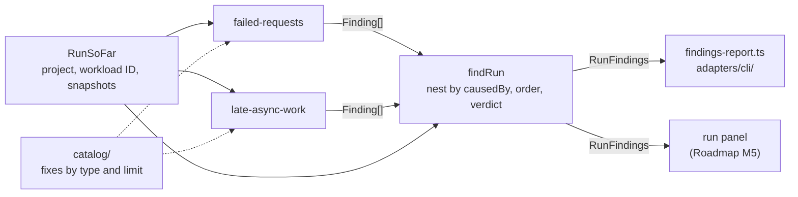

# Findings and Detectors

How a run explains itself: what a finding is, where findings come from, and how to add a detector. For maintainers new to the code; read [How metrics work](metrics.md) first. The design behind it, with hand-written readings of every template run, is [findings.md](../design/findings.md), and the decision is [ADR-0015](../adr/0015-findings-come-from-registered-detectors.md).

## What a finding is

A run's tables show what happened. A **finding** says what it means: what broke or slowed down, where, when, why, and what would fix it. Every run also gets a **verdict**, healthy runs included: *failing* if any finding is a failure, *degraded* if any is a warning, otherwise *healthy*, with "so far" until the run reaches the end of its workload.

| Field | Holds |
|---|---|
| `severity` | `failure` (requests failed), `warning` (work finished later than the project's own timeout lets a caller wait), or `note` |
| `componentId`, `window`, `causeWindow` | Where and when. `causeWindow` starts earlier when the cause began before the first bad second |
| `summary`, `reasons` | The sentences, as a `Message`: text, numbers with a unit, component references, and times |
| `evidence` | Each number quoted, with its source: `totals`, `snapshots`, or `config` |
| `fixes`, `learnMore` | From the catalog. Each fix is Documented (a link), Observed (a test), or an Assumption, plus fidelity IDs |
| `causedBy`, `affected` | The findings this one follows from, which show beneath it; and the requests it counts, for ordering |

The wording lives in `application/`, so the CLI and the run panel say the same sentences. Each formats the parts its own way: the CLI prints components by ID and times in seconds.

## How it fits together



| Piece | File | Job |
|---|---|---|
| Shapes | [`finding.ts`](../../src/application/run-analysis/findings/finding.ts), [`message.ts`](../../src/application/run-analysis/findings/message.ts) | `Finding`, `Fix`, `Claim`, `Evidence`; `Message` and the `say` template tag that builds one |
| Role | [`detector.ts`](../../src/application/run-analysis/findings/detector.ts) | `Detector`: `{ id, detect(run) }` |
| Defaults | [`create-detectors.ts`](../../src/application/run-analysis/findings/create-detectors.ts) | Lists the detectors, as `createAwsComponentRegistry` lists the types |
| Detectors | [`detectors/`](../../src/application/run-analysis/findings/detectors/) | One file each, plus the helpers a detector calls (`limit-refused`, `recovery`) |
| Reading a run | [`find-run.ts`](../../src/application/run-analysis/findings/find-run.ts), [`order-findings.ts`](../../src/application/run-analysis/findings/order-findings.ts), [`verdict.ts`](../../src/application/run-analysis/findings/verdict.ts), [`headroom.ts`](../../src/application/run-analysis/findings/headroom.ts) | Runs the detectors, nests and orders their findings, and adds the verdict with the limit closest to refusing work |
| Catalog | [`catalog/`](../../src/application/run-analysis/findings/catalog/) | One file of advice per component type, listed by `createFindingsCatalog` |
| CLI | [`findings-report.ts`](../../src/adapters/cli/findings-report.ts) | Formats the verdict and the findings as text |

## Rules every detector keeps

- **Generic.** No detector branches on a component's type. What a type knows comes from its limit declarations (`LimitUse.whenFull`: refuse with which reason, or wait holding which limit) and the catalog. Choose between behaviors with lookup maps (CONTRIBUTING rule 4).
- **Exact states, no tuned thresholds.** A detector fires on a failed request, an exhausted limit (`limitExhausted`), or a latency past a timeout the project sets. A percentile is a bucket's upper bound, so a comparison within `PERCENTILE_ERROR` says so.
- **Snapshots only.** `RunSoFar` holds per-second snapshots, which is all the browser has. Percentiles of separate seconds can't be merged into the run's, so a detector quotes per-second percentiles and exact maxima.
- **Pure and cheap.** The same run gives the same findings in the same order, and the run panel calls `findRun` as snapshots arrive, so read the snapshots in one pass.
- **Whole findings.** A detector returns whole findings, with IDs that are stable across re-runs (`<detector>:<subject>`). A sentence that adds to another detector's finding is a helper that detector calls, not a detector.
- **Counts reconcile.** A finding's `affected` must add up with the totals, or be `undefined` when the metrics can't count it exactly.

## Adding a detector

1. Write the reading first: what an expert would say about a run where it fires, with each number's source, as [findings.md §1](../design/findings.md#1-hand-written-readings) does.
2. Add a file in `detectors/` that exports a factory returning a `Detector`, taking the catalog if it gives fixes. Build sentences with `say`, and put each quoted number in `evidence`.
3. Add one line to `createDetectors`.
4. If its fixes depend on a type, add them to that type's file in `catalog/`, each with its claim. [`catalog-evidence.test.ts`](../../src/adapters/templates/findings/catalog-evidence.test.ts) checks that every link, test, fidelity ID, and Learn-more anchor exists.
5. Test it with `sampleSnapshot` beside the detector, then update the expected findings in [`src/adapters/templates/findings/`](../../src/adapters/templates/findings/), which run every template and check the findings against the totals and the verdicts findings.md quotes.
6. Refresh the report snapshots (`npx vitest run src/adapters/cli --update`) and read the diff.

A new component type needs none of this: declare its limits fully and its failures get findings. Add catalog advice for it when you have fixes with evidence.

## Worked example: Template A's lunch rush

This excerpt is from [`reports/template-a.txt`](../../src/adapters/cli/reports/template-a.txt), the CLI's file snapshot (the fixes are cut):

```text
Verdict
=======
Failing. 28,841 of 65,963 answered requests failed (43.7%); 11 were still in progress when the run ended.

Findings
========
1. Failure: 28,841 requests failed with orders-db: too-many-connections, from 14 s to 47 s.
   - That's 23,183 Get order and 5,658 Create order requests, 43.7% of the 65,963 answered.
   - The most in one second was 1,216, in the second ending at 32 s.
   - orders-db held all 90 of its connections in every second with these failures.
   - orders-db refused 28,841 attempts, and each one failed a request.
   - The last failure was in the second ending at 47 s, and none followed in the 13 s after it.
   - After it, orders-db's connections peaked at 29 of 90.
```

failed-requests found one cause in the workflows' `failures`, so it wrote one finding whose `affected` is that cause's 28,841 failures. To name the limit, it looked up orders-db's limits that declare they refuse with `too-many-connections`, and found `connections` exhausted in every failing second (the *limit-refused* part). Refused attempts equal failed requests because nothing retried them; in [findings.md §1.7](../design/findings.md#17-variant-template-b-long-rush-read-capacity-cut-to-1500-a-second-failing), retries make them differ, and the finding says "attempts aren't requests". The last two lines are the *recovery* part. Why the connections ran out (the full query workers, from 11 s) is a note detector still to come (Roadmap M5, item 8), which will show beneath this finding.
