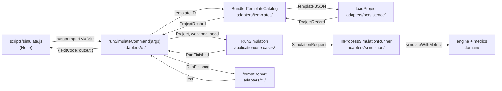

# The Headless Runner

How `npm run simulate` runs a template from the terminal and prints a text report, for maintainers new to the code. It's the quickest way to see what a change to the engine, a component type, or a template does. Read [How metrics work](metrics.md) first.

## Try it

```sh
npm run simulate -- --template template-a                        # Serverless API with RDS
npm run simulate -- --template template-b                        # DynamoDB + SQS
npm run simulate -- --template template-a --seed 7               # same run, different random draws
npm run simulate -- --template template-b --workload long-rush   # another workload (MVP design §7)
npm run simulate -- --help
```

## How it fits together



| Piece | File | Job |
|---|---|---|
| Launcher | [`scripts/simulate.js`](../../scripts/simulate.js) | Loads the TypeScript through Vite, prints the result, sets the exit code, times the run |
| Command | [`simulate-command.ts`](../../src/adapters/cli/simulate-command.ts) | Parses arguments, gets the template, and wires up the use case |
| Use case | [`run-simulation.ts`](../../src/application/use-cases/run-simulation.ts) | Picks the workload (the first, unless `--workload` names one), applies `--seed`, and runs it through the `SimulationRunner` port. The browser runs the same use case |
| Runner | [`in-process-simulation-runner.ts`](../../src/adapters/simulation/in-process-simulation-runner.ts) | The `SimulationRunner` port on the caller's thread, over `simulateWithMetrics`. The browser uses a Web Worker instead ([the user interface guide](user-interface.md#a-run-from-click-to-chart)) |
| Templates | [`bundled-template-catalog.ts`](../../src/adapters/templates/bundled-template-catalog.ts) | The `TemplateCatalog` port over the bundled JSON; `--help` lists its templates |
| Report | [`text-report.ts`](../../src/adapters/cli/text-report.ts), [`findings-report.ts`](../../src/adapters/cli/findings-report.ts) | Turns a `MetricsRun` into the verdict, the findings, and tables |

Two choices worth knowing about:

- **The command uses no Node APIs.** It takes arguments and returns text and an exit code, so tests call it directly, and it type-checks with the rest of `src/`. Only the launcher touches `process`.
- **The launcher loads TypeScript through Vite's module runner** (`runnerImport`). Node can strip types but can't resolve the extensionless imports or JSON modules the sources use. Using Vite keeps one module pipeline for the app, the tests, and the runner, with no extra dependency like `tsx`. `runnerImport` is marked experimental in Vite 8; if it breaks on an upgrade, `vite build --ssr` into a temporary folder is a fallback.

## Reading the report

The report has eight sections:

1. **Verdict:** failing, degraded, or healthy, with the request counts and, unless failing, the limit closest to refusing work.
2. **Findings:** what broke or slowed down, where, when, why, and what would fix it ([Findings and detectors](finding-detectors.md)).
3. **Workflows:** requests started, succeeded, failed, and still in progress, with end-to-end latency percentiles for the successful ones.
4. **Failures:** why requests failed, as `component: reason`.
5. **Components:** run totals per component, with type-specific counters such as Lambda `coldStarts`.
6. **Limits:** each component's limits, the most of each used at once, and, for a rate limit's token bucket, its busiest second's flow against its rate ([how to read them](metrics.md#limits-and-their-use)).
7. **Workflows per second:** traffic, requests in progress, and p99 latency over time. This is where a spike shows up.
8. **Components per second:** each component's peak use of each limit every second (or its peak work in progress, if it has no limits), plus its queue depth.

Latencies are in milliseconds and come from the histogram buckets, so they can read up to 5% high (see [How metrics work](metrics.md)).

### Reconciling the totals

A run stops at the end of its workload, usually with some requests still in progress. The report counts them, so every total reconciles, and each table says how under it:

| Table | Sum |
|---|---|
| Workflows | started = ok + failed + in progress |
| Failures | a workflow's rows add up to its `failed` count |
| Components | arrivals = ok + failed + rejected + unfinished |
| Queues (`other` column) | ok (messages accepted) = async ok + backlog + being delivered |
| Workflows per second | each row's in progress = the previous row's + started − ok − failed; the last row matches the Workflows total |
| Limits | each peak is at most its limit (`of`), and is the highest of the per-second peaks |

`timeouts` is in none of these sums: the caller stopped waiting, but the component still finished the work as ok or failed ([ADR-0006](../adr/0006-components-return-effects-to-the-engine.md)).

The report computes "in progress", "unfinished", and "being delivered" by subtraction, so the sums hold by construction. [`report-reconciles.test.ts`](../../src/adapters/cli/report-reconciles.test.ts) checks each of them against an independent value, such as a component's own count of running and waiting work at the end of the run, so a counting bug fails a test instead of disappearing into the remainder.

## Worked example: Template A's lunch rush

These excerpts are from [`reports/template-a.txt`](../../src/adapters/cli/reports/template-a.txt), a file snapshot written by `simulate-command.test.ts`. Tuning changes the numbers; run `npx vitest run src/adapters/cli --update` to update it.

The report opens with its reading of the run:

```text
Verdict
=======
Failing. 28,841 of 65,963 answered requests failed (43.7%); 11 were still in progress when the run ended.

Findings
========
1. Failure: 28,841 requests failed with orders-db: too-many-connections, from 14 s to 47 s.
   - That's 23,183 Get order and 5,658 Create order requests, 43.7% of the 65,963 answered.
```

The tables below it are the evidence. Failures gives the same cause:

```text
Failures
========
workflow      cause                            failed requests
------------  -------------------------------  ---------------
get-order     orders-db: too-many-connections           23,183
create-order  orders-db: too-many-connections            5,658
```

Every failure is the database refusing a connection. The per-second table shows when:

```text
t (s)  api requestRate  fn-orders concurrency  orders-db connections  orders-db queryWorkers  orders-db queue
   13                2                     42                     25                      16                9
   14                3                     75                     49                      16               33
   15                3                    154                     90                      16               74
   16                3                    135                     90                      16               74
```

As traffic ramps toward 2,000 requests per second, queries arrive faster than the database's 16 query workers can run them (`orders-db queryWorkers` at its limit of 16). The rest wait in line (`orders-db queue`) while holding a connection, so connections are held longer and longer, and in second 15 all 90 are taken (16 running + 74 waiting): the Limits table shows `connections` at 90 of 90, 100%, exhausted. Every query after that is refused until the spike passes. The API's token bucket barely moves (at most 5 of 5,000 tokens drawn), because 2,076 requests per second is well under its rate of 10,000. Real Lambda functions usually hold a connection for the life of each instance, which makes this worse; the model understates it (fidelity LMB-8). Compare [`reports/template-b.txt`](../../src/adapters/cli/reports/template-b.txt), where the same workload has no failures because writes go through a queue to a small, fixed set of consumers.
