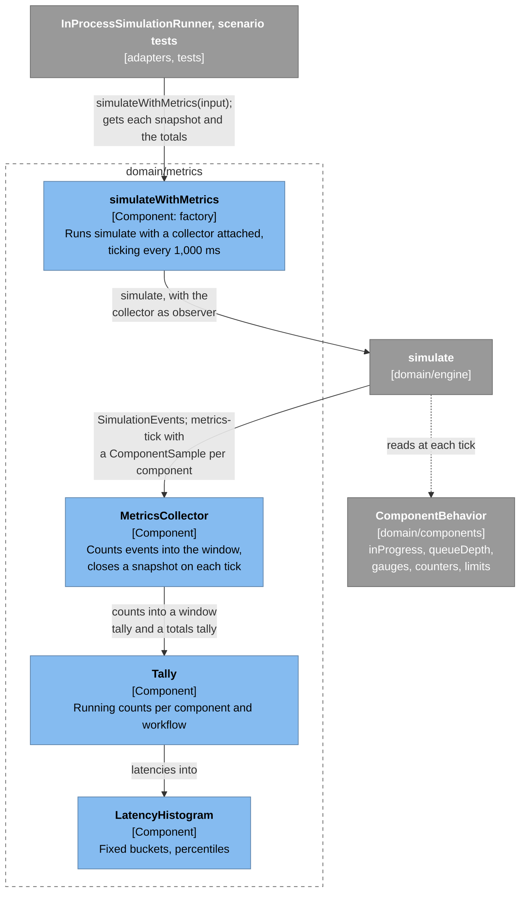
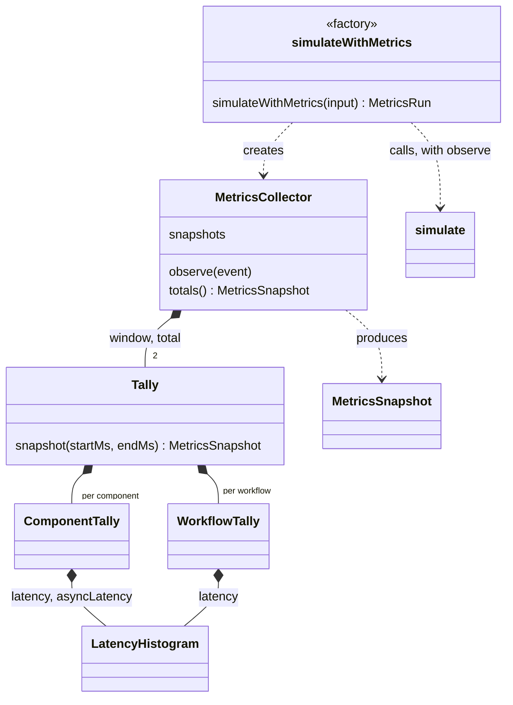
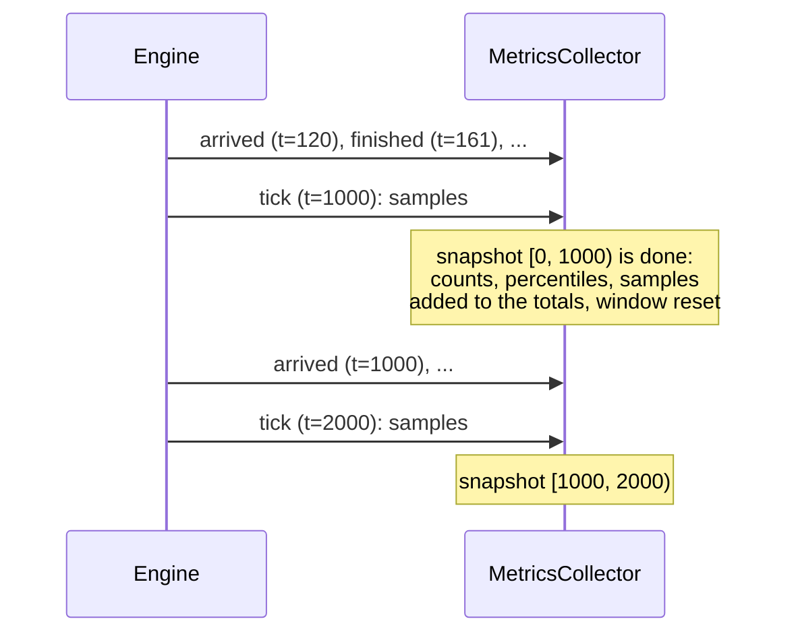

# How Metrics Work

How a run's events become per-second snapshots and run totals, for maintainers new to the code. Read [How the simulation engine works](simulation-engine.md) first. The decision behind this design is [ADR-0007](../adr/0007-metrics-observe-the-engine.md).

## The big idea: metrics watch the engine

The engine knows nothing about metrics. It reports everything that happens to an **observer** as `SimulationEvent`s, and, when asked, reports a **tick** every simulated second with each component's current state. [`MetricsCollector`](../../src/domain/metrics/metrics-collector.ts) is that observer. It counts events into the current **window**, and on each tick it closes the window into a `MetricsSnapshot`.

How the pieces connect (the [legend](architecture-overview.md#the-system-at-a-glance) explains the colors):



Usually you don't wire this up yourself; `simulateWithMetrics` does it and ticks every 1,000 ms:

```ts
const { snapshots, totals } = simulateWithMetrics({
  project,
  workloadId: "spike",
  registry: createAwsComponentRegistry(),
  onSnapshot: (s) => { /* stream to the UI as each second completes */ },
});
```

| Piece | File | Job |
|---|---|---|
| Tick events | [`simulation-events.ts`](../../src/domain/engine/simulation-events.ts) | The `tickMs` input; the `metrics-tick` event and `ComponentSample` |
| `TickSampler` | [`tick-sampler.ts`](../../src/domain/engine/tick-sampler.ts), [`interval-tick-sampler.ts`](../../src/domain/engine/interval-tick-sampler.ts), [`no-tick-sampler.ts`](../../src/domain/engine/no-tick-sampler.ts) (runs without `tickMs`) | Reports a `metrics-tick` every `tickMs`; tracks each component's peak in-progress and queue depth between ticks |
| `MetricsCollector` | [`metrics-collector.ts`](../../src/domain/metrics/metrics-collector.ts) | Events and ticks → snapshots and totals; `simulateWithMetrics` |
| `MetricsSnapshot` | [`metrics-snapshot.ts`](../../src/domain/metrics/metrics-snapshot.ts) | The snapshot types: `ComponentMetrics` and `WorkflowMetrics` for one window |
| `Tally` | [`tally.ts`](../../src/domain/metrics/tally.ts), [`component-tally.ts`](../../src/domain/metrics/component-tally.ts), [`workflow-tally.ts`](../../src/domain/metrics/workflow-tally.ts) | Running counts per component and workflow; the collector keeps one for the current window and one for the run's totals |
| `LatencyHistogram` | [`latency-histogram.ts`](../../src/domain/metrics/latency-histogram.ts) | Fixed buckets, percentiles, merging |

The collector builds its two `Tally`s itself, because they only store data; a factory builds the collector ([ADR-0009](../adr/0009-collaborators-come-from-factories.md)):



## Windows and ticks

A tick at time T closes the window `[T − 1000, T)`. The engine emits each tick **before** any other event at the same time, so an event at exactly 1,000 ms belongs to the second window, not the first. The last tick is at the end of the run and also takes in events at exactly that time.



Ticks don't go through the event queue. The loop checks the next tick time before handling each event, so ticks don't count toward `eventsProcessed`, and runs without `tickMs` (like the engine traces) never see one.

## What a snapshot holds

Per **component**:

| Field | From | Meaning |
|---|---|---|
| `arrivals`, `rejected` | `component-arrived`, `component-rejected` events | Attempts that reached it; attempts it refused |
| `completed`, `failed` | `component-finished` events | Work that finished, and work that finished because a nested call failed |
| `timeouts` | `edge-attempt-failed` events | Callers that gave up waiting on *this* component (see below) |
| `latency` | `component-finished` events | p50/p95/p99/max of `completed` work, from arrival to finish |
| `inProgress`, `queueDepth` | tick | At the window's end |
| `peakInProgress`, `peakQueueDepth` | tick | Highest during the window; the engine tracks them after every call into the component |
| `asyncSucceeded`, `asyncFailed`, `asyncLatency` | `component-async-finished` events | Queue-like components: deliveries of async work, timed from the user's request |
| `gauges` | tick | Type-specific values at the window's end (no AWS component has one today) |
| `counters` | tick | Type-specific counts during the window, e.g. Lambda `coldStarts` |
| `limits` | tick | Each of the component's limits with its use: at the window's end, and its peak during it (see [Limits](#limits-and-their-use)) |

Per **workflow**: `started`, `succeeded`, `failed`, `failures` grouped by cause (`"db: too-many-connections"`), and `latency` of successful requests.

The **totals** have the same shape, covering the whole run: counts summed, peaks as the highest of any window (limits' peaks included), latency from every window's histogram merged, and current values and gauges from the last tick.

Two details worth knowing:

- **A timeout is counted once.** When fn → db times out, fn's step fails with `db: timeout`, and then api → fn fails with the same failure. The collector counts a timeout only on the edge whose target is the component that timed out, so `db.timeouts` goes up and `fn.timeouts` doesn't.
- **Latency is for successes only.** A throttled request fails in about a millisecond; mixing those in would make an overloaded system look fast. Failures are counted, not timed.

## Limits and their use

A number like "90 connections" means little until you know the limit is 90. Each component declares the limits it enforces, and every snapshot reports each one's use against it ([ADR-0014](../adr/0014-components-report-their-limits.md)):

| Component | Limit | Kind |
|---|---|---|
| API Gateway | `requestRate` | rate |
| Lambda | `concurrency` | concurrency |
| RDS | `connections`, `queryWorkers` | concurrency |
| DynamoDB | `readUnits`, `writeUnits` | rate |
| SQS | `consumerConcurrency` | concurrency |

A behavior exposes `limits`, an array of live views built once from its `ConcurrencyLimit`s and `RateLimit`s:

```ts
// rds-behavior.ts
this.limits = [
  concurrencyGauge({ name: "connections", source: connections }),
  concurrencyGauge({ name: "queryWorkers", source: workers }),
];
```

The engine reads every limit after every call into the component, so peaks are exact even when a pool fills and drains between ticks. Each `LimitUse` in a snapshot has a `limit`, its use at the window's end (`current`), and the most used at once during the window (`peak`). For every kind, `peak / limit` runs from 0 to 1, and at 1 the limit was exhausted: the next request waited or was rejected.

- **Concurrency:** slots held. RDS `connections` at 90 of 90 means every connection was taken.
- **Rate:** a token bucket. Tokens refill at `ratePerSec` up to `limit` (the burst), and each request takes one. Use is how far the bucket was drawn down: tokens missing from a full bucket. A `peak` at `limit` means the bucket ran dry, and throttled requests show as `rejected`. Each rate limit also carries its flow: `takenPerSec` against `ratePerSec`.

> **Key concept: a bucket's level and its flow.** Picture a water tank. The tap refills it at `ratePerSec`, and each request scoops some out. The *level* (use) says how much buffer is left; the *flow* (`takenPerSec` against `ratePerSec`) says whether it's filling or draining. You need both. At 9,900 requests per second against a 10,000 rate, the tank stays full and use reads 0%, but a 2% rise in traffic starts it draining. When it is draining, it runs dry in `tokensLeft / (takenPerSec − ratePerSec)` seconds. Whether a given request is throttled depends on the level when it arrives, which is why use is the level and the flow is context. See [API Gateway's throttle](../learning/aws-did-you-know.md#api-gateway-has-account-level-throttling) and [DynamoDB's burst capacity](../learning/aws-did-you-know.md#dynamodb-saves-up-unused-capacity-for-bursts).

[`checkComponentContract`](../../src/domain/components/check-component-contract.ts) checks every limit: the same limits on every read, concurrency use within its limit, a bucket holding between 0 and its burst, and no more tokens taken than the burst plus the rate allow. `limitPeaks` ([`application/run-analysis/`](../../src/application/run-analysis/limit-peaks.ts)) gives each limit's highest use so far, for the CLI report and the run panel.

## Type-specific gauges and counters

The engine can't know that Lambda has cold starts. Instead, a `ComponentBehavior` may expose two optional records, which the tick copies as they are:

```ts
// lambda-behavior.ts
get counters() { return { coldStarts: this.coldStarts }; },   // a running total
```

Gauges are values sampled at each tick; no AWS component needs one now that limits report their use, but the mechanism stays for values that aren't limits. Counters only go up; the collector subtracts the previous tick's value to report the count per window. [`checkComponentContract`](../../src/domain/components/check-component-contract.ts) checks that both are finite and that counters never decrease. A new component type can add its own without touching the engine or the collector.

## Latency histograms

Storing every latency would take a lot of memory, and sorting them every second would be slow. `LatencyHistogram` counts values in about 270 fixed buckets instead. Each bucket is 5% wider than the one before, from 1 ms up to 10 minutes:

```text
bucket upper bounds (ms): 1, 1.05, 1.10, 1.16, ... 9.6, 10.1, ... 95, 100, ... 600,000
```

A percentile is the upper bound of the bucket where that rank falls, so it is at most about 5% too high, at any scale. It's clamped to the smallest and largest values seen, so a run where every request takes exactly 49 ms reports 49, not 49.9. Merging two histograms adds their buckets, which is how per-second windows add up to the run totals.

> **Key concept: why p99, not the average?** If 98 requests take 30 ms and 2 wait 3 s for a database connection, the average is about 90 ms, which looks fine. But p99 is 3 s: at least one user in a hundred waits that long. At 2,000 requests per second, that's 40 people every second. AWS's CloudWatch can show percentile statistics for metrics such as API Gateway `Latency` for this reason; see [AWS: Did you know?](../learning/aws-did-you-know.md#averages-hide-the-requests-users-complain-about-cloudwatch-can-show-percentiles).

## Worked example: a short spike

From [`metrics.txt`](../../src/domain/traces/metrics.txt). A Lambda function queries a small database that can run at most 100 queries per second (2 workers × 20 ms queries). Load is 40 requests per second, then 200 per second from 3 s to 5 s:

```text
second  requests  ok   failed  p50  p99  db queue  connections  db rejected  cold starts
0-1     28        28   0       34   240  2         4 of 8       0            7
1-2     38        37   0       34   50   2         4 of 8       0            0
2-3     40        41   0       34   38   1         3 of 8       0            0
3-4     205       96   102     89   291  6         8 of 8       102          32
4-5     200       100  100     85   92   6         8 of 8       100          0
5-6     40        46   0       34   88   5         7 of 8       0            0
6-7     40        40   0       34   48   2         4 of 8       0            0
7-8     52        51   0       34   62   3         5 of 8       0            0
total   643       439  202     45   287  6         8 of 8       202          39

Failures by cause: {"db: too-many-connections":202}
```

How to read it:

- **Seconds 0 to 3:** a request takes 32 ms: 10 ms in fn, then 1 + 20 + 1 ms for the query. The table says 34 because a percentile is its bucket's upper bound (33.5 ms here), up to 5% high. The first second's p99 of 240 ms is the cold starts: 7 environments started, each paying 200 ms.
- **Seconds 3 to 5:** the database is the bottleneck. It finishes about 100 queries a second, and the rest are refused because all 8 connections are held (2 running, 6 waiting: the `db queue` peak of 6). `connections` reads 8 of 8, the limit exhausted. About half the requests fail with `too-many-connections`, and successful requests now wait in line, so p50 jumps to about 85 ms. Lambda scales out to handle the spike: 32 more cold starts.
- **Second 5 onward:** the spike ends, the line drains, and latency returns to normal. Lambda doesn't need new cold starts because the environments from the spike are still warm.
- **ok can exceed requests** in a second (41 in 2–3) because the columns count different things: requests that *started* in the second, and requests *answered* in it.

## Traces are tests

The table above is generated by [`src/domain/traces/metrics.test.ts`](../../src/domain/traces/metrics.test.ts). If a change alters the numbers, the test fails and the diff shows the new table. If the change is intended, run `npx vitest run -u src/domain/traces/metrics`, then update the excerpt on this page.
