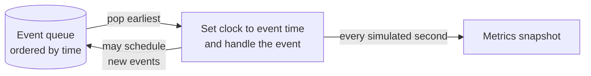
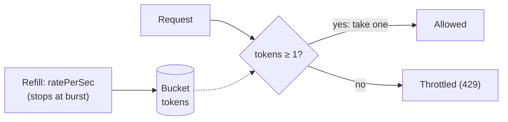
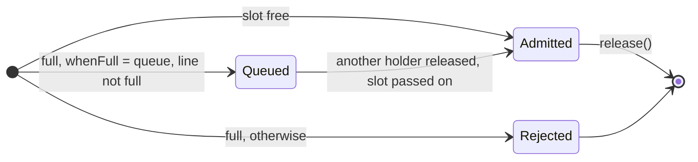
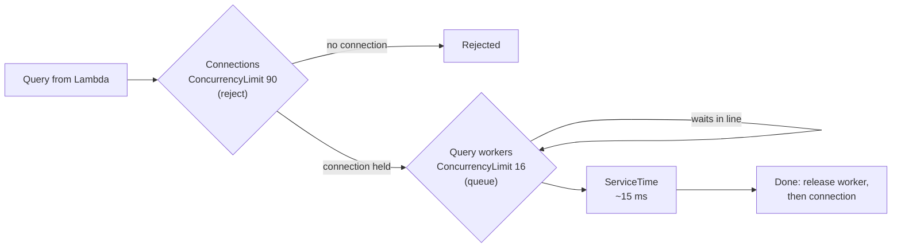

# How the Simulation Engine Works

A visual introduction to the engine's building blocks, for maintainers new to the code. Read the [architecture overview](README.md) first. The full design is in the [MVP design](../design/mvp-design.md) (§3 and §4); this page explains the moving parts.

> **Status:** the event queue and behavior primitives exist, and so does the [component definition interface](component-definitions.md). The engine loop and the five MVP service types are still being built (M1), so the later sections describe the plan.

## The big idea: jump from event to event

The engine doesn't tick through time in fixed steps. It keeps a list of **things that will happen** (events), always handles the earliest one next, and moves the simulated clock straight to that event's time. Handling an event usually schedules more events in the future.



Example: a request arrives at t=0 and its service time is sampled as 15 ms. The engine schedules a `ServiceCompleted` event at t=15, then moves on to whatever is next. Nothing is simulated between t=0 and t=15 unless another event falls in that gap. This is why idle periods cost nothing.

## Event queue: earliest first, ties in order

[`EventQueue`](../../src/domain/engine/event-queue.ts) is a binary heap. Each event gets a **sequence number** when it's scheduled. When two events are due at the same time, the lower sequence number comes out first. Without that rule, ties could resolve differently from run to run, and the same seed wouldn't always give the same results.

From [`event-queue.txt`](../../src/domain/traces/event-queue.txt):

```text
Scheduled in this order: t=20, t=5, t=20, t=0, t=20
Popped in this order:

t(ms)  seq  event
0      3    RequestArrived (req 1)
5      1    RequestArrived (req 2)
20     0    ServiceCompleted (req 1)
20     2    TimeoutFired (req 3)
20     4    RequestArrived (req 4)
```

## Behavior primitives

The engine doesn't know what "Lambda" or "RDS" are. Each component type is assembled from four small primitives in [`src/domain/behaviors/`](../../src/domain/behaviors/). Each one holds state; none of them schedules events or knows about the clock, except that `RateLimit` is told the current time.

| Primitive | Question it answers | Models |
|---|---|---|
| `RateLimit` | "Is this request allowed right now?" | API Gateway throttling, DynamoDB capacity |
| `ConcurrencyLimit` | "Is there a free slot? If not, wait or fail?" | Lambda concurrency, RDS connections and query workers |
| `Queue` | "Who's next?" | SQS, and the wait line inside `ConcurrencyLimit` |
| `ServiceTime` | "How long does this piece of work take?" | Compute time, query time, network overhead |

### RateLimit: a token bucket

Think of a bucket that holds up to `burst` tokens and gains `ratePerSec` tokens per second. Each request takes one token; with none left, the request is throttled. `burst` decides how big a sudden spike can be absorbed; `ratePerSec` decides what can be sustained.



The bucket starts full and refills *lazily*: when asked, it works out how many tokens accumulated since it was last asked. No timer events are needed.

From [`rate-limit.txt`](../../src/domain/traces/rate-limit.txt):

```text
RateLimit { ratePerSec: 10, burst: 5 }  (one token every 100 ms)

t(ms)  tokens  requests (✓ allowed, ✗ throttled)
0      5.0     ✓✓✓✓✓✗✗✗      ← the burst absorbs 5 of the spike
50     0.5     ✗
100    1.0     ✓             ← after that, one request per 100 ms
...
1000   5.0     ✓✓✓           ← quiet for 700 ms: refilled, but capped at 5
```

### ConcurrencyLimit: slots, with an optional wait line

At most `limit` requests hold a slot at once. When all slots are taken, `whenFull` decides what happens: `reject` fails the request right away (Lambda throttling, RDS "too many connections"), and `queue` puts it in a wait line (RDS query workers).



The important detail: when a holder calls `release()` and someone is waiting, the slot goes **straight to the next waiter**. It's never free in between, so a new arrival can't jump the line. `release()` returns that waiter so the caller (the engine) can start its work.

From [`concurrency-limit.txt`](../../src/domain/traces/concurrency-limit.txt):

```text
ConcurrencyLimit { limit: 2, whenFull: "queue", queueCapacity: 2 }

t(ms)  action     inUse  queued  in progress  result
0      acquire a  1      0       [a]          admitted
0      acquire b  2      0       [a, b]       admitted
0      acquire c  2      1       [a, b]       queued
0      acquire d  2      2       [a, b]       queued
0      acquire e  2      2       [a, b]       rejected
15     release a  2      1       [b, c]       slot passed to c
20     release b  2      0       [c, d]       slot passed to d
35     release c  1      0       [d]          slot freed
40     release d  0      0       []           slot freed
```

### Queue and ServiceTime

`Queue` is a plain first-in, first-out buffer, optionally capped. `ServiceTime` draws a duration from a [distribution](../../src/domain/random/distribution.ts) each time it's asked, so requests don't all take exactly as long:

| Distribution | Parameters | Shape |
|---|---|---|
| `constant` | `valueMs` | Always the same. Good for tests. |
| `exponential` | `meanMs` | Mostly short, occasionally long. Also used for gaps between random arrivals. |
| `lognormal` | `medianMs`, `p99Ms` | Always positive with a long tail: "usually 15 ms, 1 in 100 takes 60 ms or more". Realistic for service times. |

All randomness comes from the seeded [`RandomSource`](../../src/domain/random/random-source.ts), so a run is reproducible from its seed.

## Planned: how primitives combine into a component

A component definition chains primitives (see [Component definitions](component-definitions.md) for the interface). RDS is the most interesting one, because its two limits create Template A's failure:



Under load, queries wait for one of the 16 workers while still holding a connection. Waiting longer means more connections are held at once, until the 90th is taken and new requests fail.

## Traces are tests

The timelines on this page are generated by [`src/domain/traces/traces.test.ts`](../../src/domain/traces/traces.test.ts) and saved as `.txt` snapshots next to it. If a change alters behavior, that test fails and the diff shows the new timeline. If the change is intended, run `npx vitest run -u` to update the snapshots, then update the excerpts on this page to match.

To understand a primitive better, add a scenario to that file and run it; reading the output is often quicker than stepping through a debugger.
