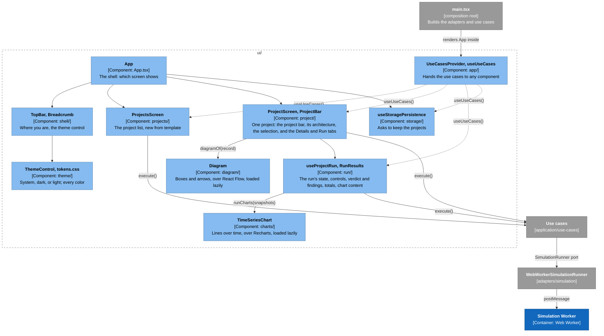

# The User Interface

An introduction to the browser UI in `src/ui/`, for maintainers new to the code: how it's wired, how components reach the use cases, how a run gets from the Run button to the charts, and how to test a component. Read the [architecture overview](architecture-overview.md) and [the application layer guide](application-layer.md) first.

## The big idea: components call use cases, nothing else

The UI never touches IndexedDB, the Worker, or the engine. A component asks for a **use case** (`openProject`, `runSimulation`, ...) and calls its `execute`; the use case works through its ports, and the adapters behind them were chosen in one place, `main.tsx`. ESLint enforces this: `ui/` can't import from `adapters/`, and imports only *types* from `domain/`.

How the pieces connect (the [legend](architecture-overview.md#the-system-at-a-glance) explains the colors):



The folders under `src/ui/`:

| Folder | Holds |
|---|---|
| `App.tsx`, `useOpenProject.ts`, `StartupFailure.tsx` | The shell (the top bar, the storage hint, which screen shows), the hook that tracks which project is open, and the page shown when IndexedDB won't open |
| `shell/` | The top bar: the app's name, the breadcrumb (Projects › the open project), and the theme control |
| `app/` | `UseCases`, `UseCasesProvider`, `useUseCases`, and the test helpers in `app/testing/` |
| `projects/` | The first screen: the user's projects, and the template list with its `useCreateFromTemplate` hook |
| `project/` | One opened project: `ProjectScreen` (open, or say why it can't), `OpenedProject` (the layout, the record with its edits through `useProjectEdits`, the run's state, and the selection, through `useSelection`), `ProjectBar`, `ArchitectureView`, `SelectionDetails` (the Details tab's content), `diagramOf`, and in `fields/` the fields that edit a component's name and settings |
| `run/` | `useProjectRun` (which holds `useSimulationRun` and `useRunFindings`), `RunControls`, `RunProgress`, `RunResults` and the narrow window's `RunPanel`, `Findings` (the verdict and findings), the totals tables, and `runCharts`, which turns snapshots into chart content |
| `diagram/`, `charts/` | Our wrappers around React Flow and Recharts. Only these folders import those libraries ([ADR-0010](../adr/0010-draw-diagrams-with-react-flow-behind-our-own-component.md), [ADR-0011](../adr/0011-draw-charts-with-recharts-behind-our-own-components.md)) |
| `storage/` | Asks the browser for persistent storage after the first create, and warns if it says no |
| `theme/` | The design tokens (`tokens.css`), the page's base styles, and the theme control, which saves the choice ([ADR-0012](../adr/0012-style-the-ui-with-css-tokens-and-css-modules.md)) |
| `shared/` | `useLoad` and `LoadableView`, `handleStatus`, `ScreenHeading`, `useFocusOnMount`, `useWideWindow`, and the building blocks every screen styles with: `Button`, `Panel`, `Tabs`, `CardList`, and `Explained` |

## How a component reaches a use case

[`src/main.tsx`](../../src/main.tsx) is the composition root. It opens the database, builds every adapter, builds the use cases over them, and renders:

```tsx
<UseCasesProvider useCases={createUseCases(database)}>
  <App />
</UseCasesProvider>
```

`UseCases` ([`app/use-cases.ts`](../../src/ui/app/use-cases.ts)) is one object holding every use case, plus the `StoragePersistence` port, the one port the UI calls directly (when to ask is a UI decision). A component reads it with `useUseCases()`:

```tsx
const { openProject } = useUseCases();
const load = useCallback(() => openProject.execute(id), [openProject, id]);
const { loadable } = useLoad(load);
```

Each use case is typed as `Pick<Class, "execute">`. A class with private fields accepts only its own instances, so this lets a test pass a plain object with an `execute` ([ADR-0009](../adr/0009-collaborators-come-from-factories.md)).

To give a component a new use case: add it to `UseCases`, build it in `main.tsx`'s `createUseCases` (or `createProjectReaders`, for a use case that reads a project over the registry), and add a default to `fakeUseCases` that rejects (or throws, for a synchronous one such as `describeSelection`). The exception is `nameComponents`, which is pure: its default is the real one over the AWS types, because every test that runs a simulation names components.

## Patterns you'll see

- **Loading.** `useLoad(load)` runs a promise when the component mounts and drops a result that arrives after it unmounts; `LoadableView` shows "Loading…", the error, or the value. Wrap `load` in `useCallback`, or it runs on every render.
- **Results with a `status`.** Use cases return unions keyed by `status` (`found`, `missing`, `invalid`). Render them with `handleStatus` and a `StatusHandlers` map, the UI's twin of the domain's `KindHandlers` (CONTRIBUTING rule 4): a new status stops the map compiling until it has a view.
- **Double clicks.** State lags a render behind, so a hook that must run something once (`useCreateFromTemplate`, `useSimulationRun`, `useStoragePersistence`) guards with a `useRef`, which changes at once.
- **Keyboard and screen readers.** A button that can't be used now is `aria-disabled` and ignores clicks rather than `disabled`, which would drop the focus: `<Button usable={false}>` does both. A new screen focuses its heading (`ScreenHeading`). Mount a live region (`role="status"`) from the start, empty, as `ProjectBar` and `StorageHint` do, so screen readers announce what appears in it; the older ones that mount with their message are [#14](https://github.com/alanbickel/wind-tunnel/issues/14). The diagram and every chart have a text or table version, and anything the diagram can select, its text version can select too. To explain something on screen, such as what a table's columns mean, use `Explained`: an info button beside its title ("About Limits") that shows and hides the explanation, with `aria-expanded`, and closes on Escape. Not a hover tooltip, which the keyboard can't reach.
- **Styling.** Each component's styles sit next to it in a CSS Module (`ProjectBar.module.css`), and every color and length in them comes from the tokens in `theme/tokens.css`, through `var()`. `theme/base.css` holds the defaults every screen shares, with element selectors only (pseudo-classes inside `:where()`, so a module's class always wins): headings, form controls, tables, the focus ring, and reduced motion. [`tests/architecture/stylesheets.test.ts`](../../tests/architecture/stylesheets.test.ts) fails on a color literal anywhere in `ui/`, a length literal in a stylesheet (except a breakpoint in a media query; see Layout), or `outline: none`; the charts' colors are its listed exceptions until the charts are themed. Each color token holds both themes with `light-dark()`, and the browser picks one by the `color-scheme` on `<html>`, so changing the theme re-renders nothing. `main.tsx` applies the saved choice before the first render.
- **Layout.** The project list is a centered column (`--content-max-width`), and the page scrolls. An open project fills the window from the `--breakpoint-wide` width up: `App` stops the shell at the window's height, and `OpenedProject` puts the project bar at the top and, under it, the architecture beside the Details and Run tabs in a grid. The bar stays put, and each panel scrolls its own content. Below that width the bar wraps, the architecture and the run's results stack in a panel each, and the page scrolls, bar and all. There are no tabs there, and no tab roles either, so a screen reader doesn't hear a tab list that isn't drawn: `OpenedProject` asks `useWideWindow`, which reads the same width with `matchMedia`, and renders `Tabs` or `RunPanel`. Use `useWideWindow` only for what CSS can't do, such as roles; a test that renders a project screen stubs the width with `stubWindowWidth` (`ui/shared/testing/`). `Tabs` follows the WAI-ARIA tabs pattern: the arrow keys, Home, and End move between tabs, only the selected tab takes a tab stop, each panel starts with its tab's label as a visually hidden h3 (so the headings in it sit under that label in a screen reader's outline), and every panel stays mounted, the hidden ones `hidden`, so the run's charts are still there when Run is selected again. Every element from the shell down to the panels passes the height on with `flex: 1; min-height: 0`, so a wrapper added in between needs the same, or the panels grow past the window. `<Panel scrolls>` scrolls its content and takes a tab stop, so the keyboard can scroll past a table between two controls. `Diagram` fills the room its flex column leaves. Prose (the project description, notes, the storage hint) stops at `--prose-max-width` however wide its container. `@media` can't read a custom property, so a media query writes out a `--breakpoint-*` token's value, and the stylesheet test fails if the value isn't one.
- **Wrapped libraries.** `Diagram` and `TimeSeriesChart` take our own types (`DiagramContent`, `TimeSeriesContent`). The rest of the UI builds those (`diagramOf`, `runCharts`) and never sees a React Flow or Recharts type, so either library can be swapped in one folder. Each library is also loaded lazily, in a chunk of its own: `Diagram` and `TimeSeriesChart` draw their frame, label, and text version at once, and `React.lazy` brings in the part that uses the library (`DiagramCanvas`, `ChartPlot`) behind a `Suspense` stand-in of the same size. So the project list loads without React Flow, and Recharts waits for the first run. If a chunk won't load (the user went offline, or a redeploy renamed the chunks), a `LoadFailureBoundary` around each `Suspense` puts "Couldn't load…" in the stand-in's place, and the rest of the screen stays. Import those two only through `lazy`: [`tests/architecture/eager-imports.test.ts`](../../tests/architecture/eager-imports.test.ts) fails if anything `main.tsx` loads at once imports either library. In a test, the boxes and lines arrive a moment after the render. Import the lazy module first with `preloadBeforeAll(() => import("…/DiagramCanvas"))` (`ui/shared/testing/`), because a full run can take longer than the 5 s test timeout over a library's first import; then wait for them (`waitFor`, `findBy…`). Or render `DiagramCanvas` or `ChartPlot` directly.

## Selection and the Details tab

A project screen has one selection, or none: a component or an edge, for now ([UX design §4.1](../design/user-experience.md#41-selection)). `OpenedProject` holds it with `useSelection`, above both columns, so the diagram, its text version, and Details read the same one. It lasts while the screen is open and isn't saved. Its type, `Selection`, lives in [`application/details/`](../../src/application/details/selection.ts), because the use case that describes it takes it.

- **Selecting.** In the diagram's text version, each component and connection is a button, marked `aria-current` while it's the selection (not `aria-pressed`: pressing it again doesn't unselect it): the way every user can rely on. On the canvas, a click on a box or an arrow selects it, a box can be focused and selected with Enter, and a click on the empty canvas clears the selection. `Diagram` reports these through `onSelect` in its own terms (a `DiagramItem`: a node or an edge, by id), and `ArchitectureView` turns them into a `Selection` ([ADR-0010's addendum](../adr/0010-draw-diagrams-with-react-flow-behind-our-own-component.md#addendum-2026-10-25)). The diagram rings the selected box and draws the selected arrow thicker, through React Flow's `selected` class, so the mark is a shape and a width, not a color alone.
- **What shows.** Selecting opens Details: the Details tab in a wide window, or a Details panel under the model, with a Close button, in a narrow one. `SelectionDetails` asks `describeSelection` for what to show: a component's name and type, a field for its name and each setting with its unit, its help, and its default with its evidence and "Reset to default", then the workflows that call it ([editing](#editing-and-saving)); or an edge's two ends, its latency, timeout, and retries, read-only, and the steps that call along it. The words come from each type's field descriptors in [`application/details/fields/`](../../src/application/details/fields/), so a new component type brings its own.
- **Focus.** Selecting moves the focus to the Details heading, so the keyboard and a screen reader land on it. Escape anywhere in Details (except in a field with a draft to put back), or Close, clears the selection, shows Run again in a wide window, and returns the focus to the element that had it when the selection was made, which `useSelection` remembers. A click on the empty canvas clears without moving the focus.

To make something else selectable (a workflow, a step, a finding), add it to `Selection`; `DescribeSelection` and the maps that read a selection stop compiling until each handles it.

## Editing and saving

Each change a user makes is a **command**, validated and saved at once; there's no Save button ([ADR-0019](../adr/0019-edit-projects-with-commands-and-save-each-change.md), [UX design §4.3](../design/user-experience.md#43-editing-and-saving)). A command is a plain function in [`application/edits/`](../../src/application/edits/component-edits.ts) that takes the project record and returns the next one: `setComponentSetting`, `renameComponent`, `resetComponentSetting`. The UI never builds a record by hand. It fills in a command's input and hands it to `edit`.

```mermaid
sequenceDiagram
    actor User
    participant F as NumberField (ui)
    participant E as useProjectEdits (ui)
    participant Q as save queue (ui)
    participant S as SaveProject (application)
    User->>F: types 0
    F->>F: draft "0" fails its range: "Query workers must be at least 1."
    User->>F: types 64, leaves the field
    F->>E: edit(record => setComponentSetting(record, { componentId, key, value: 64 }))
    E->>E: holds the next record; the screen shows it, and the run goes out of date
    E->>Q: save(next)
    Q->>S: execute(next), one at a time
    S-->>Q: saved, or not
    Q-->>E: on a failure, saveFailed: the bar says "Couldn't save your last change." with Try again
```

- **A field holds a draft.** What's typed stays in the field (`useDraft`) until it passes the field's checks, which word their own messages: a number against its descriptor's `range` (`checkNumberDraft`), a distribution's parts and its rule that the p99 is at least the median (`checkDistributionDraft`), and a name that no other component of its type uses (`checkComponentName`). All are in [`application/details/`](../../src/application/details/), so they're tested without a browser. On Enter, or on leaving the field, a passing draft becomes a command; a failing one stays, with its message, and never reaches the project. Escape puts back the saved value. A draft starts again whenever the saved value changes, such as after a reset.
- **Messages are tied to their field.** A failing field is `aria-invalid`, and its `aria-describedby` points at the message first, then its unit, help, and default, so a screen reader reads them whenever the field has the focus. Leaving a field with a failing draft also puts the message in Details' polite status region, since the focus has moved on.
- **Field kinds.** `ComponentSettings` picks a field by the descriptor's `kind`: `NumberField` for a number or whole number, and `DistributionField` for a distribution: a kind picker (constant, exponential, lognormal) and a field for each of the kind's parts. Changing the kind fills the new parts from the old one's typical value (a constant takes the median; a lognormal starts with its p99 at its median), and a kind switched back to gets its old values back. The kind saves when the picker is left, not on each change, because arrow keys on a closed picker change it once for each kind they pass. A new component type brings its own descriptors, so it needs no field code.
- **Saving.** `OpenedProject` holds the record through `useProjectEdits`, so the screen shows every change at once. Saves go through `saveProject` one at a time, in order. Each record is the whole project, so a record waiting behind the one in flight is replaced by a newer one. If a save fails, or `SaveProject` refuses the record (which the fields' checks should rule out), the change stays on screen, the project bar says "Couldn't save your last change." from a status region that's there from the start, and Try again saves it. A later save that works clears it. A save that works isn't announced: the field already shows it.
- **Run freshness.** A saved change changes the project the screen holds, so a run on screen goes out of date with no extra code ([run freshness](#run-freshness)).

## A run, from click to chart

`OpenedProject` owns a run through `useProjectRun`, above the parts that show it: the project bar's controls, progress bar, and status line, and the Run tab's results (`RunResults`). So the bar and the tab read the same run, and showing Details or narrowing the window doesn't stop it. `useProjectRun` holds the picked workload and two hooks: `useSimulationRun`, which runs it, and `useRunFindings`, which reads it. Clicking Run makes an `AbortController`, calls `runSimulation.execute` with the workload, its signal, and an `onSnapshot` that appends each snapshot to state, then records how the run ended as a `RunPhase` (`running`, `finished`, `stopped`, `failed`). Each phase after `idle` is a `RanModel`: the workload, and the project as it was when Run was clicked, which is the run's copy ([run freshness](#run-freshness)). Stop, or leaving the screen, aborts the controller.

In the browser, the use case's runner is `WebWorkerSimulationRunner`. It starts a fresh Worker for each run, posts it the project, and passes each snapshot the Worker posts back to `onSnapshot`. Stopping terminates the Worker, so snapshots still queued are dropped:

```mermaid
sequenceDiagram
    actor User
    participant UI as OpenedProject, useSimulationRun (ui)
    participant UC as RunSimulation (application)
    participant WB as WebWorkerSimulationRunner (adapter)
    participant W as Web Worker
    participant E as Engine (domain)

    User->>UI: Click "Run"
    UI->>UC: execute({ project, workloadId, onSnapshot, stopSignal })
    UC->>WB: run({ request, onSnapshot, stopSignal }) via SimulationRunner port
    WB->>W: new Worker, then postMessage({ kind: "run", request })
    W->>E: simulateWithMetrics, seeded from the workload
    loop every simulated second
        E-->>W: metrics snapshot
        W-->>WB: postMessage({ kind: "snapshot" })
        WB-->>UI: onSnapshot(snapshot), appended to state
    end
    E-->>W: final results
    W-->>WB: postMessage({ kind: "finished", run })
    WB->>W: terminate()
    WB-->>UC: resolves finished
    UC-->>UI: finished; phase becomes "finished"
    Note over UI,W: If the stop signal fires first, the runner terminates the Worker at once<br/>and resolves stopped; snapshots still queued are dropped.
```

From the snapshots so far, the project bar draws a progress bar, and the Run tab what the run means, then the evidence: the totals and each limit's busiest use (`RunTotals`, each table with its sum under it and an info control beside its heading), and four charts (`runCharts`): requests per second, p99 latency, and each component's work in progress and queue. Findings and charts take far longer than a snapshot takes to arrive, so `useRunFindings` defers the run (its id, project copy, workload, and snapshots together, so the deferred value never mixes two runs) with `useDeferredValue`, and the totals and charts draw the same deferred run: React puts clicks such as Stop first and skips snapshots it falls behind on, while the progress bar stays current.

**What the run means.** `useRunFindings` calls `findRun` with the [default detectors](finding-detectors.md) on the run so far, as the CLI does, and `Findings` shows the result: the verdict (its title, such as "Failing so far", its summary, and its no-headroom and closest-to-failing lines), then each finding with its causes nested beneath it, numbered as the CLI numbers them. Each finding shows its severity in words and its summary; its `Explained` control opens its reasons, fixes (each with its claim: a Documented link, an Observed test, or the Assumption label), and Learn more. The words come from the phrasebook in their long form, and `MessageText` turns a `Message` into text by the same rules as the CLI (`partText`), setting components and times apart in their own elements. Components show by name: `useRunFindings` gets the run's copy's names from the `nameComponents` use case and hands them to `Findings` with the phrasebook, as `RunMeaning.wording`. The status line ends with the verdict's title, so a screen reader hears it when the level changes or the run ends, not on every snapshot. For a moment after a new run starts, the deferred run is still the one before; the status line leaves the title out until it catches up, so it never announces the old run's verdict as the new one's.

### Run freshness

A run keeps the model it ran ([ADR-0018](../adr/0018-tie-a-run-to-the-model-it-ran.md)). Its phase holds the project as it was when the run started; a project is never changed in place, so holding that object is the copy. Everything drawn from the run reads it: the findings and their wording, the totals, and the charts all take the `RunSoFar` that `useRunFindings` builds from the copy. So an old run reads as it did, a finding can name a component that's since been renamed or removed, and a run that's going when the project changes finishes with what it started with.

`useProjectRun` asks `runIsCurrent` ([`application/run-analysis/run-freshness.ts`](../../src/application/run-analysis/run-freshness.ts)) whether the copy still matches the project, and exposes the answer as `outOfDate`. The comparison is by content, not by a revision number, so changing a setting and changing it back makes the run current again. It counts the architecture (component names included), the workflows, and the workload that ran; the project's name and description, the other workloads, and the layout (which isn't part of a `Project`) don't count. Its table has a row for every field of `Project`, so a new field doesn't compile until it's placed on one side.

When the run is out of date, the project bar's second status region says "Out of date", after the run's status, and the Run tab opens with "This run is of an earlier version of the project. Run again to see your changes." above the findings, which stay as they were. Both status regions are on the page from the start, empty, so screen readers announce their text when it arrives, and the focus doesn't move.

### A workload that can't run

A project can be saved with run issues: a step that calls a removed component, say, or a workload whose mix is empty ([the two groups of checks](domain-model.md#validation-who-checks-what)). `useProjectRun` asks the `checkWorkloads` use case which workloads can run, once per change to the project, and exposes the answer as `checks`. The screen shows it in three places:

- **The picker** adds "(can't run yet)" to such a workload's name.
- **Run** is unusable (`aria-disabled`) while one is picked. `RunSimulation` refuses it anyway, as `cant-run`, if a run starts before the screen catches up.
- **The project bar** says why, in its third status region: the check's summary, such as "Lunch rush can't run yet: Get order and Create order call orders-db, which isn't in the architecture." Components and workflows show by name.

Like the others, that region is on the page from the start, empty while the picked workload can run. So when a saved change stops the picked workload running, screen readers announce the reason politely, and the focus stays where the user was editing (UX design §4.4). Showing each issue on its step or mix entry waits for the workflow and workload editors; every issue keeps its path for them.

### Worked example

[`src/ui/traces/user-interface.test.tsx`](../../src/ui/traces/user-interface.test.tsx) renders the whole app the way `main.tsx` does and follows a user from a template to a finished run. It records each click, each use case call, and what the screen shows, in [`user-interface.txt`](../../src/ui/traces/user-interface.txt). `ui/` can't import adapters, so the test's runner stands in for the Worker runner and sends two snapshots itself; the Worker's side is tested in `src/adapters/simulation/`.

Opening the app loads both lists. Creating a project saves it, asks for persistent storage (the first create only), and reloads the list:

```text
App renders inside UseCasesProvider, as main.tsx does
  call     listTemplates.execute() → [sample]
  call     listProjects.execute() → []
  screen   projects screen: your projects, and the templates
  screen   breadcrumb "Projects"

User clicks "Create a project from Sample project"
  call     createProjectFromTemplate.execute("sample") → created project-1
  call     storagePersistence.request() → persisted
  call     listProjects.execute() → [project-1 "Sample project"]
  screen   the list now has "Sample project"
```

Running it: each snapshot moves the progress bar, the verdict, the totals, and every chart on by a second. The totals reconcile at every step: started = succeeded + failed + in progress.

```text
User clicks "Run"
  call     runSimulation.execute({ project: project-1, workloadId: "steady", onSnapshot, stopSignal })
  call     runner.run({ request: { project: project-1, workloadId: "steady" }, onSnapshot, stopSignal })
  screen   status "Running Steady… Healthy so far."

Worker posts the snapshot for 0–1000 ms
  screen   status "Running Steady… Healthy so far."
  screen   progress 1 of 2 simulated seconds
  screen   verdict "Healthy so far": "All 18 answered requests succeeded; 2 are in progress." 0 findings
  screen   requests (run totals): started 20 = succeeded 18 + failed 0 + in progress 2
  screen   chart "Requests per second, all workflows": 1 s of points
  screen   chart "Latency of successful requests, p99": 1 s of points
  ...

Worker posts finished
  call     runSimulation.execute → finished
  screen   status "Finished Steady. Healthy."
```

If the flow changes, that test fails and the diff shows the new timeline. If the change is intended, run `npx vitest run src/ui/traces --update`, then update the excerpts on this page.

## How it's tested

UI tests start with `// @vitest-environment jsdom`, render with Testing Library, and call `cleanup` in `afterEach` (see [CONTRIBUTING](../../CONTRIBUTING.md#tests)).

| Helper | Use it for |
|---|---|
| `fakeUseCases(overrides)` ([`app/testing/`](../../src/ui/app/testing/)) | A component that calls one or two use cases. Every call you don't override rejects, so an unexpected call fails the test |
| `inMemoryUseCases(templates)` | Following a user through several steps: the real project use cases over in-memory adapters |
| `new RunSimulation({ runner })` with a test runner | Run tests. `ManualSimulationRunner` ([`run/testing/`](../../src/ui/run/testing/)) sends snapshots and ends the run when the test says |
| `renderOpenedProject()` ([`project/testing/`](../../src/ui/project/testing/)) | A test of the whole project screen: renders `OpenedProject` with the sample project (or the one given), a `ManualSimulationRunner`, and a real `saveProject` over the AWS types that saves to the `projects` it returns, and returns `change(project)`, which hands the screen a changed project as opening it again would. `bar()`, `statusRegions()`, `status()`, and `clickRun()` beside it read and drive the project bar |
| `stubWindowWidth("wide" \| "narrow")` ([`shared/testing/`](../../src/ui/shared/testing/)) | Any test that renders `OpenedProject`, `ProjectScreen`, or `App`: jsdom lacks the `matchMedia` that `useWideWindow` reads. Undo it with `vi.unstubAllGlobals()` |
| `stubDiagramBrowserApis()` ([`diagram/testing/`](../../src/ui/diagram/testing/)) | Any test that renders a `Diagram`, `ProjectScreen`, or `App`: jsdom lacks the `ResizeObserver` and `DOMMatrixReadOnly` that React Flow needs. Undo it with `vi.unstubAllGlobals()` |

Keep logic out of components where you can: `diagramOf` and `runCharts` are plain functions with plain tests, and the component tests check what the user sees and can do. Counts the CLI report shows too, such as the run totals, come from [`application/run-analysis/`](../../src/application/run-analysis/) ([ADR-0013](../adr/0013-derive-run-results-in-application-run-analysis.md)).

## Adding to it

- **A new screen or panel:** a folder under `src/ui/`, reading use cases with `useUseCases()`. Load with `useLoad`, render results with `handleStatus`, and give the screen a `ScreenHeading`. Build it from `Panel`, `CardList`, and `Button`, and lay it out in its own CSS Module. A size the tokens don't have yet (like `--diagram-height`) becomes a token.
- **A new chart:** add a `TimeSeriesContent` to `runCharts`. Keep every series present from the first snapshot, in a fixed order, so lines keep their colors as the run fills in. A chart that needs something `TimeSeriesChart` can't draw gets a new prop in our own types, in `src/ui/charts/`.
- **A new color:** add a token named for its role to `tokens.css`, as `light-dark(<light>, <dark>)` with two `#rrggbb` values, and add it to `CONTRAST_RULES` in `theme/tokens.test.ts` with each background it sits on. A color that carries no information goes in `DECORATIVE` with the reason instead. The test fails until you do one or the other, and fails if a pair is below its WCAG ratio. The test can't tell whether neighboring chart series stay distinct for color-blind readers: for a series color, run the palette validator from Claude Code's dataviz skill on all eight, in each theme, against `--color-surface`. Series colors are for graphics only, never text: they're held to 3:1, so a tooltip row or legend label uses `--color-text`, with the hue on the line and the swatch.
- **A new use case for the UI:** see [How a component reaches a use case](#how-a-component-reaches-a-use-case).
