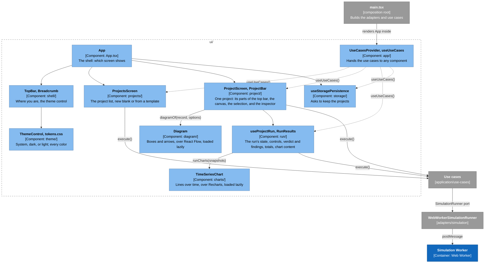
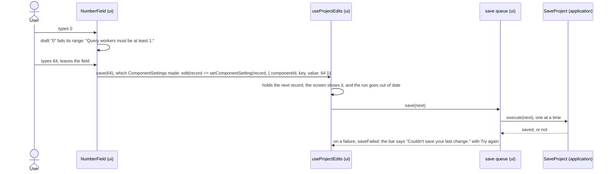
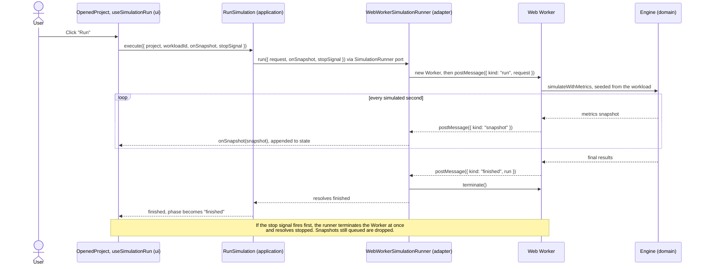

# The User Interface

An introduction to the browser UI in `src/ui/`, for maintainers new to the code: how it's wired, how components reach the use cases, how a run gets from the Run button to the charts, and how to test a component. Read the [architecture overview](architecture-overview.md) and [the application layer guide](application-layer.md) first.

## The big idea: components call use cases, nothing else

The UI never touches IndexedDB, the Worker, or the engine. A component asks for a **use case** (`openProject`, `runSimulation`, ...) and calls its `execute`; the use case works through its ports, and the adapters behind them were chosen in one place, `main.tsx`. ESLint enforces this: `ui/` can't import from `adapters/`, and imports only *types* from `domain/`.

How the pieces connect (the [legend](architecture-overview.md#the-system-at-a-glance) explains the colors):



The folders under `src/ui/`:

| Folder | Holds |
|---|---|
| `App.tsx`, `useOpenProject.ts`, `StartupFailure.tsx` | The shell (which screen shows, and the top bar and storage hint of the project list), the hook that tracks which project is open, and the page shown when IndexedDB won't open |
| `shell/` | The top bar: the app's name, the breadcrumb (Projects › the open project), an open project's controls and status line, and the theme control |
| `app/` | `UseCases`, `UseCasesProvider`, `useUseCases`, and the test helpers in `app/testing/` |
| `projects/` | The first screen: the user's projects, and "New project": `CreateBlank` with its `useCreateBlank` hook, and the template list with its `useCreateFromTemplate` hook |
| `project/` | One opened project: `ProjectScreen` (open, or say why it can't), `ProjectFrame` (the top bar, the storage hint, and the content under them), `OpenedProject` (the layout, the record with its edits and their history through `useProjectEdits`, Undo and Redo through `useUndoRedo`, the run's state, and the selection, through `useSelection`), `ProjectName` (the last crumb), `ProjectBar` and `ProjectStatus` (the project's controls and status line in the top bar), `ArchitectureView` (the canvas: the diagram, the tool rail, and `CanvasPanels`, the "Workflows" and "As text" panels), `Inspector` and `StackedInspector` (the Details and Run content, over the canvas or under it), `SelectionDetails` (the Details tab's content) and `WorkflowOutline` (a workflow's, in it), `diagramOf`, and in `fields/` the fields that edit a component's name and settings |
| `run/` | `useProjectRun` (which holds `useSimulationRun` and `useRunFindings`), `RunControls`, `RunProgress`, `RunResults` and the narrow window's `RunPanel`, `Findings` (the verdict and findings), the totals tables, and `runCharts`, which turns snapshots into chart content |
| `diagram/`, `charts/` | Our wrappers around React Flow and Recharts. Only these folders import those libraries ([ADR-0010](../adr/0010-draw-diagrams-with-react-flow-behind-our-own-component.md), [ADR-0011](../adr/0011-draw-charts-with-recharts-behind-our-own-components.md)) |
| `storage/` | Asks the browser for persistent storage after the first create, and warns if it says no |
| `theme/` | The design tokens (`tokens.css`), the page's base styles, and the theme control, which saves the choice ([ADR-0012](../adr/0012-style-the-ui-with-css-tokens-and-css-modules.md)) |
| `shared/` | `useLoad` and `LoadableView`, `handleStatus`, `ScreenHeading`, `useFocusOnMount`, `useWideWindow`, and the building blocks every screen styles with: `Button`, `Panel`, `Tabs`, `CardList`, and `Explained`. `SelectableItem.module.css` is the style of a list line that selects something, which the diagram's text version and the workflow outline `composes` |

## How a component reaches a use case

[`src/main.tsx`](../../src/main.tsx) is the composition root. It opens the database, builds every adapter, builds the use cases over them, and renders:

```tsx
<UseCasesProvider useCases={createUseCases(database)}>
  <App />
</UseCasesProvider>
```

`UseCases` ([`app/use-cases.ts`](../../src/ui/app/use-cases.ts)) is one object holding every use case, plus the `StoragePersistence` port, the one port the UI calls directly (when to ask is a UI decision). A component reads it with `useUseCases()`:

```tsx
const { openProject } = useUseCases();
const load = useCallback(() => openProject.execute(id), [openProject, id]);
const { loadable } = useLoad(load);
```

Each use case is typed as `Pick<Class, "execute">`. A class with private fields accepts only its own instances, so this lets a test pass a plain object with an `execute` ([ADR-0009](../adr/0009-collaborators-come-from-factories.md)).

To give a component a new use case: add it to `UseCases`, build it in `main.tsx`'s `createUseCases` (or `createProjectReaders`, for a use case that reads a project over the registry), and add a default to `fakeUseCases` that rejects (or throws, for a synchronous one such as `describeSelection`). The exceptions are the pure ones, `nameComponents`, `checkWorkloads`, `checkWorkflows`, and `listComponentTypes`: their defaults are the real ones over the AWS types, because every test that shows a project uses them.

## Patterns you'll see

- **Loading.** `useLoad(load)` runs a promise when the component mounts and drops a result that arrives after it unmounts; `LoadableView` shows "Loading…", the error, or the value. It always renders one empty `role="status"` and changes only its text (a screen reader skips a region added with its text), so each `LoadableView` adds one region to its parent, and a screen with two has two. Wrap `load` in `useCallback`, or it runs on every render.
- **Results with a `status`.** Use cases return unions keyed by `status` (`found`, `missing`, `invalid`). Render them with `handleStatus` and a `StatusHandlers` map, the UI's twin of the domain's `KindHandlers` ([coding standards rule 4](../contributing/coding-standards.md#4-look-up-dont-branch)): a new status stops the map compiling until it has a view.
- **Double clicks.** State lags a render behind, so a hook that must run something once (`useCreateFromTemplate`, `useCreateBlank`, `useSimulationRun`, `useStoragePersistence`) guards with a `useRef`, which changes at once.
- **Keyboard and screen readers.** A button that can't be used now is `aria-disabled` and ignores clicks rather than `disabled`, which would drop the focus: `<Button usable={false}>` does both. A new screen focuses its heading (`ScreenHeading`). Mount a live region (`role="status"`) from the start, empty, as `ProjectBar` and `StorageHint` do, so screen readers announce what appears in it. The diagram and every chart have a text or table version, and anything the diagram can select, its text version can select too. To explain something on screen, such as what a table's columns mean, use `Explained`: an info button beside its title ("About Limits") that shows and hides the explanation, with `aria-expanded`, and closes on Escape. Not a hover tooltip, which the keyboard can't reach.
- **Styling.** Each component's styles sit next to it in a CSS Module (`ProjectBar.module.css`), and every color and length in them comes from the tokens in `theme/tokens.css`, through `var()`. `theme/base.css` holds the defaults every screen shares, with element selectors only (pseudo-classes inside `:where()`, so a module's class always wins): headings, form controls, tables, the focus ring (for any focus, not keyboard focus alone), and reduced motion. [`tests/architecture/stylesheets.test.ts`](../../tests/architecture/stylesheets.test.ts) fails on a color literal anywhere in `ui/` (comments included, so cite an issue as "issue 121" there, since `#121` reads as a color), a length literal in a stylesheet (except a breakpoint in a media query; see Layout), or `outline: none`; the charts' colors are its listed exceptions until the charts are themed. Each color token holds both themes with `light-dark()`, and the browser picks one by the `color-scheme` on `<html>`, so changing the theme re-renders nothing. `main.tsx` applies the saved choice before the first render.
- **Layout.** The project list is a centered column (`--content-max-width`) under the top bar, and the page scrolls. A project screen is canvas first ([UX design §2](../design/user-experience.md#2-the-screen)). It draws its own frame (`ProjectFrame`), since the project's controls sit in the top bar, so `App` draws a top bar only for the list, and hands a project screen the way back and the storage hint (`ShellParts`); while the project opens, or if it can't, the frame's last crumb is the name the list had. The one top bar holds the app's name, the breadcrumb, whose last crumb is the project's heading and Rename (`ProjectName`), Undo and Redo and the run's controls (`ProjectBar`), and the theme control. Under its row, across the bar, the status line (`ProjectStatus`) holds the run's progress and status, "Out of date", why the picked workload can't run, and a failed save; it takes no room while its regions are all empty. The storage hint is a slim line under the bar. From the `--breakpoint-wide` width up, the frame stops at the window's height, the bar stays put, and the canvas (`ArchitectureView`) fills the rest: the diagram edge to edge, "Add component" on a tool rail at its top left, React Flow's zoom controls at the left edge's middle, and at its bottom left "Workflows" and "As text", each opening its panel over the canvas (`CanvasPanels`). One panel opens at a time, Escape in it closes it and returns the focus to its button, and a closed one stays mounted, hidden. Which is open is the screen's (`useCanvasPanels`), so a workflow's remove can open "Workflows" before the focus goes to "Add workflow", in it, and Escape in Details can open the panel the focus goes back to. The inspector (`Inspector`) floats over the canvas's right and holds the Details and Run tabs, each scrolling its own content. Close collapses it to a strip on the right edge, whose button (the same one, so the focus stays) opens it again, and selecting anything, or Run, opens it too (`inspectorOpen`, in `useSelection`); the tabs stay mounted, hidden, while it's collapsed. `useCoveredWidth` measures how much of the canvas the inspector covers, and `Diagram` fits its boxes clear of that (`coveredRightPx`, through `fitOptions`), at most at their own size. With nothing selected, Details shows the project's description, then that nothing is selected. Below that width the bar wraps, the canvas keeps `--diagram-height`, and the inspector's content follows it, full-width (`StackedInspector`): Details while something is selected, or the description while nothing is, then Run, and the page scrolls, bar and all. There are no tabs there, and no tab roles either, so a screen reader doesn't hear a tab list that isn't drawn: `OpenedProject` asks `useWideWindow`, which reads the same width with `matchMedia`, and renders `Inspector` or `StackedInspector`. Use `useWideWindow` only for what CSS can't do, such as roles; a test that renders a project screen stubs the width with `stubWindowWidth` (`ui/shared/testing/`). `Tabs` follows the WAI-ARIA tabs pattern: the arrow keys, Home, and End move between tabs, only the selected tab takes a tab stop, each panel starts with its tab's label as a visually hidden h3 (so the headings in it sit under that label in a screen reader's outline), and every panel stays mounted, the hidden ones `hidden`, so the run's charts are still there when Run is selected again. Every element from the shell down to the panels passes the height on with `flex: 1; min-height: 0`, so a wrapper added in between needs the same, or the panels grow past the window. `<Panel scrolls>` scrolls its content and takes a tab stop, so the keyboard can scroll past a table between two controls. `Diagram` fills the room its flex column leaves. Prose (the project description, notes, the project list's storage hint) stops at `--prose-max-width` however wide its container. `@media` can't read a custom property, so a media query writes out a `--breakpoint-*` token's value, and the stylesheet test fails if the value isn't one.
- **Wrapped libraries.** `Diagram` and `TimeSeriesChart` take our own types (`DiagramContent`, `TimeSeriesContent`). The rest of the UI builds those (`diagramOf`, `runCharts`) and never sees a React Flow or Recharts type, so either library can be swapped in one folder. Each library is also loaded lazily, in a chunk of its own: `Diagram` and `TimeSeriesChart` draw their frame, label, and text version at once, and `React.lazy` brings in the part that uses the library (`DiagramCanvas`, `ChartPlot`) behind a `Suspense` stand-in of the same size. So the project list loads without React Flow, and Recharts waits for the first run. If a chunk won't load (the user went offline, or a redeploy renamed the chunks), a `LoadFailureBoundary` around each `Suspense` puts "Couldn't load…" in the stand-in's place, and the rest of the screen stays. Import those two only through `lazy`: [`tests/architecture/eager-imports.test.ts`](../../tests/architecture/eager-imports.test.ts) fails if anything `main.tsx` loads at once imports either library. In a test, the boxes and lines arrive a moment after the render. Import the lazy module first with `preloadBeforeAll(() => import("…/DiagramCanvas"))` (`ui/shared/testing/`), because a full run can take longer than the 5 s test timeout over a library's first import; then wait for them (`waitFor`, `findBy…`). Or render `DiagramCanvas` or `ChartPlot` directly.
- **React Flow hides a node without a size.** It takes a box's measured size only from the node object it's given, so a new node object without `measured` is hidden, with its arrows, until a `ResizeObserver` measures it again, a frame later. `DiagramCanvas` gives each node its size back (`useMeasuredSizes`); keep it when you change how nodes are built. jsdom's stubbed `ResizeObserver` never measures, so a test that needs to see this uses `stubMeasuringResizeObserver`.

## Creating a project

"New project", on the projects screen, makes one of two ways ([UX design, M6 version, §2.1](https://github.com/alanbickel/wind-tunnel/blob/6ef2e1e9ace6a3cb9a419bc9187fa3c2b8869d38/docs/design/user-experience.md#21-model-your-own-system) step 1), each a section with its own h3, so a screen-reader user moving by heading finds both. "Create from template" copies a template, and the copy joins the list. "Create blank" takes a name, typed into its field, and Enter or the button creates a project with nothing else in it and opens it. Either way, `App` asks for persistent storage after the first create.

- **Names are unique.** `useCreateBlank` lists the projects when the user asks, checks the name against them with `checkProjectName` (in [`application/details/`](../../src/application/details/project-name.ts)), and only then calls `createBlankProject`. An empty name, or one another project uses ignoring case, creates nothing: the message shows under the field, which is `aria-invalid` and described by it, and is announced, since the focus is already on the field or the button. Typing clears it. `CreateBlankProject` refuses a taken name too, and the screen shows the same message. A template copy whose name is taken is numbered by its use case: "Serverless API with RDS (2)".
- **The empty diagram.** With no components, `ArchitectureView` shows "No components yet. Add one to start describing your system." under "Add component", in place of the diagram and its text version. The first component brings them back. The run panel already says "This project has no workloads to run."

## Selection and the Details tab

A project screen has one selection, or none: a component, an edge, a workflow, a step, a [workload](workload-editor.md#selecting-a-workload), a workflow being made (`new-workflow`, a draft that isn't in the project), or a finding of the run on screen (`finding`, by its `FindingKey`), for now ([UX design §5](../design/user-experience.md#5-selection-and-focus)). `OpenedProject` holds it with `useSelection`, above both columns, so the diagram, its text version, and Details read the same one. It lasts while the screen is open and isn't saved. Its type, `Selection`, lives in [`application/details/`](../../src/application/details/selection.ts), because the use case that describes it takes it.

- **Cards and status badges.** Each box is a card (`NodeCard`, in `ui/diagram/`): the type's icon (`ComponentIcon`, from react-aws-icons: [ADR-0022](../adr/0022-draw-component-icons-with-react-aws-icons.md)), the name, the type in words (`diagramOf` is given `displayNameOf`, the registry's names), and after a run a badge saying how the component did. The status comes from `application/run-analysis/` (`componentStatuses`, beside `componentTotals` and `limitPeaks`, so the CLI could print it): **refused** if the component's `rejected` total is above 0, else **waited** if a limit that makes work wait when full ran out at its peak, else **ok**, and refused wins. `useProjectRun` turns it into `badges` (`runBadgesOf`: each component's status, and whether the run is out of date), which `OpenedProject` passes to `ArchitectureView`, and `diagramOf` puts each status on its node as a `DiagramStatus`, with the word (`STATUS_WORDS`, written to match the findings' wording, not built from it: the phrasebook has no entry to share) and an `outOfDate` flag. They update as snapshots arrive, and there are none before the first run. A component added since the run has no entry, so no badge; one removed has no box. Each status has a shape as well as a color and its word (a circle, a triangle, a square), so color is never the only signal. When the run is out of date ([ADR-0018](../adr/0018-tie-a-run-to-the-model-it-ran.md)) the badge is hollow with a dashed border, and a screen reader hears "from an earlier version of the project" after the word. The text version lists the same: "Function (Lambda): refused", with the same note after it when out of date. Keep new imports for a card inside `ui/diagram/`'s lazy chunk: `ArchitectureView` may import only `diagram-model.ts` from it, or the icons load with the project list.
- **Selecting.** In the diagram's text version, each component and connection is a button, marked `aria-current` while it's the selection (not `aria-pressed`: pressing it again doesn't unselect it): the way every user can rely on. On the canvas, a click on a box or an arrow selects it, a box can be focused and selected with Enter, and a click on the empty canvas clears the selection. `Diagram` reports these through `onSelect` in its own terms (a `DiagramItem`: a node or an edge, by id), and `ArchitectureView` turns them into a `Selection` ([ADR-0010's addendum](../adr/0010-draw-diagrams-with-react-flow-behind-our-own-component.md#addendum-2026-10-25)). The diagram marks the selected box with a bar down its left edge and draws the selected arrow thicker, through React Flow's `selected` class, so the mark is a shape and a width, not a color alone. A text-version row and the Details panel carry the same bar (`--selection-bar-width`), and the bar is never a ring: a ring means the DOM focus ([UX design §5](../design/user-experience.md#5-selection-and-focus)); a selected workflow's path is marked too ([the workflow editor guide](workflow-editor.md#the-path-on-the-diagram)). After its components and connections, the text version gives each workflow's path as a line of text, not a button ([the workflow editor guide](workflow-editor.md#a-workflow-four-ways)). Under the text version, "Workflows" lists the project's workflows, a button each, marked `aria-current` while its workflow or one of its steps is selected; a step is selected from its workflow's outline in Details ([the workflow editor guide](workflow-editor.md)). The same panel's "Workloads" lists the workloads the same way, and the top bar's Edit selects the picked one; Details has fields for its duration and seed, an editable mix ([the mix](workload-editor.md#the-mix)), and an editable profile, a table of points under a read-only chart ([the profile](workload-editor.md#the-profile)), and the project bar's picker follows a selection one way ([the workload editor guide](workload-editor.md#selecting-a-workload)).
- **What shows.** Selecting opens Details: the Details tab in a wide window, or a Details panel under the model, with a Close button, in a narrow one. `SelectionDetails` asks `describeSelection` for what to show: a component's name and type, a field for its name and each setting with its unit and "Reset to default", and an info control for its help and its default with its evidence ([messages](#editing-and-saving)), then "Connect to…" and the workflows that call it ([editing](#editing-and-saving)); or an edge's two ends, a field for its latency, timeout, and retries, each with its caller type's default, and the steps that call along it; or a workflow's name, the workloads that use it, and its outline, with the selected step marked, if one is. The words come from each type's field descriptors in [`application/details/fields/`](../../src/application/details/fields/), so a new component type brings its own.
- **Focus.** The focus ring is `:where(:focus)` in `base.css`, so it shows on whatever has the DOM focus, whatever put it there; `:focus-visible` would hide focus that code moves after a click, such as "Add component" after a remove. Tab in the canvas moves the focus without selecting. Selecting moves the focus to the Details heading (or, for a component just added, its name field), so the keyboard and a screen reader land on it. Escape anywhere in Details (except in a field with a draft to put back, or beside an open info control, where it closes the explanation first and moves the focus to the control), or Close, clears the selection, shows Run again in a wide window, and returns the focus to the element that had it when the selection was made, which `useSelection` remembers. A step selected in an outline is selected with `selectWithin`, which keeps the element remembered before, such as the workflow's row: the step's own button is in Details, and goes when Details closes. A click on the empty canvas clears without moving the focus.
- **A finding.** In the Run tab, each finding's summary is a button, marked `aria-current` while it's the selection (`FindingList`, `FindingItem`; a cause note beneath a finding is one too, and the same note under two findings is marked under both, since the selection is its key). Selecting it (`selectFinding`, in `useSelection`) rings its component (`key.componentId`) on the diagram and in the text version, through `selectionOnArchitecture`, and is the one selection that moves nothing: the inspector stays on Run, the focus stays on the button, and Details shows as if nothing were selected (`detailsSelection`, in `Inspector`; `describeSelection` returns undefined for it). Escape in the findings, a click on the empty canvas, or any other selection clears it; an open explanation's own Escape closes it first. The finding is worded from the run's copy of the project (ADR-0018), so its component may be gone from the project: the selection then rings nothing, and a live region under the finding, on the page from the start, says "Table isn't in the project any more." with the name from the run's copy (`FindingSelecting.isGone`). An undo or redo leaves it selected.

To make something else selectable (a workload), add it to `Selection`; `DescribeSelection` and the maps that read a selection stop compiling until each handles it.

## Editing and saving

Each change a user makes is a **command**, validated and saved at once; there's no Save button ([ADR-0019](../adr/0019-edit-projects-with-commands-and-save-each-change.md), [UX design §6](../design/user-experience.md#6-editing-and-saving)). A command is a plain function in [`application/edits/`](../../src/application/edits/component-edits.ts) that takes the project record and returns the next one: `setComponentSetting`, `renameComponent`, `resetComponentSetting`, `addComponent`, and `removeComponent`, and for edges ([`edge-edits.ts`](../../src/application/edits/edge-edits.ts)) `connectComponents`, `setEdgeSetting`, `resetEdgeSetting`, and `removeEdge`, and for the layout ([`layout-edits.ts`](../../src/application/edits/layout-edits.ts)) `moveComponent`, and for the project ([`project-edits.ts`](../../src/application/edits/project-edits.ts)) `renameProject`, which "Rename" in the top bar uses, and for workflows ([`workflow-edits.ts`](../../src/application/edits/workflow-edits.ts)) `renameWorkflow`, `addWorkflow`, and `removeWorkflow`, and for a workflow's steps `addCall`, `changeStep`, `moveStep`, and `removeStep` ([the workflow editor guide](workflow-editor.md#the-commands) lists them, and says [how to add another](workflow-editor.md#changing-it)), and for workloads ([`workload-edits.ts`](../../src/application/edits/workload-edits.ts)) `addWorkload`, `renameWorkload`, `removeWorkload`, `setWorkloadDuration`, `setWorkloadSeed`, and for a workload's mix `addToMix`, `setMixWeight`, and `removeFromMix`, and for its profile `addProfilePoint`, `setProfilePoint`, and `removeProfilePoint` ([the workload editor guide](workload-editor.md#the-commands) has their table, the sequence of a remove, and [the sequence of a point's time changing](workload-editor.md#the-profile)). The breadcrumb takes the open project's name from the held record, not from the summary the project was opened with: `useProjectEdits` tells the shell when an edit, Undo, or Redo changes the name, so it follows them. A command that changes nothing returns the record it was given, and `edit` saves nothing for it. The UI never builds a record by hand. It fills in a command's input and hands it to `edit` as an `Edit`: the command, and `describe`, which says what it does in the screen's words ("Remove orders-db", "Change orders-db's query workers", "Connect fn-orders to orders-db", "Move orders-db", "Add a call from api to fn-orders, and its edge"), so Undo and Redo can name it. `describe` gets the record the command made, for words that depend on it: an add names the component `addComponent` named.



- **A field holds a draft.** What's typed stays in the field (`useDraft`) until it passes the field's checks, which word their own messages: a number against its descriptor's `range` (`checkNumberDraft`), a distribution's parts and its rule that the p99 is at least the median (`checkDistributionDraft`), a name that no other component of its type uses (`checkComponentName`), a workflow's name, which no other workflow may use (`checkWorkflowName`), and a workload's, which no other workload may use (`checkWorkloadName`), and a workload's duration and seed (`checkDurationDraft`, `checkSeedDraft`; [the workload editor guide](workload-editor.md#duration-and-seed)). All are in [`application/details/`](../../src/application/details/), so they're tested without a browser. On Enter, or on leaving the field, a passing draft becomes a command; a failing one stays, with its message, and never reaches the project. Escape puts back the saved value. A draft starts again whenever the saved value changes, such as after a reset.
- **Messages are tied to their field.** A failing field is `aria-invalid`, and its `aria-describedby` points at the message first, then its unit, help, and default, so a screen reader reads them whenever the field has the focus. The help and the default's evidence sit behind the field's info control (`Explained`, "About <label>"), hidden until it's opened; they stay in the DOM, and `aria-describedby` reaches hidden elements, so the screen reader still hears them. **Reset to default** stays beside the field, outside the info content, so it takes no extra step: it's the one thing a person does to a setting rather than reads about it. The workload's mix and profile tables put their one shared help behind an info control above the table the same way. Leaving a field with a failing draft also puts the message in Details' polite status region, since the focus has moved on.
- **Field kinds.** `Setting` picks a field by the descriptor's `kind`: `NumberField` for a number or whole number, and `DistributionField` for a distribution: a kind picker (constant, exponential, lognormal) and a field for each of the kind's parts. Changing the kind fills the new parts from the old one's typical value (a constant takes the median; a lognormal starts with its p99 at its median), and a kind switched back to gets its old values back. The kind saves when the picker is left, not on each change, because arrow keys on a closed picker change it once for each kind they pass. A new component type brings its own descriptors, so it needs no field code. A field doesn't know whose setting it edits: it saves through `save(value)`, and its Reset through `reset()`, which `ComponentSettings` makes into commands on its component.
- **Saving.** `OpenedProject` holds the record through `useProjectEdits`, so the screen shows every change at once. Saves go through `saveProject` one at a time, in order. Each record is the whole project, so a record waiting behind the one in flight is replaced by a newer one. If a save fails, or `SaveProject` refuses the record (which the fields' checks should rule out), the change stays on screen, the top bar says "Couldn't save your last change." from a status region that's there from the start, and Try again saves it. A later save that works clears it. A save that works isn't announced: the field already shows it.
- **Adding a component.** "Add component", on the canvas's tool rail, is a button that shows the types (`listComponentTypes`), each with its line on what it's for ("API Gateway: the front door; throttles requests over its rate."). Choosing one closes the list with the focus back on the button, and `useAddAndRemove` asks `newComponent` for an id and the type's defaults, hands `addComponent` to `edit`, and selects the new component with `select(selection, "name")`. Details then gives the focus to the name field, its text selected, rather than the heading: `takeFocus` is asked per target, so only the one named takes it. The layout doesn't place the new component, so `diagramOf` puts it in its spare row, and Details says "Called by: nothing yet."
- **Adding a workflow.** "Add workflow", beside the workflows list's heading in the "Workflows" panel, selects `{ kind: "new-workflow" }` with `select(selection, "name")`. Details shows a draft that exists only in the UI: a name field holding the first free name, and a component picker and an action picker. It saves through `addWorkflow` once the first step is complete, and then selects the saved workflow; [when a new workflow exists](workflow-editor.md#when-a-new-workflow-exists) has the states and the Escape-then-blur guard.
- **Removing one.** Remove, in a component's Details header, opens a confirmation under it, with the focus on Cancel: what the remove takes and the steps it leaves, worded by `describeSelection` ("Remove orders-db and its edge from fn-orders?", and "2 workflow steps call it, and won't run until you change them."). Cancel or Escape closes it and returns the focus to Remove. Confirming hands `removeComponent` to `edit`, which takes the component, its edges, and its layout position, and never a workflow step; then the selection clears, and the focus goes to "Add component", since what made the selection may be gone. The steps that called it are now run issues: the workloads that use them can't run, and the top bar says why ([a workload that can't run](#a-workload-that-cant-run)), without naming the removed component, whose name went with it: "Lunch rush can't run yet: Get order and Create order call a component that isn't in the architecture any more."
- **Removing a workflow.** Remove in a workflow's Details header asks as a component's does, naming the workloads that run it: "Remove Get order?" and "Lunch rush and Steady day run it; it leaves their mixes." Confirming hands `removeWorkflow` to `edit`, which takes the workflow and its entries in every mix; the selection clears, the "Workflows" panel opens if it was closed, the focus goes to "Add workflow", in it, and "Removed Get order." is announced from a region beside the canvas's panel buttons: a live region in a hidden panel says nothing, and the buttons always show. Escape or Close in Details opens the panel that holds the button that made the selection, if it's closed since, so the focus can go back to it (`reveal`, which `useCanvasPanels` hands `useSelection`). A workload left with an empty mix can't run, and the top bar says why. See [removing a workflow](workflow-editor.md#removing-a-workflow).
- **Adding and removing a workload.** "Add workload", beside the "Workloads" list's heading, hands `addWorkload` to `edit` with an id from `newWorkload`, selects the workload with `select(selection, "name")`, and the picker follows the selection. The workload is saved and complete, and the bar says why it can't run yet. Remove in a workload's Details header asks as a workflow's does ("Remove Lunch rush?"), picks the next workload in the bar, clears the selection, opens the "Workflows" panel, puts the focus on "Add workload", and announces "Removed Lunch rush." from the region beside the panel buttons. See [adding, renaming, and removing a workload](workload-editor.md#the-commands).
- **Changing a step.** The selected step in a workflow's outline has a Component picker and an Action picker, showing what it is now. An action, or a component that keeps or settles the action, hands `changeStep` to `edit` at once; a component that leaves the action to choose is held in the picker until one is, so nothing half-done is saved. A component the caller has no edge to adds the edge in the same step, marked in the picker and announced. The selection and the focus stay where they are; Details' polite region says "Changed fn-orders · invoke to orders-db · read." and Undo is named "Change fn-orders · invoke to orders-db · read". A change drops everything under the step, so a step with steps under it asks first ("Change fn-orders · invoke to fn-writer · invoke? The 3 steps under it go.", with the focus on Cancel), and Undo's name and the announcement say how many went. See [changing a step](workflow-editor.md#changing-a-step).
- **Moving and removing a step.** In a workflow's outline, each step that's one of another's calls has Move up, Move down (unusable at either end of its siblings, and absent for a step with none), and Remove. A move hands `moveStep` to `edit`, keeps the focus on the button pressed, and says "Moved orders-db · read up." from Details' polite region. Remove goes at once for a step with nothing under it, and asks first for one with calls, counting them ("Remove fn-orders · invoke and the 2 calls under it?", with the focus on Cancel); confirming hands `removeStep` to `edit`, selects the step's caller, puts the focus on its line, and says "Removed fn-orders · invoke." The undo names are "Move orders-db · read up" and "Remove fn-orders · invoke", and each undoes in one step. No edge goes with a step. See [moving and removing a step](workflow-editor.md#moving-and-removing-a-step).
- **Connecting.** On the diagram, a drag from a box's right handle to another box connects them; "Connect to…", under a component's settings in Details, is the keyboard's way: a picker of the components it has no edge to yet, and Connect. Both go through `useConnect`, which asks `newEdge` for an id and the caller type's `edgeDefaults` and hands `connectComponents` to `edit`. The diagram refuses a drag from a box to itself or a second arrow the same way (`canConnect`), and the picker offers neither, so the save's check (`validateArchitecture`) is only a backstop. A connection is announced, "Connected Function to API.": from Details' region for "Connect to…", where the focus stays on Connect (or, once the last is connected and Connect goes, on the line that says so), and from the region beside "Add component" for a drag, since the canvas says nothing to a screen reader.
- **Moving a component.** A box on the diagram moves when it's dragged, or with the arrow keys once it has the focus (5 px a press, 20 px with Shift), and its description says so. A canvas that moves boxes lets each take the focus, even if it doesn't select. `useNodeMoves`, in `ui/diagram/`, draws a box being moved where it was put, and reports the move through `onMove` once: when a drag ends, or when a run of arrow key presses stops for `KEYBOARD_MOVE_PAUSE_MS` (half a second), the box loses the focus, or a drag starts (pressing the mouse doesn't blur the box, so the keys' move would otherwise be reported after the drag's, putting the box back). So each is one save, and one undo step. A click that doesn't move the box only selects it. React Flow moves only its own selected box with the arrow keys, so the canvas handles them itself, in the capture phase, before React Flow sees them. A drag makes new nodes on every step, and React Flow hides a node that comes without a size until it measures it again, so `useMeasuredSizes` keeps the sizes React Flow reports and gives each node its own back; otherwise the boxes and arrows flash while a box moves. `OpenedProject` hands `moveComponent` to `edit`, which sets the component's point in the layout, placing one from the spare row, and, if that changed it, announces "Moved Function." from the region beside "Add component", since the canvas says nothing to a screen reader. The layout isn't part of the `Project`, so a move leaves the run on screen current, and the text version doesn't change. Without `onMove`, nothing on a `Diagram` moves.
- **Undo and redo.** Each command that changes the record is one step in the screen's edit history ([`edit-history.ts`](../../src/application/edits/edit-history.ts)), with the records before and after it, so undoing a remove brings back the component, its edges, and its layout position at once. `useProjectEdits` keeps the history beside the record; a new edit after an undo drops what could be redone, and opening the project again starts a new history, since none is stored. Undo and Redo, after the project's name in the top bar, name what they'd do ("Undo remove orders-db") and are unusable, with `aria-disabled`, when there's nothing to do. Each saves the record it goes to through the same queue as an edit, so saves still land in order, and announces what it did ("Undid: remove orders-db.") from a polite region beside them that's there from the start, since the change can be anywhere on the screen. The region is visually hidden: a sighted user sees the change. `useUndoRedo` then moves the selection as `selectionAfterUndo` says: to what it brought back, a component before an edge before a workload, whose Details take the focus as after any selection, unless a workflow or a step is selected and still there ([the workflow editor guide](workflow-editor.md#selecting-a-workflow-or-a-step)); or, if it took away the selected component, edge, workflow, or step, off it, leaving the focus where it is unless that element went with it and the focus fell to the page, when it moves to the Undo or Redo button just used (a ref the bar's buttons take, checked after the render). Ctrl+Z undoes, and Ctrl+Shift+Z and Ctrl+Y redo, with Cmd for Ctrl as on a Mac (`useUndoShortcuts`, on the window). They're ignored in a text field or a picker, so the field's own undo still works on its draft; clicking Undo leaves the field first, so its draft commits and Undo takes that back. Only saved commands are steps: never a draft, the selection, or a run. Undoing back to what ran makes the run current again, since undo puts back the very project the run started from.
- **Editing an edge.** A selected edge's Details are `EdgeSettings`: latency and timeout as `NumberField`s, and the retry policy as `RetryField` (attempts, a backoff picker, and a base delay, saved together like a distribution's parts, `checkRetryDraft`). Each default, and Reset, is the caller type's: a timeout of 0 stays in its field with "Timeout must be more than 0.", and Reset puts back 5,000 ms from a Lambda.
- **Removing an edge.** Remove in an edge's Details asks as a component's does, naming the steps that call along it, which stay: "Remove the edge from fn-orders to orders-db? 2 workflow steps call along it, and won't run until you change them." Confirming hands `removeEdge` to `edit`; the selection clears, the focus goes to "Add component", and "Removed the edge from fn-orders to orders-db." is announced. The workloads whose workflows call along it can't run, and the top bar says why.
- **Run freshness.** A saved change changes the project the screen holds, so a run on screen goes out of date with no extra code ([run freshness](#run-freshness)).

## A run, from click to chart

`OpenedProject` owns a run through `useProjectRun`, above the parts that show it: the top bar's run controls, progress bar, and status line, and the Run tab's results (`RunResults`). So the bar and the tab read the same run, and showing Details, collapsing the inspector, or narrowing the window doesn't stop it. `useProjectRun` holds the picked workload and two hooks: `useSimulationRun`, which runs it, and `useRunFindings`, which reads it. Clicking Run makes an `AbortController`, calls `runSimulation.execute` with the workload, its signal, and an `onSnapshot` that appends each snapshot to state, then records how the run ended as a `RunPhase` (`running`, `finished`, `stopped`, `failed`). Each phase after `idle` is a `RanModel`: the workload, and the project as it was when Run was clicked, which is the run's copy ([run freshness](#run-freshness)). Stop, or leaving the screen, aborts the controller.

In the browser, the use case's runner is `WebWorkerSimulationRunner`. It starts a fresh Worker for each run, posts it the project, and passes each snapshot the Worker posts back to `onSnapshot`. Stopping terminates the Worker, so snapshots still queued are dropped:



From the snapshots so far, the top bar's status line draws a progress bar, and the Run tab what the run means, then the evidence: the totals and each limit's busiest use (`RunTotals`, each table with its sum under it and an info control beside its heading), and four charts (`runCharts`): requests per second, p99 latency, and each component's work in progress and queue. Findings and charts take far longer than a snapshot takes to arrive, so `useRunFindings` defers the run (its id, project copy, workload, and snapshots together, so the deferred value never mixes two runs) with `useDeferredValue`, and the totals and charts draw the same deferred run: React puts clicks such as Stop first and skips snapshots it falls behind on, while the progress bar stays current.

**What the run means.** `useRunFindings` calls `findRun` with the [default detectors](finding-detectors.md) on the run so far, as the CLI does, and `Findings` shows the result: the verdict (its title, such as "Failing so far", its summary, and its no-headroom and closest-to-failing lines), then each finding with its causes nested beneath it, numbered as the CLI numbers them. Each finding shows its severity in words and its summary; its `Explained` control opens its reasons, fixes (each with its claim: a Documented link, an Observed test, or the Assumption label), and Learn more. The words come from the phrasebook in their long form, and `MessageText` turns a `Message` into text by the same rules as the CLI (`partText`), setting components and times apart in their own elements. Components show by name: `useRunFindings` gets the run's copy's names from the `nameComponents` use case and hands them to `Findings` with the phrasebook, as `RunMeaning.wording`. The status line ends with the verdict's title, so a screen reader hears it when the level changes or the run ends, not on every snapshot. For a moment after a new run starts, the deferred run is still the one before; the status line leaves the title out until it catches up, so it never announces the old run's verdict as the new one's.

**The verdict chip.** Beside Run, in the bar's row, `ProjectBar` draws a chip from `ProjectRun.chip` (`verdictChipOf` in `run-status.ts`, which reads the same phase, seconds, and current verdict as `statusText`). While a run goes it says its progress ("Running · 5 of 20 s"); once it has finished or been stopped it says the verdict's title, and for a failing run the share of answered requests that failed, as the Run tab's summary does ("Failing · 43.7%", rounded down by `shareDown`). A failed run says "Run failed". With no run, or until the deferred verdict catches up, there's no chip. The level sets the chip's border colour and its words say the same, so colour isn't the only signal. The chip is drawn only: it isn't a live region, because the status line's regions already announce the verdict and "Out of date", and a second announcement would be noise. "Out of date" is repeated on the chip, in its own element, once the project changes after the run.

The status line under the bar always has the height of one line, empty or not, so the first status of a run doesn't push the canvas down; its regions stay mounted and announce as before.

### Run freshness

A run keeps the model it ran ([ADR-0018](../adr/0018-tie-a-run-to-the-model-it-ran.md)). Its phase holds the project as it was when the run started; a project is never changed in place, so holding that object is the copy. Everything drawn from the run reads it: the findings and their wording, the totals, and the charts all take the `RunSoFar` that `useRunFindings` builds from the copy. So an old run reads as it did, a finding can name a component that's since been renamed or removed, and a run that's going when the project changes finishes with what it started with.

`useProjectRun` asks `runIsCurrent` ([`application/run-analysis/run-freshness.ts`](../../src/application/run-analysis/run-freshness.ts)) whether the copy still matches the project, and exposes the answer as `outOfDate`. The comparison is by content, not by a revision number, so changing a setting and changing it back makes the run current again. It counts the architecture (component names included), the workflows, and the workload that ran; the project's name and description, the other workloads, and the layout (which isn't part of a `Project`) don't count. Its table has a row for every field of `Project`, so a new field doesn't compile until it's placed on one side.

When the run is out of date, the status line's second status region says "Out of date", after the run's status, and the Run tab opens with "This run is of an earlier version of the project. Run again to see your changes." above the findings, which stay as they were. Both status regions are on the page from the start, empty, so screen readers announce their text when it arrives, and the focus doesn't move.

### A workload that can't run

A project can be saved with run issues: a step that calls a removed component, say, or a workload whose mix is empty ([the two groups of checks](domain-model.md#validation-who-checks-what)). `useProjectRun` asks the `checkWorkloads` use case which workloads can run, once per change to the project, and exposes the answer as `checks`. The screen shows it in three places:

- **The picker** adds "(can't run yet)" to such a workload's name.
- **Run** is unusable (`aria-disabled`) while one is picked, and its `aria-describedby` points at the status line's reason, so a screen reader on Run hears why. `RunSimulation` refuses it anyway, as `cant-run`, if a run starts before the screen catches up.
- **The status line** says why, in its third status region: the check's summary, such as "Lunch rush can't run yet: Get order and Create order call a component that isn't in the architecture any more." Components and workflows show by name.

Like the others, that region is on the page from the start, empty while the picked workload can run. So when a saved change stops the picked workload running, screen readers announce the reason politely, and the focus stays where the user was editing ([UX design §10](../design/user-experience.md#10-what-a-screen-reader-hears)). A step's issues also show on the step, in its workflow's outline, and the workflows list counts them ([how an issue finds its step](workflow-editor.md#how-an-issue-finds-its-step)). A workload's own issues show on its mix entries and profile rows in Details, found by their paths ([how an issue finds its row](workload-editor.md#how-an-issue-finds-its-row)).

### Worked example

[`src/ui/traces/user-interface.test.tsx`](../../src/ui/traces/user-interface.test.tsx) renders the whole app the way `main.tsx` does and follows a user from a template to a finished run. It records each click, each use case call, and what the screen shows, in [`user-interface.txt`](../../src/ui/traces/user-interface.txt). `ui/` can't import adapters, so the test's runner stands in for the Worker runner and sends two snapshots itself; the Worker's side is tested in `src/adapters/simulation/`.

Opening the app loads both lists. Creating a project saves it, asks for persistent storage (the first create only), and reloads the list:

```text
App renders inside UseCasesProvider, as main.tsx does
  call     listTemplates.execute() → [sample]
  call     listProjects.execute() → []
  screen   projects screen: your projects, and the templates
  screen   breadcrumb "Projects"

User clicks "Create a project from Sample project"
  call     createProjectFromTemplate.execute("sample") → created project-1
  call     storagePersistence.request() → persisted
  call     listProjects.execute() → [project-1 "Sample project"]
  screen   the list now has "Sample project"
```

Running it: each snapshot moves the progress bar, the verdict, the totals, and every chart on by a second. The totals reconcile at every step: started = succeeded + failed + in progress.

```text
User clicks "Run"
  call     runSimulation.execute({ project: project-1, workloadId: "steady", onSnapshot, stopSignal })
  call     runner.run({ request: { project: project-1, workloadId: "steady" }, onSnapshot, stopSignal })
  screen   status "Running Steady… Healthy so far."

Worker posts the snapshot for 0–1000 ms
  screen   status "Running Steady… Healthy so far."
  screen   progress 1 of 2 simulated seconds
  screen   verdict "Healthy so far": "All 18 answered requests succeeded; 2 are in progress." 0 findings
  screen   requests (run totals): started 20 = succeeded 18 + failed 0 + in progress 2
  screen   chart "Requests per second, all workflows": 1 s of points
  screen   chart "Latency of successful requests, p99": 1 s of points
  ...

Worker posts finished
  call     runSimulation.execute → finished
  screen   status "Finished Steady. Healthy."
```

If the flow changes, that test fails and the diff shows the new timeline. If the change is intended, run `npx vitest run src/ui/traces --update`, then update the excerpts on this page.

## How it's tested

UI tests start with `// @vitest-environment jsdom`, render with Testing Library, and call `cleanup` in `afterEach` (see [Tests](../contributing/testing.md)).

| Helper | Use it for |
|---|---|
| `fakeUseCases(overrides)` ([`app/testing/`](../../src/ui/app/testing/)) | A component that calls one or two use cases. Every call you don't override rejects, so an unexpected call fails the test |
| `inMemoryUseCases(templates)` | Following a user through several steps: the real project use cases over in-memory adapters |
| `new RunSimulation({ runner })` with a test runner | Run tests. `ManualSimulationRunner` ([`run/testing/`](../../src/ui/run/testing/)) sends snapshots and ends the run when the test says |
| `renderOpenedProject()` ([`project/testing/`](../../src/ui/project/testing/)) | A test of the whole project screen: renders `OpenedProject` with the sample project (or the one given), a `ManualSimulationRunner`, and a real `saveProject` over the AWS types that saves to the `projects` it returns, and returns `change(project)`, which hands the screen a changed project as opening it again would. `bar()`, `statusRegions()`, `status()`, and `clickRun()` beside it read and drive the top bar |
| `openPanel(name)`, `revealButton(name)` ([`project/testing/canvas-panels.ts`](../../src/ui/project/testing/canvas-panels.ts)) | A test that reaches the canvas's "Workflows" or "As text" panel, which start closed and hidden: `openPanel` opens one, and `revealButton` finds a button where it shows, or opens the panel that holds it. `TEST_SHELL` is the `shell` for a project screen rendered without `App` |
| `stubWindowWidth("wide" \| "narrow")` ([`shared/testing/`](../../src/ui/shared/testing/)) | Any test that renders `OpenedProject`, `ProjectScreen`, or `App`: jsdom lacks the `matchMedia` that `useWideWindow` reads. Undo it with `vi.unstubAllGlobals()` |
| `stubDiagramBrowserApis()` ([`diagram/testing/`](../../src/ui/diagram/testing/)) | Any test that renders a `Diagram`, `ProjectScreen`, or `App`: jsdom lacks the `ResizeObserver` and `DOMMatrixReadOnly` that React Flow needs. Undo it with `vi.unstubAllGlobals()` |

Keep logic out of components where you can: `diagramOf` and `runCharts` are plain functions with plain tests, and the component tests check what the user sees and can do. Counts the CLI report shows too, such as the run totals, come from [`application/run-analysis/`](../../src/application/run-analysis/) ([ADR-0013](../adr/0013-derive-run-results-in-application-run-analysis.md)).

## Adding to it

- **A new screen or panel:** a folder under `src/ui/`, reading use cases with `useUseCases()`. Load with `useLoad`, render results with `handleStatus`, and give the screen a `ScreenHeading`. Build it from `Panel`, `CardList`, and `Button`, and lay it out in its own CSS Module. A size the tokens don't have yet (like `--diagram-height`) becomes a token.
- **The profile preview** (`ProfileChart`, over `ProfilePlot`, loaded lazily like `ChartPlot`) isn't a time series of a run: it draws a workload's request rate from the saved table values (never a draft in a field), takes its vertices from `profileLine`, and is read-only, with a short label and nothing to focus, since the editable table is its accessible version.
- **A new chart:** add a `TimeSeriesContent` to `runCharts`. Keep every series present from the first snapshot, in a fixed order, so lines keep their colors as the run fills in. A chart that needs something `TimeSeriesChart` can't draw gets a new prop in our own types, in `src/ui/charts/`.
- **A new color:** add a token named for its role to `tokens.css`, as `light-dark(<light>, <dark>)` with two `#rrggbb` values, and add it to `CONTRAST_RULES` in `theme/tokens.test.ts` with each background it sits on. A color that carries no information goes in `DECORATIVE` with the reason instead. The test fails until you do one or the other, and fails if a pair is below its WCAG ratio. The test can't tell whether neighboring chart series stay distinct for color-blind readers: for a series color, run the palette validator from Claude Code's dataviz skill on all eight, in each theme, against `--color-surface`. Series colors are for graphics only, never text: they're held to 3:1, so a tooltip row or legend label uses `--color-text`, with the hue on the line and the swatch.
- **A new use case for the UI:** see [How a component reaches a use case](#how-a-component-reaches-a-use-case).
