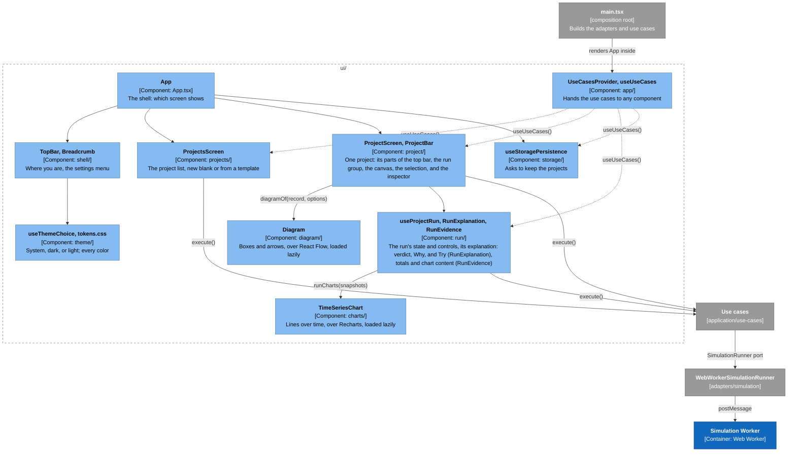
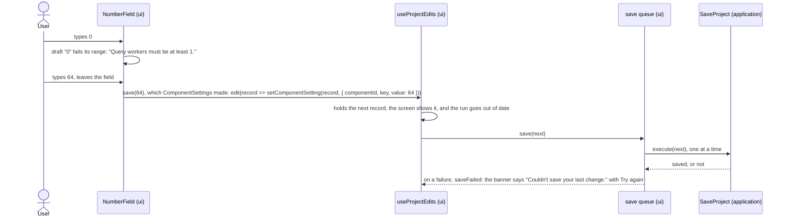
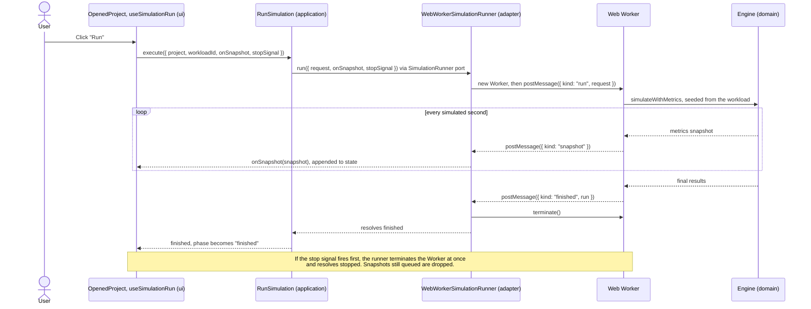
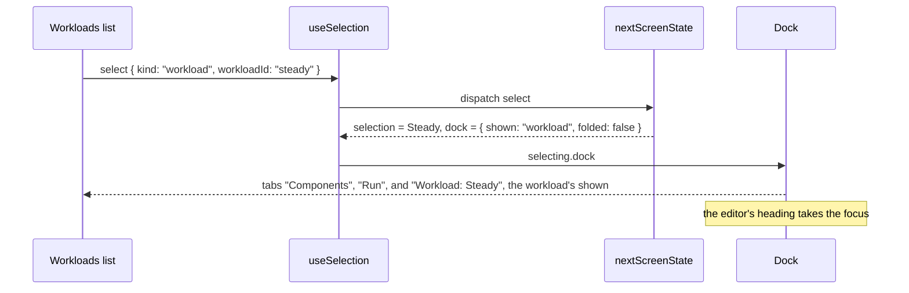

# The User Interface

An introduction to the browser UI in `src/ui/`, for maintainers new to the code: how it's wired, how components reach the use cases, how a run gets from the Run button to the charts, and how to test a component. Read the [architecture overview](architecture-overview.md) and [the application layer guide](application-layer.md) first.

## The big idea: components call use cases, nothing else

The UI never touches IndexedDB, the Worker, or the engine. A component asks for a **use case** (`openProject`, `runSimulation`, ...) and calls its `execute`; the use case works through its ports, and the adapters behind them were chosen in one place, `main.tsx`. ESLint enforces this: `ui/` can't import from `adapters/`, and imports only *types* from `domain/`.

How the pieces connect (the [legend](architecture-overview.md#the-system-at-a-glance) explains the colors):



The folders under `src/ui/`:

| Folder | Holds |
|---|---|
| `App.tsx`, `useOpenProject.ts`, `StartupFailure.tsx` | The shell (which screen shows, and the top bar and storage hint of the project list), the hook that tracks which project is open, and the page shown when IndexedDB won't open |
| `shell/` | The top bar: the app's name, the breadcrumb (Projects › the open project), an open project's controls, and the settings menu |
| `app/` | `UseCases`, `UseCasesProvider`, `useUseCases`, and the test helpers in `app/testing/` |
| `projects/` | The first screen: the user's projects, and "New project": `CreateBlank` with its `useCreateBlank` hook, and the template list with its `useCreateFromTemplate` hook |
| `project/` | One opened project: `ProjectScreen` (open, or say why it can't), `ProjectFrame` (the top bar, the banner, and the content under them), `OpenedProject` (the layout, the record with its edits and their history through `useProjectEdits`, Undo and Redo through `useUndoRedo`, the run's state, and the selection and the inspector, through `useSelection`), in `screen/` the screen's view state and its transitions ([below](#selection-and-the-inspector)), `ProjectName` (the last crumb), `ProjectBar` (the project's controls in the top bar), `SaveFailure` (the banner's strip for a save that failed), `ArchitectureView` (the canvas: the diagram, `ToolRail`, the icon rail down its left edge, and `CanvasPanels`, the workflow picker and zoom), `Inspector` and `StackedInspector` (one surface, over the canvas or under it: the selection, or the run's explanation), `SelectionDetails` (a selection's details) and `WorkflowOutline` (a workflow's, in it), `diagramOf`, in `dock/` the dock, its overlays (Library, Components, Run, and the workload editor), and the run group (`RunGroup`: the workload picker, Run and Stop, the run's status, and the verdict), and in `fields/` the fields that edit a component's name and settings |
| `run/` | `useProjectRun` (which holds `useSimulationRun` and `useRunFindings`), `RunControls`, `RunProgress`, `RunExplanation` (the run's heading, verdict, Why, and Try, for the inspector), `RunEvidence` (the totals and charts, for the dock), `Findings`, the totals tables, and `runCharts`, which turns snapshots into chart content |
| `diagram/`, `charts/` | Our wrappers around React Flow and Recharts. Only these folders import those libraries ([ADR-0010](../adr/0010-draw-diagrams-with-react-flow-behind-our-own-component.md), [ADR-0011](../adr/0011-draw-charts-with-recharts-behind-our-own-components.md)) |
| `storage/` | Asks the browser for persistent storage after the first create, and warns if it says no |
| `theme/` | The design tokens (`tokens.css`), the page's base styles, and the theme choice (`useThemeChoice`), which saves it ([ADR-0012](../adr/0012-style-the-ui-with-css-tokens-and-css-modules.md)) |
| `shared/` | `useLoad` and `LoadableView`, `handleStatus`, `ScreenHeading`, `useFocusOnMount`, `useWideWindow`, and the building blocks every screen styles with: `Button`, `Panel`, `Tabs`, `CardList`, and `Explained`. `SelectableItem.module.css` is the style of a list line that selects something, which the Components tab's lists and the workflow outline `composes` |

## How a component reaches a use case

[`src/main.tsx`](../../src/main.tsx) is the composition root. It opens the database, builds every adapter, builds the use cases over them, and renders:

```tsx
<UseCasesProvider useCases={createUseCases(database)}>
  <App />
</UseCasesProvider>
```

`UseCases` ([`app/use-cases.ts`](../../src/ui/app/use-cases.ts)) is one object holding every use case, plus the `StoragePersistence` port, the one port the UI calls directly (when to ask is a UI decision). A component reads it with `useUseCases()`:

```tsx
const { openProject } = useUseCases();
const load = useCallback(() => openProject.execute(id), [openProject, id]);
const { loadable } = useLoad(load);
```

Each use case is typed as `Pick<Class, "execute">`. A class with private fields accepts only its own instances, so this lets a test pass a plain object with an `execute` ([ADR-0009](../adr/0009-collaborators-come-from-factories.md)).

To give a component a new use case: add it to `UseCases`, build it in `main.tsx`'s `createUseCases` (or `createProjectReaders`, for a use case that reads a project over the registry), and add a default to `fakeUseCases` that rejects (or throws, for a synchronous one such as `describeSelection`). The exceptions are the pure ones, `nameComponents`, `checkWorkloads`, `checkWorkflows`, and `listComponentTypes`: their defaults are the real ones over the AWS types, because every test that shows a project uses them.

## Patterns you'll see

- **Loading.** `useLoad(load)` runs a promise when the component mounts and drops a result that arrives after it unmounts; `LoadableView` shows "Loading…", the error, or the value. It always renders one empty `role="status"` and changes only its text (a screen reader skips a region added with its text), so each `LoadableView` adds one region to its parent, and a screen with two has two. Wrap `load` in `useCallback`, or it runs on every render.
- **Results with a `status`.** Use cases return unions keyed by `status` (`found`, `missing`, `invalid`). Render them with `handleStatus` and a `StatusHandlers` map, the UI's twin of the domain's `KindHandlers` ([coding standards rule 4](../contributing/coding-standards.md#4-look-up-dont-branch)): a new status stops the map compiling until it has a view.
- **Double clicks.** State lags a render behind, so a hook that must run something once (`useCreateFromTemplate`, `useCreateBlank`, `useSimulationRun`, `useStoragePersistence`) guards with a `useRef`, which changes at once.
- **Keyboard and screen readers.** A button that can't be used now is `aria-disabled` and ignores clicks rather than `disabled`, which would drop the focus: `<Button usable={false}>` does both. A new screen focuses its heading (`ScreenHeading`). Mount a live region (`role="status"`) from the start, empty, as `RunGroup`, `SaveFailure`, and `StorageHint` do, so screen readers announce what appears in it. The diagram and every chart have a text or table version, and anything the diagram can select, its text version can select too. To explain something on screen, such as what a table's columns mean, use `Explained`: an info button beside its title ("About Limits") that shows and hides the explanation, with `aria-expanded`, and closes on Escape. Not a hover tooltip, which the keyboard can't reach.
- **Styling.** Each component's styles sit next to it in a CSS Module (`ProjectBar.module.css`), and every color and length in them comes from the tokens in `theme/tokens.css`, through `var()`. `theme/base.css` holds the defaults every screen shares, with element selectors only (pseudo-classes inside `:where()`, so a module's class always wins): headings, form controls, tables, the focus ring (for any focus, not keyboard focus alone), and reduced motion. [`tests/architecture/stylesheets.test.ts`](../../tests/architecture/stylesheets.test.ts) fails on a color literal anywhere in `ui/` (comments included, so cite an issue as "issue 121" there, since `#121` reads as a color), a length literal in a stylesheet (except a breakpoint in a media query; see Layout), or `outline: none`; the charts' colors are its listed exceptions until the charts are themed. Each color token holds both themes with `light-dark()`, and the browser picks one by the `color-scheme` on `<html>`, so changing the theme re-renders nothing. `main.tsx` applies the saved choice before the first render.
- **Layout.** The project list is a centered column (`--content-max-width`) under the top bar, and the page scrolls. A project screen is canvas first ([UX design §2](../design/user-experience.md#2-the-screen)). It draws its own frame (`ProjectFrame`), since the project's controls sit in the top bar, so `App` draws a top bar only for the list, and hands a project screen the way back and the storage hint (`ShellParts`); while the project opens, or if it can't, the frame's last crumb is the name the list had. The one top bar holds the app's name, the breadcrumb, whose last crumb is the project's heading and Rename (`ProjectName`), Undo and Redo (`ProjectBar`), in a narrow window the run group, and the settings menu; nothing else about the run. Under the bar, the banner shows only problems that affect the whole project, each a strip that takes no room while it has nothing to say: a save that failed (`SaveFailure`), then the storage hint, which is on the project list too. From the `--breakpoint-wide` width up, the frame stops at the window's height, the bar stays put, and the canvas (`ArchitectureView`) fills the rest: the diagram edge to edge, the tool rail (`ToolRail`) down its left edge, a toolbar of three icon buttons (Connect, Workflows, Workloads) whose icons are SVGs drawn in `shared/RailIcons.tsx`, decorative, with the name as hidden text and a matching tooltip, and at its bottom left one row (`CanvasPanels`): the workflow picker (`WorkflowPicker`), and zoom out, zoom in, and fit (`ZoomButtons`, icons drawn in `shared/ZoomIcons.tsx`, each named by its `label` and tooltip). The row has the floating surface's style and wraps in a narrow window. The picker is a menu button, not a native `<select>`, whose arrow keys change a closed select's value on Windows: it shows the shown workflow's name, or "Workflows" with none, and opens upward a `menu` of one `menuitemradio` per workflow (the shown one checked, with a ✓ so it isn't color alone, and a workflow with problems says how many, as in the list) and "Clear selection". The arrow keys, Home, and End move through it; Escape closes it and returns the focus to its button, as does leaving it. Picking a workflow selects it as its row in the list does, so the focus goes to the inspector's heading; the focus goes to the picker's button first, so closing the inspector returns there. "Shown" is what the list marks current: the selected workflow, or the one a selected step is in (`shownWorkflowId`). Zoom is the diagram's actions (`ZoomActions`: `DiagramCanvas` reports them through `onZoom`, from inside React Flow, where `useReactFlow` works), and the buttons are unusable until it has loaded; fit uses `fitOptions`, like the automatic fit. Connect, the workflows list, and the workloads list each open a panel over the canvas, beside the rail. One panel opens at a time, and opening the picker's menu closes the open one. Escape in a panel closes it and returns the focus to its button, and a closed one stays mounted, hidden. A click outside the rail closes Connect's hint, which is a popover; the two lists stay open while you pick through their rows. The rail keeps its height at every width, and its panels open over the canvas. Which panel is open is the screen's (`useCanvasPanels`), so a workflow's remove can open "Workflows" (a workload's, "Workloads") before the focus goes to "Add workflow" ("Add workload"), in it, and Escape in Details can open the panel the focus goes back to. The arrow keys also move between the rail's buttons, which each still take a tab stop. The inspector (`Inspector`) floats over the canvas's right, one surface with Close at its top and its content under it, which scrolls and takes a tab stop so the keyboard can scroll it ([what it shows](#selection-and-the-inspector)). It's about a quarter of the window (`--inspector-width`, 25vw, as the after-run mock has it), but never under `--inspector-min-width` (20rem), which keeps a component's fields, a name field beside its label, on one row; at the wide breakpoint, 64rem, that's under a third of the window, so the diagram fits beside it. With a selection shown, Close clears it, as Escape does, and the overview comes back; with nothing selected, Close collapses it to a strip on the right edge, whose button (the same one, so the focus stays) opens it again, and selecting anything, or Run, opens it too (`inspectorOpen`, in `useSelection`); its content stays mounted, hidden, while it's collapsed. `useCoveredWidth` measures how much of the canvas the inspector covers, and `Diagram` fits its boxes clear of that (`coveredRightPx`, through `fitOptions`), at most at their own size. The dock (`Dock`, in `project/dock/`) is a band along the bottom of the screen, as wide as the window, under the canvas and the inspector: in a wide window the canvas (`styles.canvas`, the box `useCoveredWidth` measures) gives up the height the dock takes, at most half of it, and the shown overlay scrolls inside its panel. It holds overlays, each in a tab of the shared `Tabs`, Library first: **Library** (`LibraryOverlay`), always there, the one place to add a component ([adding a component](#how-a-project-screen-changes)); **Components** (`ComponentsOverlay`), always there, even with no run: each component with its type and, after a run, its status (hollow-badge wording when the run is out of date), then each connection ("API → Function"), with its call numbers while a workflow is selected. It is the diagram's text version, read from the same `diagramOf` content and marks, so the tab and the canvas can't disagree. Each row is a button that selects what it names, as a click on the canvas does, marked `aria-current` while it's the selection, with the focus staying on the row; selecting never changes the tab (§5 rule 3). A workflow's path isn't here: a workflow's text version is its outline. **Run**, from the moment a run starts until the screen closes, with the run's evidence (`RunEvidence`: the out-of-date line, the totals, then each chart with its table), and **Workload: _name_** while a workload is selected, its name read live from the project, with its editor. Its tab strip ends with the run group (`RunGroup`), then Fold: the workload picker, Run and Stop, while a run goes its progress beside Stop, the run's status and "Out of date" ([below](#a-run-from-click-to-chart)), the reason the picked workload can't run, and the verdict, as one unit (UX design §5 rule 6). Library and Components are always there, so the dock is never empty or drawn as nothing. A project screen opens on Library, empty project or not (`INITIAL_SCREEN_STATE`). The run group keeps its place in the tree as tabs come and go, so it isn't mounted afresh and the focus stays on Run when a run's tab appears. Which tab shows and whether it's folded are the screen's view state ([below](#how-the-dock-shows-a-tab)), which `Dock` reads (`selecting.dock`) and sends the user's changes to; which tabs are there it reads from the live `OverlayProps` (`OVERLAYS[key].shows`). Run shows the Run tab, unfolded, and moves no focus; each selection of a workload, the same one again too, shows its tab, unfolded, so its heading can take the focus. Switching tabs changes no selection: a selected workload stays picked in the run group, and a component stays in the inspector. Close or Escape in the workload's editor clears the selection, which takes its tab away, and the first tab left shows. Selecting a workload closes the inspector, which shows the overview for it, its heading never taking the focus. Fold shrinks the dock to one line, the run group and Unfold, so Run and the verdict stay on screen, and keeps every overlay mounted, hidden, so a draft and the charts survive. The inspector holds what the run means (`RunExplanation`); the totals and charts are only in the dock. Below that width the bar wraps, the canvas keeps `--diagram-height`, and the inspector follows it, full-width (`StackedInspector`): the same one surface, with the same content, then the dock, with its tabs, and the page scrolls, bar and all. There the run group moves to the top bar, whole, at the end of its row, so Run is never scrolled out of sight: `OpenedProject` hands it to `ProjectBar` or to `Dock` by the width, so it's in one place, never both. `OpenedProject` asks `useWideWindow`, which reads the same width with `matchMedia`, and renders `Inspector` or `StackedInspector`. Use `useWideWindow` only for what CSS can't do, such as roles; a test that renders a project screen stubs the width with `stubWindowWidth` (`ui/shared/testing/`). `Tabs` follows the WAI-ARIA tabs pattern: the arrow keys, Home, and End move between tabs, only the selected tab takes a tab stop, each panel starts with its tab's label as a visually hidden h3 (so the headings in it sit under that label in a screen reader's outline), and every panel stays mounted, the hidden ones `hidden`, so what a panel holds (a draft, the run's charts) is still there when its tab is selected again. Its `end` is what sits at the strip's end, after the tabs, and isn't a tab (the dock's run group and Fold); its `fold` hides the tab list and the panels, still mounted, and leaves `end`. Every element from the shell down to the panels passes the height on with `flex: 1; min-height: 0`, so a wrapper added in between needs the same, or the panels grow past the window. `<Panel scrolls>` scrolls its content and takes a tab stop, so the keyboard can scroll past a table between two controls. `Diagram` fills the room its flex column leaves. Prose (the project description, notes) stops at `--prose-max-width` however wide its container. `@media` can't read a custom property, so a media query writes out a `--breakpoint-*` token's value, and the stylesheet test fails if the value isn't one.
- **Wrapped libraries.** `Diagram` and `TimeSeriesChart` take our own types (`DiagramContent`, `TimeSeriesContent`). The rest of the UI builds those (`diagramOf`, `runCharts`) and never sees a React Flow or Recharts type, so either library can be swapped in one folder. Each library is also loaded lazily, in a chunk of its own: `Diagram` and `TimeSeriesChart` draw their frame, label, and text version at once, and `React.lazy` brings in the part that uses the library (`DiagramCanvas`, `ChartPlot`) behind a `Suspense` stand-in of the same size. So the project list loads without React Flow, and Recharts waits for the first run. If a chunk won't load (the user went offline, or a redeploy renamed the chunks), a `LoadFailureBoundary` around each `Suspense` puts "Couldn't load…" in the stand-in's place, and the rest of the screen stays. Import those two only through `lazy`: [`tests/architecture/eager-imports.test.ts`](../../tests/architecture/eager-imports.test.ts) fails if anything `main.tsx` loads at once imports either library. In a test, the boxes and lines arrive a moment after the render. Import the lazy module first with `preloadBeforeAll(() => import("…/DiagramCanvas"))` (`ui/shared/testing/`), because a full run can take longer than the 5 s test timeout over a library's first import; then wait for them (`waitFor`, `findBy…`). Or render `DiagramCanvas` or `ChartPlot` directly.
- **React Flow hides a node without a size.** It takes a box's measured size only from the node object it's given, so a new node object without `measured` is hidden, with its arrows, until a `ResizeObserver` measures it again, a frame later. `DiagramCanvas` gives each node its size back (`useMeasuredSizes`); keep it when you change how nodes are built. jsdom's stubbed `ResizeObserver` never measures, so a test that needs to see this uses `stubMeasuringResizeObserver`.

## Creating a project

"New project", on the projects screen, makes one of two ways ([UX design, M6 version, §2.1](https://github.com/alanbickel/wind-tunnel/blob/6ef2e1e9ace6a3cb9a419bc9187fa3c2b8869d38/docs/design/user-experience.md#21-model-your-own-system) step 1), each a section with its own h3, so a screen-reader user moving by heading finds both. "Create from template" copies a template, and the copy joins the list. "Create blank" takes a name, typed into its field, and Enter or the button creates a project with nothing else in it and opens it. Either way, `App` asks for persistent storage after the first create.

- **Names are unique.** `useCreateBlank` lists the projects when the user asks, checks the name against them with `checkProjectName` (in [`application/details/`](../../src/application/details/project-name.ts)), and only then calls `createBlankProject`. An empty name, or one another project uses ignoring case, creates nothing: the message shows under the field, which is `aria-invalid` and described by it, and is announced, since the focus is already on the field or the button. Typing clears it. `CreateBlankProject` refuses a taken name too, and the screen shows the same message. A template copy whose name is taken is numbered by its use case: "Serverless API with RDS (2)".
- **The empty diagram.** With no components, `ArchitectureView` shows "No components yet. Add one to start describing your system." on the canvas, in place of the diagram, and the dock's Components tab says it too, in place of its lists. The first component brings them back. The run panel already says "This project has no workloads to run."

## Selection and the inspector

A project screen has one selection, or none: a component, an edge, a workflow, a step, a [workload](workload-editor.md#selecting-a-workload), a workflow being made (`new-workflow`, a draft that isn't in the project), the run on screen (`run`, with no id: there's one, the latest, and a new run replaces it), or one of its findings (`finding`, by its `FindingKey`) ([UX design §5](../design/user-experience.md#5-selection-and-focus)). It lasts while the screen is open and isn't saved.

**Where it's held.** The selection, whether the inspector is open or collapsed, and the dock's shown tab and folding are the screen's view state ([ADR-0023](../adr/0023-hold-the-project-screens-view-state-in-one-place.md)): `ScreenState`, in [`project/screen/screen-state.ts`](../../src/ui/project/screen/screen-state.ts), plain TypeScript with no React. It changes only through named transitions (`select`, `clear`, `collapse-inspector`, `open-inspector`, `show-tab`, `fold-dock`, `unfold-dock`, `run`), each a pure function from one state to the next in `nextScreenState`; a change to what the screen does when is a change to a transition. Their tests, beside them in Node, are UX design §5's map, grouped by its rules, with an `it.todo` for each rule the screen doesn't follow yet. `run` selects the run, as `select` of the run does (the verdict's): the inspector opens on its explanation, and the dock unfolds on the Run tab. The state doesn't know whether there's a run, so §5's limit "no run: the run and a finding can't be selected" is the screen's: only a run's own controls select either (Run, the verdicts, which aren't drawn before a run, and the findings, which are in the run's explanation), and a run stays until the screen closes; `OpenedProject.select-run.test.tsx` tests it. `useSelection` holds the state with `useReducer` over `nextScreenState`, once, in `OpenedProject`, so the diagram, Details, and the dock (its Components tab included) read the same one. The focus isn't view state: the target asked to take it and the element `close` returns it to stay in `useSelection`, around the state. Its type, `Selection`, lives in [`application/details/`](../../src/application/details/selection.ts), because the use case that describes it takes it.

- **The canvas look.** The dots are `--color-diagram-grid` (`--xy-background-pattern-color`, in `Diagram.module.css`), drawn at `GRID_DOT_SIZE`. A card is `--node-card-width` wide, set on React Flow's `.react-flow__node-default`, at the body text size; the fit's `FIT_MAX_ZOOM` of 1 still shows it at its own size. The inspector, the canvas panels, and the rail share `--floating-radius`, `--floating-border` (edged in `--color-floating-edge`), and `--floating-shadow` in `tokens.css`; use them for any new surface that floats over the canvas.
- **Cards and status badges.** Each box is a card (`NodeCard`, in `ui/diagram/`): the type's icon (`ComponentIcon`, from react-aws-icons: [ADR-0022](../adr/0022-draw-component-icons-with-react-aws-icons.md)) beside the name, the type in words under it in the muted small style (`diagramOf` is given `displayNameOf`, the registry's names), and after a run a full-width badge along the card's bottom saying how the component did. The status comes from `application/run-analysis/` (`componentStatuses`, beside `componentTotals` and `limitPeaks`, so the CLI could print it): **refused** if the component's `rejected` total is above 0, else **waited** if a limit that makes work wait when full ran out at its peak, else **ok**, and refused wins. `useProjectRun` turns it into `badges` (`runBadgesOf`: each component's status, and whether the run is out of date), which `OpenedProject` passes to `ArchitectureView`, and `diagramOf` puts each status on its node as a `DiagramStatus`, with the word (`STATUS_WORDS`, in `run-analysis/status-words.ts`, which the findings' two `refused()` helpers build their word from too; other findings' sentences use the verb freely) and an `outOfDate` flag. They update as snapshots arrive, and there are none before the first run. A component added since the run has no entry, so no badge; one removed has no box. Each status has a shape as well as a color and its word (a circle, a triangle, a square), so color is never the only signal. When the run is out of date ([ADR-0018](../adr/0018-tie-a-run-to-the-model-it-ran.md)) the badge is hollow with a dashed border, and a screen reader hears "from an earlier version of the project" after the word. The Components tab lists the same: "Function (Lambda): refused", with the same note after it when out of date. Keep new imports for a card inside `ui/diagram/`'s lazy chunk: `ArchitectureView` may import only `diagram-model.ts` from it, or the icons load with the project list.
- **Selecting.** In the dock's Components tab, each component and connection is a button, marked `aria-current` while it's the selection (not `aria-pressed`: pressing it again doesn't unselect it): the way every user can rely on. On the canvas, a click on a box or an arrow selects it, a box can be focused and selected with Enter, and a click on the empty canvas clears the selection. `Diagram` reports these through `onSelect` in its own terms (a `DiagramItem`: a node or an edge, by id), and `ArchitectureView` turns them into a `Selection` ([ADR-0010's addendum](../adr/0010-draw-diagrams-with-react-flow-behind-our-own-component.md#addendum-2026-10-25)). The diagram marks the selected box with a bar down its left edge and draws the selected arrow thicker, through React Flow's `selected` class, so the mark is a shape and a width, not a color alone. A Components row and the Details panel carry the same bar (`--selection-bar-width`), and the bar is never a ring: a ring means the DOM focus ([UX design §5](../design/user-experience.md#5-selection-and-focus)); a selected workflow's path is marked too, the rest of the diagram fades, and each call is numbered on its arrow, which the Components tab's connections repeat ([the workflow editor guide](workflow-editor.md#the-path-on-the-diagram)). A workflow's text version is its outline, not a line in the Components tab ([the workflow editor guide](workflow-editor.md#a-workflow-three-ways)). The rail's "Workflows" panel lists the project's workflows, a button each, marked `aria-current` while its workflow or one of its steps is selected; a step is selected from its workflow's outline in Details ([the workflow editor guide](workflow-editor.md)). Its "Workloads" panel lists the workloads the same way, and the run group's Edit selects the picked one; the dock ([the workload editor](workload-editor.md#selecting-a-workload)) has fields for its duration and seed, an editable mix ([the mix](workload-editor.md#the-mix)), and an editable profile, a table of points under a read-only chart ([the profile](workload-editor.md#the-profile)), and the run group's picker follows a selection one way ([the workload editor guide](workload-editor.md#selecting-a-workload)).
- **What shows.** The inspector is one surface, with no tabs (UX design §2), and the selection alone decides what it shows (§5, rule 1): `InspectorContent`, in `Inspector.tsx`, looks the selection's kind up in `CONTENTS`, with no fallback. With nothing selected it shows the project's overview (`ProjectOverview`, a region named "Overview"): the project's description, what it holds ("3 components, 1 workflow, 1 workload."), that nothing is selected, the problems (each workload that can't run, with its check's summary), and after a run, under "Latest run", the verdict, which selects the run. With the run, or one of its findings, selected, it shows the run's explanation (below, "What the run means"), and never otherwise. Run selects the run, and so does the verdict, a button (`VerdictButton`) beside Run and in the overview; neither is drawn before a run. With a workload selected, which opens in the dock and collapses the inspector, it shows the overview for now. Selecting a thing shows Details, a region named "Details" in the inspector, in a wide window and in a narrow one, where it has a Close button beside its heading. `SelectionDetails` asks `describeSelection` for what to show: a component's name and type, a field for its name and each setting with its unit and "Reset to default", and an info control for its help and its default with its evidence ([messages](#editing-and-saving)), then "Connect to…" and the workflows that call it ([editing](#editing-and-saving)); or an edge's two ends, a field for its latency, timeout, and retries, each with its caller type's default, and the steps that call along it; or a workflow's name, the workloads that use it, and its outline, with the selected step marked, if one is. The words come from each type's field descriptors in [`application/details/fields/`](../../src/application/details/fields/), so a new component type brings its own.
- **Focus.** The focus ring is `:where(:focus)` in `base.css`, so it shows on whatever has the DOM focus, whatever put it there; `:focus-visible` would hide focus that code moves after a click, such as the Components list after a remove. Tab in the canvas moves the focus without selecting. Selecting moves the focus to the Details heading (or, for a workload, the dock's heading; or, for a component just added, its name field), so the keyboard and a screen reader land on it. Escape anywhere in Details, the dock's editor, or the run's explanation (not on the dock's Fold or Unfold button, which sit outside it; except in a field with a draft to put back, or beside an open info control, where it closes the explanation first and moves the focus to the control), or Close ("Close the details", or "Close the run" with the run or a finding selected), clears the selection, shows the overview (closing a workload's dock reopens the inspector it closed), and returns the focus to the element that had it when the selection was made, which `useSelection` remembers; Run remembers it too. If that element has gone from the page, or nothing but the page had the focus, the overview's heading takes it. Run leaves the focus on Run; a verdict moves it to the run's heading ("Run: <workload>"), since the overview's verdict goes as the run shows. A step selected in an outline is selected with `selectWithin`, which keeps the element remembered before, such as the workflow's row: the step's own button is in Details, and goes when Details closes. A click on the empty canvas clears without moving the focus.
- **A finding.** In the run's explanation, under Why, each finding's summary is a button, marked `aria-current` while it's the selection (`FindingList`, `FindingItem`; a cause note beneath a finding is one too, and the same note under two findings is marked under both, since the selection is its key). Selecting it (`selectFinding`, in `useSelection`) rings its component (`key.componentId`) on the diagram and in the Components tab, through `selectionOnArchitecture`, and moves nothing else: the focus stays on the button, and the inspector shows the run's explanation for it, with the finding marked, as for the run (`CONTENTS`, in `Inspector`; `describeSelection` returns undefined for both). Escape in the findings, or Close, closes it to the overview, as for the run; a click on the empty canvas clears it too, and Run, or any other selection, replaces it, so a new run's selection is the run, not a finding of the old one. An open explanation's own Escape closes that first. The finding is worded from the run's copy of the project (ADR-0018), so its component may be gone from the project: the selection then rings nothing, and a live region under the finding, on the page from the start, says "Table isn't in the project any more." with the name from the run's copy (`FindingSelecting.isGone`). An undo or redo leaves it selected.

To make something else selectable, add it to `Selection`; `DescribeSelection` and the maps that read a selection stop compiling until each handles it.

## Editing and saving

Each change a user makes is a **command**, validated and saved at once; there's no Save button ([ADR-0019](../adr/0019-edit-projects-with-commands-and-save-each-change.md), [UX design §6](../design/user-experience.md#6-editing-and-saving)). A command is a plain function in [`application/edits/`](../../src/application/edits/component-edits.ts) that takes the project record and returns the next one: `setComponentSetting`, `renameComponent`, `resetComponentSetting`, `addComponent`, and `removeComponent`, and for edges ([`edge-edits.ts`](../../src/application/edits/edge-edits.ts)) `connectComponents`, `setEdgeSetting`, `resetEdgeSetting`, and `removeEdge`, and for the layout ([`layout-edits.ts`](../../src/application/edits/layout-edits.ts)) `moveComponent`, and for the project ([`project-edits.ts`](../../src/application/edits/project-edits.ts)) `renameProject`, which "Rename" in the top bar uses, and for workflows ([`workflow-edits.ts`](../../src/application/edits/workflow-edits.ts)) `renameWorkflow`, `addWorkflow`, and `removeWorkflow`, and for a workflow's steps `addCall`, `changeStep`, `moveStep`, and `removeStep` ([the workflow editor guide](workflow-editor.md#the-commands) lists them, and says [how to add another](workflow-editor.md#changing-it)), and for workloads ([`workload-edits.ts`](../../src/application/edits/workload-edits.ts)) `addWorkload`, `renameWorkload`, `removeWorkload`, `setWorkloadDuration`, `setWorkloadSeed`, and for a workload's mix `addToMix`, `setMixWeight`, and `removeFromMix`, and for its profile `addProfilePoint`, `setProfilePoint`, and `removeProfilePoint` ([the workload editor guide](workload-editor.md#the-commands) has their table, the sequence of a remove, and [the sequence of a point's time changing](workload-editor.md#the-profile)). The breadcrumb takes the open project's name from the held record, not from the summary the project was opened with: `useProjectEdits` tells the shell when an edit, Undo, or Redo changes the name, so it follows them. A command that changes nothing returns the record it was given, and `edit` saves nothing for it. The UI never builds a record by hand. It fills in a command's input and hands it to `edit` as an `Edit`: the command, and `describe`, which says what it does in the screen's words ("Remove orders-db", "Change orders-db's query workers", "Connect fn-orders to orders-db", "Move orders-db", "Add a call from api to fn-orders"), so Undo and Redo can name it. `describe` gets the record the command made, for words that depend on it: an add names the component `addComponent` named.



- **A field holds a draft.** What's typed stays in the field (`useDraft`) until it passes the field's checks, which word their own messages: a number against its descriptor's `range` (`checkNumberDraft`), a distribution's parts and its rule that the p99 is at least the median (`checkDistributionDraft`), a name that no other component of its type uses (`checkComponentName`), a workflow's name, which no other workflow may use (`checkWorkflowName`), and a workload's, which no other workload may use (`checkWorkloadName`), and a workload's duration and seed (`checkDurationDraft`, `checkSeedDraft`; [the workload editor guide](workload-editor.md#duration-and-seed)). All are in [`application/details/`](../../src/application/details/), so they're tested without a browser. On Enter, or on leaving the field, a passing draft becomes a command; a failing one stays, with its message, and never reaches the project. Escape puts back the saved value. A draft starts again whenever the saved value changes, such as after a reset.
- **Messages are tied to their field.** A failing field is `aria-invalid`, and its `aria-describedby` points at the message first, then its unit, help, and default, so a screen reader reads them whenever the field has the focus. The help and the default's evidence sit behind the field's info control (`Explained`, "About <label>"), hidden until it's opened; they stay in the DOM, and `aria-describedby` reaches hidden elements, so the screen reader still hears them. **Reset to default** stays beside the field, outside the info content, so it takes no extra step: it's the one thing a person does to a setting rather than reads about it. The workload's mix and profile tables put their one shared help behind an info control above the table the same way. Leaving a field with a failing draft also puts the message in Details' polite status region, since the focus has moved on.
- **Field kinds.** `Setting` picks a field by the descriptor's `kind`: `NumberField` for a number or whole number, and `DistributionField` for a distribution: a kind picker (constant, exponential, lognormal) and a field for each of the kind's parts. Changing the kind fills the new parts from the old one's typical value (a constant takes the median; a lognormal starts with its p99 at its median), and a kind switched back to gets its old values back. The kind saves when the picker is left, not on each change, because arrow keys on a closed picker change it once for each kind they pass. A new component type brings its own descriptors, so it needs no field code. A field doesn't know whose setting it edits: it saves through `save(value)`, and its Reset through `reset()`, which `ComponentSettings` makes into commands on its component.
- **Saving.** `OpenedProject` holds the record through `useProjectEdits`, so the screen shows every change at once. Saves go through `saveProject` one at a time, in order. Each record is the whole project, so a record waiting behind the one in flight is replaced by a newer one. If a save fails, or `SaveProject` refuses the record (which the fields' checks should rule out), the change stays on screen, the banner under the top bar says "Couldn't save your last change." (`SaveFailure`) from a status region that's there from the start, and Try again, after the region, saves it. A later save that works clears it. A save that works isn't announced: the field already shows it.
- **Adding a component.** The dock's Library tab (`LibraryOverlay`) is the one place to add one: a card per type (`listComponentTypes`), each a button with its component icon ([ADR-0022](../adr/0022-draw-component-icons-with-react-aws-icons.md)), its name, and its line on what it's for ("API Gateway: the front door; throttles requests over its rate."), so a click, Enter, or Space adds. The dock stays on the Library, since selecting a component never changes the tab (§5 rule 3), so the next one is a click away. `OverlayProps.onAdd` is `useAddAndRemove`'s `add`, which asks `newComponent` for an id and the type's defaults, hands `addComponent` to `edit`, and selects the new component with `select(selection, "name")`. Details then gives the focus to the name field, its text selected, rather than the heading: `takeFocus` is asked per target, so only the one named takes it. The layout doesn't place the new component, so `diagramOf` puts it in its spare row, and Details says "Called by: nothing yet."
- **Connect is a hint, not a mode.** The rail's "Connect" opens a popover that says how to connect two components: drag from a box's handle to another box, or, from the keyboard, select a box and use "Connect to…" in its Details. Nothing is armed, and connecting is architecture only: a workflow's calls go only along existing edges.
- **Adding a workflow.** "Add workflow", beside the workflows list's heading in the "Workflows" list, selects `{ kind: "new-workflow" }` with `select(selection, "name")`. Details shows a draft that exists only in the UI: a name field holding the first free name, and a component picker and an action picker. It saves through `addWorkflow` once the first step is complete, and then selects the saved workflow; [when a new workflow exists](workflow-editor.md#when-a-new-workflow-exists) has the states and the Escape-then-blur guard.
- **Removing one.** Remove, in a component's Details header, opens a confirmation under it, with the focus on Cancel: what the remove takes and the steps it leaves, worded by `describeSelection` ("Remove orders-db and its edge from fn-orders?", and "2 workflow steps call it, and won't run until you change them."). Cancel or Escape closes it and returns the focus to Remove. Confirming hands `removeComponent` to `edit`, which takes the component, its edges, and its layout position, and never a workflow step; then the selection clears, and the focus goes to the Components tab's list, since what made the selection may be gone, with "Removed orders-db." announced from the dock's polite region ([where the focus goes](#how-the-dock-shows-a-tab)). The steps that called it are now run issues: the workloads that use them can't run, and the run group says why ([a workload that can't run](#a-workload-that-cant-run)), without naming the removed component, whose name went with it: "Lunch rush can't run yet: Get order and Create order call a component that isn't in the architecture any more."
- **Removing a workflow.** Remove in a workflow's Details header asks as a component's does, naming the workloads that run it: "Remove Get order?" and "Lunch rush and Steady day run it; it leaves their mixes." Confirming hands `removeWorkflow` to `edit`, which takes the workflow and its entries in every mix; the selection clears, the "Workflows" list opens if it was closed, the focus goes to "Add workflow", in it, and "Removed Get order." is announced from a region on the tool rail: a live region in a hidden panel says nothing, and the rail always shows. Escape or Close in Details opens the panel that holds the button that made the selection, if it's closed since, so the focus can go back to it (`reveal`, which `useCanvasPanels` hands `useSelection`). A workload left with an empty mix can't run, and the run group says why. See [removing a workflow](workflow-editor.md#removing-a-workflow).
- **Adding and removing a workload.** "Add workload", beside the heading of the "Workloads" list (its own rail button), hands `addWorkload` to `edit` with an id from `newWorkload`, selects the workload with `select(selection, "name")`, and the picker follows the selection. The workload is saved and complete, and the bar says why it can't run yet. Remove in a workload's Details header asks as a workflow's does ("Remove Lunch rush?"), picks the next workload in the bar, clears the selection, opens the "Workloads" list, puts the focus on "Add workload", and announces "Removed Lunch rush." from the region on the tool rail. See [adding, renaming, and removing a workload](workload-editor.md#the-commands).
- **Adding a call from an arrow.** With a workflow selected, each arrow leaving a box in its path has a "+" at its middle (an `EdgeOffer` on `Diagram`, drawn by `OfferEdge` in React Flow's label layer). It runs the same `addCall` (or `addAsyncWork`, for a queue's empty slot) as the outline, through `useEdgeOffers`, and asks in a popover only which step or which action when it has to; a drag between boxes still only draws an edge. See [adding a call from the canvas](workflow-editor.md#adding-a-call-from-the-canvas).
- **Changing a step.** The selected step in a workflow's outline has a Component picker and an Action picker, showing what it is now. An action, or a component that keeps or settles the action, hands `changeStep` to `edit` at once; a component that leaves the action to choose is held in the picker until one is, so nothing half-done is saved. The component picker offers only the components the caller has an edge to (and the step's own, if its edge has gone); a change never adds an edge. The selection and the focus stay where they are; Details' polite region says "Changed fn-orders · invoke to orders-db · read." and Undo is named "Change fn-orders · invoke to orders-db · read". A change drops everything under the step, so a step with steps under it asks first ("Change fn-orders · invoke to fn-writer · invoke? The 3 steps under it go.", with the focus on Cancel), and Undo's name and the announcement say how many went. See [changing a step](workflow-editor.md#changing-a-step).
- **Moving and removing a step.** In a workflow's outline, each step that's one of another's calls has Move up, Move down (unusable at either end of its siblings, and absent for a step with none), and Remove. A move hands `moveStep` to `edit`, keeps the focus on the button pressed, and says "Moved orders-db · read up." from Details' polite region. Remove goes at once for a step with nothing under it, and asks first for one with calls, counting them ("Remove fn-orders · invoke and the 2 calls under it?", with the focus on Cancel); confirming hands `removeStep` to `edit`, selects the step's caller, puts the focus on its line, and says "Removed fn-orders · invoke." The undo names are "Move orders-db · read up" and "Remove fn-orders · invoke", and each undoes in one step. No edge goes with a step. See [moving and removing a step](workflow-editor.md#moving-and-removing-a-step).
- **Connecting.** On the diagram, a drag from a box's right handle to another box connects them; "Connect to…", under a component's settings in Details, is the keyboard's way: a picker of the components it has no edge to yet, and Connect. Both go through `useConnect`, which asks `newEdge` for an id and the caller type's `edgeDefaults` and hands `connectComponents` to `edit`. The diagram refuses a drag from a box to itself or a second arrow the same way (`canConnect`), and the picker offers neither, so the save's check (`validateArchitecture`) is only a backstop. A connection is announced, "Connected Function to API.": from Details' region for "Connect to…", where the focus stays on Connect (or, once the last is connected and Connect goes, on the line that says so), and from the dock's polite region for a drag, since the canvas says nothing to a screen reader.
- **Moving a component.** A box on the diagram moves when it's dragged, or with the arrow keys once it has the focus (5 px a press, 20 px with Shift), and its description says so. A canvas that moves boxes lets each take the focus, even if it doesn't select. `useNodeMoves`, in `ui/diagram/`, draws a box being moved where it was put, and reports the move through `onMove` once: when a drag ends, or when a run of arrow key presses stops for `KEYBOARD_MOVE_PAUSE_MS` (half a second), the box loses the focus, or a drag starts (pressing the mouse doesn't blur the box, so the keys' move would otherwise be reported after the drag's, putting the box back). So each is one save, and one undo step. A click that doesn't move the box only selects it. React Flow moves only its own selected box with the arrow keys, so the canvas handles them itself, in the capture phase, before React Flow sees them. A drag makes new nodes on every step, and React Flow hides a node that comes without a size until it measures it again, so `useMeasuredSizes` keeps the sizes React Flow reports and gives each node its own back; otherwise the boxes and arrows flash while a box moves. `OpenedProject` hands `moveComponent` to `edit`, which sets the component's point in the layout, placing one from the spare row, and, if that changed it, announces "Moved Function." from the dock's polite region, since the canvas says nothing to a screen reader. The layout isn't part of the `Project`, so a move leaves the run on screen current, and the Components lists don't change. Without `onMove`, nothing on a `Diagram` moves.
- **Undo and redo.** Each command that changes the record is one step in the screen's edit history ([`edit-history.ts`](../../src/application/edits/edit-history.ts)), with the records before and after it, so undoing a remove brings back the component, its edges, and its layout position at once. `useProjectEdits` keeps the history beside the record; a new edit after an undo drops what could be redone, and opening the project again starts a new history, since none is stored. Undo and Redo, after the project's name in the top bar, name what they'd do ("Undo remove orders-db") and are unusable, with `aria-disabled`, when there's nothing to do. Each saves the record it goes to through the same queue as an edit, so saves still land in order, and announces what it did ("Undid: remove orders-db.") from a polite region beside them that's there from the start, since the change can be anywhere on the screen. The region is visually hidden: a sighted user sees the change. `useUndoRedo` then moves the selection as `selectionAfterUndo` says: to what it brought back, a component before an edge before a workload, whose Details take the focus as after any selection, unless a workflow or a step is selected and still there ([the workflow editor guide](workflow-editor.md#selecting-a-workflow-or-a-step)); or, if it took away the selected component, edge, workflow, or step, off it, leaving the focus where it is unless that element went with it and the focus fell to the page, when it moves to the Undo or Redo button just used (a ref the bar's buttons take, checked after the render). Ctrl+Z undoes, and Ctrl+Shift+Z and Ctrl+Y redo, with Cmd for Ctrl as on a Mac (`useUndoShortcuts`, on the window). They're ignored in a text field or a picker, so the field's own undo still works on its draft; clicking Undo leaves the field first, so its draft commits and Undo takes that back. Only saved commands are steps: never a draft, the selection, or a run. Undoing back to what ran makes the run current again, since undo puts back the very project the run started from.
- **Editing an edge.** A selected edge's Details are `EdgeSettings`: latency and timeout as `NumberField`s, and the retry policy as `RetryField` (attempts, a backoff picker, and a base delay, saved together like a distribution's parts, `checkRetryDraft`). Each default, and Reset, is the caller type's: a timeout of 0 stays in its field with "Timeout must be more than 0.", and Reset puts back 5,000 ms from a Lambda.
- **Removing an edge.** Remove in an edge's Details asks as a component's does, naming the steps that call along it, which stay: "Remove the edge from fn-orders to orders-db? 2 workflow steps call along it, and won't run until you change them." Confirming hands `removeEdge` to `edit`; the selection clears, the focus goes to the Components tab's list, and "Removed the edge from fn-orders to orders-db." is announced. The workloads whose workflows call along it can't run, and the run group says why.
- **Run freshness.** A saved change changes the project the screen holds, so a run on screen goes out of date with no extra code ([run freshness](#run-freshness)).

## A run, from click to chart

`OpenedProject` owns a run through `useProjectRun`, above the parts that show it: the run group (its controls, progress bar, status, and verdict), the inspector's explanation of it (`RunExplanation`), and the dock's Run overlay, with the totals and charts (`RunEvidence`). So the run group, the inspector, and the dock read the same run, and showing Details, collapsing the inspector, or narrowing the window, which moves the run group, doesn't stop it. `useProjectRun` takes the picked workload's id and `pick` from the screen's view state (the id follows a workload's selection there, in the `select` transition), resolves the id against the project, and holds two hooks: `useSimulationRun`, which runs it, and `useRunFindings`, which reads it. Clicking Run makes an `AbortController`, calls `runSimulation.execute` with the workload, its signal, and an `onSnapshot` that appends each snapshot to state, then records how the run ended as a `RunPhase` (`running`, `finished`, `stopped`, `failed`). Each phase after `idle` is a `RanModel`: the workload, and the project as it was when Run was clicked, which is the run's copy ([run freshness](#run-freshness)). Stop, or leaving the screen, aborts the controller.

In the browser, the use case's runner is `WebWorkerSimulationRunner`. It starts a fresh Worker for each run, posts it the project, and passes each snapshot the Worker posts back to `onSnapshot`. Stopping terminates the Worker, so snapshots still queued are dropped:



From the snapshots so far, the run group draws a progress bar beside Stop while the run goes, the inspector what the run means, and the dock's Run overlay the evidence: the totals and each limit's busiest use (`RunTotals`, each table with its sum under it and an info control beside its heading), and four charts (`runCharts`): requests per second, p99 latency, and each component's work in progress and queue. Findings and charts take far longer than a snapshot takes to arrive, so `useRunFindings` defers the run (its id, project copy, workload, and snapshots together, so the deferred value never mixes two runs) with `useDeferredValue`, and the totals and charts draw the same deferred run: React puts clicks such as Stop first and skips snapshots it falls behind on, while the progress bar stays current.

**What the run means.** `useRunFindings` calls `findRun` with the [default detectors](finding-detectors.md) on the run so far, as the CLI does, and the inspector, with the run or one of its findings selected, shows the result as the run's explanation (`RunExplanation`, UX design §9), a region named by its heading: the out-of-date line when the run isn't current, then "Run: _workload_", named from the run's own copy of the workload (`ProjectRun.ran`), so a rename since doesn't change it, then `Findings`. That's the verdict (its title, such as "Failing so far", which says its level in words as well as colour, its summary, and its no-headroom and closest-to-failing lines); **Why**, each finding with its causes nested beneath it, numbered as the CLI numbers them; and **Try**, the fixes those findings suggest, each once, in the findings' order, cause notes included (`suggestedFixes`, in `application/run-analysis/findings/`, which keeps a fix that two findings share by sharing the catalog's one `Fix` object once, as `orderFindings` does), left out with its heading when there are none. Each finding shows its severity in words and its summary; its `Explained` control opens its reasons, fixes (each with its claim: a Documented link, an Observed test, or the Assumption label), and Learn more. Try draws each fix with the same `FixList`, so a fix's evidence goes with it there too. The words come from the phrasebook in their long form, and `MessageText` turns a `Message` into text by the same rules as the CLI (`partText`), setting components and times apart in their own elements. Components show by name: `useRunFindings` gets the run's copy's names from the `nameComponents` use case and hands them to `Findings` with the phrasebook, as `RunMeaning.wording`. The run's status, in the run group, ends with the verdict's title, so a screen reader hears it when the level changes or the run ends, not on every snapshot. For a moment after a new run starts, the deferred run is still the one before; the status leaves the title out until it catches up, so it never announces the old run's verdict as the new one's.

**The verdict chip.** At the run group's end, after Run, `RunGroup` draws a chip from `ProjectRun.chip` (`verdictChipOf` in `run-status.ts`, which reads the same phase, seconds, and current verdict as `statusText`). While a run goes it says its progress ("Running · 5 of 20 s"); once it has finished or been stopped it says the verdict's title, and for a failing run the share of answered requests that failed, as the verdict's summary does ("Failing · 43.7%", rounded down by `shareDown`). A failed run says "Run failed". With no run, or until the deferred verdict catches up, there's no chip. The level sets the chip's border colour and its words say the same, so colour isn't the only signal. The chip is a button that selects the run (`VerdictButton`, the overview's verdict too), not a live region, because the run group's status regions already announce the verdict and "Out of date", and a second announcement would be noise. "Out of date" is repeated on the chip, in its own element, once the project changes after the run.

**The run's status** (`RunStatus`) is two status regions in the run group, mounted with it: the run's state with the verdict's title ("Finished Steady. Failing so far."), then "Out of date". The top bar says nothing about the run, so they're here. They're visually hidden while the chip and the progress bar show the same (`statusLookOf` in `run-status.ts`). A stopped run's status shows, because the chip gives only its verdict, not that it was stopped or how far it got; so does a failed run's, in the error colour, because its problem ("Steady failed: …") is shown nowhere else.

### Run freshness

A run keeps the model it ran ([ADR-0018](../adr/0018-tie-a-run-to-the-model-it-ran.md)). Its phase holds the project as it was when the run started; a project is never changed in place, so holding that object is the copy. Everything drawn from the run reads it: the findings and their wording, the totals, and the charts all take the `RunSoFar` that `useRunFindings` builds from the copy. So an old run reads as it did, a finding can name a component that's since been renamed or removed, and a run that's going when the project changes finishes with what it started with.

`useProjectRun` asks `runIsCurrent` ([`application/run-analysis/run-freshness.ts`](../../src/application/run-analysis/run-freshness.ts)) whether the copy still matches the project, and exposes the answer as `outOfDate`. The comparison is by content, not by a revision number, so changing a setting and changing it back makes the run current again. It counts the architecture (component names included), the workflows, and the workload that ran; the project's name and description, the other workloads, and the layout (which isn't part of a `Project`) don't count. Its table has a row for every field of `Project`, so a new field doesn't compile until it's placed on one side.

When the run is out of date, the run group's second status region says "Out of date", after the run's status, and the run's explanation opens with "This run is of an earlier version of the project. Run again to see your changes." above the findings, which stay as they were. The dock's Run overlay opens with the same line above the totals and charts, which are of that version too. Both status regions are on the page from the start, empty, so screen readers announce their text when it arrives, and the focus doesn't move.

### The top bar's controls, and the banner

- **The app mark** (`AppMark` in `TopBar`) is three streamlines beside the name; it's decorative (`aria-hidden`), so the name stays the only label.
- **Undo and Redo** are icon buttons (`Button`'s `icon` look, `HistoryButton` in `ProjectBar`). Each holds its icon and the same visually hidden text as before ("Undo change orders-db's query workers"), so the text is the accessible name, and it's the tooltip (`title`) too.
- **Rename** is the project's name itself: a button inside the heading (`NameButton`, accessibly "Rename Orders API"; the heading keeps the name alone). A click or Enter on it opens the field with the draft, Enter, leaving, and Escape rules unchanged, and focus returns to the name.
- **The workload picker**, in the run group (in the top bar only in a narrow window), stays a styled native `<select>`: it gives the keyboard and screen-reader behaviour a menu would have to rebuild. It sizes to the picked name (`field-sizing: content`, capped), and the picked workload's run, from `workloadSummary` ("20 s · 2k req/s": duration and peak rate), shows beside it in full.
- **Settings** is a `⋯` icon button at the bar's end (`SettingsMenu`, accessibly "Settings", with a tooltip) that opens a menu below it, labeled "Theme": one `menuitemradio` for each choice (System, Dark, Light), the chosen one checked with a ✓. It opens on the checked item; the arrow keys, Home, and End move through the items, Enter or Space picks one and closes the menu, and Escape, Tab, or the focus leaving closes it, with the focus back on the button. It is on every screen, the project list's included.
- **The storage hint** is a dismissible strip under the bar (`StorageHint`), shown only when the browser won't promise to keep the projects (storage unsupported, or best-effort). Its `role="status"` wrapper is always on the page, so the text is announced when it arrives; with storage fine, or once Dismiss is pressed (for the session, kept by `useStoragePersistence`), it draws nothing. A failed save has its own strip before it (`SaveFailure`), with the same always-mounted region, and Try again after the region, so it isn't read as part of the message.

### A workload that can't run

A project can be saved with run issues: a step that calls a removed component, say, or a workload whose mix is empty ([the two groups of checks](domain-model.md#validation-who-checks-what)). `useProjectRun` asks the `checkWorkloads` use case which workloads can run, once per change to the project, and exposes the answer as `checks`. The screen shows it in three places:

- **The picker** adds "(can't run yet)" to such a workload's name.
- **Run** is unusable (`aria-disabled`) while one is picked, and its `aria-describedby` points at the reason beside it, so a screen reader on Run hears why. `RunSimulation` refuses it anyway, as `cant-run`, if a run starts before the screen catches up.
- **The run group** says why, beside Run, in its status region: the check's summary, such as "Lunch rush can't run yet: Get order and Create order call a component that isn't in the architecture any more." Components and workflows show by name.

Like the run's status regions before it, that region is on the page from the start, with the group, empty while the picked workload can run. So when a saved change stops the picked workload running, screen readers announce the reason politely, and the focus stays where the user was editing ([UX design §10](../design/user-experience.md#10-what-a-screen-reader-hears)). A step's issues also show on the step, in its workflow's outline, and the workflows list counts them ([how an issue finds its step](workflow-editor.md#how-an-issue-finds-its-step)). A workload's own issues show on its mix entries and profile rows in the dock, found by their paths ([how an issue finds its row](workload-editor.md#how-an-issue-finds-its-row)).

### Worked example

[`src/ui/traces/user-interface.test.tsx`](../../src/ui/traces/user-interface.test.tsx) renders the whole app the way `main.tsx` does and follows a user from a template to a finished run. It records each click, each use case call, and what the screen shows, in [`user-interface.txt`](../../src/ui/traces/user-interface.txt). `ui/` can't import adapters, so the test's runner stands in for the Worker runner and sends two snapshots itself; the Worker's side is tested in `src/adapters/simulation/`.

Opening the app loads both lists. Creating a project saves it, asks for persistent storage (the first create only), and reloads the list:

```text
App renders inside UseCasesProvider, as main.tsx does
  call     listTemplates.execute() → [sample]
  call     listProjects.execute() → []
  screen   projects screen: your projects, and the templates
  screen   breadcrumb "Projects"

User clicks "Create a project from Sample project"
  call     createProjectFromTemplate.execute("sample") → created project-1
  call     storagePersistence.request() → persisted
  call     listProjects.execute() → [project-1 "Sample project"]
  screen   the list now has "Sample project"
```

Running it: each snapshot moves the progress bar, the verdict, the totals, and every chart on by a second. The totals reconcile at every step: started = succeeded + failed + in progress.

```text
User clicks "Run"
  call     runSimulation.execute({ project: project-1, workloadId: "steady", onSnapshot, stopSignal })
  call     runner.run({ request: { project: project-1, workloadId: "steady" }, onSnapshot, stopSignal })
  screen   status "Running Steady… Healthy so far."

Worker posts the snapshot for 0–1000 ms
  screen   status "Running Steady… Healthy so far."
  screen   progress 1 of 2 simulated seconds
  screen   verdict "Healthy so far": "All 18 answered requests succeeded; 2 are in progress." 0 findings
  screen   requests (run totals): started 20 = succeeded 18 + failed 0 + in progress 2
  screen   chart "Requests per second, all workflows": 1 s of points
  screen   chart "Latency of successful requests, p99": 1 s of points
  ...

Worker posts finished
  call     runSimulation.execute → finished
  screen   status "Finished Steady. Healthy."
```

If the flow changes, that test fails and the diff shows the new timeline. If the change is intended, run `npx vitest run src/ui/traces --update`, then update the excerpts on this page.

## How the dock shows a tab

The dock holds no state of its own (Layout, in [Patterns you'll see](#patterns-youll-see), describes what it holds). Its tabs are Components, always there, then Run once a run starts, then the selected workload's. Which tab shows and whether it's folded are `ScreenState.dock`, and the transitions that change the selection change them too: `select` of a workload shows its tab, unfolded, and `run` (Run, through `selecting.showRun`) and `select` of the run (a verdict) select the run, open the inspector, and show the Run tab, unfolded. The user's tab and Fold go through `show-tab`, `fold-dock`, and `unfold-dock`. Because one dispatch changes the selection and the tab, the workload's editor is on screen in the same render as its selection, so the focus request that runs after it, the editor heading's, finds its target.

Worked example: a run has finished, so the dock shows Run, and the user selects Steady in the Workloads list.



Then:

- **Run again.** `onRunStart` is `showRun`, which selects the run, so the dock shows Run, unfolded, and the workload's tab goes with its selection. The focus stays on Run.
- **Steady selected again.** Another `select`, so its tab shows again, even if the user had switched to Run.
- **Close.** The selection clears, so `OVERLAYS.workload.shows` is false and its tab goes. `clear` leaves `shown` as `"workload"`, and the dock draws the first tab left, Components.
- **A component or an edge selected, from a row or the canvas.** Neither shows a tab, so `shown` and the folding stay as they were (rule 3): the row is marked whichever tab shows.
- **A component's or an edge's remove, which leaves the dock as it is** (rule 2). The edit runs, the selection clears, and `useAddAndRemove` moves the focus to the Components tab's list (`focusComponentsList`) and announces what went ("Removed orders-db.") from a polite region that is always in the dock, since the Components tab may be hidden, and a live region in a hidden panel says nothing. The tab may not be showing, or the dock may be folded, so the focus goes to the first of these that is visible: the list, the Components tab, or Unfold. Nothing changes the tab or unfolds.

## How it's tested

UI tests start with `// @vitest-environment jsdom`, render with Testing Library, and call `cleanup` in `afterEach` (see [Tests](../contributing/testing.md)).

| Helper | Use it for |
|---|---|
| `fakeUseCases(overrides)` ([`app/testing/`](../../src/ui/app/testing/)) | A component that calls one or two use cases. Every call you don't override rejects, so an unexpected call fails the test |
| `inMemoryUseCases(templates)` | Following a user through several steps: the real project use cases over in-memory adapters |
| `new RunSimulation({ runner })` with a test runner | Run tests. `ManualSimulationRunner` ([`run/testing/`](../../src/ui/run/testing/)) sends snapshots and ends the run when the test says |
| `renderOpenedProject()` ([`project/testing/`](../../src/ui/project/testing/)) | A test of the whole project screen: renders `OpenedProject` with the sample project (or the one given), a `ManualSimulationRunner`, and a real `saveProject` over the AWS types that saves to the `projects` it returns, and returns `change(project)`, which hands the screen a changed project as opening it again would. `bar()` beside it reads the top bar, `statusRegions()`, `status()`, and `clickRun()` read and drive the run group, and `saveFailureRegion()` reads the banner's failed save |
| `openPanel(name)`, `revealButton(name)` ([`project/testing/canvas-panels.ts`](../../src/ui/project/testing/canvas-panels.ts)) | A test that reaches the rail's "Workflows" or "Workloads" panel, which start closed and hidden: `openPanel` opens one, and `revealButton` finds a button where it shows, or opens the Components tab or the panel that holds it. `railRegion` finds the polite regions that say what a remove took: the dock's, for a component or an edge, and the rail's, for a workflow or a workload. `TEST_SHELL` is the `shell` for a project screen rendered without `App` |
| `stubWindowWidth("wide" \| "narrow")` ([`shared/testing/`](../../src/ui/shared/testing/)) | Any test that renders `OpenedProject`, `ProjectScreen`, or `App`: jsdom lacks the `matchMedia` that `useWideWindow` reads. Undo it with `vi.unstubAllGlobals()` |
| `stubDiagramBrowserApis()` ([`diagram/testing/`](../../src/ui/diagram/testing/)) | Any test that renders a `Diagram`, `ProjectScreen`, or `App`: jsdom lacks the `ResizeObserver` and `DOMMatrixReadOnly` that React Flow needs. Undo it with `vi.unstubAllGlobals()` |

Keep logic out of components where you can: `diagramOf` and `runCharts` are plain functions with plain tests, and the component tests check what the user sees and can do. Counts the CLI report shows too, such as the run totals, come from [`application/run-analysis/`](../../src/application/run-analysis/) ([ADR-0013](../adr/0013-derive-run-results-in-application-run-analysis.md)).

## Adding to it

- **A new screen or panel:** a folder under `src/ui/`, reading use cases with `useUseCases()`. Load with `useLoad`, render results with `handleStatus`, and give the screen a `ScreenHeading`. Build it from `Panel`, `CardList`, and `Button`, and lay it out in its own CSS Module. A size the tokens don't have yet (like `--diagram-height`) becomes a token.
- **The profile preview** (`ProfileChart`, over `ProfilePlot`, loaded lazily like `ChartPlot`) isn't a time series of a run: it draws a workload's request rate from the saved table values (never a draft in a field), takes its vertices from `profileLine`, and is read-only, with a short label and nothing to focus, since the editable table is its accessible version.
- **A dock overlay:** add its key to `OverlayKey` (`project/screen/screen-state.ts`), then register it in `OVERLAYS` (`project/dock/overlays.ts`), which doesn't compile until you do: whether it has anything to show, its tab's label, and the component that draws it, from the live `OverlayProps`. Its place in `OVERLAYS` is its tab's place. Write the component in `project/dock/` with a test of its own beside the others in `overlays.test.tsx`. If a selection or Run should show its tab, that's a change to their transitions in `nextScreenState`, with its test in the map.
- **A new chart:** add a `TimeSeriesContent` to `runCharts`. Keep every series present from the first snapshot, in a fixed order, so lines keep their colors as the run fills in. A chart that needs something `TimeSeriesChart` can't draw gets a new prop in our own types, in `src/ui/charts/`.
- **A new color:** add a token named for its role to `tokens.css`, as `light-dark(<light>, <dark>)` with two `#rrggbb` values, and add it to `CONTRAST_RULES` in `theme/tokens.test.ts` with each background it sits on. A color that carries no information goes in `DECORATIVE` with the reason instead. The test fails until you do one or the other, and fails if a pair is below its WCAG ratio. The test can't tell whether neighboring chart series stay distinct for color-blind readers: for a series color, run the palette validator from Claude Code's dataviz skill on all eight, in each theme, against `--color-surface`. Series colors are for graphics only, never text: they're held to 3:1, so a tooltip row or legend label uses `--color-text`, with the hue on the line and the swatch.
- **A new use case for the UI:** see [How a component reaches a use case](#how-a-component-reaches-a-use-case).
