# The Workflow Editor

How a workflow gets from the call tree in a project to what the screen shows, for maintainers new to the code. A workflow is the path one kind of request takes through the architecture ([UX design §7](../design/user-experience.md#7-workflows)). Today the screen lists a project's workflows, each with a count of its problems, and shows a selected one's steps as an outline in Details, each step with its run issues under it; it draws a selected workflow's path on the diagram, and every workflow's path as a line of the diagram's text version. Details has a name field that renames the workflow, and Remove takes it away; each step that's one of another's calls has Move up, Move down, and Remove, and each step that can take a call has "Add a call from …", and the selected step has pickers for its component and action; an `enqueue` step with no async work has "Add async work …", and async work takes the same edits as the main tree ([the commands](#the-commands), [async work](#async-work)). [Changing it](#changing-it) says how to add a command. Read [the domain model](domain-model.md) and [the user interface](user-interface.md) first.

## A workflow, four ways

The same workflow appears four ways, and this section answers "how does the tree on disk become what I see?" The example is Template B's "Create order", because it has both kinds of child: `calls`, made in order while the step holds its component, and `async` work, done later, when a queue's consumer takes the message. (Template A's "Create order" has the same shape without the queue.)

**1. The stored call tree.** What `Workflow.root` holds, and the template's JSON: each step has an ID, a component's ID, and an action. A step's `calls` are its children; an `enqueue` may have one `async` child.

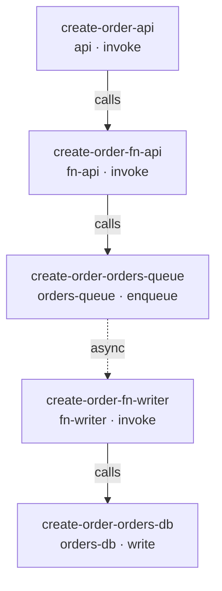

**2. The outline in Details.** Selecting the workflow shows its steps numbered, as `workflowDetails` builds them: each step named by its component's name and its action, never by an ID; its calls numbered under its own number; and an `enqueue`'s async work after its calls, under "Async work, done when a consumer takes the message". Each line is a button that selects the step.

```text
1  API Gateway · invoke
   1.1  fn-api · invoke
        1.1.1  orders-queue · enqueue
               Async work, done when a consumer takes the message
               1.1.1.1  fn-writer · invoke
                        1.1.1.1.1  orders-db · write
```

**3. The path on the diagram.** Selecting the workflow highlights its path: every component a step calls, and every edge a call follows, async work included. Here that's the five components above, and the four edges `api → fn-api`, `fn-api → orders-queue`, `orders-queue → fn-writer`, and `fn-writer → orders-db`; orders-read and `fn-api → orders-read`, which only "Get order" uses, aren't on it. Selecting the step `1.1.1.1  fn-writer · invoke` keeps the path and marks fn-writer and `orders-queue → fn-writer`, the edge the queue delivers its message along. [The path on the diagram](#the-path-on-the-diagram) says how.

**4. The path in the text version.** Under the diagram's components and connections, in the canvas's "As text" panel, its text version gives each workflow's path as one line, for a reader who can't see the diagram. [`workflowPathText`](../../src/application/details/workflow-path-text.ts) names each step by its component, and the last step of a path by its action too; a workflow that branches gets a path per leaf, joined by semicolons, and async work follows its queue after "then":

```text
Create order: API Gateway → fn-api → orders-queue (enqueue), then fn-writer → orders-db (write).
```

Template A's "Create order" branches nowhere, so it reads "Create order: API Gateway → fn-orders → orders-db (write)."; had fn-orders first read the customer's record, it would read "… → orders-db (read); API Gateway → fn-orders → orders-db (write)." The lines aren't buttons, since the Workflows list under the text version selects a workflow, and they mark no selection.

## How a step is addressed

A step is named by its `id`, not by where it is in the tree ([ADR-0020](../adr/0020-give-workflow-steps-stable-ids.md)). A path such as `["workflows", 1, "root", "calls", 0]` shifts when an earlier sibling moves or goes, so a selection held as a path would jump to another step after an edit or an undo; an ID doesn't change. So a selected step is `{ kind: "step", workflowId, stepId }`, and the outline keeps each step's ID beside its number for selecting it, never for showing it. Run issues still carry paths, because they're worked out afresh from the project each time; [How an issue finds its step](#how-an-issue-finds-its-step) turns one into the step's ID.

The bundled templates' step IDs are readable (`create-order-fn-api`), but a copy of a template gets new ones from the `IdGenerator`, as a blank project's steps would. Nothing can come to depend on a template's IDs, and a test can't look up a copied step by one.

## The parts

How the pieces connect (the [legend](architecture-overview.md#the-system-at-a-glance) explains the colors):

```mermaid
%%{init: {"flowchart": {"wrappingWidth": 320}}}%%
flowchart TB
    subgraph ui["ui/project/"]
        list["<b>ArchitectureView</b><br/>[Component]<br/>The Workflows list, a row per workflow, with its problems; the diagram's marks; the text version's path lines"]:::component
        details["<b>SelectionDetails, WorkflowOutline</b><br/>[Component]<br/>The heading, Used by, and the outline with its issues"]:::component
        selecting["<b>useSelection</b><br/>[Component]<br/>The selection, the tab, and where the focus returns"]:::component
        undo["<b>useUndoRedo</b><br/>[Component]<br/>Moves the selection after an undo"]:::component
    end
    subgraph app["application/"]
        describeUc["<b>DescribeSelection</b><br/>[Component: use-cases/]<br/>Finds the workflow and the step"]:::component
        checkUc["<b>CheckWorkflows</b><br/>[Component: use-cases/]<br/>Each workflow's check, for the list"]:::component
        outline["<b>workflowDetails, usedByLine</b><br/>[Component: details/]<br/>The numbered outline, and its words"]:::component
        checks["<b>workflowRunChecks</b><br/>[Component: run-checks/]<br/>Each issue on its step; the count"]:::component
        phrases["<b>run-issue-phrases</b><br/>[Component: run-checks/]<br/>An issue's words, with the step as the subject"]:::component
        pathText["<b>workflowPathText</b><br/>[Component: details/]<br/>A workflow's path line, for the text version"]:::component
        afterUndo["<b>selectionAfterUndo</b><br/>[Component: details/]<br/>Keeps a step while it's there"]:::component
        onDiagram["<b>selectionOnArchitecture</b><br/>[Component: details/]<br/>The path, and what a step marks"]:::component
        edits["<b>workflow-edits</b><br/>[Component: edits/]<br/>addCall, addAsyncWork, changeStep (drops what's under the step), moveStep, removeStep (an async root empties its slot)"]:::component
    end
    diagram["<b>Diagram</b><br/>[ui/diagram/]"]:::external
    stepTree["<b>stepsOfWorkflow, stepAt, stepLinksOf</b><br/>[domain/model/step-tree.ts]"]:::external
    findIssues["<b>findRunIssues</b><br/>[domain/components/]"]:::external
    list -->|"select(workflow)"| selecting
    list -->|"execute({ project })"| checkUc
    details -->|"selectWithin(step)"| selecting
    details -->|"execute({ project, selection })"| describeUc
    describeUc --> outline
    describeUc & checkUc --> checks
    checks --> findIssues
    checks --> phrases
    describeUc & afterUndo & checks & onDiagram --> stepTree
    undo --> afterUndo
    details -->|"edit(command)"| edits
    edits --> stepTree
    list --> onDiagram
    list --> pathText
    list -->|"marks"| diagram
    style ui fill:none,stroke:#666,stroke-dasharray:5 5
    style app fill:none,stroke:#666,stroke-dasharray:5 5
    classDef person fill:#08427b,stroke:#052e56,color:#fff
    classDef system fill:#1168bd,stroke:#0b4884,color:#fff
    classDef component fill:#85bbf0,stroke:#5d82a8,color:#000
    classDef external fill:#999,stroke:#6b6b6b,color:#fff
    classDef planned fill:#fff,stroke:#1168bd,color:#1168bd,stroke-dasharray:5 5
```

## Selecting a workflow or a step

- **The list.** The canvas's "Workflows" panel, opened from its bottom left, lists the project's workflows in project order, each a button that selects it. A workflow with run issues says how many after its name, one per issue: "Get order · 1 problem". Its row is marked `aria-current` while the workflow, or one of its steps, is selected. With no workflows, it says "No workflows yet. A workflow is the path one kind of request takes through your architecture."
- **Details.** `DescribeSelection` answers both kinds with one `WorkflowDetails`: the name, the names of the workloads whose mix has it (`usedBy`), the outline, and `currentStepId`, the selected step's or undefined. It describes nothing for a workflow the project doesn't have, or a step that isn't in that workflow. The heading is the workflow's name, "· Workflow"; then "Used by: Lunch rush, Steady day", or "Used by: no workload yet", joined with semicolons when a name has a comma of its own, as the templates' do; then the outline, the selected step marked `aria-current`. A step whose component is gone reads "a removed component · read", since a component's ID is never shown. Remove, in the header, asks first ([Removing a workflow](#removing-a-workflow)); `removal` in `WorkflowDetails` holds its words.
- **Focus.** As for a component: selecting a workflow or a step moves the focus to the Details heading, and Escape, or Close in a narrow window, clears the selection and returns the focus to whatever made it. A step is selected from inside Details, so the outline selects it with `selectWithin`, which keeps the element remembered before, the workflow's row; the step's own button goes when Details closes.
- **Undo and redo.** `selectionAfterUndo` keeps a selected workflow while the project still has it, and a selected step while its workflow still has a step with its ID, async work included; otherwise it clears the selection. Either stays even through an undo that brings a component or an edge back, which would otherwise select what came back: undoing a component's removal while one of its steps is selected leaves the step selected, and its issue goes from the outline. Undoing a workflow's remove while it's selected can't happen, since the remove cleared the selection; an undo that takes a selected workflow away (undoing its add) clears it. Undoing a step's remove puts its step and everything under it back, and the selection, which the remove moved to the step's caller, stays there, since the caller is still in the workflow. An undo of a move leaves the selection on its step, whose id didn't change. Otherwise an undo only redraws the outline, with any renamed component's new name and the issues as they now are.

## The path on the diagram

A selected workflow's path, or a selected step's, is drawn on the diagram as the [M6 UX design's §4.1](https://github.com/alanbickel/wind-tunnel/blob/6ef2e1e9ace6a3cb9a419bc9187fa3c2b8869d38/docs/design/user-experience.md#41-selection) table says (M7's canvas adds to it: [UX design §5](../design/user-experience.md#5-selection-and-focus)). [`selectionOnArchitecture`](../../src/application/details/selection-on-architecture.ts) works out which parts, and `ArchitectureView` hands them to `Diagram` as its `marks`:

- **The path** is every component the workflow's steps call, and the edge each call follows, from its caller's component to its own; async work's edge runs from the queue to its consumer. `stepLinksOf` (in `step-tree.ts`) pairs each step with its caller. A step selection keeps its workflow's path, as the list keeps its row marked.
- **A step** marks its component and the edge its call arrives on. The root step has no caller, since the user calls it, so it marks only its component.
- **Only what the architecture has.** A step whose component was removed marks nothing, and a call with no edge arrives on none; the outline says why ([How an issue finds its step](#how-an-issue-finds-its-step)). A workflow or step the project doesn't have shows nothing.
- **How it looks.** A path's boxes get a thick accent border inside their own, and its arrows are drawn at the thick line's width, in the accent color. The selection's bar runs down the box's left edge, and a selected arrow is twice as thick again, so a step's mark reads apart from its workflow's path by shape and width, not color alone. `Diagram.module.css` draws both, from the `on-path` class and React Flow's `selected` class.

## How an issue finds its step

A run issue names where it is by a path into the project, not by a step's ID ([How a step is addressed](#how-a-step-is-addressed)): `findStepIssues` walks each workflow's tree and records the path it took. [`workflowRunChecks`](../../src/application/run-checks/workflow-run-checks.ts) turns each issue back into its step, so the outline can show it there:

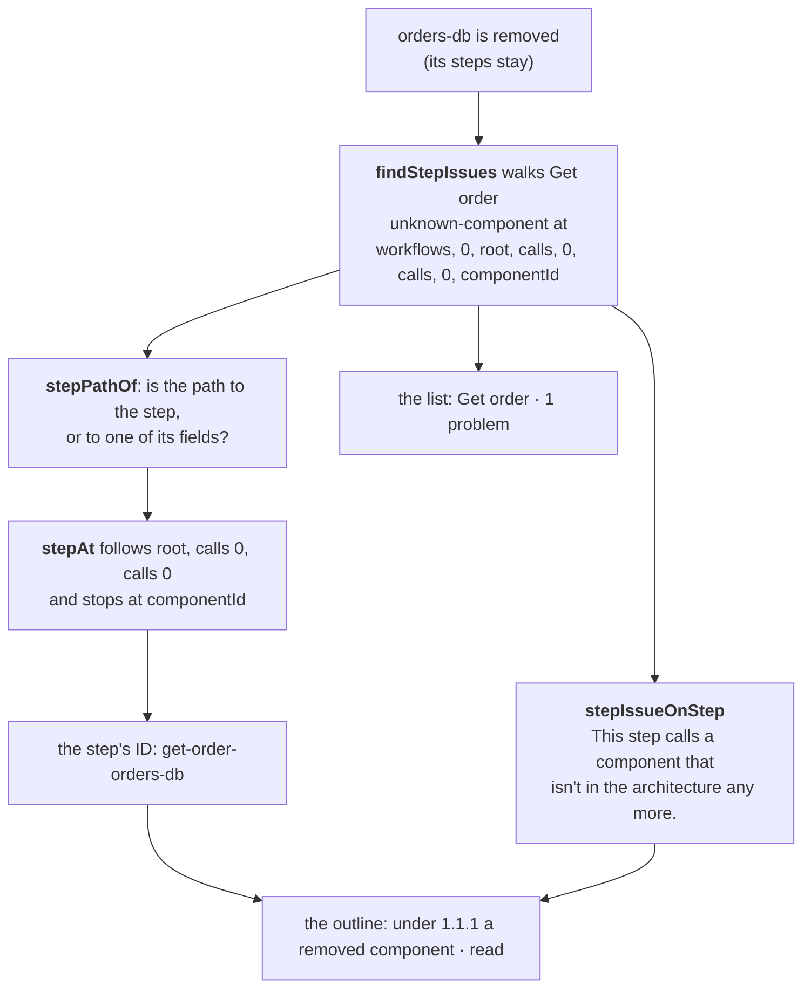

- **`stepAt`** ([`step-tree.ts`](../../src/domain/model/step-tree.ts)) follows `calls` and an index, or `async`, as far as the path goes, and stops at anything else: a path that runs on into the step's `componentId` or `action` names that step.
- **A path that ends in `async` is the one that needs care.** It's the async work's own path, so a missing edge from a queue to its consumer, whose path is to the step called, lands on the consumer. But the two issues about a step's async work itself (`async-not-on-enqueue`, `async-not-delivered`) name the step's `async` field too, so `stepPathOf` drops that last part first, by a table keyed by the issue's kind: they land on the step that has the async work.
- **The words** come from the same phrasebook as the top bar's, with the step as the subject: "This step calls orders-db from fn-orders, which has no edge to it." Like the outline's labels, they name components by name and never show an ID; a removed component has no name to give, so the step says only that it's gone ([M6 UX design §2.4 step 5](https://github.com/alanbickel/wind-tunnel/blob/6ef2e1e9ace6a3cb9a419bc9187fa3c2b8869d38/docs/design/user-experience.md#24-add-a-component-and-remove-one)).
- **The count** is one per issue, so a step with two issues counts twice, and it matches the sentences under the steps. The row says it in words, and the outline sets an issue off by a line down its side, so neither relies on color. The issues also describe the step's button (`aria-describedby`), so a screen reader hears them on it.
- **Opening a project with run issues** still works, as it has since [#94](https://github.com/alanbickel/wind-tunnel/issues/94): the outline is where they now show, alongside the top bar's reason.

## The commands

Each edit to a workflow is a command in [`workflow-edits.ts`](../../src/application/edits/workflow-edits.ts), a plain function from record to record that [the user interface guide](user-interface.md#editing-and-saving) describes. Each row says what it changes in the record, and the name its undo step gets.

| Command | Changes in the record | Undo name |
|---|---|---|
| `renameWorkflow` | The workflow's `name`; its id, steps, and the workloads' mixes stay. The same name, or a workflow that isn't there, returns the record as it was. The field checks the name first (`checkWorkflowName`): not empty, and not another workflow's, ignoring case and surrounding spaces | "Rename Get order to Fetch order" |
| `addWorkflow` | A workflow after the others, with the given ids and name and a root step that has the given component and action, and no calls. The workloads' mixes and the architecture stay. It's added only once the first step is complete ([When a new workflow exists](#when-a-new-workflow-exists)) | "Add workflow Get order" |
| `removeWorkflow` | The workflow, and its entry in every workload's mix, so no mix names a workflow the project doesn't have. The architecture, the layout, and other workflows stay. A workflow that isn't there returns the record as it was | "Remove workflow Get order" |
| `addCall` | A new step, with the given id, component and action, as the last of the given step's `calls`; if the step's component has no edge to the call's, one edge too, with the caller type's `edgeDefaults` (`connectIfMissing`, the function "Connect to…" also ends in). The step can be any step, in the main tree or in async work; a step the workflow doesn't have returns the record as it was. The pickers offer only components that exist | "Add a call from api to fn-orders", or "…, and its edge" |
| `addAsyncWork` | The `async` of an `enqueue` step that has none: a new step with the given id, component and action, called along the queue's edge to the consumer; if the queue's component has no edge to it, one edge too, through `connectIfMissing`, so the slot and its edge are one undo step. A step that isn't an `enqueue`, already has async work, or isn't in the workflow returns the record as it was | "Add async work from orders-queue to fn-writer", or "…, and its edge" |
| `changeStep` | A step's `componentId` and `action`, together, so a step is never left without either. The step keeps its id and loses everything under it, `calls` and `async` alike, whatever changed (a different component of the same type too): what's under a step belongs to what it was. A step changed to `enqueue` has an empty async slot, which is stored as no `async`. If the step's caller, the step that has it among its `calls`, has no edge to the new component, one edge too, with the caller type's `edgeDefaults`, through `connectIfMissing`, as `addCall` does; the root has no caller and adds none. The step can be any step, in the main tree or in async work (the caller of an async root is its queue); a step the workflow doesn't have returns the record as it was, and so does a change to what the step already is (unless the caller has no edge to it, which is still added) | "Change fn-orders · invoke to orders-db · read", with ", and its edge" and ", and remove the 3 steps under it" when they apply |
| `moveStep` | One step's place among its siblings, up or down, its calls and async work with it: its caller's `calls` swap two entries, and nothing else changes. A step at that end, with no siblings, that's a workflow's first step or an async root (its slot's only step), or that the workflow doesn't have returns the record as it was; a step below an async root moves among its siblings | "Move orders-db · read up" |
| `removeStep` | The step, and every step under it, async work included. A caller left with no calls loses its `calls` field. Removing an async root leaves its queue's slot empty: the queue's `async` goes and its `calls` stay. No edge goes: edges belong to the architecture. A workflow's first step, or a step the workflow doesn't have, returns the record as it was | "Remove fn-orders · invoke" |

Renaming a workflow makes the run on screen out of date, as renaming a component does, because workflows are part of what ran ([ADR-0018](../adr/0018-tie-a-run-to-the-model-it-ran.md)); renaming the project doesn't. Adding or removing a workflow, and adding, moving, or removing a step, make the run out of date the same way. Editing steps adds rows as it lands.

### Moving and removing a step

Both commands work by the step's id, on the workflow they're given, and both find the step that holds it (`holderOf`, which searches `calls` and `async`: for an async root it's the queue), so a command for a step that is the root, or isn't there, changes nothing, and a move of an async root, which has no siblings, changes nothing either. The examples are Template A's "Create order" after a `read` was added before its `write` (the [worked example](#editing-it) runs them). Before:

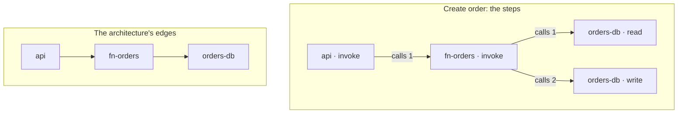

`moveStep` on `write`, up, swaps it with `read`: the two entries of fn-orders' `calls` trade places, whatever is under each goes with it, and the edges don't change. fn-orders now writes, then reads:

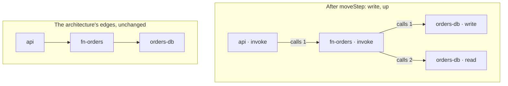

`removeStep` on fn-orders takes it and everything under it, so Remove asks first, "Remove fn-orders · invoke and the 2 calls under it?". The edges stay, and Details of `api → fn-orders` now says no step calls along it:

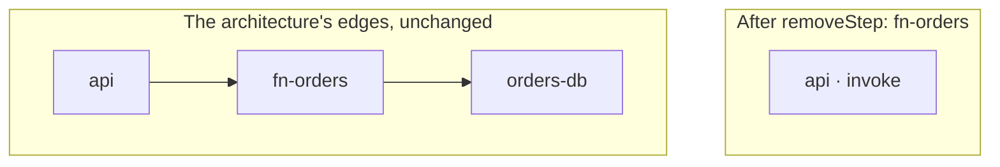

The words come from `describeSelection`, not the UI: each `OutlineStep` has `editing`, which says whether its Move up and Move down are usable, who its caller is, and what Remove asks (`stepRemovalText`; nothing for a step with nothing under it, which goes at once). The workflow's first step has no `editing`, and so no buttons. An async root has Remove but no Move (it's its slot's only step), and its `editing` names its queue as its caller and as the step whose slot a remove empties (`emptiesSlotOf`).

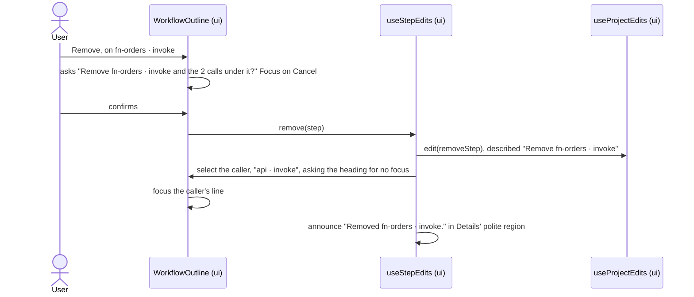

- **The focus.** A move leaves it on the button pressed: React puts the focus back on an element it moved, as long as the step's key is its id, so a step keyed by its place would leave it on its neighbour's. A move that can't go that way, at either end of the siblings, is `aria-disabled`, not `disabled`, so the focus can stay. A remove takes the step's buttons away, so `useFocusAfterRedraw` puts the focus on the caller's step button once the outline has drawn again; the selection moved to the caller with `selectWithin(…, "none")`, which asks Details' heading for nothing.
- **The announcements.** "Moved orders-db · read up." and "Removed fn-orders · invoke." come from the polite region in Details, which is on the page before its text changes, as for a connection made there. They name the step as the outline does, by its component and action, never by an id. Each button's name says which step it's for ("Move up 1.1.2 orders-db · write"), since a screen reader lists many.

## Adding a call

Under each step's calls, a button "Add a call from api" opens a draft call and moves the focus to its component picker (the button is gone, and the focus would otherwise fall to the page's body): a component picker, and once a component is chosen, an action picker. Like a new workflow's first step, the draft lives only in the UI (`AddCall`, local state), so nothing is stored until both are chosen, and Escape drops it, returns the focus to the button, and saves nothing. Escape stops there: Details' own Escape, which would close the outline, doesn't see it. A component whose type accepts one action has it chosen already, so choosing the component saves the call.

`NewCall` (a use case, since the ids come from the `IdGenerator` port) says what the draft needs: ids for the call and for an edge it may add, the caller type's `edgeDefaults`, and the components to offer. The caller's neighbours come first, then the rest, each of those marked "No edge from api yet; choosing it adds one." The caller's own component isn't offered, since the architecture has no edge to itself. The draft reads it again whenever the project changes, so an Undo that takes a component away takes it from the picker.

The compound case, a call along a missing edge, is one command and so one undo step:

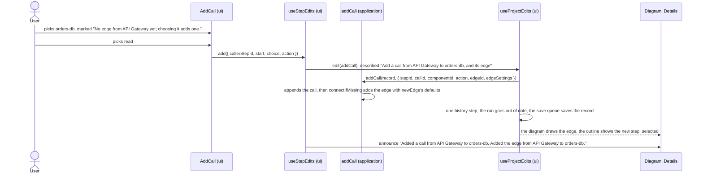

- **The edge is the same function.** `addCall` ends in `connectIfMissing` (in [`edge-edits.ts`](../../src/application/edits/edge-edits.ts)), which calls `connectComponents`, as "Connect to…" does, so a call's edge and a drawn one are the same, with the same defaults from the caller's type. `connectIfMissing` adds none when the caller already has an edge to the callee, so a call along an edge that's there leaves the architecture as it was.
- **The announcement** says the edge appeared, since it appears on the diagram, away from the focus. A call along an edge that's there says only "Added a call from fn-orders to orders-db."
- **The focus and the selection.** The new step is selected and its line takes the focus (`useFocusAfterRedraw`), since the draft, which had it, has gone. The selection follows the step by id: an Undo takes it away, and `selectionAfterUndo` clears the selection, as for a removed step.
- **Undo** removes the call and the edge together, because the history keeps the record from before.

## Changing a step

Selecting a step puts two pickers under its line, Component and Action, showing what it is now (`ChangeStep`). Choosing an action saves at once. Choosing a component saves at once if its type accepts the step's action, or accepts only one action, which the step takes; otherwise the action picker empties and the component waits as a draft, in the UI only (`ChangeStep`'s local state), until an action is chosen: a step is never saved without both. A step whose action its component doesn't accept (the run issue `action-not-accepted`) shows an empty action picker, since the picker never shows an action it can't offer; choosing an accepted one fixes the issue, which leaves the outline and the workflow's row, since both are read from the project.

`ChangeStep` (a use case, since the edge's id comes from the `IdGenerator` port) says what the pickers need: the step's component, action, and label, the caller's name, the caller type's `edgeDefaults`, and the components to offer, by the same `callChoices` that `NewCall` uses (the caller's neighbours first, the others marked as adding an edge; for the root, every component and none adding one), and how many steps are under the step. A change along a missing edge is one command and so one undo step, announced as an add is: "Changed fn-orders · invoke to orders-db · read. Added the edge from API Gateway to orders-db." The words are `changeStepText`.

- **A change drops what's under the step, after asking.** Any change to a step's component or action drops every step under it, calls and async work, so when `stepsBelow` isn't 0 the pickers hold the change and ask first, as a remove does, with `RemoveConfirmation` (its button says "Change"): "Change fn-orders · invoke to fn-writer · invoke? The 3 steps under it go." (`changeStepQuestion`), the count taking in everything nested, with the focus on Cancel. Cancel changes nothing and puts the pickers back to what the step is; either answer returns the focus to the Component picker. A step with nothing under it changes at once. Undo's name and the announcement say how many went ("Change … , and remove the 3 steps under it"; "Changed …. The 3 steps under it are gone."), and a change to `enqueue` adds "It has no async work yet." Both pickers offer every component and action, async work or not. An `enqueue` offers no "Add a call": its follow-up work is its async work (a stored project with such calls still opens).
- **Changing an `enqueue` back to a `write`** shows what goes. The question is "Change orders-queue · enqueue to orders-db · write? The 2 steps under it go." Before, from [the async sketch](#async-work):

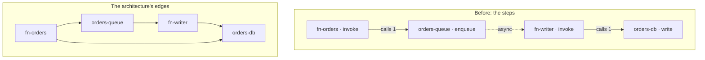

After, the step keeps its id and its place, and the async root and everything under it goes. All the edges stay, since edges belong to the architecture: `fn-orders → orders-db`, which the changed step now calls along, was there all along, and `fn-orders → orders-queue`, `orders-queue → fn-writer` and `fn-writer → orders-db` are used by no step, which their Details say:

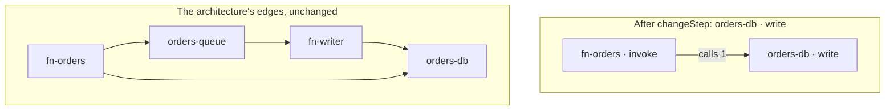

- **The selection** stays on the step, whose id doesn't change; so does the focus, which stays on the picker.
- **Undo** puts back the step and any edge the change added, because the history keeps the record from before.

## Async work

An `enqueue` step with no async work shows its slot: the heading "Async work, done when a consumer takes the message", "No async work yet. A message is taken off the queue and nothing runs.", and a button "Add async work, done when a consumer takes the message" (`OutlineStep.asyncSlot`, which is derived from the step: an empty slot is stored as no `async`). The button opens the same draft as "Add a call" (`AddCall`, over the same `NewCall` use case, with the queue as the caller), and once a component and an action are chosen `useStepEdits` hands `addAsyncWork` to `edit`, selects the new step, and announces "Added async work from orders-queue to fn-writer. Added the edge from orders-queue to fn-writer." Escape drops the draft and saves nothing.

- **The async root's line** has Remove and the pickers that change it, no Move, and a description for a screen reader, "Runs when a consumer takes the message from orders-queue.", which describes its button along with any issues.
- **Remove** on the async root leaves the slot empty and takes no edge; it asks first only if something is under it. The selection and the focus go to the queue step, whose slot's button is now there, and the announcement says so: "Removed fn-writer · invoke. orders-queue · enqueue has no async work now."
- **A chain of queues** works: an `enqueue` under async work gets a slot like any other.
- **A stored project's issues** (`async-not-on-enqueue`, `async-not-delivered`) show on the step that has the async work. Remove on the root, or changing the step's action, fixes them.

The sketch's first two steps, as one flow. Each is one command, so each is one undo step, and each says what appeared away from the focus:

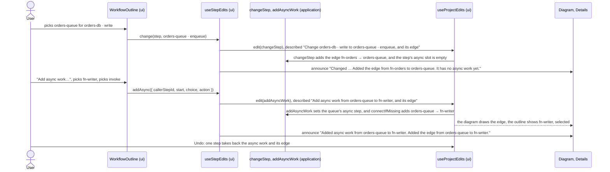

[`async-work-sequence.test.ts`](../../src/adapters/templates/details/async-work-sequence.test.ts) builds [M6 UX design §2.6's sketch](https://github.com/alanbickel/wind-tunnel/blob/6ef2e1e9ace6a3cb9a419bc9187fa3c2b8869d38/docs/design/user-experience.md#26-sketch-put-a-queue-in-front-of-a-slow-component) in a copy of Template A, through the same edit history the screen keeps, and writes each stage to [`async-work-sequence.txt`](../../src/adapters/templates/details/async-work-sequence.txt): three calls and their three edges (`fn-orders → orders-queue`, `orders-queue → fn-writer`, `fn-writer → orders-db`), each undone in turn, and the announcement of each. It also checks that the result has no run issues and that a run of it delivers messages. If a stage changes, run `npx vitest run src/adapters/templates/details --update` and read the diff.

## Removing a workflow

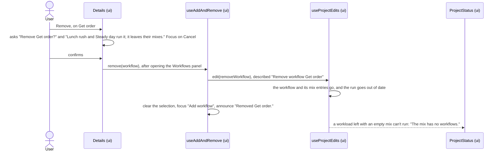

- **The words** come from `describeSelection` (`workflowRemovalText`): the question, and a warning naming the workloads whose mix has the workflow, which is absent when none does. A single workload reads "Steady day runs it; it leaves its mix."
- **The focus** goes to "Add workflow", in the canvas's "Workflows" panel, which the remove opens first if it was closed, with "Removed Get order." said from a polite region beside it that's on the page from the start, as for a component with "Add component".
- **Undo** puts back the workflow at its place and the mix entries in one step, because the history keeps the record from before.

## When a new workflow exists

A workflow is stored with a root step, and a step names a component, so a workflow can't be stored before its first step's component is chosen. "Add workflow" therefore opens a *draft*, which lives only in the UI. It's a selection, `{ kind: "new-workflow" }`, so selecting anything else replaces it in the same update, and it's never saved because no selection is.

```mermaid
stateDiagram-v2
    [*] --> Draft: Add workflow
    Draft: Draft, not stored
    Draft: name "workflow-1" selected, empty first step
    Draft --> ComponentChosen: choose a component
    ComponentChosen --> ActionChosen: choose an action
    Draft --> ActionChosen: choose a component with one action
    ActionChosen --> Saved: the name passes its check
    ActionChosen --> ActionChosen: the name fails; saves when it passes
    Saved: Saved and selected
    Saved: one command, one undo step
    Draft --> NothingSaved: Escape, or select something else
    ComponentChosen --> NothingSaved: Escape, or select something else
    ActionChosen --> NothingSaved: Escape, or select something else
    NothingSaved --> [*]
    Saved --> [*]
```

- **What starts it.** `NewWorkflow` (a use case, since the ids come from the `IdGenerator` port) returns the workflow's id and its root step's, the first free name ("workflow-1", then "workflow-2", from `newWorkflowName`, which compares names as `checkWorkflowName` does, so the suggestion passes), and every component with the actions its type accepts. `NewWorkflowDetails` reads the ids and the name once when the draft opens, so they belong to the draft, and reads the components again whenever the project changes: Undo and Redo stay usable under a draft, and a step must call a component that is there.
- **What saves it.** The draft saves when the name passes `checkWorkflowName` and the step has a component and an action. A component that accepts one action has it chosen already, so choosing the component can save it. Checks run when a picker changes and when the name field commits (Enter, or leaving it), so a draft whose name was wrong saves once the name is fixed. Saving hands `addWorkflow` to `edit` and selects the workflow with `selectWithin`, in the same event; no effect watches for it.
- **What drops it.** Escape, or selecting anything else, unmounts the draft: nothing was saved, and there's no undo step. A browser fires `blur` on the name field as it's removed, which would commit a draft that Escape meant to drop (or commit one that has just saved); jsdom doesn't, so no ordinary test catches it. A ref that Escape and the save set, and the commit checks, guards it.
- **With no components,** a first step has nothing to call, so "Add workflow" is `aria-disabled` and says "Add a component first."

## Worked example

[`workflow-outlines.test.ts`](../../src/adapters/templates/details/workflow-outlines.test.ts) describes each template's workflows with `DescribeSelection` and lays them out as Details does, each followed by its line in the diagram's text version, in [`workflow-outlines.txt`](../../src/adapters/templates/details/workflow-outlines.txt). It lives beside the templates, since `application/` can't import them. Template A's:

```text
Template A: Serverless API with RDS

Get order
Used by: Lunch rush, 20 s at 2,000 requests/s; Steady day, 200 requests/s; Long rush, 2 min at 2,000 requests/s
1  API Gateway · invoke
   1.1  fn-orders · invoke
        1.1.1  orders-db · read
Text version: Get order: API Gateway → fn-orders → orders-db (read).

Create order
Used by: Lunch rush, 20 s at 2,000 requests/s; Steady day, 200 requests/s; Long rush, 2 min at 2,000 requests/s
1  API Gateway · invoke
   1.1  fn-orders · invoke
        1.1.1  orders-db · write
Text version: Create order: API Gateway → fn-orders → orders-db (write).
```

Template B's "Create order" is the outline, and its path line, in [A workflow, four ways](#a-workflow-four-ways). If an outline or a path line changes, the test fails and the diff shows how. If the change is intended, run `npx vitest run src/adapters/templates/details --update`, then update the excerpts on this page.

### Editing it

[`workflow-edit-sequence.test.ts`](../../src/adapters/templates/details/workflow-edit-sequence.test.ts) runs the step commands on Template A's "Create order", with a `read` added before its `write` (a call added with `addCall` goes last, so the test builds this one by hand to keep the stages short), through the same edit history the screen keeps, and writes each stage's outline and path line to [`workflow-edit-sequence.txt`](../../src/adapters/templates/details/workflow-edit-sequence.txt). It moves the write up, removes it (nothing under it, so it goes at once), undoes that, removes fn-orders (which asks first), and undoes that, then adds a call from API Gateway to orders-db along an edge the architecture doesn't have, and undoes that, then changes the call to a write and undoes that. Each undo says how many edges the architecture has:

```text
Start
1  API Gateway · invoke
   1.1  fn-orders · invoke
        1.1.1  orders-db · read
        1.1.2  orders-db · write
Text version: Create order: API Gateway → fn-orders → orders-db (read); API Gateway → fn-orders → orders-db (write).

Move orders-db · write up
1  API Gateway · invoke
   1.1  fn-orders · invoke
        1.1.1  orders-db · write
        1.1.2  orders-db · read
Text version: Create order: API Gateway → fn-orders → orders-db (write); API Gateway → fn-orders → orders-db (read).

Remove asks: nothing; the step goes at once
Remove orders-db · write
1  API Gateway · invoke
   1.1  fn-orders · invoke
        1.1.1  orders-db · read
Text version: Create order: API Gateway → fn-orders → orders-db (read).

Undo: Remove orders-db · write
Edges: 2
1  API Gateway · invoke
   1.1  fn-orders · invoke
        1.1.1  orders-db · write
        1.1.2  orders-db · read
Text version: Create order: API Gateway → fn-orders → orders-db (write); API Gateway → fn-orders → orders-db (read).

Remove asks: Remove fn-orders · invoke and the 2 calls under it?
Remove fn-orders · invoke
1  API Gateway · invoke
Text version: Create order: API Gateway (invoke).

Undo: Remove fn-orders · invoke
Edges: 2
1  API Gateway · invoke
   1.1  fn-orders · invoke
        1.1.1  orders-db · write
        1.1.2  orders-db · read
Text version: Create order: API Gateway → fn-orders → orders-db (write); API Gateway → fn-orders → orders-db (read).

Add a call from API Gateway to orders-db, and its edge
Edges: 3 (API Gateway → orders-db is new)
1  API Gateway · invoke
   1.1  fn-orders · invoke
        1.1.1  orders-db · write
        1.1.2  orders-db · read
   1.2  orders-db · read
Text version: Create order: API Gateway → fn-orders → orders-db (write); API Gateway → fn-orders → orders-db (read); API Gateway → orders-db (read).

Change orders-db · read to orders-db · write
Edges: 3 (the same: API Gateway → orders-db is there already)
1  API Gateway · invoke
   1.1  fn-orders · invoke
        1.1.1  orders-db · write
        1.1.2  orders-db · read
   1.2  orders-db · write
Text version: Create order: API Gateway → fn-orders → orders-db (write); API Gateway → fn-orders → orders-db (read); API Gateway → orders-db (write).

Undo: Change orders-db · read to orders-db · write
Edges: 3
1  API Gateway · invoke
   1.1  fn-orders · invoke
        1.1.1  orders-db · write
        1.1.2  orders-db · read
   1.2  orders-db · read
Text version: Create order: API Gateway → fn-orders → orders-db (write); API Gateway → fn-orders → orders-db (read); API Gateway → orders-db (read).

Undo: Add a call from API Gateway to orders-db, and its edge
Edges: 2
1  API Gateway · invoke
   1.1  fn-orders · invoke
        1.1.1  orders-db · write
        1.1.2  orders-db · read
Text version: Create order: API Gateway → fn-orders → orders-db (write); API Gateway → fn-orders → orders-db (read).
```

The test also checks that the architecture is the same object at every stage before the added call, so no move or remove touches an edge; that the added call makes it three edges, and the change, along an edge that's there, adds none; and that each undo gives back the very record from before. If a stage changes, run the `--update` command above and update this excerpt.

## Changing it

To add a step command (say, `duplicateStep`), in the order a reviewer will read it:

1. **The command**, in [`workflow-edits.ts`](../../src/application/edits/workflow-edits.ts): a plain function from record to record that takes its step by id, like `moveStep`. It does the whole change, so it's one undo step; it returns the very record it was given when there's nothing to do, so `edit` saves nothing; and it touches the architecture only to add an edge a call needs, which it does through `connectIfMissing` (the one place a step command adds an edge), never by building the edge itself. `moveStep` and `removeStep` share `changeCallsHolding`, which finds the step that holds an id among its calls and swaps in the calls `change` returns; a command that changes one step's calls should use it, and one that changes a step in place can use `mapSteps` ([`step-tree.ts`](../../src/domain/model/step-tree.ts)).
2. **Its words**, in `application/details/`, not the UI: what the outline needs to offer it (`StepEditing`, built by `stepEditing` in `workflow-details.ts`), and a confirmation's question if it takes something with it (`removal-text.ts`, beside `stepRemovalText`). The undo name is the command's `describe`, in `useStepEdits`: the verb, then the step as the outline labels it, "Move orders-db · read up".
3. **The button**, in `WorkflowOutline`, calling the command through `useStepEdits`, which saves it, selects what should be selected, and announces it. Name the button for its step, make one that can be unusable `aria-disabled` (the `Button`'s `usable`), and say where the focus goes.
4. **Tests**, each with a `// Fails if` comment you've watched go red: the command in `workflow-edits.test.ts` (or its own file, as `addCall`'s is; the change, the unchanged record, the input left alone, the architecture left alone); its words in `workflow-details.test.ts` or `removal-text.test.ts`; the screen in `OpenedProject.step-edits.test.tsx` (the announcement, the focus, the undo name, undoing it); and a stage in the edit sequence above. Update the commands table and the excerpt.

A new step *action* or component type needs nothing from the editor: its pickers read the registry's `actions`, so a type that accepts a new action offers it as soon as it's registered, in the pickers of a new call and of a change alike ([adding a component type](../../CONTRIBUTING.md#adding-a-component-type)). `changeStep` rebuilds a changed step from its id, component and action, so a field added to `Step` that belongs to the step itself must be named there (see [Gotchas](../../CONTRIBUTING.md#gotchas)).
