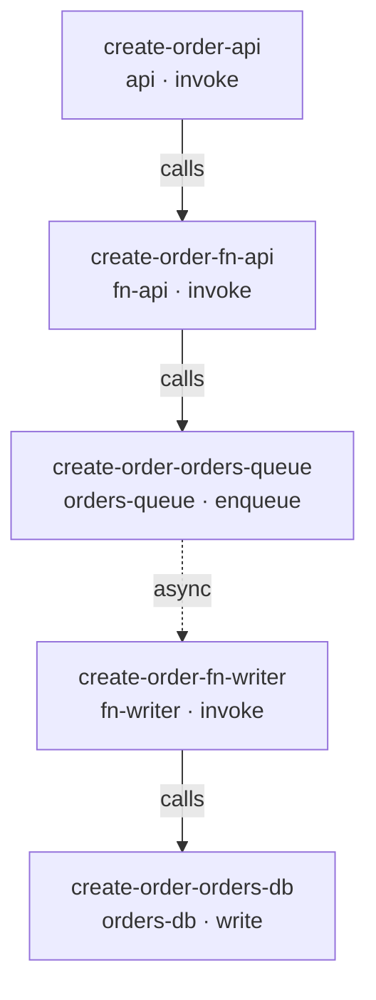
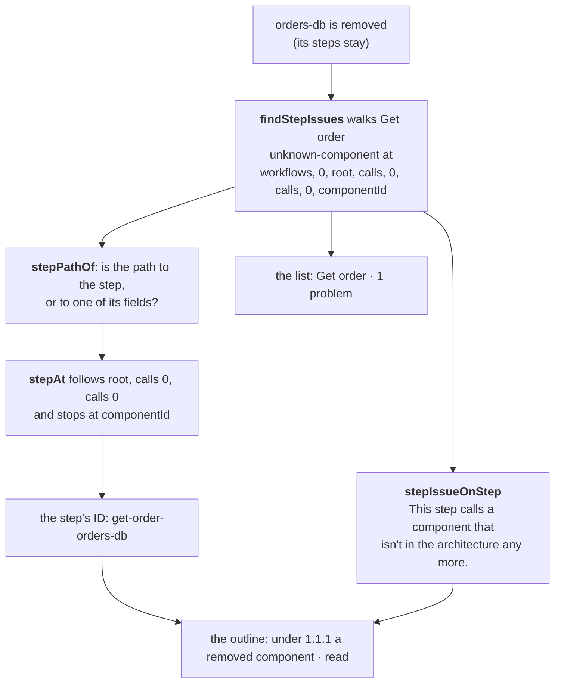

# The Workflow Editor

How a workflow gets from the call tree in a project to what the screen shows, for maintainers new to the code. A workflow is the path one kind of request takes through the architecture ([UX design §2.5](../design/user-experience.md#25-describe-a-requests-path)). Today the screen lists a project's workflows, each with a count of its problems, and shows a selected one's steps as an outline in Details, each step with its run issues under it, and draws its path on the diagram. The path in the diagram's text version ([#122](https://github.com/alanbickel/wind-tunnel/issues/122)), and editing ([#116](https://github.com/alanbickel/wind-tunnel/issues/116), [#117](https://github.com/alanbickel/wind-tunnel/issues/117)) add to this guide as they land. Read [the domain model](domain-model.md) and [the user interface](user-interface.md) first.

## A workflow, three ways

The same workflow appears three ways, and this section answers "how does the tree on disk become what I see?" The example is Template B's "Create order", because it has both kinds of child: `calls`, made in order while the step holds its component, and `async` work, done later, when a queue's consumer takes the message. (Template A's "Create order" has the same shape without the queue.)

**1. The stored call tree.** What `Workflow.root` holds, and the template's JSON: each step has an ID, a component's ID, and an action. A step's `calls` are its children; an `enqueue` may have one `async` child.



**2. The outline in Details.** Selecting the workflow shows its steps numbered, as `workflowDetails` builds them: each step named by its component's name and its action, never by an ID; its calls numbered under its own number; and an `enqueue`'s async work after its calls, under "Async work, done when a consumer takes the message". Each line is a button that selects the step.

```text
1  API Gateway · invoke
   1.1  fn-api · invoke
        1.1.1  orders-queue · enqueue
               Async work, done when a consumer takes the message
               1.1.1.1  fn-writer · invoke
                        1.1.1.1.1  orders-db · write
```

**3. The path on the diagram.** Selecting the workflow highlights its path: every component a step calls, and every edge a call follows, async work included. Here that's the five components above, and the four edges `api → fn-api`, `fn-api → orders-queue`, `orders-queue → fn-writer`, and `fn-writer → orders-db`; orders-read and `fn-api → orders-read`, which only "Get order" uses, aren't on it. Selecting the step `1.1.1.1  fn-writer · invoke` keeps the path and rings fn-writer and `orders-queue → fn-writer`, the edge the queue delivers its message along. [The path on the diagram](#the-path-on-the-diagram) says how.

## How a step is addressed

A step is named by its `id`, not by where it is in the tree ([ADR-0020](../adr/0020-give-workflow-steps-stable-ids.md)). A path such as `["workflows", 1, "root", "calls", 0]` shifts when an earlier sibling moves or goes, so a selection held as a path would jump to another step after an edit or an undo; an ID doesn't change. So a selected step is `{ kind: "step", workflowId, stepId }`, and the outline keeps each step's ID beside its number for selecting it, never for showing it. Run issues still carry paths, because they're worked out afresh from the project each time; [How an issue finds its step](#how-an-issue-finds-its-step) turns one into the step's ID.

The bundled templates' step IDs are readable (`create-order-fn-api`), but a copy of a template gets new ones from the `IdGenerator`, as a blank project's steps would. Nothing can come to depend on a template's IDs, and a test can't look up a copied step by one.

## The parts

How the pieces connect (the [legend](architecture-overview.md#the-system-at-a-glance) explains the colors):

```mermaid
%%{init: {"flowchart": {"wrappingWidth": 320}}}%%
flowchart TB
    subgraph ui["ui/project/"]
        list["<b>ArchitectureView</b><br/>[Component]<br/>The Workflows list, a row per workflow, with its problems; the diagram's marks"]:::component
        details["<b>SelectionDetails, WorkflowOutline</b><br/>[Component]<br/>The heading, Used by, and the outline with its issues"]:::component
        selecting["<b>useSelection</b><br/>[Component]<br/>The selection, the tab, and where the focus returns"]:::component
        undo["<b>useUndoRedo</b><br/>[Component]<br/>Moves the selection after an undo"]:::component
    end
    subgraph app["application/"]
        describeUc["<b>DescribeSelection</b><br/>[Component: use-cases/]<br/>Finds the workflow and the step"]:::component
        checkUc["<b>CheckWorkflows</b><br/>[Component: use-cases/]<br/>Each workflow's check, for the list"]:::component
        outline["<b>workflowDetails, usedByLine</b><br/>[Component: details/]<br/>The numbered outline, and its words"]:::component
        checks["<b>workflowRunChecks</b><br/>[Component: run-checks/]<br/>Each issue on its step, worded; the count"]:::component
        afterUndo["<b>selectionAfterUndo</b><br/>[Component: details/]<br/>Keeps a step while it's there"]:::component
        onDiagram["<b>selectionOnArchitecture</b><br/>[Component: details/]<br/>The path, and what a step rings"]:::component
    end
    diagram["<b>Diagram</b><br/>[ui/diagram/]"]:::external
    stepTree["<b>stepsOfWorkflow, stepAt, stepLinksOf</b><br/>[domain/model/step-tree.ts]"]:::external
    findIssues["<b>findRunIssues</b><br/>[domain/components/]"]:::external
    list -->|"select(workflow)"| selecting
    list -->|"execute({ project })"| checkUc
    details -->|"selectWithin(step)"| selecting
    details -->|"execute({ project, selection })"| describeUc
    describeUc --> outline
    describeUc & checkUc --> checks
    checks --> findIssues
    describeUc & afterUndo & checks & onDiagram --> stepTree
    undo --> afterUndo
    list --> onDiagram
    list -->|"marks"| diagram
    style ui fill:none,stroke:#666,stroke-dasharray:5 5
    style app fill:none,stroke:#666,stroke-dasharray:5 5
    classDef person fill:#08427b,stroke:#052e56,color:#fff
    classDef system fill:#1168bd,stroke:#0b4884,color:#fff
    classDef component fill:#85bbf0,stroke:#5d82a8,color:#000
    classDef external fill:#999,stroke:#6b6b6b,color:#fff
    classDef planned fill:#fff,stroke:#1168bd,color:#1168bd,stroke-dasharray:5 5
```



## Selecting a workflow or a step

- **The list.** Under the diagram's text version, "Workflows" lists the project's workflows in project order, each a button that selects it. A workflow with run issues says how many after its name, one per issue: "Get order · 1 problem". Its row is marked `aria-current` while the workflow, or one of its steps, is selected. With no workflows, it says "No workflows yet. A workflow is the path one kind of request takes through your architecture."
- **Details.** `DescribeSelection` answers both kinds with one `WorkflowDetails`: the name, the names of the workloads whose mix has it (`usedBy`), the outline, and `currentStepId`, the selected step's or undefined. It describes nothing for a workflow the project doesn't have, or a step that isn't in that workflow. The heading is the workflow's name, "· Workflow"; then "Used by: Lunch rush, Steady day", or "Used by: no workload yet", joined with semicolons when a name has a comma of its own, as the templates' do; then the outline, the selected step marked `aria-current`. A step whose component is gone reads "a removed component · read", since a component's ID is never shown. There's no Remove yet.
- **Focus.** As for a component: selecting a workflow or a step moves the focus to the Details heading, and Escape, or Close in a narrow window, clears the selection and returns the focus to whatever made it. A step is selected from inside Details, so the outline selects it with `selectWithin`, which keeps the element remembered before, the workflow's row; the step's own button goes when Details closes.
- **Undo and redo.** `selectionAfterUndo` keeps a selected workflow while the project still has it, and a selected step while its workflow still has a step with its ID, async work included; otherwise it clears the selection. Either stays even through an undo that brings a component or an edge back, which would otherwise select what came back: undoing a component's removal while one of its steps is selected leaves the step selected, and its issue goes from the outline. Nothing removes a step or a workflow yet, so today an undo only redraws the outline, with any renamed component's new name and the issues as they now are.

## The path on the diagram

A selected workflow's path, or a selected step's, is drawn on the diagram as the [UX design §4.1](../design/user-experience.md#41-selection) table says. [`selectionOnArchitecture`](../../src/application/details/selection-on-architecture.ts) works out which parts, and `ArchitectureView` hands them to `Diagram` as its `marks`:

- **The path** is every component the workflow's steps call, and the edge each call follows, from its caller's component to its own; async work's edge runs from the queue to its consumer. `stepLinksOf` (in `step-tree.ts`) pairs each step with its caller. A step selection keeps its workflow's path, as the list keeps its row marked.
- **A step** rings its component and the edge its call arrives on. The root step has no caller, since the user calls it, so it rings only its component.
- **Only what the architecture has.** A step whose component was removed rings nothing, and a call with no edge arrives on none; the outline says why ([How an issue finds its step](#how-an-issue-finds-its-step)). A workflow or step the project doesn't have shows nothing.
- **How it looks.** A path's boxes get a thick accent border inside their own, and its arrows are drawn at the thick line's width, in the accent color. The selection's ring sits outside the box, apart from it, and a selected arrow is twice as thick again, so a step's ring reads apart from its workflow's path by shape and width, not color alone. `Diagram.module.css` draws both, from the `on-path` class and React Flow's `selected` class.

## How an issue finds its step

A run issue names where it is by a path into the project, not by a step's ID ([How a step is addressed](#how-a-step-is-addressed)): `findStepIssues` walks each workflow's tree and records the path it took. [`workflowRunChecks`](../../src/application/run-checks/workflow-run-checks.ts) turns each issue back into its step, so the outline can show it there:



- **`stepAt`** ([`step-tree.ts`](../../src/domain/model/step-tree.ts)) follows `calls` and an index, or `async`, as far as the path goes, and stops at anything else: a path that runs on into the step's `componentId` or `action` names that step.
- **A path that ends in `async` is the one that needs care.** It's the async work's own path, so a missing edge from a queue to its consumer, whose path is to the step called, lands on the consumer. But the two issues about a step's async work itself (`async-not-on-enqueue`, `async-not-delivered`) name the step's `async` field too, so `stepPathOf` drops that last part first, by a table keyed by the issue's kind: they land on the step that has the async work.
- **The words** come from the same phrasebook as the project bar's, with the step as the subject: "This step calls orders-db from fn-orders, which has no edge to it." Like the outline's labels, they name components by name and never show an ID; a removed component has no name to give, so the step says only that it's gone (UX design §2.4 step 5).
- **The count** is one per issue, so a step with two issues counts twice, and it matches the sentences under the steps. The row says it in words, and the outline sets an issue off by a line down its side, so neither relies on color. The issues also describe the step's button (`aria-describedby`), so a screen reader hears them on it.
- **Opening a project with run issues** still works, as it has since [#94](https://github.com/alanbickel/wind-tunnel/issues/94): the outline is where they now show, alongside the project bar's reason.

## Worked example

[`workflow-outlines.test.ts`](../../src/adapters/templates/details/workflow-outlines.test.ts) describes each template's workflows with `DescribeSelection` and lays them out as Details does, in [`workflow-outlines.txt`](../../src/adapters/templates/details/workflow-outlines.txt). It lives beside the templates, since `application/` can't import them. Template A's:

```text
Template A: Serverless API with RDS

Get order
Used by: Lunch rush, 20 s at 2,000 requests/s; Steady day, 200 requests/s; Long rush, 2 min at 2,000 requests/s
1  API Gateway · invoke
   1.1  fn-orders · invoke
        1.1.1  orders-db · read

Create order
Used by: Lunch rush, 20 s at 2,000 requests/s; Steady day, 200 requests/s; Long rush, 2 min at 2,000 requests/s
1  API Gateway · invoke
   1.1  fn-orders · invoke
        1.1.1  orders-db · write
```

Template B's "Create order" is the outline in [A workflow, three ways](#a-workflow-three-ways). If an outline changes, the test fails and the diff shows how. If the change is intended, run `npx vitest run src/adapters/templates/details --update`, then update the excerpts on this page.
