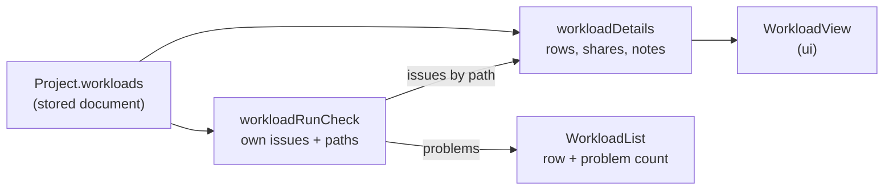

# The Workload Editor

How a workload gets from the project document to what the screen shows, for maintainers new to the code. A workload is the traffic: which workflows run, in what mix, at what rate over time, for how long, from which seed ([UX design §8](../design/user-experience.md#8-workloads)). Today the screen lists a project's workloads and shows a selected one read-only in Details; the editing pieces ([#181](https://github.com/alanbickel/wind-tunnel/issues/181) to [#184](https://github.com/alanbickel/wind-tunnel/issues/184)) extend this guide. A workload isn't a workflow: [the workflow editor](workflow-editor.md) says how workflows work, and the two meet at "Used by" (a workflow's Details names the workloads whose mix has it) and at the mix entries a removed workflow takes with it. Read [the domain model](domain-model.md) and [the user interface](user-interface.md) first.

## A workload, three ways

**1. The stored document.** What `Project.workloads` holds: an `id`, a `name`, `durationMs`, a `seed`, a `mix` of `{ workflowId, weight }` entries, and a `profile` of `{ atMs, requestsPerSec }` points. The engine reads the ids; the user never sees them.

**2. The Details a user reads.** `DescribeSelection` answers a `{ kind: "workload" }` selection with a `WorkloadDetails` (built by `workloadDetails` in [`application/details/`](../../src/application/details/workload-details.ts)): the name, the duration in seconds, the seed, the mix as rows, and the profile as rows. Every word and every sum is made there; [`WorkloadView`](../../src/ui/project/WorkloadView.tsx) only lays them out.

- **A mix row** has the workflow's name, its weight, and its share: "Get order, 80, 80.0%". A workflow the project no longer has reads "A workflow that is no longer in the project." in place of a name, because an id is never shown. An empty mix says "No workflows in the mix. A workload with an empty mix can't run."; otherwise the rows end with "Shares total 100%".
- **A profile row** has a time in seconds and a rate in requests per second, in stored order. A point past the run's end gets a note (below).
- **A share** is the entry's weight over the total, to a tenth of a percent. Rounding each share on its own gives 33.3% three times, which adds to 99.9%, so `mixShares` rounds each down to a tenth and gives the tenths left over, one each, to the entries with the largest remainders (the earlier entry wins a tie). The shares add to exactly 100.0% for any weights, and "Shares total 100%" is therefore true. An entry whose weight isn't positive counts as none (the run's own check refuses it); with no positive weight at all there are no shares to show.
- **A note** is `profileNotes`' for a point past the run's end (`atMs > durationMs`): "After the run's end (30 s). Arrivals follow the line toward this point, and the run stops at 30 s." A point exactly at the end is the end of the line, so it has no note.

**3. The line the engine follows.** The rate is a straight line between the profile's points, level before the first and after the last, cut off at `durationMs`; the mix picks each request's workflow by weight. That's why a point past the end still matters: the line toward it is what the run follows until it stops.



## How an issue finds its row

A workload's own run issues come from `findWorkloadIssues`, which gives each a path into the project: `["workloads", 0, "mix", 2, "weight"]`, `["workloads", 0, "profile", 1, "atMs"]`, or, for an empty mix or profile, `["workloads", 0, "mix"]`. `workloadRunCheck` words them (`ownIssues`) and the Details builder sorts them by that path: the third element is the section (`mix` or `profile`), the fourth, if there is one, the row's index. An issue with an index goes on that row; one without goes on the section. A mix entry's repeated workflow and non-positive weight both land on its row, an unordered profile point and a negative rate both on theirs.

The issues the project bar says (`WorkloadRunCheck.issues`) are these plus the step issues of the workflows in the mix; the step issues show in those workflows' outlines, not here. The list row's count, `WorkloadRunCheck.problems`, counts only the workload's own, so every problem it counts is one Details shows on a row.

## Selecting a workload

- **The list.** Under the workflows list, in the canvas's "Workflows" panel, "Workloads" lists them in project order, a button each, marked `aria-current` while selected, with "· 1 problem" after the name when it has issues. With none, it says what a workload is.
- **Details.** Selecting a workload is a `WorkloadSelection` held by the project screen like any other: the focus goes to Details' heading, and Escape clears the selection and returns the focus to whatever made it, the row or the top bar's Edit. Details has no Remove for a workload yet ([#181](https://github.com/alanbickel/wind-tunnel/issues/181)).
- **The picker follows one way.** Selecting a workload picks it in the top bar, so Run runs what the user is looking at; picking in the bar changes only the bar. Edit, beside the picker, selects the picked workload. `usePickSelectedWorkload` does the picking, and only when the selection changes: a change to the project doesn't pick the selected workload again, or it would undo a pick made in the bar since.
- **Undo and redo.** `selectionAfterUndo` keeps a selected workload while the project has it, and clears it once it doesn't.

## Worked example

[`workload-details.txt`](../../src/adapters/templates/details/workload-details.txt) is each template's workloads as Details shows them, and a stored workload broken by hand: Template A's "Steady day" with an empty mix and a run cut to 30 s. A test writes the file and fails when it goes stale (refresh it with `npx vitest run src/adapters/templates/details --update`). Its last block:

```text
Steady day, broken
Duration: 30 seconds. Seed: 42.
Mix
    Problem: The mix has no workflows.
  No workflows in the mix. A workload with an empty mix can't run.
Profile (time in s, rate in requests/s)
  0  200
  60  200
    After the run's end (30 s). Arrivals follow the line toward this point, and the run stops at 30 s.
```
