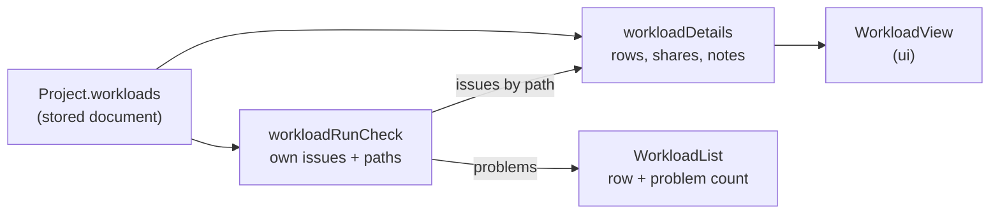

# The Workload Editor

How a workload gets from the project document to what the screen shows, for maintainers new to the code. A workload is the traffic: which workflows run, in what mix, at what rate over time, for how long, from which seed ([UX design §8](../design/user-experience.md#8-workloads)). Today the screen lists a project's workloads, adds, renames, and removes them, and shows a selected one's duration and seed as fields, its mix and its profile as editable tables, the profile with a chart of its line, in Details. A workload isn't a workflow: [the workflow editor](workflow-editor.md) says how workflows work, and the two meet at "Used by" (a workflow's Details names the workloads whose mix has it) and at the mix entries a removed workflow takes with it. Read [the domain model](domain-model.md) and [the user interface](user-interface.md) first.

## A workload, three ways

**1. The stored document.** What `Project.workloads` holds: an `id`, a `name`, `durationMs`, a `seed`, a `mix` of `{ workflowId, weight }` entries, and a `profile` of `{ atMs, requestsPerSec }` points. The engine reads the ids; the user never sees them.

**2. The Details a user reads.** `DescribeSelection` answers a `{ kind: "workload" }` selection with a `WorkloadDetails` (built by `workloadDetails` in [`application/details/`](../../src/application/details/workload-details.ts)): the name, the duration in seconds, the seed, the mix as rows, and the profile as rows. Every word and every sum is made there; [`WorkloadView`](../../src/ui/project/WorkloadView.tsx) only lays them out.

- **A mix row** has the workflow's name, its weight, and its share: "Get order, 80, 80.0%". A workflow the project no longer has reads "A workflow that is no longer in the project." in place of a name, because an id is never shown. An empty mix says "No workflows in the mix. A workload with an empty mix can't run."; otherwise the rows end with "Shares total 100%".
- **A profile row** has a time in seconds and a rate in requests per second, in stored order. A point past the run's end gets a note (below).
- **A share** is the entry's weight over the total, to a tenth of a percent. Rounding each share on its own gives 33.3% three times, which adds to 99.9%, so `mixShares` rounds each down to a tenth and gives the tenths left over, one each, to the entries with the largest remainders (the earlier entry wins a tie). The shares add to exactly 100.0% for any weights, and "Shares total 100%" is therefore true. An entry whose weight isn't positive counts as none (the run's own check refuses it); with no positive weight at all there are no shares to show.
- **A note** is `profileNotes`' for a point past the run's end (`atMs > durationMs`): "After the run's end (30 s). Arrivals follow the line toward this point, and the run stops at 30 s." A point exactly at the end is the end of the line, so it has no note.

**3. The line the engine follows.** The rate is a straight line between the profile's points, level before the first and after the last, cut off at `durationMs`; the mix picks each request's workflow by weight. That's why a point past the end still matters: the line toward it is what the run follows until it stops.



## How an issue finds its row

A workload's own run issues come from `findWorkloadIssues`, which gives each a path into the project: `["workloads", 0, "mix", 2, "weight"]`, `["workloads", 0, "profile", 1, "atMs"]`, or, for an empty mix or profile, `["workloads", 0, "mix"]`. `workloadRunCheck` words them (`ownIssues`) and the Details builder sorts them by that path: the third element is the section (`mix` or `profile`), the fourth, if there is one, the row's index. An issue with an index goes on that row; one without goes on the section. A mix entry's repeated workflow and non-positive weight both land on its row, an unordered profile point and a negative rate both on theirs.

The issues the project bar says (`WorkloadRunCheck.issues`) are these plus the step issues of the workflows in the mix; the step issues show in those workflows' outlines, not here. The list row's count, `WorkloadRunCheck.problems`, counts only the workload's own, so every problem it counts is one Details shows on a row.

## Selecting a workload

- **The list.** The rail's "Workloads" list, opened from its own button and separate from the workflows list, lists them in project order, a button each, marked `aria-current` while selected, with "· 1 problem" after the name when it has issues. With none, it says what a workload is.
- **The dock.** Selecting a workload is a `WorkloadSelection` held by the project screen like any other, and it opens in the bottom dock (`WorkloadDock`), not in the inspector, which closes; Details shows as if nothing were selected, as it does for a finding. The dock holds the same `SelectionDetails` the inspector used to: the focus goes to its heading, and Escape clears the selection and returns the focus to whatever made it, the row or the top bar's Edit. Its header has Remove and Close, and its body starts with the name field ([below](#the-commands)). Fold shrinks the dock to one line and keeps the editor mounted, hidden, so a draft survives; selecting another workload opens it unfolded. The editor's layout is still the inspector's one, a column of fields, mix, and profile; laying it out for the dock's width is a later change.
- **The picker follows one way.** Selecting a workload picks it in the top bar, so Run runs what the user is looking at; picking in the bar changes only the bar. The picker remembers the workload's id and reads the workload from the project each time (`usePickedWorkload`), so a rename shows in it at once; if the project no longer has the picked workload, as after an Undo of its add, the picker shows the project's first. Edit, beside the picker, selects the picked workload. `usePickSelectedWorkload` does the picking, and only when the selection changes: a change to the project doesn't pick the selected workload again, or it would undo a pick made in the bar since.
- **Undo and redo.** `selectionAfterUndo` keeps a selected workload while the project has it, and clears it once it doesn't; an undo or redo that brings a workload back, such as an Undo of its remove, selects it, unless a workflow or a step is selected and still there.

## The commands

The commands in [`workload-edits.ts`](../../src/application/edits/workload-edits.ts) change which workloads a project has, what they're called, and their duration and seed. Each is pure: it takes the project record and returns the next one, and for a workload the project doesn't have, or a change that changes nothing, it returns the record it was given, so `edit` saves nothing for it ([ADR-0019](../adr/0019-edit-projects-with-commands-and-save-each-change.md)).

| Command | What it changes | Undo is named | What it announces |
|---|---|---|---|
| `addWorkload` | Appends a workload with the editor's defaults and a new id. Its name is the first free "workload-1", "workload-2", … (`firstFreeName`, comparing names as the name check does). | "Add workload workload-1" | The bar's status regions say why it can't run: "workload-1 can't run yet: The mix has no workflows." |
| `renameWorkload` | The name, and nothing else. | "Rename workload-1 to Lunch rush" | Nothing: the field shows it. A name that fails its check is announced from Details' region. |
| `removeWorkload` | Takes the workload. The workflows its mix named stay as they are. | "Remove workload Lunch rush" | "Removed Lunch rush." |
| `setWorkloadDuration` | `durationMs`, and nothing else: the profile keeps every point, past the new end or not. | "Change Lunch rush's duration to 45 s" | Nothing: the field shows it. |
| `setWorkloadSeed` | `seed`, and nothing else. | "Change Lunch rush's seed to 7" | Nothing: the field shows it. |
| `addToMix` | Appends an entry for a workflow at weight 1. A workflow already in the mix, or one the project doesn't have, returns the record unchanged. | "Add Get order to Lunch rush's mix" | Nothing: the new row's weight field takes the focus. |
| `setMixWeight` | One entry's `weight`, and nothing else: the entry keeps its place. An entry that isn't there, or the weight it has, returns the record unchanged. | "Change Get order's weight in Lunch rush to 80" | Nothing: the field and the shares show it. |
| `removeFromMix` | Takes one entry; the others keep their weights and order. The last one may go, leaving an empty mix. | "Remove Get order from Lunch rush's mix" | Nothing: the focus goes to the next row's weight, or to "Add to mix". |

| `addProfilePoint` | Adds a point in its place in time order, at the rate the line already has at its time. By default it's 10 s after the last point, at its rate. A time another point has returns the record unchanged. | "Add a point at 10 s to Lunch rush's profile" | Nothing: the new row's time field takes the focus. |
| `setProfilePoint` | A point's time or its rate. A new time moves the point, rate and all, to its place; the other points keep their times and rates. A time another point has, a missing point, or no change returns the record unchanged. | "Change Lunch rush's rate at 50 s to 200 requests/s", or "Change Lunch rush's point at 50 s to 55 s" | "Moved to row 4 of 5." when the row changed. |
| `removeProfilePoint` | Takes one point. The only point stays: the record comes back unchanged. | "Remove the point at 50 s from Lunch rush's profile" | Nothing: the focus goes to the next row's time field, or to "Add point". |

The commands that change a workload share a private `changeWorkload`, which finds the workload, applies the change, and returns the record itself when the workload is missing or the change changes nothing. The mix commands name an entry by its workflow's id. A stored mix that repeats a workflow (a run issue, so only a hand-edited document has one) has two entries with one id; `setMixWeight` and `removeFromMix` act on the first, so the user can remove the repeats one at a time.

## Duration and seed

Details starts with two draft number fields, `WorkloadValueFields`, built from the parts a component's settings use: `useDraft`, `TextField`, `fieldKeys`, `describedBy`. Each commits on Enter or on leaving the field, puts the saved value back on Escape, checks on every render, and keeps a refused value in the field with its message tied to it by `aria-describedby`. A refused value never reaches a command.

| Field | Range | Where the range comes from | Message |
|---|---|---|---|
| Duration, in s | more than 0, no upper limit | The stored schema's `durationSec: z.number().positive()` | "Duration must be more than 0 s." |
| Seed | a whole number, 0 to 4,294,967,295 | The stored schema's seed: an integer in the engine's 32 bits | "Seed must be a whole number from 0 to 4,294,967,295." |

- **Descriptors without evidence.** [`workload-fields.ts`](../../src/application/details/workload-fields.ts) holds the two descriptors, a `RangedFieldDescriptor`: a label, unit, range, and help, and no `evidence`. A component setting's descriptor says how sure its default is, with a fidelity entry; these are the model's and the editor's choices, not claims about AWS, so there's nothing to cite and **fidelity.md has no entry for them**. The schema stays the authority: [`workload-field-ranges.test.ts`](../../src/adapters/persistence/workload-field-ranges.test.ts) feeds each end of each range, and a value just past it, to the stored schema.
- **Seconds typed, milliseconds held.** The user enters seconds, as the stored document holds them, and the domain holds milliseconds. `durationMsOf` converts, rounded to 12 significant digits so 1.005 s is 1,005 ms and not 1,004.9999999999999. The check returns the seconds typed, so the field compares it with the saved seconds and "45.0" is no change.
- **One message for the seed.** Whatever is wrong with a seed draft, the field says the range once, since "must be a whole number" and "at most 4,294,967,295" would both be true of 1.5e10 and say less than the range does.
- **The run.** Editing the workload that ran makes the run on screen out of date; editing another doesn't ([ADR-0018](../adr/0018-tie-a-run-to-the-model-it-ran.md), which compares the workload the run used).

## The mix

[`MixSection`](../../src/ui/project/MixSection.tsx) edits a workload's mix in Details, from the same `WorkloadDetails` the read-only view used. Above the rows is "Shares total 100%" (or, for an empty mix, "No workflows in the mix. A workload with an empty mix can't run." and no total). Each row has the workflow's name, a weight field, its share, and "Remove from mix"; below them, "Add to mix".

- **Weight** is a draft number field ([`WEIGHT_FIELD`](../../src/application/details/workload-fields.ts)): more than 0, fractions allowed, so 0 and -5 are refused with "Weight must be more than 0." The help says weights are relative, once, above the table behind an info control, and each field's `aria-describedby` lists its row's workflow, then the help. The range, like the duration's, is checked against the stored schema in `workload-field-ranges.test.ts`.
- **Add to mix** is a picker of the project's workflows not in the mix, in project order (`MixDetails.addable`). Choosing one saves `addToMix` and moves the focus to the new row's weight field. With nothing to offer it stays focusable but unusable, and says "Every workflow is already in the mix." or, for a project with no workflows, "Add a workflow first."
- **Remove from mix** asks nothing, since an entry is a name and a number and Undo restores it. The focus goes to the next row's weight field, or to "Add to mix" when the last row went. [`useMixFocus`](../../src/ui/project/useMixFocus.ts) holds the request and acts on it after the mix has drawn, as the step outline's `useFocusAfterRedraw` does.
- **Issues** show on the row they belong to, as for any workload. The screen can make only the empty mix; a stored 0 weight shows its issue on a weight field that accepts a positive value, and an entry whose workflow is gone can be removed. The bar says why the workload can't run, from the same `checkWorkloads` answer, and clears it when an entry comes back.

### How the shares are computed, and why they reconcile

A share is an entry's weight over the total, shown to a tenth of a percent. Rounding each on its own breaks the total: three equal weights are each 33.333…%, which rounds to 33.3% three times and adds to 99.9%. `mixShares` instead rounds each share *down* to a tenth, counts the tenths short of 1,000, and gives one each to the entries with the largest remainders (the earlier entry wins a tie). Three weights of 1: the exact shares are 333.33 tenths each; the floors, 333 each, total 999, so one tenth is left, and the first entry (a three-way tie on remainder) takes it: 33.4%, 33.3%, 33.3%. That adds to 100.0% for any weights, so "Shares total 100%" is always true. Nothing in the screen sums them: `mixShares` computes them from the weights again after every command, so a share never goes stale. [`workload-mix-edits.test.ts`](../../src/application/edits/workload-mix-edits.test.ts) builds that example with `addToMix` and checks the sum, after adding, re-weighting, and removing.

### The relation from both sides

A workload names workflows (its mix); a workflow is "used by" the workloads whose mix has it ([the workflow editor's guide](workflow-editor.md#removing-a-workflow)). Removing a workflow takes its entries out of every mix (`removeWorkflow`), and the remaining shares re-sum to 100.0% because they're computed from what's left. **Undo needs no extra code:** the history step holds the whole record from before, so the workflow returns with its entries at their old weights and places. `removeFromMix` then `addToMix` is not an undo: the entry returns last, at weight 1. Only Undo restores weight and place. The workflow removal's confirmation still says "Lunch rush runs it; it leaves its mix."

## The profile

[`ProfileSection`](../../src/ui/project/ProfileSection.tsx) edits a workload's profile in Details: a read-only chart of the line, then a table of the points, then "Add point". Each row has a Time (s) field, a Rate (requests/s) field, any note or issues, and "Remove". The fields are drafts like the mix's, with their descriptors, `TIME_FIELD` and `RATE_FIELD`, in `workload-fields.ts`: both 0 or more (checked against the stored schema in `workload-field-ranges.test.ts`), and a time can't be another point's.

- **A point is addressed by its time**, what the user sees, not by its index: a change of time re-sorts the profile, so an index would name another point afterwards. Time is unique in any profile the commands make (`addProfilePoint` and `setProfilePoint` refuse a taken time), so a point needs no stored id. A stored profile can have two points at one time (a run issue). The screen can't tell them apart, so the commands act on the first, and the user can fix it by changing the first's time, or removing it ([`workload-profile-edits.test.ts`](../../src/application/edits/workload-profile-edits.test.ts) and the screen's test do each).
- **`application/` owns the order.** The commands sort (`inTimeOrder`), and the UI never does. The field only refuses what's wrong with the number, or a duplicate time, with its message. `rowAfterMove` tells the screen where a point will land, to move the focus there and to say "Moved to row 4 of 5." only when the row changed; it counts the earlier points, as the command's sort does. A stored profile that's out of order is shown in stored order, with its issue on the row, and the first edit to it sorts it.
- **Rows are keyed by time** (`pointKeys`), so a point that moves is a new row with a draft of its own, and the focus goes to its time field in its new place (`useProfileFocus`, as `useMixFocus` does for the mix). Remove moves the focus to the next row's time field, or to "Add point" after the last. The only point's Remove stays focusable but unusable, and says "A profile needs at least one point."
- **Undo** puts the whole record back, so a moved point returns to its old place at its old rate. The focus isn't moved by Undo: it stays where the user pressed it.

```mermaid
sequenceDiagram
    actor User
    participant F as Time field (ui)
    participant C as setProfilePoint (application)
    participant E as useProjectEdits (ui)
    participant T as Table (ui)
    User->>F: types 45 over the 20 s row, Enter
    F->>F: checkTimeDraft: a number, 0 or more, not another point's time
    F->>F: rowAfterMove: row 4 of 5, so focus.after(3) and "Moved to row 4 of 5."
    F->>E: edit(setProfilePoint at 20 s to 45 s), named "Change Lunch rush's point at 20 s to 45 s"
    E->>C: command(record)
    C->>C: replaces the point, then sorts all of them: 0, 10, 40, 45, 50
    C-->>E: the next record (the history keeps the one before)
    E-->>T: draws the rows: the moved point is a new row, keyed 45 s
    T-->>User: the focus is on its time field, row 4; the status region says "Moved to row 4 of 5."
```

- **The chart** ([`ProfileChart`](../../src/ui/charts/ProfileChart.tsx)) is a picture of what the run reads, labeled "Request rate over time", with the end marked "Run ends at 60 s". `profileLine` makes its vertices, and takes every rate from the engine's `rateAt`, so the chart and the run can't disagree; its test compares them at several times. It's drawn from the committed table values, not from a draft in a field, so it changes when a command saves. Points past the end are drawn dashed and muted after the marker, and their rows carry the note. The chart has a short label and nothing to focus: the table is its accessible version. Dragging points is out of scope.

## A point past the run's end

A profile point after the duration is allowed: not a run issue, and not a floor the duration field enforces, so shortening a duration never refuses a value the user can see is valid, and never edits the profile. Its row gets the [note](#a-workload-three-ways). What the engine does with it ([UX design §8](../design/user-experience.md#8-workloads), "A point after it is allowed"), pinned by tests in [`arrivals.test.ts`](../../src/domain/engine/arrivals.test.ts):

- **The slope.** The rate is read from the line between points, so a point past the end still sets the rate before it. With 2,000 requests/s at 40 s and 200 at 50 s, a 45 s duration has a rate near 45 s of 1,100, not 2,000 and not 200, and the last five seconds send about 7,750 requests, not the 10,000 a flat 2,000 would.
- **The draws.** `PoissonArrivalProcess` draws candidates at the *highest rate of any point*, then keeps each with probability rate over peak. A later point that doesn't raise the peak changes no arrival; one that does changes the draws (not the rate) of the whole run. The same workload and seed still give the same run, which is all the seed's help claims.

**The defaults** are 60 s, seed 42, an empty mix, and one profile point: 0 s at 100 requests/s. `addWorkload` is the only place that writes them, as named constants (`NEW_WORKLOAD_DURATION_MS`, …). They're the editor's choices, an assumption, not a claim about any system.

**A new workload is complete at once.** A new workflow has to wait as a draft, because a workflow can't be stored without a first step. A workload can be stored with an empty mix: that's a run issue, not an error in the stored document, and it stops only a run of that workload ([UX design §8](../design/user-experience.md#8-workloads), "Problems"). So "Add workload" saves and selects it in one event, and its empty-mix issue shows on its list row, in Details, and in the bar, where the user can see why Run waits. Nothing is held in the UI.

**The name field** ([`WorkloadNameField`](../../src/ui/project/fields/WorkloadNameField.tsx)) is a draft like a workflow's: `useDraft`, `TextField`, and the check `checkWorkloadName` on every render, since the other workloads' names are in the project. It uses the same `nameKey` as the workflow and project names, so "lunch rush" can become "Lunch rush" and another workload's name is refused in any case. Enter or leaving the field saves; Escape puts the saved name back; a bad name stays in the field, `aria-invalid`, with its message in `aria-describedby`. After "Add workload" the field takes the focus with its text selected, as a new component's does.

**Remove** in Details' header asks first, with the focus on Cancel ("Remove Lunch rush?", worded by `workloadRemovalText`, with no warning: a workload's remove takes nothing but itself). Confirming does all of this in one event:

```mermaid
sequenceDiagram
    actor User
    participant D as Details header (ui)
    participant R as useRevealingRemove (ui)
    participant A as useAddAndRemove (ui)
    participant E as useProjectEdits (ui)
    participant P as useProjectRun (ui)
    User->>D: Remove
    D->>User: "Remove Lunch rush?" with the focus on Cancel
    User->>D: Remove (confirms)
    D->>R: remove({ kind: "workload", workloadId })
    R->>R: opens the rail's Workloads list, so Add workload is there to take the focus
    R->>P: pick(workloadAfterRemoval): the next in the list, else the one before, else none
    R->>A: remove(target)
    A->>E: edit(removeWorkload), named "Remove workload Lunch rush"
    E->>E: history keeps the record before; the screen shows the next; the run on screen is compared with it
    A->>A: clear the selection, focus Add workload
    A-->>User: "Removed Lunch rush." from the rail's region
```

- **Why undo brings it back whole.** The history step holds the whole record from before the remove, so Undo puts back the workload with its mix and profile at its place in the list; `removeWorkload` has no inverse to get wrong. `selectionAfterUndo` then selects it, which picks it in the bar.
- **The next pick.** `workloadAfterRemoval` reads the list as it was, before the edit: the workload after the removed one, or the one before if it was last, or none. With none left, the bar says "This project has no workloads to run."
- **The run.** A run of the removed workload stays on screen, out of date: `runIsCurrent` compares the workload the run used, and the project no longer has it. Renaming or removing the workload that ran makes the run out of date; changing any other workload doesn't, and neither does adding one, since no workload a run used has changed.
- **Where the announcement is said.** "Add workload" is in the rail's "Workloads" list, which may be closed, and a live region in a hidden list says nothing. So a workload's remove, like a workflow's, is announced from the rail's region, which always shows, not from beside "Add workload".

## Worked example

[`workload-details.txt`](../../src/adapters/templates/details/workload-details.txt) is each template's workloads as Details shows them, and a stored workload broken by hand: Template A's "Steady day" with an empty mix and a run cut to 30 s. A test writes the file and fails when it goes stale (refresh it with `npx vitest run src/adapters/templates/details --update`). Its last block:

```text
Steady day, broken
Duration: 30 s. Seed: 42.
Mix
  No workflows in the mix. A workload with an empty mix can't run.
Profile (time in s, rate in requests/s)
  0  200
  60  200
    After the run's end (30 s). Arrivals follow the line toward this point, and the run stops at 30 s.
```

[`workload-profile-sequence.txt`](../../src/adapters/templates/details/workload-profile-sequence.txt) is the "Lunch rush" profile of [UX design §8](../design/user-experience.md#8-workloads), built from a new workload's one point by the commands the screen runs, with the table (`time/rate`) after each. A test writes it and fails when it goes stale (the same `--update`). The last step is the move above:

```text
Change Lunch rush's rate at 50 s to 200 requests/s
  0/200  10/200  20/2000  40/2000  50/200
Change Lunch rush's point at 20 s to 45 s
  0/200  10/200  40/2000  45/2000  50/200
  Announced: Moved to row 4 of 5.
```
