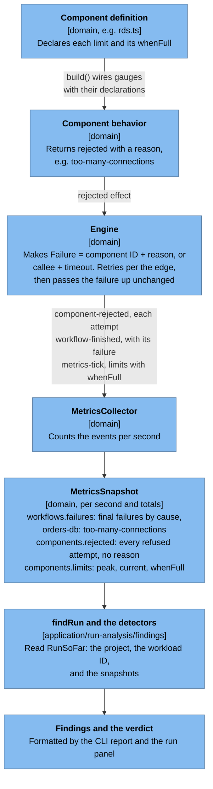
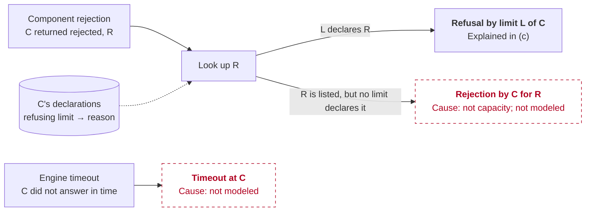
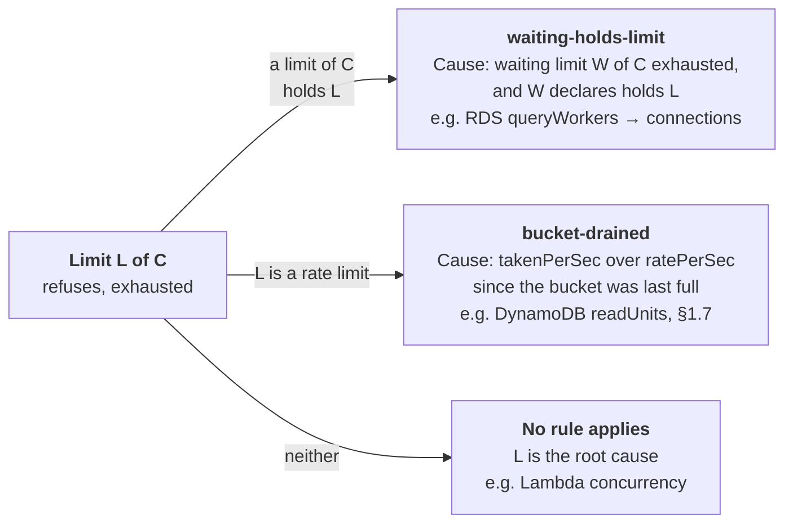

# Findings: What a Run Should Tell You

A run's tables and charts show what happened. A **finding** says what it means: what broke or slowed down, where, when, why, and what would fix it, in sentences backed by the run's numbers. Every run also gets a **verdict**, healthy runs included. This page designs both, before any code ([#47](https://github.com/alanbickel/wind-tunnel/issues/47)). [ADR-0015](../adr/0015-findings-come-from-registered-detectors.md) records the decisions that set precedents.

The method: write what an expert would say about real runs ([§1](#1-hand-written-readings)), work back to the detector that would write each sentence ([§2](#2-detectors)), then fix the shape that those detectors share ([§3](#3-the-shape)).

## How to read this page

**Times** are seconds from the run's start. A snapshot covers one second, `[startMs, endMs)`, and the CLI labels it by its end: the row "t = 15" covers 14 s to 15 s. "From 14 s to 47 s" means the snapshots from the one ending at 15 s through the one ending at 47 s.

**Every sentence carries its evidence.** A claim about the run says where its number comes from:

- **[totals]**: the run's totals snapshot (the CLI's Workflows, Failures, Components, and Limits tables).
- **[snapshots]**: the per-second snapshots (the CLI's per-second tables), with the rule used to read them.
- **[config]**: the project's settings.
- **[trace]**: an observer on the engine's events, written for the reading and not part of the metrics. A detector can't read it, so a sentence that needs it is listed in [§2.3](#23-sentences-no-detector-can-write-today).

A claim about AWS uses the levels in [fidelity.md](fidelity.md#how-to-read-an-entry): **Documented** (with a link, checked 2026-10-21), **Observed** (with its source), or **Assumption**. A claim about what a change *would do in Wind Tunnel* is Observed, with the test or run that shows it. A fix with no source is an assumption and says so. Where a known difference from AWS could change a sentence, the fidelity entry is named.

All runs are seed 42, from `npm run simulate -- --template <id> --workload <id>`. The scenario tests in `src/adapters/templates/scenarios/` check the same lessons on three seeds.

## 1. Hand-written readings

### 1.1 Template A, lunch rush: failing

> **Failing.** 28,841 of 65,963 answered requests failed (43.7%); 11 were still in progress when the run ended.

1. **What, where, when.** orders-db refused 28,841 connections from 14 s to 47 s, failing 23,183 *Get order* and 5,658 *Create order* requests. [totals: Failures; orders-db rejected = 28,841 = the sum of the workflows' failures] [snapshots: every second ending 15–47 s has failures; no other second does; the per-second sum is 28,841]
2. **The limit.** orders-db held all 90 of its 90 connections in every second from 14 s to 47 s. [snapshots: `connections` exhausted in exactly the failing seconds] [config: `maxConnections` 90]
3. **Why: the cause started 3 s earlier.** From 11 s, all 16 of orders-db's query workers were busy, and queries began to wait (4 in the second ending at 12 s, 33 at 14 s). A waiting query holds its connection, so by 14 s, 16 running and 74 waiting queries held all 90. [snapshots: `queryWorkers` exhausted from the second ending 12 s through 49 s; peak queue 74 from 15 s; 16 + 74 = 90] This is the model's rule (fidelity [RDS-2](fidelity.md#rds-2-database-capacity-is-a-fixed-pool-of-query-workers): Assumption).
4. **How far over.** While its workers were full, orders-db completed 892 queries a second on average, against 2,002 requests a second arriving at the peak (20–40 s). About 1,111 a second were refused. [snapshots: means over the seconds ending 21–40 s of orders-db `completed`, workflows' `started`, and `failed`]
5. **Latency of what succeeded.** *Get order*'s p99 rose from about 130 ms before the rush to 204–225 ms at the peak, because successful queries waited behind the line (orders-db's median rose from 15 ms to 98 ms). Failures were instant, so latency understates the damage: the failure rate carries the lesson. [snapshots: workflow and component `latency` per second] [fidelity [RDS-5](fidelity.md#rds-5-refused-connections-fail-instantly)]
6. **Recovery.** The last failure was in the second ending at 47 s, on the way down, when about 860 requests a second were arriving: fewer than the 892 a second the database completes. The line was empty by 49 s, before the rush was back to 200 requests a second at 50 s. [snapshots: `started` 859 in the second ending at 47 s; orders-db `peakQueueDepth` 0 from the second ending at 50 s] [config: the workload's profile]
7. **Fix, in Wind Tunnel.** More query capacity: with `queryWorkers` at 64, queries don't back up and nothing runs out. **Observed:** `lunch-rush.test.ts`, the "fails requests in every second of the peak" test's comment. More connections alone doesn't work: at `maxConnections` 5,000, waiting queries hold all 1,000 of fn-orders' concurrency and Lambda throttles instead. **Observed:** same comment.
8. **Fix, in AWS.** A larger DB instance class: "You can change the CPU and memory available to a DB instance by changing its DB instance class." **Documented:** [DB instance classes](https://docs.aws.amazon.com/AmazonRDS/latest/UserGuide/Concepts.DBInstanceClass.html). That more CPU means proportionally more query throughput is an **Assumption** (RDS-2).
9. **Fix, in AWS: move reads.** 80% of the traffic is reads. Read replicas "scale out beyond the capacity constraints of a single DB instance for read-heavy database workloads", and replicate asynchronously, so reads may be stale. **Documented:** [Working with read replicas](https://docs.aws.amazon.com/AmazonRDS/latest/UserGuide/USER_ReadRepl.html). Not modeled ([RDS-6](fidelity.md#rds-6-no-rds-proxy-read-replicas-or-multi-az)). Template B moves reads to DynamoDB and writes behind a queue, and fails nothing under the same traffic. **Observed:** §1.4.
10. **Not a fix here: RDS Proxy.** A proxy waits for a pooled connection instead of refusing, up to `ConnectionBorrowTimeout` (default 120 s). **Documented:** [RDS Proxy connection settings](https://docs.aws.amazon.com/AmazonRDS/latest/UserGuide/rds-proxy-connections.html). It doesn't add query capacity, so this run's refusals would become waits and then timeouts at the 29 s integration limit (**Assumption**; RDS-6).
11. **What would change this in AWS.** [LMB-8](fidelity.md#lmb-8-rds-connections-are-held-per-invocation-not-per-environment): real Lambda functions hold a connection per warm environment, so connections run out at lower load and stay out after the spike (sentences 2 and 6 are optimistic). [RDS-2](fidelity.md#rds-2-database-capacity-is-a-fixed-pool-of-query-workers): a real database may slow down past saturation instead of holding 892 a second (sentence 4). [ENG-7](fidelity.md#eng-7-users-dont-give-up-or-retry): real clients would retry the 28,841 failures, adding load.
12. **Learn more:** [RDS connection limits depend on instance size](../learning/aws-did-you-know.md#rds-connection-limits-depend-on-instance-size).

### 1.2 Template A, long rush: failing

> **Failing.** 139,042 of 273,536 answered requests failed (50.8%); 10 were still in progress when the run ended.

1. Same mechanism as §1.1, held for longer: connections ran out from 14 s to 146 s, and requests failed in every one of those 132 seconds, all `orders-db: too-many-connections`. [totals; snapshots: failing seconds = `connections` exhausted seconds = 15–146]
2. Query workers were full from 11 s to 149 s, with up to 74 queries waiting. [snapshots]
3. orders-db completed 893 queries a second through the peak (20–140 s) against 1,995 arriving. The throughput didn't grow with time: the shortfall is a rate, not a backlog that would clear. [snapshots: means over the seconds ending 21–140 s]
4. Recovery and fixes as in §1.1 (sentences 6–12).

The long rush adds nothing new for Template A. Its reading confirms that a detector's window follows the run, not the workload's name.

### 1.3 Template A, steady day: healthy

> **Healthy.** All 12,101 answered requests succeeded; 15 were still in progress when the run ended.
> Closest to failing: orders-db connections, at most 14 of 90 (15.5%) from 0 s to 1 s, while fn-orders had 62 cold starts; at most 13 of 90 (14.4%) in the seconds without cold starts.

1. Nothing failed, and no limit ran out. [totals: Failures "None"; Limits "exhausted" all "-"] 12,101 + 0 + 15 = 12,116 started. [totals: Workflows]
2. The headroom line quotes the peaks. [snapshots: per-second `peak` of each limit; fn-orders `coldStarts` 62 in the second ending at 1 s and none after]
3. The verdict doesn't name the limits that make work wait (here, orders-db's query workers, at most 14 of 16): they show in the Limits table, and nothing waited.

### 1.4 Template B, lunch rush: healthy, with a backlog

> **Healthy.** All 65,966 answered requests succeeded; 8 were still in progress when the run ended.
> Closest to failing: orders-db connections, at most 13 of 90 (14.4%).

**Note: writes waited in orders-queue during the rush, and landed up to 6.2 s late.**

1. **What, where, when.** From 15 s to 54 s, all 15 of orders-queue's consumers were busy, and writes waited. [snapshots: `consumerConcurrency` exhausted in the seconds ending 16–54 s] [config: `consumerMaxConcurrency` 15]
2. **How much.** At the peak (20–40 s), writes arrived at 400 a second and were delivered at 313. The backlog grew to 1,937 messages in the second ending at 43 s, and was empty by 54 s. [snapshots: means of orders-queue `arrivals` and `asyncSucceeded`; `peakQueueDepth`; `queueDepth` > 0 at the end of the seconds ending 18–53 s]
3. **What users saw.** *Create order* was answered within 114 ms (p99), because the request ends once the write is queued. The write itself reached orders-db up to 6.2 s later (p99; slowest 6.24 s). That's well under the 29 s that API Gateway would wait for a synchronous answer. [totals: workflow latency; orders-queue `asyncLatency`] [config: the `api->fn-api` edge's `timeoutMs`]
4. **Why it's a note, not a warning.** The backlog emptied before the run ended, and no write took longer than a synchronous request could have waited.
5. **Context.** orders-db never held more than 13 connections, and its query workers peaked at 13 of 16. [snapshots] The headroom line needs no warm-up context: fn-writer, orders-db's only caller, cold-started only in the second ending at 1 s, when orders-db held 5 connections, and the peak of 13 came in the seconds ending 22, 27, and 49 s. [snapshots: fn-writer `coldStarts`; orders-db `connections` peak per second] [config: the one edge to orders-db] The queue's consumer cap is what keeps the database's load down: Template B's design working. A detector can quote these numbers side by side but can't yet say the cap *caused* them (see §2.3).
6. **The trade-off.** Users get "accepted" instead of "done": a new order may not be readable for up to 6 s. **Observed:** this run. See [MVP design §7, "what Template B costs"](mvp-design.md#template-b-serverless-api-with-dynamodb--sqs).
7. **What would change this in AWS.** [SQS-3](fidelity.md#sqs-3-the-consumer-reaches-full-concurrency-instantly): an SQS consumer starts at 5 concurrent invocations and adds up to 300 a minute (**Documented:** [SQS scaling](https://docs.aws.amazon.com/lambda/latest/dg/services-sqs-scaling.html)), so it reaches 15 a little later than the model's instant start. [SQS-4](fidelity.md#sqs-4-batch-size-1-no-batching-window): Lambda pulls up to 10 messages per invocation by default, so each consumer could deliver several writes at once, and the backlog might not build at all (sentence 2 is pessimistic).
8. **Learn more:** [Limit SQS consumers with maximum concurrency, not reserved concurrency](../learning/aws-did-you-know.md#limit-sqs-consumers-with-maximum-concurrency-not-reserved-concurrency).

The verdict's headroom line quotes only limits that refuse work (§3.4). The consumer cap makes work wait, so its story is the note.

### 1.5 Template B, long rush: degraded

> **Degraded.** All 273,539 answered requests succeeded, but 1 finding is a warning; 7 were still in progress when the run ended.
> Closest to failing: orders-db connections, at most 13 of 90 (14.4%).

**Warning: writes landed up to 32.6 s after they were accepted, past API Gateway's 29 s timeout.**

1. **What, where, when.** All 15 of orders-queue's consumers were busy from 15 s to 184 s. Writes arrived at 397 a second during the peak (20–140 s) and were delivered at 314, so the backlog grew by about 83 a second, reached 10,197 in the second ending at 142 s, and was empty by 184 s. [snapshots: as §1.4; growth 397 − 314 = 83 matches the backlog's rise from 1,833 at 40 s to 10,048 at 140 s, 82 a second]
2. **Why it's a warning.** *Create order* was answered within 114 ms (p99), but the write reached orders-db up to 32.6 s later (p99; slowest 32.8 s). That's longer than the 29 s API Gateway waits for an integration, so no synchronous design could have offered this wait. In the seconds from 157 s to 180 s, the p99 of the writes delivered in each second was over 29 s. [totals: orders-queue `asyncLatency`] [snapshots: per-second `asyncLatency.p99Ms`] [config: `api->fn-api` `timeoutMs` 29,000]
3. **Accuracy.** Latency percentiles are bucket upper bounds, up to 5% high ([metrics guide](../architecture/metrics.md)). 32.6 s is clear of 29 s by more than that; the per-second windows near 29 s (such as 29.6 s at 160 s) are not, and a detector says so instead of rounding them into the window.
4. **The longer the peak, the later the writes.** The backlog grew in every 20 s step of the peak. **Observed:** `long-rush-template-b.test.ts`.
5. **Fix, in Wind Tunnel.** More consumers: at `consumerMaxConcurrency` 20, the consumers keep up. **Observed:** `long-rush-template-b.test.ts`, "grows the backlog through the whole peak" test's comment. Check the database first: 20 consumers can hold 20 connections and need more than its 16 query workers at once, so queries would queue there instead (**Assumption**, untested).
6. **Fix, in AWS.** Raise the event source mapping's maximum concurrency (2 to 1,000), keeping the function's reserved concurrency at least that high, "Otherwise, Lambda might throttle your messages." **Documented:** [SQS scaling](https://docs.aws.amazon.com/lambda/latest/dg/services-sqs-scaling.html).
7. **What would change this in AWS.** SQS-4 (batching) could remove the backlog entirely; SQS-3 (ramp-up) would make it drain later. Messages stay for 4 days by default, so this backlog is nowhere near being lost. **Documented:** [SQS message retention](https://docs.aws.amazon.com/AWSSimpleQueueService/latest/SQSDeveloperGuide/sqs-basic-architecture.html). In AWS, watch `ApproximateAgeOfOldestMessage`, "the age of the oldest unprocessed message in the queue". **Documented:** [SQS CloudWatch metrics](https://docs.aws.amazon.com/AWSSimpleQueueService/latest/SQSDeveloperGuide/sqs-available-cloudwatch-metrics.html).
8. **Learn more:** [SQS messages expire if the backlog lasts too long](../learning/aws-did-you-know.md#sqs-messages-expire-if-the-backlog-lasts-too-long).

**As built (#62).** The late-async-work detector reads only the per-second snapshots, which is all the run panel has, and percentiles of separate seconds can't be merged into the run's. So the finding quotes the slowest delivery (32.8 s, an exact maximum) and the highest per-second p99, not the run's p99 of 32.6 s from the totals. It reports 23 seconds over 29 s, 7 of them within the histogram's error.

The headroom line needs no warm-up context, as in §1.4: fn-writer cold-started only in the second ending at 1 s (orders-db held 5), and orders-db's peak of 13 came first at 22 s and recurred through 156 s. [snapshots: fn-writer `coldStarts`; orders-db `connections` peak per second]

### 1.6 Template B, steady day: healthy

> **Healthy.** All 12,106 answered requests succeeded; 10 were still in progress when the run ended.
> Closest to failing: orders-db connections, at most 6 of 90 (6.6%).

orders-queue's consumers were all busy in the first second, while fn-writer cold-started 15 environments, and at most 8 of 15 after it. That's in the Limits table; the verdict doesn't name limits that make work wait.

1. No message was still waiting at the end of any second, so there's no backlog note. [snapshots: `queueDepth` 0 at every second's end; `peakQueueDepth` 1 in the first second only]
2. Writes landed within 248 ms (p99); the slowest took 1.24 s. [totals: orders-queue `asyncLatency`] fn-writer's 15 cold starts all came in the first second. [snapshots: `coldStarts`] Whether the slowest write was one of those isn't traced: the snapshots don't link a delivery to a cold start.
3. A cold start holds a concurrency slot, so the first second's 15 cold starts filled the cap. **Documented** for Lambda: [execution environment lifecycle](https://docs.aws.amazon.com/lambda/latest/dg/lambda-runtime-environment.html) (see [Did you know?](../learning/aws-did-you-know.md#cold-starts-count-toward-lambda-concurrency)). **Observed** for the model: `steady-day.test.ts`, the Template B test's comment.
4. **No warm-up context on the headroom line.** fn-writer calls orders-db, but its cold starts held only 5 connections. orders-db's peak of 6 came in the seconds ending 3 s and 60 s, after them. [snapshots: fn-writer `coldStarts` 15 in the second ending at 1 s and none after; orders-db `connections` peak per second]

### 1.7 Variant: Template B, long rush, read capacity cut to 1,500 a second: failing

Not a shipped workload. It's here because it's the case the issue names: a failure whose cause starts long before it. To reproduce, set `orders-read`'s `readUnitsPerSec` to 1500 in `template-b.json` (don't commit it) and run the long rush. Under the lunch rush the same change fails nothing.

> **Failing.** 4,377 of 273,539 answered requests failed (1.6%); 7 were still in progress when the run ended.

1. **What, where, when.** orders-read throttled reads from 95 s to 141 s. 4,377 *Get order* requests failed, all `orders-read: throttled`. [totals: Failures] [snapshots: failing seconds = `readUnits` exhausted seconds = 96–141]
2. **Why: the cause started 76 s earlier.** orders-read's read bucket was last full at 18 s. From 19 s, reads took more tokens than the bucket refilled in every second, about 1,600 a second against 1,500, so the bucket's 7,500 tokens of burst ran down by about 100 a second. It ran out at 95 s. [snapshots: `readUnits.current` < 1 last at the second ending 18 s; `takenPerSec` > `ratePerSec` in every second ending 20–96 s; `peak` 7,500 from 96 s] [config: 1,500 × `burstSec` 5 = 7,500] ADR-0014's formula gives the same time: (7,500 − 1) ÷ (1,600 − 1,500) ≈ 75 s after 19 s.
3. **Retries rescued most reads.** orders-read refused 64,201 read attempts; the edge's 4 attempts got all but 4,377 requests through. 278,914 attempts = 214,713 completed + 64,201 refused. [totals: orders-read arrivals, completed, rejected] The retries cost time: *Get order*'s p99 rose from about 105 ms to 168–194 ms while throttling lasted. [snapshots] In AWS, the SDKs retry throttled DynamoDB requests on their own. **Documented:** [DynamoDB error handling](https://docs.aws.amazon.com/amazondynamodb/latest/developerguide/Programming.Errors.html). So a throttle may reach your code only as latency ([Did you know?](../learning/aws-did-you-know.md#your-code-may-never-see-a-dynamodb-throttle-because-the-sdk-retries-it)).
4. **Recovery.** Once the rush eased, the bucket refilled: full again at 152 s. [snapshots]
5. **Fix, in Wind Tunnel.** Provision for the sustained rate, not the burst: at 2,500 reads a second (the template's setting) nothing fails. **Observed:** §1.5.
6. **What would change this in AWS.** Probably everything: [DDB-1](fidelity.md#ddb-1-every-request-costs-one-capacity-unit) (default reads are eventually consistent and cost half a unit, so 1,500 units serve 3,000 reads a second), [DDB-2](fidelity.md#ddb-2-the-burst-bucket-starts-full-and-is-reliable) (AWS keeps up to 300 s of burst, not the template's 5 s), [DDB-4](fidelity.md#ddb-4-throttled-requests-fail-immediately) (the SDK backs off from 1,000 ms for throttles, not 25 ms). The variant teaches the shape of a finding, not a fact about DynamoDB.
7. **Learn more:** [DynamoDB saves up unused capacity for bursts](../learning/aws-did-you-know.md#dynamodb-saves-up-unused-capacity-for-bursts).

The variant's queue is unchanged, so it also gets §1.5's warning about late writes, below the failure.

### 1.8 Variant: Template B, lunch rush, database connections cut to 10: healthy, with failed deliveries

Not a shipped workload. It's the case [#69](https://github.com/alanbickel/wind-tunnel/issues/69) names: a queue's deliveries fail, but no request does, because each sender was told "accepted" before the write was tried. To reproduce, set `orders-db`'s `maxConnections` to 10 in `template-b.json` (don't commit it; the queue has 15 consumers) and run the lunch rush. The **[trace]** numbers come from an observer that matched each failed delivery to the rejection in its call.

As designed, not as built: today the verdict's second line reads "Closest to failing: orders-db connections, at most 10 of 10 (100.0%)", and the only finding is retries-absorbed's, which misreads the run (sentence 8).

> **Healthy.** All 65,966 answered requests succeeded; 8 were still in progress when the run ended.
> No headroom: orders-db connections ran out in 39 seconds from 14 s to 54 s, and orders-db refused 90 attempts; no request failed with its rejections.

**Note: orders-db refused 90 of orders-queue's deliveries, all too-many-connections, and the queue tried each again.**

1. **What, where, when.** From 16 s to 53 s, in 33 seconds, 90 of orders-queue's 13,191 delivery attempts failed (0.7%). Each was fn-writer's call to orders-db, refused with `too-many-connections`; that edge makes one attempt, so the refusal failed the delivery. [totals: orders-queue `asyncFailed` 90; fn-writer `failed` 90 and `arrivals` 13,191; orders-db `rejected` 90] [config: `fn-writer->orders-db` `maxAttempts` 1] [trace: all 90 failures carry that cause] [totals: orders-queue `asyncFailures` `{ "orders-db: too-many-connections": 90 }`, by cause since [ADR-0017](../adr/0017-count-failed-async-deliveries-by-cause.md)]
2. **The limit.** orders-db held all 10 of its connections in 39 seconds from 14 s to 54 s. Its query workers peaked at 10 of 16, and no query waited, so this isn't §1.1's cause: the connections ran out on their own. [snapshots: `connections` exhausted in the seconds ending 15 and 17–54; `queryWorkers` peak 10; `peakQueueDepth` 0] [config: `maxConnections` 10]
3. **Why.** orders-queue delivers up to 15 messages at once, and each delivery holds one orders-db connection while its query runs, so the consumers can ask for more connections than orders-db has. [config: `consumerMaxConcurrency` 15, `maxConnections` 10] They do only in bursts: a delivery spends about 20 ms in fn-writer before its 15 ms query (the medians), so most of the time fewer than 10 queries run at once. With 90 connections, §1.4's orders-db never held more than 13, in the seconds ending 22, 27, and 49 s, so under this workload the bursts reach 13 and no further. **Observed:** §1.4.5. That the consumers cause the bursts is a claim about the architecture that no detector can make yet (§2.3).
4. **What it cost: hardly any throughput.** At the peak (20–40 s), writes were delivered at 311 a second against 400 arriving, as in §1.4 (313). The backlog peaked at 1,970 in the second ending at 43 s (§1.4: 1,937), and was empty by 54 s. [snapshots: means of orders-queue `arrivals` and `asyncSucceeded` over the seconds ending 21–40; `peakQueueDepth`; `queueDepth`]
5. **What it cost: late writes for the messages that failed.** A failed message goes to the back of the backlog ([SQS-1](fidelity.md#sqs-1-failed-messages-come-back-immediately)), so it waits again behind every message then waiting: up to 1,970 here. The slowest delivery took 15.6 s, against 6.24 s in §1.4. [snapshots: highest `peakQueueDepth` in a second with a failed delivery, 1,970 at 43 s; `asyncLatency.maxMs` 15,580 in the second ending at 53 s] [trace: the 10 slowest deliveries were all of messages that had failed; no message that never failed took over 6.33 s] The totals' p99 barely moves (6.5 s; §1.4: 6.2 s), because 87 messages are 0.7% of 13,097.
6. **Attempts, not messages.** The 90 failed attempts were 87 messages: 84 failed once and 3 twice. [trace] The metrics count attempts, as `rejected` does, so the note says "90 deliveries", which is at most 90 messages. The counts reconcile: attempts (fn-writer's 13,191 arrivals) = 13,097 delivered + 90 failed + 4 being delivered, and messages accepted (13,101) = 13,097 delivered + 0 waiting + 4 being delivered. [totals: orders-queue `completed`, `asyncSucceeded`, `asyncFailed`, `queueDepth`, being delivered; fn-writer `arrivals`]
7. **Why it's a note.** No request failed: each sender was answered "accepted" (§1.4.3). The failures stopped before the run ended (the last in the second ending at 53 s), and the backlog was empty by 54 s, so nothing was left going round. [snapshots] It would be a warning if a delivery failed in the last second of a finished run: messages would still be failing, with nothing in the run to say they'd ever land. It's never a failure, which means requests failed (§3.2).
8. **Not "callers retried".** As built (#68), retries-absorbed reads this run as "orders-db refused 90 attempts, but no request failed with its rejections: callers retried every one". No caller retried: the edge makes one attempt, and the queue redelivered. Its fixes are §1.1's (raise `queryWorkers`), for a cause that didn't happen here: the workers never filled. [config; snapshots as sentence 2]
9. **Fix, in Wind Tunnel: give every consumer a connection.** At `maxConnections` 15, nothing fails, and the run matches §1.4 (311 → 313 delivered a second; slowest 6.24 s). **Observed:** this variant, under the lunch and long rushes. Shrinking the consumers to fit the database is worse: at `consumerMaxConcurrency` 10, nothing fails, but writes are delivered at 208 a second against 400 arriving, the backlog reaches 4,770, and 2,661 messages are still waiting when the run ends (**Degraded**). **Observed:** this variant. The 15 consumers were needed; the connections past 10 were needed only in bursts, and none past 13 (sentence 3), so any `maxConnections` of 13 or more matches §1.4 under this workload. 15 is still the advice: it covers every consumer whatever the burst, and the long rush, with more bursts, fails nothing at 15 either.
10. **Fix, in AWS.** Raise `max_connections` or move to a larger instance class, so the database takes as many connections as the queue can send (**Documented:** [RDS maximum connections](https://docs.aws.amazon.com/AmazonRDS/latest/UserGuide/CHAP_Limits.html#RDS_Limits.MaxConnections), see [RDS-1](fidelity.md#rds-1-the-default-connection-limit-isnt-tied-to-an-instance-size)). Or put RDS Proxy in front, so a delivery waits for a pooled connection instead of being refused (**Documented:** [RDS Proxy connection settings](https://docs.aws.amazon.com/AmazonRDS/latest/UserGuide/rds-proxy-connections.html); not modeled, [RDS-6](fidelity.md#rds-6-no-rds-proxy-read-replicas-or-multi-az)). Either way, set a redrive policy with `maxReceiveCount` at least 5 and a dead-letter queue, and watch it (**Documented:** [configuring an SQS event source mapping](https://docs.aws.amazon.com/lambda/latest/dg/services-sqs-configure.html)).
11. **What would change this in AWS.** The visibility timeout: a failed message stays hidden for it (30 s by default; Lambda recommends at least six times the function's timeout) before it's tried again, so each of the 87 writes would land at least 30 s late, past API Gateway's 29 s. **Documented:** [SQS visibility timeout](https://docs.aws.amazon.com/AWSSimpleQueueService/latest/SQSDeveloperGuide/sqs-visibility-timeout.html), [configuring an SQS event source mapping](https://docs.aws.amazon.com/lambda/latest/dg/services-sqs-configure.html). The model's immediate redelivery makes sentence 5 optimistic ([SQS-1](fidelity.md#sqs-1-failed-messages-come-back-immediately)). [LMB-8](fidelity.md#lmb-8-rds-connections-are-held-per-invocation-not-per-environment): a warm Lambda environment holds its connection between invocations, so fn-writer's 15 environments would want 15 connections all the time, and refusals would be steady, not rare (sentence 3 is optimistic; **Assumption**). [SQS-4](fidelity.md#sqs-4-batch-size-1-no-batching-window): with batches, one refused write returns its whole batch unless the function reports partial batch failures (**Documented:** same page).
12. **Learn more:** [A failed SQS message waits out the visibility timeout before it's retried](../learning/aws-did-you-know.md#a-failed-sqs-message-waits-out-the-visibility-timeout-before-its-retried).

The run also gets §1.4's backlog note. The note above doesn't explain it, though the failures added to it: the metrics can't say which deliveries were redelivered messages (§2.3).

**The long rush.** Under the long rush, the same change makes 445 deliveries fail (442 messages), from 16 s to 185 s. [totals] [trace] The run is **Degraded** by §1.5's late-writes warning, which now quotes a slowest delivery of 59.8 s, not 32.8 s: every delivery slower than 33.4 s was of a message that had failed. [snapshots: `asyncLatency.maxMs`] [trace] The warning is right, and failed deliveries are its worst case, but no detector can link the two (§2.3). This run also shows why the cause has to be recorded: orders-db refused 2 attempts in the second ending at 119 s, and orders-queue counted 1 failed delivery in it and 1 in the next, because a delivery fails a moment after its refusal. The per-second counts don't line up even when every refusal is a delivery's. [snapshots: orders-db `rejected`, orders-queue `asyncFailed`]

## 2. Detectors

Each detector reads a `RunSoFar` (the project and the snapshots so far) and returns findings. The table maps every sentence above to the detector that would write it.

### 2.1 The detectors

| Detector | Fires when | Reads | Quotes | Severity | Sentences |
|---|---|---|---|---|---|
| **failed-requests** | Any workflow failure, one finding per cause (`"<component>: <reason>"`) | Workflow `failures` per snapshot; totals | Failed count, by workflow; share of answered; window (first to last second with that cause); worst second | failure | 1.1.1, 1.2.1, 1.7.1 |
| *limit-refused* (part of failed-requests) | The cause's component has a limit that refuses with that reason, exhausted in the failing seconds | That limit's `peak` per snapshot; the component's `rejected` | Limit, peak, seconds exhausted; refusals = failures when nothing retried them (retries-absorbed compares them when callers retried) | (part of failed-requests) | 1.1.2, 1.2.1, 1.7.1 |
| **waiting-holds-limit** | A limit that makes work wait is exhausted, and declares that its waiting work holds another limit (whether or not that one ran out) | Both limits' `peak`; the component's `peakQueueDepth`, `completed`, and `arrivals` | When waiting began (cause window start), running + waiting = limit, throughput while saturated vs arrivals | note, explaining the held limit | 1.1.3, 1.1.4, 1.2.2, 1.2.3 |
| **bucket-drained** | A rate limit is exhausted | That limit's `current`, `peak`, `takenPerSec`, `ratePerSec` per snapshot | Last second the bucket was full; when the drain began (cause window start); mean flow vs rate over the drain, burst size, time to drain | note, explaining its own limit | 1.7.2 |
| **retries-absorbed** | A component refused more attempts than requests failed with its rejections, none failing included | The component's `rejected` and limit declarations; workflow `failures`; latency per snapshot | Attempts refused vs requests failed, and whether they're of one reason; the median second's p99 before vs during, and the highest during | note | 1.7.3 |
| **backlog** | A limit that makes work wait and holds no other limit is exhausted, and its component had messages waiting at the end of a second | That component's `queueDepth`, `peakQueueDepth`, `arrivals`, `completed`, `asyncSucceeded`, `asyncLatency`; the limit's `peak` and `current` | Window, when the limit ran out, peak backlog and when, arrival vs delivery rate and growth up to the peak, when it emptied, slowest delivery and highest p99; if messages are still waiting, accepted = delivered + waiting + being delivered | note; warning if messages are still waiting at the end of a finished run | 1.4.1–1.4.4, 1.5.1, 1.8.4 |
| **late-async-work** | A queue's async p99 is over the timeout of its workflow's entry edge | Per-second `asyncLatency` (p99 and max); workflow latency; the entry edge's `timeoutMs` | The slowest delivery; the seconds whose p99 is over, and how many are within the error; the highest answered p99 of those seconds; the reference timeout | warning | 1.5.2, 1.5.3 |
| **failed-deliveries** | Any failed async delivery, one finding per cause (`"<component>: <reason>"`) | Each component's `asyncFailures` per snapshot ([ADR-0017](../adr/0017-count-failed-async-deliveries-by-cause.md)); the cause's limits through limit-refused; the queue's `peakQueueDepth` and `queueDepth`; for the share and the reconciliation, the queue's `completed`, `asyncSucceeded`, and `asyncFailed`, and its consumer limit's `current` (being delivered) | Failed attempts, by queue, and their share of its attempts (`asyncSucceeded` + `asyncFailed` + being delivered); window; the refusing limit; the most messages waiting in a second with a failure; whether the backlog emptied, or that deliveries were still failing at the end | note; warning if a delivery failed in the last second of a finished run | 1.8.1, 1.8.2, 1.8.5 (its first half), 1.8.6, 1.8.7 |
| *recovery* (part of failed-requests) | The failure ends before the run does | The finding's window; the limit's peak after it | Last bad second, when the waiting cleared | (part of failed-requests) | 1.1.6, 1.7.4 |
| **verdict** | Always | All findings; workflow totals; every limit's peaks; `coldStarts`; for a run that isn't failing, the seconds each refusing limit was exhausted and its component's `rejected` in them | Level, request counts, closest to failing, warm-up context | (the verdict) | every summary line |

**Parts aren't detectors.** A detector returns whole findings, and `findRun` nests them only by `causedBy` (§3.5), so no detector can add a reason to another's finding. *limit-refused* and *recovery* write reasons in failed-requests' finding, so they're helpers that failed-requests calls, not registered detectors. The backlog finding quotes its own end.

**As built (#67): the cause notes.** Both notes read only the `whenFull` declarations and the limit's kind, and quote what the readings quote, with these differences:

- *waiting-holds-limit* quotes the unbroken run of seconds with the waiting limit out that leads into the held limit's first second out: 11 s to 49 s in §1.1, and it says the workers were also full in 1 other second (the run's first). "Running" is the waiting limit's size and "waiting" the component's highest `peakQueueDepth` in those seconds, so it assumes the component's queue is the line for that limit, as it is for RDS. Its throughput and arrivals are means over the seconds with both limits out, from the component's own `completed` and `arrivals` (attempts, refused ones included), not over the workload's peak: 896 against 1,770 a second in §1.1 (14–47 s), and 894 against 1,947 in §1.2. If the held limit never ran out, the note shows on its own, over the seconds the waiting limit was out.
- *bucket-drained*'s cause window starts where the drain began: the end of the last second before the first second out that ended with less than one token missing, or the run's start if none did (18 s in §1.7). It doesn't start at the unbroken run of seconds with `takenPerSec` over `ratePerSec` (19 s in §1.7): a second at or under the refill can still draw the bucket down, as 18–19 s does, and a drain measured from there would quote the burst and the formula for a bucket already part drawn. The mean flow covers the drain, the second it ran out included (1,595 against 1,500 in §1.7). The time the burst lasted is given as the bounds of the second it ran out (77 s to 78 s), and ADR-0014's formula, (burst − 1) ÷ (flow − rate), gives about 78.9 s at the mean flow.

**As built (#68): retries-absorbed and backlog.** Both read only the `whenFull` declarations, with these differences from the readings:

- *backlog* reads the seconds with a backlog: those that ended with messages waiting, and the second each backlog emptied in (17 s to 54 s in §1.4, 17 s to 184 s in §1.5). Its `causeWindow` starts where the limit ran out, in the unbroken run of seconds out that leads into the backlog: 15 s in both. Its rates are means over the seconds with a backlog up to the peak's, not over the workload's peak: 385 arriving against 312 delivered a second in §1.4 (17–43 s), so it grew by about 73 a second, and 395 against 314 in §1.5, about 81. As late-async-work does, it quotes the slowest delivery and the highest p99 of a second, not the run's p99 from the totals. It compares no latency with a timeout: late-async-work does that, and the backlog note shows beneath it. When messages are still waiting, "being delivered" is the limit's slots held at the end of the last second, not a remainder, so the sum accepted = delivered + waiting + being delivered is a check that a test makes.
- *retries-absorbed* is per component. The detectors can't see the registry's `rejectionReasons`, so a component's reasons are those its limits declare and any its failures carry; for every AWS type, that's the type's list. It quotes the p99 of the median second (the lower middle of an even count, so one second's own p99), because percentiles of separate seconds can't be merged and the median isn't moved by the first seconds' cold starts: in §1.7, *Get order*'s p99 was 108 ms before the refusals and 185 ms during them, and up to 445 ms in the second throttling began in full. The note names the refusing limits that ran out while it refused, with their fixes and causes, except those the failure finding already names (a limit out in a second with the component's failures); so when none failed, it names them all, and a limit whose refusals were all retried is named even when requests failed elsewhere at the component. limit-refused now says only that refused attempts equal failed requests, when they do, so the comparison appears once.

**As designed (#69): failed deliveries.** §1.8's reading settles these, for the detector's issue to build:

- *failed-deliveries* mirrors failed-requests, with queues in place of workflows. Its key is the cause's (`kind`, the refusing component, and the reason), so it's orders-db's finding, not orders-queue's: that's where the work was refused, and the node to highlight. limit-refused fills `limitNames`, so a cause note that explains the limit (waiting-holds-limit, bucket-drained) shows beneath it, as under a failure. In §1.8 neither applies, so the limit is the root cause, as in diagram (c); why it ran out, the consumer cap, is §2.3's call-graph gap. The finding explains nothing itself (`explains` undefined), so it shows at the top level. Its `affected` is undefined, because attempts aren't messages (1.8.6), so it orders by window like late-async-work. A cause the lookup in (b) doesn't resolve to a limit (a timeout, or a reason no limit declares) still gets a finding, naming its component and reason only.
- *Fixes* are the refusing limit's advice plus advice for the queue's type under the finding's kind: for SQS, the redrive policy and dead-letter queue (1.8.10). That makes the catalog keyed by type and kind as well as by type and limit, a change to ADR-0015 that its [second addendum](../adr/0015-findings-come-from-registered-detectors.md#addendum-2026-10-22-failed-deliveries) records with the verdict's.
- *Advice that depends on a cause moves to that cause's note.* RDS `connections` lists "raise `queryWorkers`" and "more connections alone moves the failure upstream", which hold only when waiting queries hold the connections (1.1.3). In §1.8 the workers never filled, so those fixes are wrong there (1.8.8). They move to waiting-holds-limit's finding, keyed by the waiting limit (`queryWorkers` already has the first), and `connections` keeps the fixes that hold whatever the cause.
- *retries-absorbed* counts a component's rejections that ended deliveries alongside those that ended requests, from `asyncFailures`. A component fires only when it refused more attempts than both together, so the note means what it says: a caller retried. In §1.8, 90 refused = 0 failed requests + 90 failed deliveries, so it doesn't fire.
- *The verdict* changes for every run, not only queues: a run that isn't failing names a refusing limit that ran out and refused instead of quoting its headroom (§3.4).

**Which queue the backlog detector reads.** Both waiting limits in these runs have a queue: SQS's messages and RDS's waiting queries (`queueDepth` on both). The declarations (§2.2) tell them apart. A waiting limit that holds another limit, such as RDS `queryWorkers`, is explained only by waiting-holds-limit. One that holds nothing, such as SQS `consumerConcurrency`, gets a backlog finding, read from its own component's `queueDepth`.

**Thresholds.** None of the rules has a tuned number. Each fires on an exact state: a failure, an exhausted limit, a message still waiting at a second's end, or a latency past a timeout the project itself sets. That's deliberate: the detector reports the mechanism, not a guess at when to worry. The one comparison that needs care is a percentile against a timeout, because percentiles are up to 5% high (1.5.3). A detector compares the bucket's upper bound and says when the result is within that error.

**Fixes and AWS facts** aren't computed. Each comes from a catalog entry keyed by component type and limit, with its evidence level, its fidelity IDs, and its Did-you-know anchor. A test checks that every Documented entry has a link and every Observed entry names its source. The Wind Tunnel fixes cite the scenario test that proves them.

### 2.2 Declarations the detectors need

The detectors need three facts about a limit that only its component type knows. Each component declares them with its limits (ADR-0014's `LimitGauge`), and they're copied into `LimitUse`, so detectors stay generic:

| Declaration | Example | Used by |
|---|---|---|
| **When full, the limit refuses or makes work wait** | RDS `connections` refuses; RDS `queryWorkers` and SQS `consumerConcurrency` make work wait | verdict (only limits that refuse get a headroom line), waiting-holds-limit, backlog |
| **The rejection reason it produces** | RDS `connections` → `too-many-connections`; DynamoDB `readUnits` → `throttled` | failed-requests, through limit-refused (matching a failure cause to its limit) |
| **Which other limit waiting work holds** | RDS `queryWorkers` → `connections`; SQS `consumerConcurrency` → none | waiting-holds-limit, backlog (only a waiting limit that holds none gets a backlog finding) |

DynamoDB's read and write buckets both refuse with `throttled`. The detector picks the one exhausted in the failing seconds; if both were, it names both.

failed-deliveries needs no new declaration: limit-refused already resolves a cause to its limit, and only a component that delivers async work has `asyncFailures`. What it needs is in the metrics: the cause of each failed delivery ([ADR-0017](../adr/0017-count-failed-async-deliveries-by-cause.md)).

### 2.3 Sentences no detector can write today

| Sentence | Why not | What it would take |
|---|---|---|
| 1.1.7, 1.5.5, 1.8.9: "with this setting, nothing fails" | The evidence is another run | The catalog cites the test for now; later, a "try this fix" re-run |
| 1.4.5: "the cap kept orders-db at 13 connections"; 1.8.3: "15 consumers can ask for more than orders-db's 10 connections" | It's a claim about the architecture, not the metrics: a queue delivers at most `consumerMaxConcurrency` at once, and each delivery holds one connection | Reasoning over the call graph: which limit upstream bounds a limit downstream. The verdict's warm-up context (§3.4) looks one hop up the call graph, which is all it needs; this would need the whole path |
| 1.8.5, and §1.8's long rush: "the slowest deliveries were of messages that had failed" | A delivery's latency doesn't say whether its message failed before | Delivery latency split by whether the message was redelivered, per queue. It would also let failed-deliveries explain a late-writes warning or a backlog note |
| 1.8.6: "90 attempts were 87 messages" | The metrics count attempts | A count of messages whose first delivery failed, per queue |
| 1.5.2: "*n* writes landed after 29 s" | The histogram gives percentiles, not exact counts above a value | Counting async deliveries over the entry timeout, per window |
| How long the oldest message has waited, while it waits | `asyncLatency` is measured on delivery | A per-queue gauge of the oldest waiting message's age |
| "Queries waited about 80 ms in line" | Component latency includes the wait; there's no separate wait time | A wait-time histogram per queuing limit. Little's law (74 waiting ÷ 892 a second ≈ 83 ms) gives an estimate, labeled as one |
| Average use of a limit over a second | Snapshots give `peak` and `current`, not the mean | Not needed: peaks are what cause waiting and refusals (ADR-0014) |

### 2.4 How a failure reaches a finding

Three diagrams. The first shows where a rejection reason travels, from the component that rejects to the finding that explains it. The second resolves a failure cause to a limit, and the third explains why that limit ran out. Every box in (a) is built.

**(a) Where reasons travel.** A component names its reason, the engine attaches the component's ID, and the failure reaches the snapshots unchanged, however many callers it passes through. The declarations travel on a separate path, with each limit's use.



**(b) Resolving a cause.** Each failure cause is a component C and a reason R. failed-requests resolves it with one lookup in C's declaration table, the same for every component and every reason; the reason is only the key. R is always one of the reasons C's type lists in `rejectionReasons` ([ADR-0016](../adr/0016-component-types-list-every-rejection-reason.md)). A cause has one of three outcomes. Red outcomes are ones the design doesn't yet explain.



**(c) Explaining an exhausted limit.** Why L ran out depends on L's kind and on the declarations of C's other limits, not on the reason. Each rule is a separate detector. Every rule that applies adds a cause note (`causedBy`), so the rules have no order. If none applies, L itself is the root cause.



What the diagrams show:

- **Resolution is generic.** It's the same lookup for every component and every reason, so no reason gets its own logic. Reasons don't need to be unique across types (`throttled` is a token bucket in DynamoDB and a concurrency limit in Lambda), and a new type adds entries to its own table only.
- **The declarations are checked where each type is defined.** The component guide describes [rejection reasons](../architecture/component-definitions.md#rejection-reasons) and [what a full limit does](../architecture/component-definitions.md#what-a-full-limit-does), with what catches each mistake.
- **Several limits may share a reason.** The detector picks the one exhausted in the failing seconds, or names both (DynamoDB's two buckets).
- **Waiting limits never appear as causes in (b).** A limit that makes work wait never rejects. It appears in (c) as the cause of another limit's refusals, or as a backlog when it holds nothing.
- **The engine marks a timeout by its reason.** A failure is a timeout when its reason is `timeout`, so no type may list that reason, and the contract checks it.
- **Reasons survive only on final failures.** `rejected` counts every refused attempt without its reason, so a rejection that a retry rescued appears only in that count. retries-absorbed compares `rejected` with the failures by cause, which is exact only for a component that refuses with one reason. Counting rejections by reason per component would close this gap.
- **Two outcomes in (b) are unexplained,** shown in red. A timeout names the component that didn't answer, but not why. A rejection for a reason no limit declares (none is modeled yet; a failed validation would be one) names its component and reason only, until the catalog gives reasons wording of their own.
- **Failed async deliveries never reach `workflows.failures`.** Their requests were already answered. They're counted in the queue's `asyncFailed`, and by cause, in the same form, in its `asyncFailures` ([ADR-0017](../adr/0017-count-failed-async-deliveries-by-cause.md)). failed-deliveries will resolve each cause with the same lookup in (b) (§1.8). Until that detector is built, diagram (a) shows no cause for them.

## 3. The shape

### 3.1 A finding

```ts
/** One thing a run did that the developer should know about. */
interface Finding {
  /** Stable across re-runs of the same project, e.g. "failed-requests:orders-db: too-many-connections". */
  readonly id: string;
  readonly detectorId: string;
  readonly severity: Severity;
  /** Where: the component to highlight. */
  readonly componentId: string;
  /** When: the seconds in which it happened. */
  readonly window: TimeWindow;
  /** When its cause began, if earlier than `window`. */
  readonly causeWindow: TimeWindow | undefined;
  /** What happened, in one sentence. */
  readonly summary: Message;
  /** Why, in causal order. */
  readonly reasons: readonly Message[];
  /** The numbers the sentences quote, each with where it came from. */
  readonly evidence: readonly Evidence[];
  readonly fixes: readonly Fix[];
  /** Anchor in docs/learning/aws-did-you-know.md. */
  readonly learnMore: string | undefined;
  /** Findings this one follows from, by ID. */
  readonly causedBy: readonly string[];
  /**
   * Requests or messages affected, for ordering. Reconciles with the totals.
   * Undefined when the metrics can't count it exactly, such as late writes.
   */
  readonly affected: number | undefined;
}

type Severity = "failure" | "warning" | "note";

interface TimeWindow { readonly fromMs: number; readonly toMs: number }
```

- **Numbers reconcile.** Each `Evidence` names its source (`totals`, `snapshots`, or `config`). The failure findings' `affected` counts add up to the run's failed requests, cause by cause, and a reconcile test checks it on every template, as `run-analysis-reconciles.test.ts` does for the totals.
- **A message is parts, not a string.** `Message` is a list of text, numbers (with their unit), component references, and times. The wording lives with the detector, in `application/`, so the CLI and the run panel say the same thing. The outer layers format the parts: the CLI prints them as plain text, and the panel turns a component reference into a link that highlights the node, and a time into one that marks the chart. That keeps ADR-0013's rule that display formatting stays outside `application/`.
- **The cause can come first.** `causeWindow` starts when the cause began: 11 s for Template A's line (window 14–47 s), 19 s for the variant's drain (window 95–141 s). The panel shades both. Detectors find it by walking back from the window through the per-second state, not by looking only inside the window.
- **Fixes carry evidence.** A `Fix` has a message and a claim: `documented` (URL), `observed` (source), or `assumption`, plus fidelity IDs. A fix without a source can't be built.

As built (#62), failed-requests' `causeWindow` walks back only along the refusing limits it names, while one stays out. In §1.1 and §1.7 those limits run out in exactly the failing seconds, so neither failure finding has a `causeWindow`. The 11 s and 19 s starts (18 s as built, see below) belong to the note findings for the waiting limit and the drained bucket.

As built (#67), the cause notes have those starts: waiting-holds-limit's `causeWindow` runs from 11 s to the end of its `window` (14–47 s, the seconds with both limits out) in §1.1, and bucket-drained's from 18 s, where the bucket was last full, to the end of its `window` (95–141 s, the seconds the bucket was out) in §1.7. Each walks back in the same pass that reads the seconds forward, by tracking where the current run began or where the bucket was last full. A cause that begins in the first second out gets no `causeWindow`.

As built (#67), a finding is identified by a `key` (`kind`, `componentId`, and an optional `reason` or `limitName`) in place of `id`, `detectorId`, and `componentId`, and the ordering's last tiebreak (§3.3) compares keys field by field. A finding lists the limits it's about (`limitNames`); a cause note says what it explains (`explains`: a component and, optionally, a limit), and `findRun` fills `causedBy` with the keys of the notes that explain each finding. A note beneath a finding leaves out the fixes and Learn more the finding above it shows. [ADR-0015](../adr/0015-findings-come-from-registered-detectors.md#addendum-2026-10-22)'s addendum records the decision.

As built (#62), `Fix` also has a `scope` (`wind-tunnel` or `aws`), a Documented claim carries its link's title, and an Observed claim names a test file and the test in it. `Evidence` is a number, what it is, and its source. [`finding.ts`](../../src/application/run-analysis/findings/finding.ts) is the reference; the [findings guide](../architecture/finding-detectors.md) shows a finding printed.

### 3.2 Severity

| Severity | When | Examples |
|---|---|---|
| **failure** | Requests failed | 1.1, 1.2, 1.7 |
| **warning** | Nothing failed, but work finished later than the project's own timeout allows a synchronous caller to wait, a queue backlog was still waiting at the end of a finished run, or a queue's deliveries were still failing in its last second. Requests still in progress at the end are normal: they appear only in the verdict's counts | 1.5 |
| **note** | Worth knowing: a limit made work wait, a backlog that cleared, retries that hid a throttle, deliveries that failed and were tried again, or the cause of another finding | 1.4, 1.7.2, 1.7.3, 1.8 |

### 3.3 Ordering

1. A finding cited in another's `causedBy` shows under that finding, not in the top list. Template A shows one top-level finding (refused connections) with the query-worker line beneath it, not two.
2. Top-level findings: by severity, then `affected` (largest first), then the window's start (earliest first), then `id`, so the order is the same on every run.
3. Warnings without an `affected` count (1.5's late writes) go at the bottom of the warnings, after the counted ones and before any notes, ordered by window start.

### 3.4 The verdict

Always present, before the findings:

- **Level:** *failing* if any finding is a failure, *degraded* if any is a warning, otherwise *healthy*. While a run is still going, the verdict is "so far".
- **Requests:** answered, succeeded, failed, and in progress, from `requestsInProgress` (ADR-0013), so started = succeeded + failed + in progress.
- **Closest to failing:** among the limits that refuse work, the one with the highest `peak / limit`, with its peak and limit, and its share rounded down to 0.1% as ADR-0014 requires (the Limits table's rule). This is the headroom before the first refusal. For a rate limit, the bucket's level is the number; its busiest flow against its rate follows as labeled context (ADR-0014). A failing run has no headroom line: a limit already refused work, and the failure findings name it (1.1, 1.2, 1.7). The line names only limits that refuse work; a limit that made work wait has its own note, if it earned one, among the findings (1.4).
- **No headroom** (#69): on a run that isn't failing, a limit that refuses work may still have run out and refused, with every refusal retried by a caller or redelivered by a queue. The line doesn't quote its share as "closest to failing". It says instead that the limit ran out, in which seconds, how many attempts its component refused in them, and that no request failed with its rejections (1.8). It fires only when the component's `rejected` is above 0 in the seconds the limit was out: a concurrency limit is exhausted once its peak reaches its size, refused or not (1.8.2: out at 15 s, first refusal at 16 s), and a limit that reached its size without refusing keeps the "closest to failing" line, at 100.0%. `rejected` doesn't split refusals by limit, so when two refusing limits of one component ran out (DynamoDB's read and write buckets, both `throttled`), the line names both with one count. If limits at several components ran out, it names each. The "closest to failing" line still names the highest share among the refusing limits that didn't refuse, so a run can show both lines; it's left out only when every refusing limit refused. [ADR-0015](../adr/0015-findings-come-from-registered-detectors.md#addendum-2026-10-22-failed-deliveries)'s second addendum records the change.
- **Warm-up context:** if a limit's peak came only in seconds when the component, or one that calls it, had cold starts, the line gives that peak, says so, and gives the peak in the other seconds too (1.3: orders-db's peak came while fn-orders, which calls it, cold-started). "Calls it" means an edge in `architecture.edges` whose `to` is the limit's component. That one-hop lookup is the only call-graph reasoning the design uses (§2.3).

### 3.5 Where findings live, and how detectors are added

Findings are a read model in **`src/application/run-analysis/findings/`**, as [ADR-0013](../adr/0013-derive-run-results-in-application-run-analysis.md) planned, so the CLI report and the run panel call the same code. That was #20's question; this is the answer.

- A `Detector` is `{ id, detect(run: RunSoFar): Finding[] }`, one file each. A function `createDetectors()` lists the defaults, as `createAwsComponentRegistry` lists component types. `findRun(run, detectors)` runs them, links causes, orders the findings, and adds the verdict.
- A new detector is a new file and one line in the list. The engine, the collector, and the other detectors don't change (Open/Closed).
- A detector returns whole findings, and `findRun` nests them only by `causedBy`. A sentence that adds to another detector's finding isn't a detector: it's a helper that detector calls (limit-refused and recovery are parts of failed-requests). A new sentence of that kind changes the detector that owns the finding.
- What only a component type knows comes from its limit declarations (§2.2) and its catalog entries, not from `if (type === "rds")` in a detector.
- `RunSoFar` needs to say whether the run has finished, because a backlog still waiting is a warning only at the end. It gains the workload ID, so detectors can compare the last snapshot's end with the workload's duration.

## 4. Not yet

Decided with the maintainer while reviewing this design:

- **Nothing predictive.** Findings and the verdict report what happened, not what would happen at more load or a longer peak. So there's no "would run out in about *n* s" note for a bucket that drained without running out (the variant under the lunch rush ends at 72% full), and no verdict line for the limit closest to making work wait. The Limits table already shows both.
- **Gaps are found, not forecast.** §2.3 lists only what these readings ran into. New scenarios and architectures will turn up more, and the reporting grows to meet them then.
