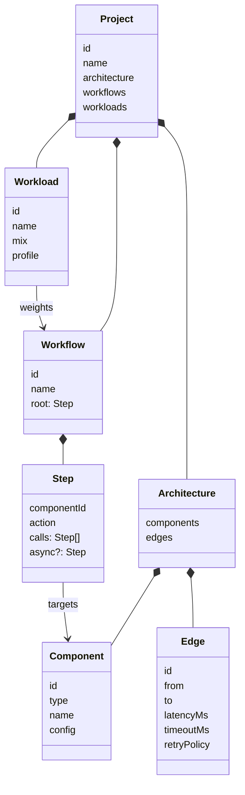
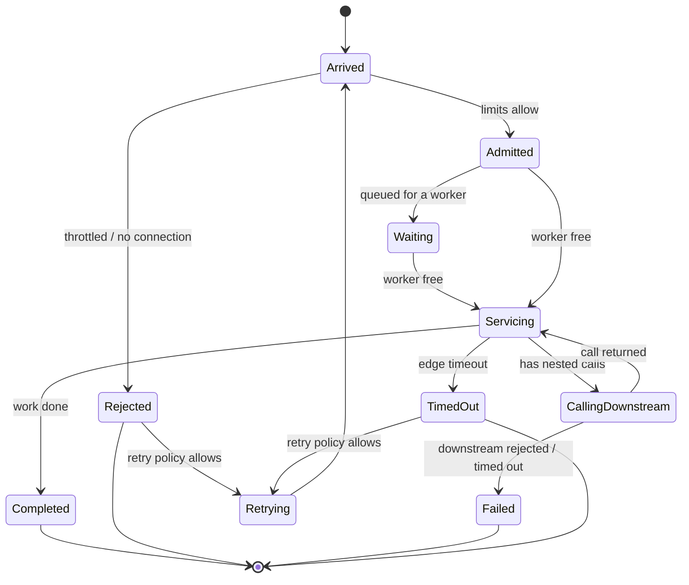
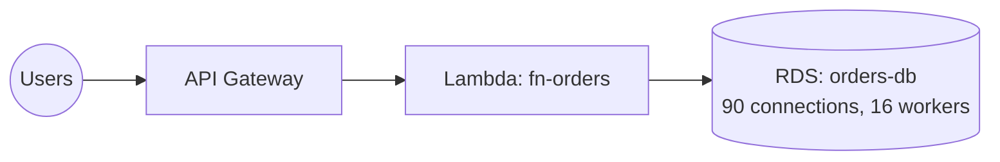
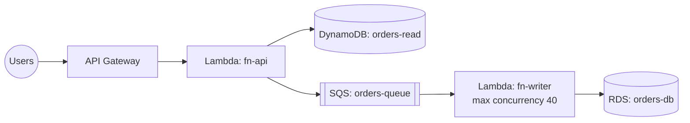

# MVP Design: Domain Model, Simulation Engine, and Project Document

- **Status:** Draft
- **Date:** 2026-10-13
- **Related:** [Architecture overview](../architecture/README.md), [ADR-0002](../adr/0002-use-clean-architecture-layering.md), [ADR-0004](../adr/0004-persist-projects-in-indexeddb.md)

This document describes what the first working version of Wind Tunnel contains and how its core works. It is written for maintainers who are new to the codebase. Read the [architecture overview](../architecture/README.md) first for vocabulary and layering.

## 1. MVP goal

Prove the concept: **load a template project, run a workload against it, and see where and why it breaks.**

In scope:

- Five component types: **API Gateway, Lambda, DynamoDB, RDS, SQS**.
- Workflows and workloads as defined in the project document (no editor yet).
- A deterministic simulation engine that runs headless.
- IndexedDB persistence and two bundled templates.
- A minimal UI: project list, read-only architecture view, a Run button, and metric charts.

Out of scope for the MVP (see the local `TODO.md`): editing architectures on the canvas, animated request particles, run comparison, cost estimates, IaC import/export, DynamoDB partition modeling.

## 2. Milestones

The core is built and validated **without UI first**, so we can judge whether the simulation is convincing before investing in the interface.

| # | Milestone | Done when |
|---|---|---|
| M0 | Project scaffolding | Vite + React + strict TS, Vitest, ESLint with the import-boundary rule, CI running lint and tests |
| M1 | Domain model and engine, headless | Both templates run from a Node script and print metrics; Template A visibly fails and Template B doesn't |
| M2 | Application layer and persistence | Use cases work against the IndexedDB adapter (tested with `fake-indexeddb`) and the template catalog |
| M3 | Minimal UI | Create a project from a template, view it, run it, see charts |

## 3. Domain model



### 3.1 Components are built from behavior primitives

The engine does not know about "Lambda" or "RDS". It knows a few small **behavior primitives**, and each component type is a combination of them (Interface Segregation; see ADR-0002).

| Primitive | Behavior | When full |
|---|---|---|
| `ConcurrencyLimit` | At most *N* requests in progress | Reject, or wait in a queue (configurable) |
| `RateLimit` | Token bucket: steady rate *r*, burst *b* | Reject (e.g. HTTP 429) |
| `Queue` | FIFO buffer, optionally bounded | Reject when bounded and full |
| `ServiceTime` | How long one unit of work takes, sampled from a distribution (constant, exponential, lognormal) | n/a |

A **component definition** registers a type and says how to build it from its config. Adding a new service type means adding a definition, not editing the engine (Open/Closed):

```ts
interface ComponentDefinition<Config> {
  type: string;                       // "lambda"
  displayName: string;                // "AWS Lambda"
  configSchema: z.ZodType<Config>;    // validates config; see ADR-0005
  defaultConfig: Config;
  actions: StepAction[];              // actions it accepts, e.g. ["read", "write"]
  deliversAsync: boolean;             // queue-like: runs the `async` step of what it accepts
  build<T>(config: Config, context: { random: RandomSource }): ComponentBehavior<T>;
}
```

A `ComponentBehavior` is called by the engine (`arrive`, `finish`, `dispatchFinished`) and answers with effects (`started`, `queued`, `rejected`, `dispatched`); it never schedules events itself. For metrics it exposes `inProgress`, `queueDepth`, and optional type-specific `gauges` and `counters`. See [ADR-0006](../adr/0006-components-return-effects-to-the-engine.md) and the [component definitions guide](../architecture/component-definitions.md).

Every definition must pass a shared **contract test suite** (Liskov Substitution), `checkComponentContract`: it must eventually complete or reject every request it accepts, never complete a request twice, and report consistent metrics.

### 3.2 MVP component types

| Type | Built from | Key config (defaults) | What it teaches |
|---|---|---|---|
| **API Gateway** | `RateLimit` → `ServiceTime` | rate 10,000/s, burst 5,000, overhead ~10 ms | Account-level throttling, 429s |
| **Lambda** | `ConcurrencyLimit` (reject = throttle) + cold starts → `ServiceTime` | concurrency 1,000, cold start ~300 ms, idle timeout before an instance goes cold, compute time | Throttling; concurrency = rate × duration |
| **DynamoDB** | `RateLimit` per table → `ServiceTime` | read/write capacity per second, up to 300 s of saved-up burst capacity, ~5 ms latency | Throttling under capacity limits (partitions come later) |
| **RDS** | `ConcurrencyLimit` on connections (reject) **and** a second `ConcurrencyLimit` for query workers (queue) → `ServiceTime` | max connections 90, query workers 16, query time ~15 ms | Connection exhaustion; queueing when the database is CPU-bound |
| **SQS** | Unbounded `Queue` + pollers that pull into a consumer Lambda | consumer max concurrency (event source mapping, 10), batch size 1 for the MVP; failed messages are redelivered immediately (no visibility timeout yet) | Buffering, backlog, decoupling |

RDS has two limits on purpose. When queries arrive faster than the workers can handle them, they queue. That makes each Lambda invocation take longer, so more invocations are running at once. Each one holds a connection, so the connection limit is eventually hit. This feedback loop is the main lesson of Template A.

> **Fidelity note:** In real Lambda, a database connection opened during initialization stays open for as long as the execution environment exists, even between invocations. The MVP simplifies this to "a connection is held for the duration of an invocation". Modeling connections per environment is a later fidelity improvement. This and every other known difference from AWS is listed, with sources, in [Fidelity: where Wind Tunnel differs from AWS](fidelity.md) (this one is LMB-8).

### 3.3 Workflows are call trees

A workflow describes what one user request does. Each step targets a component and can make **nested calls** while it runs. Nesting matters: a Lambda holds its concurrency slot (and its RDS connection) while it waits for its downstream calls. That's why problems downstream spread back upstream.

```ts
interface Step {
  componentId: string;
  action: "invoke" | "read" | "write" | "enqueue";
  calls?: Step[];   // made in order while this step holds its resources
  async?: Step;     // only on "enqueue": work done later, when a consumer takes the message
}
```

Example, "Create order" in Template B:

```text
api (invoke)
└─ fn-api (invoke)
   └─ orders-queue (enqueue)          ← the user's request completes once this succeeds
      └─ async: fn-writer (invoke)    ← runs later, when the queue's consumer pulls the message
         └─ orders-db (write)
```

**Validation rule:** every parent → child call must follow an edge in the architecture. The edge provides the network latency, timeout, and retry policy for that call.

### 3.4 Workloads use an open arrival model

A workload has a **mix** (relative weights of workflows) and a **profile** (target request rate over time, given as points with linear interpolation between them):

```ts
interface Workload {
  id: string;
  name: string;
  durationSec: number;
  mix: { workflowId: string; weight: number }[];
  profile: { atSec: number; requestsPerSec: number }[];
}
```

Arrivals are random (a Poisson process), following the profile's rate. Requests keep arriving at the target rate however slow the system gets. This is called an **open model**.

> **Key concept: open vs. closed workload models.** In a *closed* model, a fixed number of users each wait for a response before sending the next request. When the system slows down, they automatically send less, which hides overload. Real internet traffic behaves more like an *open* model: new users keep arriving whether or not the system is coping. Load tests that use closed models often make systems look healthier than they are. (Search: "coordinated omission".)

## 4. Simulation engine

### 4.1 Discrete-event simulation

The engine does not advance in fixed time steps. It keeps a **priority queue of future events** ordered by simulated time, repeatedly takes the earliest one, and processes it, which may schedule new events. Simulated time jumps directly from one event to the next, so idle periods cost nothing.

Internal event types: `user-arrives`, `attempt-arrives` (after edge latency), `service-done`, `response` (after edge latency), `timeout`, `retry`. Metrics ticks are emitted by the loop itself, outside the queue, when `tickMs` is set ([ADR-0007](../adr/0007-metrics-observe-the-engine.md)). What happens is reported to an observer as `SimulationEvent`s; see the [engine guide](../architecture/simulation-engine.md#the-engine-loop-a-requests-journey).



### 4.2 Determinism

Given the same project, workload, and **seed**, a run produces exactly the same results. This makes bugs reproducible, lets tests assert exact numbers, and allows replay later.

- All randomness comes from a `RandomSource` interface. The engine never calls `Math.random`. Because the engine lives in `domain` and `domain` cannot import from `application`, `RandomSource` is **defined in `domain`**, along with its seeded implementation (a small, pure algorithm such as mulberry32). The engine receives a `RandomSource` as a parameter, so tests can pass in a scripted one.
- Simulated time is a number of milliseconds inside the engine; the wall clock is never used.
- Events with the same timestamp are ordered by a sequence number assigned when they were scheduled.

### 4.3 Output: metrics snapshots

The engine runs as fast as it can and emits a **snapshot every simulated second** containing, per component:

- arrivals, completions, failures, rejections, timeouts
- in-progress count and queue depth (current and peak)
- latency percentiles (p50, p95, p99) from a fixed-bucket histogram
- for queue-like components, async deliveries and their latency
- type-specific gauges and counters, e.g. RDS connections held and Lambda cold starts

and, per workflow, requests started, succeeded, and failed (with failures grouped by cause), and latency percentiles of successful requests. Run totals have the same shape. The engine emits ticks; a `MetricsCollector` observer builds the snapshots ([ADR-0007](../adr/0007-metrics-observe-the-engine.md), [metrics guide](../architecture/metrics.md)).

Separating computation from display is intentional: the UI replays snapshots at any speed, and the same engine can feed charts, tests, or a command-line report.

### 4.4 Scale expectations

Each request generates roughly 5 to 15 events. A 60-second run at 2,000 requests per second is about 1 to 2 million events, which should take a few seconds in a Web Worker. Much larger runs will need an aggregate (queueing-math) mode; that's a later decision.

## 5. Application layer

### 5.1 Ports

| Port | Purpose | MVP adapter |
|---|---|---|
| `ProjectRepository` | Load, save, list, and delete projects | IndexedDB (`idb`) |
| `TemplateCatalog` | List templates and load one | Bundled JSON |
| `SimulationRunner` | Start a run and stream snapshots | Web Worker (in-process for tests) |
| `Clock` | Current wall-clock time for timestamps like `createdAt` | `Date` |
| `IdGenerator` | New unique IDs | `crypto.randomUUID()` |

### 5.2 MVP use cases

`ListProjects`, `CreateProjectFromTemplate`, `LoadProject`, `SaveProject`, `DeleteProject`, `RunSimulation`.

## 6. Project document (persistence format)

This is the stored and exported shape described in ADR-0004. It is separate from the domain entities; a mapper in `src/adapters/persistence/` converts between them. In code, the shape below is defined as a Zod schema ([ADR-0005](../adr/0005-use-zod-for-schema-validation.md)) and the TypeScript types are derived from it; it's written as interfaces here for readability. Every document is parsed against the schema before it reaches the domain.

```ts
interface ProjectDocumentV1 {
  schemaVersion: 1;
  id: string;
  name: string;
  description?: string;
  createdAt: string;   // ISO 8601
  updatedAt: string;
  source?: { templateId: string; templateVersion: number };

  architecture: {
    components: {
      id: string;                       // stable, referenced by edges and workflows
      type: string;                     // "api-gateway" | "lambda" | "dynamodb" | "rds" | "sqs"
      name: string;
      config: Record<string, unknown>;  // validated by the component definition
    }[];
    edges: {
      id: string;
      from: string;
      to: string;
      latencyMs: number;
      timeoutMs: number;
      retry: { maxAttempts: number; backoff: "none" | "exponential" | "exponential-jitter"; baseDelayMs: number };
    }[];
  };

  workflows: { id: string; name: string; root: StepDocument }[];
  workloads: {
    id: string;
    name: string;
    durationSec: number;
    seed: number;
    mix: { workflowId: string; weight: number }[];
    profile: { atSec: number; requestsPerSec: number }[];
  }[];

  layout: { nodes: Record<string, { x: number; y: number }> };   // keyed by component id
}

interface StepDocument {
  componentId: string;
  action: "invoke" | "read" | "write" | "enqueue";
  calls?: StepDocument[];
  async?: StepDocument;
}
```

**IndexedDB layout (database version 1):** database `wind-tunnel`, one object store `projects` with key path `id` and an index on `updatedAt` for "recent projects". A `runs` store will be added in a later database version.

**Load-time checks:** the schema version is known (otherwise migrate or refuse), all IDs are unique, every edge and step points at an existing component, every step follows an edge, mix weights are positive, and the profile's times increase.

## 7. Templates

Both templates use the **same workload**, so their results can be compared directly.

**Shared workload: "Lunch rush"** (60 seconds, seed 42)

- Mix: 80% *Get order*, 20% *Create order*
- Profile: 200 requests/s for 10 s, ramping to 2,000 requests/s at 20 s, holding until 40 s, then back down to 200 requests/s at 50 s

### Template A: "Serverless API with RDS"



- *Get order:* api → fn-orders → orders-db (read)
- *Create order:* api → fn-orders → orders-db (write)

**Expected behavior:** At 200 requests/s everything is fine. During the spike, queries arrive faster than 16 workers can handle them, so they queue, invocations get longer, and Lambda concurrency rises past 90. Every invocation beyond that can't get a connection and fails. Errors and p99 latency both jump.

### Template B: "Serverless API with DynamoDB + SQS"



- *Get order:* api → fn-api → orders-read (read)
- *Create order:* api → fn-api → orders-queue (enqueue), then later fn-writer → orders-db (write)

**Expected behavior:** Reads go to DynamoDB, which has capacity to spare. Writes are accepted as soon as they're queued, so API latency stays flat. During the spike the queue grows, then empties after the spike ends. fn-writer never uses more than 40 connections, so RDS never runs out.

> **Key concept: what Template B costs.** Users get "accepted" (HTTP 202) instead of "done" for writes, and a write may be visible only after the queue catches up. Reading data that may briefly be out of date (eventual consistency) is the price of absorbing spikes.

If M1 shows these two behaviors clearly, the concept works.

## 8. Testing strategy

| Layer | Test type | Notes |
|---|---|---|
| Domain primitives | Unit tests | Exact numbers, thanks to determinism |
| Component definitions | Shared contract tests | Every type runs the same suite |
| Engine | Scenario tests | Templates as fixtures; assert broad outcomes ("A has >5% errors during the spike; B has <0.1%") rather than exact values, so tuning doesn't break tests |
| Persistence adapter | Integration tests | `fake-indexeddb` in Node |
| UI | Component tests | Added in M3; kept light |

## 9. Decisions and open questions

- **Validation:** Zod, per [ADR-0005](../adr/0005-use-zod-for-schema-validation.md).
- **Headless runner:** M1 includes a small Node script (`npm run simulate -- --template a`) that prints a text report. It stays useful after M1 for debugging and benchmarks.
- **Open: canvas library for M3.** React Flow is the leading candidate. Decide (with an ADR) when M3 starts.
