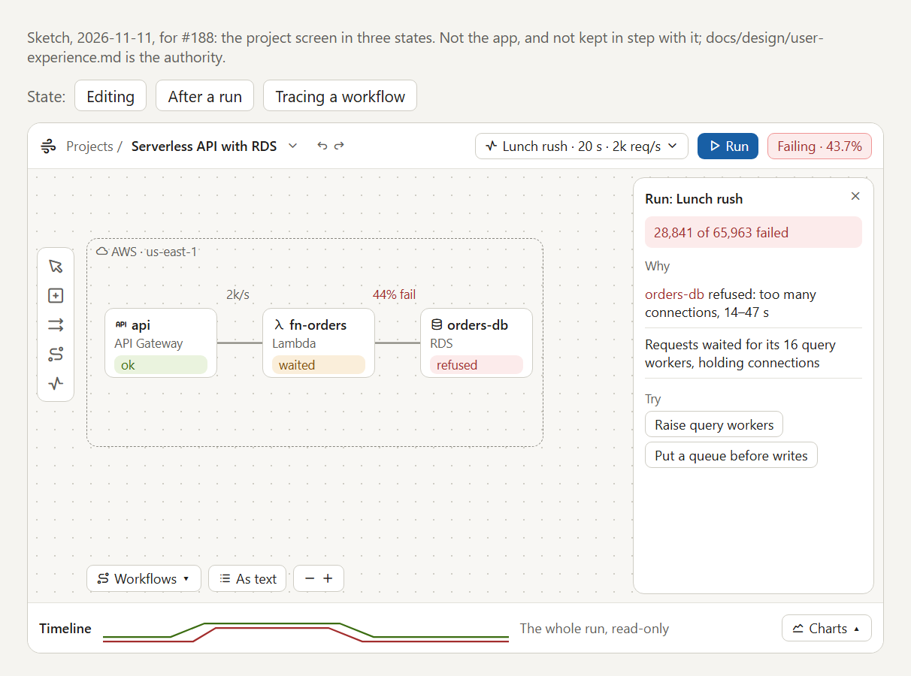
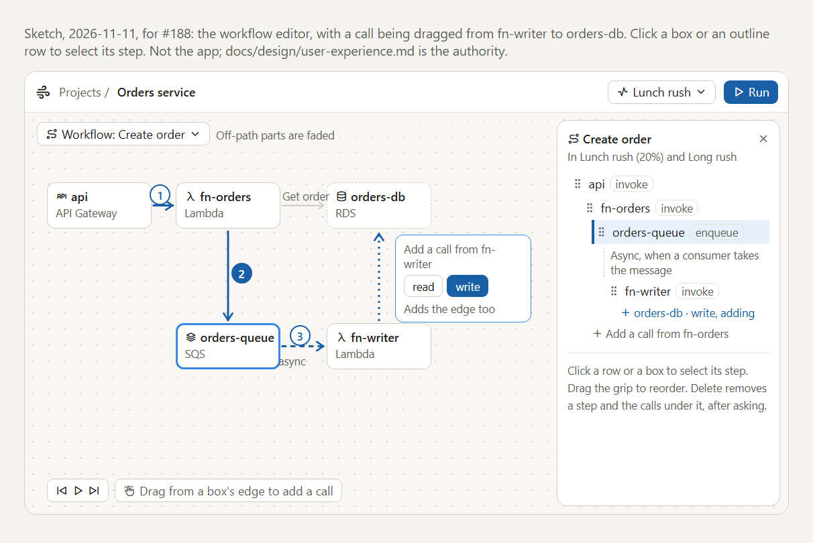
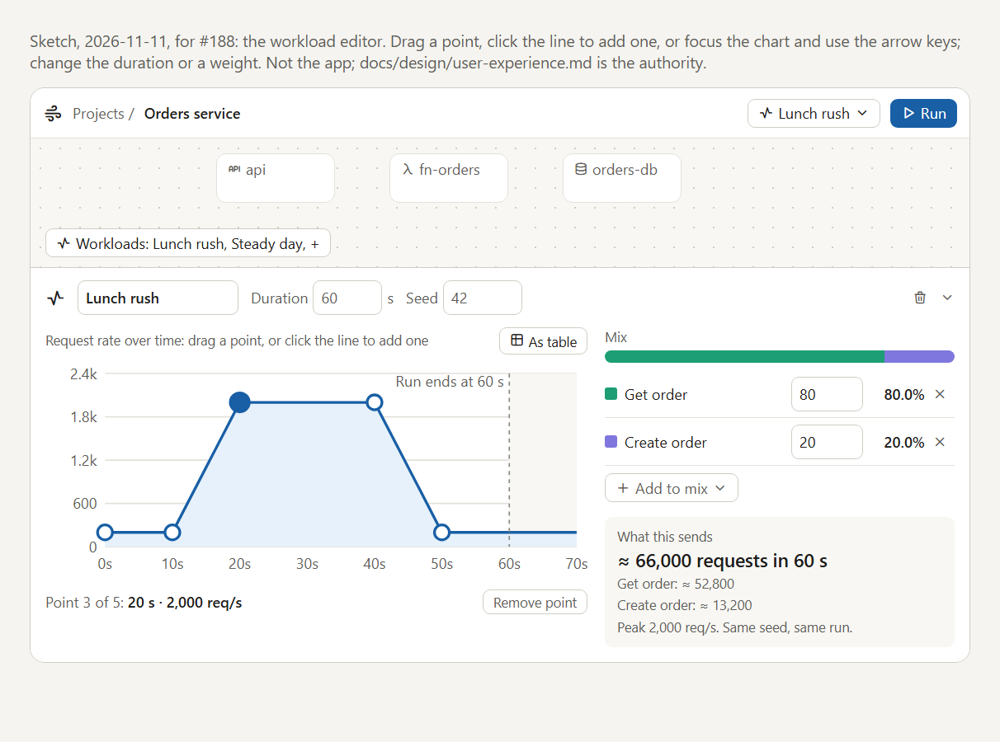

# User experience

Wind Tunnel exists so a developer can describe their own system, run real-world traffic through it, and learn *why* it behaves as it does. This page is the design of the project screen, where all of that happens: what it's for, how it looks, the rules every part of it follows, and the reasons behind them. It's written for a person deciding what to build or changing what's there.

**Status.** M7 ("Canvas-first", [#188](https://github.com/alanbickel/wind-tunnel/issues/188)) rebuilds the screen around the diagram. Today's screen has the shell (item 2, [#190](https://github.com/alanbickel/wind-tunnel/issues/190)): one top bar, the full-bleed canvas, and the inspector over it, holding M6's Details and Run tabs; the later items are still to come. The [user interface guide](../architecture/user-interface.md) describes the code as it is; this page describes where it's going, and [§11](#11-how-m7-builds-it) says in what order. The rules in §3 to §6 hold on both screens.

**What isn't here.** Exact wording of messages, the list of edit commands, and the field-by-field data each step needs. Those live in the code and its tests, and, for work not built yet, in the issue that builds it. The M6 version of this page, which went through every journey step by step and is still cited by the M6 Roadmap items and ADRs 0010, 0018, 0019, and 0021, is [kept at its last commit](https://github.com/alanbickel/wind-tunnel/blob/6ef2e1e9ace6a3cb9a419bc9187fa3c2b8869d38/docs/design/user-experience.md). A `§x.y` in a code comment, a test, or a guide is a section of that M6 version.

## 1. The modeling loop

Modeling is a loop, and a user goes round it many times in a sitting. **Describe** part of your system: a component and its settings, the path a request takes, the traffic it faces. **Check** that Wind Tunnel's picture matches the one in your head. **Run** it, and read what broke, where, and why. Then change something and go round again.

The loop is only as fast as its slowest step, so no step needs a reload, a separate screen, or a Save button. A feature that doesn't help one of the three steps waits.

## 2. The screen

*Sketch: [`mocks/project-screen.html`](mocks/project-screen.html) has it in three states (editing, after a run, tracing a workflow).*

The canvas fills the window. Everything else sits over it or docks to it:

- **The top bar** says where you are and whether the project holds up: the project's name (rename it there), Undo and Redo, the workload picker, Run and Stop, and the verdict ("Failing · 43.7%"), with "Out of date" once the project has changed since the run.
- **The canvas** is your system: a box per component, an arrow per edge. A small tool rail on the left adds components, connects them, and opens the workflows and workloads. At the bottom left are the workflow picker, the diagram's text version, and zoom.
- **The inspector** floats over the right of the canvas and shows whatever is selected: a component's settings, an edge's, a workflow's steps, or, after a run with nothing selected, the run's explanation. Escape closes it.
- **The dock** runs along the bottom and holds the things that are about time: the run's timeline, and the workload editor when a workload is open. It folds down to one line.

**Why canvas-first.** The diagram is the user's system, the thing being built, and it's where an explanation lands best: "orders-db refused" means most on the orders-db box. On M6's screen the diagram has about a sixth of the window and says nothing after a run. [IcePanel](https://icepanel.io/) is the model for how this should feel: a full-bleed canvas, quiet floating chrome, and editing done on the picture rather than in forms.

**Narrow windows.** Below `--breakpoint-wide`, the top bar wraps, the canvas keeps a fixed height at the top, and the inspector and the dock become full-width sections below it, in that order, with the page scrolling as it does today. Selecting still moves the focus to the inspector's heading, so nothing opens out of sight.

## 3. Principles

Every part of the screen follows these. When a new feature seems to need an exception, that's a design question for the maintainer, not a local choice.

1. **The picture explains the run.** A run's results appear on the things they're about: a badge on the box, the finding beside it. Charts and tables are the evidence, a click away, not the first thing you read.
2. **One selection.** The screen has one selected thing or none, and every part reads the same one ([§5](#5-selection-and-focus)).
3. **Everything by keyboard, everything as text.** Whatever you can do by dragging on the canvas, you can do with a button and the keyboard, and whatever the canvas shows has a text version: the diagram's text version, a workflow's outline, a profile's table. The canvas is the fast path, never the only one.
4. **Changes save as you make them, and each one can be undone** ([§6](#6-editing-and-saving)).
5. **Problems show where they are, and stop only what they break.** A workflow step that calls a removed component is marked on the step, counted on its workflow, and stops runs of the workloads that use it. Nothing else stops.
6. **Quiet by default.** Help, defaults, and their evidence are there on demand (an info control beside a setting), not printed under every field. Only the thing that needs attention gets color.

## 4. The canvas

**Boxes.** Each component is a card: an icon for its type, its name, and its type in words. After a run, the card gets a badge from the run's totals, telling three cases apart: it **refused** work (it turned requests away), its limits made work **wait**, or **ok** (neither). Each badge has its own shape as well as its color, so color is never the only signal, and the text version lists the same status. Once the run is out of date, the badges are drawn hollow: they're from an earlier version of the project.

**Arrows.** Edges belong to the architecture, so they're drawn, edited, and removed on their own, whether or not a workflow uses them. Drag from a box's handle to another box to connect them; from the keyboard, the inspector's "Connect to…" does the same.

**Moving.** Boxes move by dragging, or with the arrow keys once one has the focus. Where a box sits is saved with the project, and a move is one undo step when it ends.

**Adding and removing.** "Add component" (on the tool rail) lists the types, each with a line on what it's for, and places the new box selected, with its name field focused, since naming it is what comes next. Removing a component takes it and its own edges, never workflow steps; the confirmation names the steps that call it, and those steps are then marked as calling a component that's gone.

## 5. Selection and focus

The screen has one selection, or none: a component, an edge, a workflow, a step, a workload, or a finding. The screen holds it, above every panel, so the canvas, the inspector, the lists, and the run's results all read the same one. It isn't saved, and it isn't an undo step.

**Focus and selection look different, because they are different.** The focus ring means the DOM focus: it's drawn on whatever has the focus, however it got there, and nothing else is ever a ring. The selection is a filled bar down the left edge of what's selected: a box, a list row, a row of the text version, and the inspector itself, so one rule holds everywhere. A selected arrow has no left edge, so it's drawn thicker instead. Focus is where you are; the selection is what you act on.

**Tab on the canvas doesn't select**, because selecting moves the focus to the inspector's heading: selecting on focus would pull a keyboard user away before they reached the next box. Enter selects the focused box.

| Selected | Canvas | Inspector | Elsewhere |
|---|---|---|---|
| Component | Marks the box | Its settings | |
| Edge | Thickens the arrow | Its latency, timeout, retry, and the steps that call along it | |
| Workflow | Highlights the boxes and arrows it uses, fades the rest, numbers its steps | Its outline | Its row in the workflow picker is marked |
| Step | Marks the step's box and the arrow its call arrives on | The workflow's outline, with the step marked | |
| Workload | Nothing | Closes: the workload opens in the dock | The top bar's picker picks it |
| Finding | Marks the boxes it names | Stays on the run's explanation | |

- **Selecting** a component, edge, workflow, step, or workload moves the focus to the heading of what opened (the inspector, or the dock for a workload). Escape there clears the selection and returns the focus to whatever made it. Selecting a finding leaves the focus on the finding.
- **Clicking** a box, an arrow, or a row selects it; clicking the empty canvas clears the selection.
- **When the selected thing goes**, the selection clears and the focus moves to the nearest "Add" button ("Add component", or "Add workload"), since what made the selection may be gone too ([#95](https://github.com/alanbickel/wind-tunnel/issues/95)). Undoing the remove selects it again. When an Undo or Redo removes what had the focus, the focus moves to the Undo or Redo button just used.
- **A finding can name a component that's been removed since the run**, because the run keeps its own copy of the project (§9). Selecting that finding marks nothing, and the finding says the component isn't in the project any more.

## 6. Editing and saving

How edits reach storage is [ADR-0019](../adr/0019-edit-projects-with-commands-and-save-each-change.md); the short version:

- **There's no Save button.** Each change is checked and saved as it's made.
- **A field holds a draft.** What you type stays in the field until it passes the field's checks (a range, a p99 at or above its median, a name nobody else uses), and becomes a change on Enter or when you leave the field. A draft that fails shows its message on the field and never reaches the project. Escape puts the saved value back.
- **The architecture must always be valid; workflows and workloads needn't be.** A component's settings and the edges can't be saved broken, and the screen's pickers and fields can't make them so. A workflow or a workload with a problem saves, shows the problem where it is, and stops only runs that need it (§3, principle 5).
- **A remove takes only what it owns.** Removing a component takes its edges; removing a step takes the calls under it; removing a workflow takes it out of the workloads' mixes.
- **Undo** takes back one saved change at a time, and says which ("Undo change orders-db's query workers"). A remove comes back whole, with what it took. A draft, the selection, and a run are never undo steps. The history lasts while the project is open.
- **If a save fails** (the browser's storage refused it), the top bar says so and offers "Try again", and the change stays on screen.

Names are unique where a user picks one by name: projects, workflows, workloads, and components of one type. They're compared ignoring case and the spaces around them.

## 7. Workflows

A workflow is the path one kind of request takes through your architecture: a tree of calls, each step calling one component with one action, and making its own calls in order while it holds that component's resources (a Lambda invocation keeps its concurrency slot while its database call runs). A component does nothing until a workflow calls it.

On the canvas (the sketch in §4, interactive in [`mocks/workflow-editor.html`](mocks/workflow-editor.html)):

- **Pick a workflow** from the picker at the bottom left, or its row on the tool rail's list. Its boxes and arrows are highlighted and the rest of the diagram fades. Each call is numbered on its arrow, in the order the requests take them.
- **The player** steps through the path one call at a time, marking each step's box and arrow in turn, so you can watch a request travel.
- **Add a call by drawing it.** Drag from a box in the path to the box it calls. If the target accepts more than one action (RDS takes `read` and `write`), a small popover asks which. If there's no edge between them yet, the call adds one, and says so.
- **The outline** in the inspector is the same tree as text, and the keyboard's way to do everything: each row selects its step, a grip drags it among its siblings (Move up and Move down do the same from the keyboard), and each step that can take a call has "Add a call from …". A row's component and action can be changed in place; the step keeps its place and its id.
- **Async work.** A step that enqueues a message has a second tree under it, the work done when a consumer takes the message off the queue. It's drawn dashed on the canvas and set off in the outline, and it's edited the same way ([ADR-0021](../adr/0021-edit-async-work-through-the-same-commands.md)).
- **Removing a step** takes the calls under it, and asks first if there are any.
- **A new workflow** starts from "Add workflow": you name it and pick its first component, by clicking a box or from the inspector's picker. It saves once that first step is complete, as one undo step; until then nothing is stored, and Escape drops it.

The inspector's header says which workloads run the workflow, and how big a share of each.

## 8. Workloads

A workload is the traffic: which workflows run, in what mix, at what rate over time, for how long, from which random seed. Without one, nothing runs.

*Try it: [`mocks/workload-editor.html`](mocks/workload-editor.html) lets you drag the profile and change the weights.*

The workload editor lives in the dock, because a workload is about time, and the dock is the screen's time axis: it's as wide as the window, which a rate-over-time curve needs, and after a run the run's own timeline sits in the same place, so the target and what happened line up.

- **Opening one.** The tool rail's Workloads lists them; selecting one opens it in the dock and picks it in the top bar, so Run runs what you're looking at. Picking in the top bar changes only what Run runs. "Add workload" makes one at once (it's valid from the start: 60 s, seed 42, one point at 100 requests/s, and an empty mix), opens it, and focuses its name.
- **Duration and seed.** How long requests keep arriving, in simulated seconds, and the seed: the same seed always gives the same run, so changing it shows how much a result owes to luck.
- **The profile** is the target request rate over time, drawn as a line through its points: straight between them, level before the first and after the last. Drag a point to move it, click the line to add one, or select one and nudge it with the arrow keys. "As table" shows the same points as rows of time and rate, the version a screen reader reads, and as editable as the chart.
  - The points are always in time order, and no two share a time, since a line can't have two rates at one moment. Moving a point past its neighbor re-sorts it, rate and all.
  - A profile keeps at least one point.
  - **As built ([#184](https://github.com/alanbickel/wind-tunnel/issues/184)):** the table is the editor, and the chart above it is a read-only picture drawn from the saved points; dragging, clicking the line, and arrow-key nudging aren't built (only if the table proves slow for shaping a curve). A point is addressed by its time, not by a row number, because a change of time re-sorts the rows; the commands sort, and a field only refuses a negative number or a time another point has. "Add point" puts a point 10 s after the last, at its rate. Undo doesn't move the focus. [The workload editor guide](../architecture/workload-editor.md#the-profile) has the rest.
  - The run ends at the duration, marked on the chart. A point after it is allowed, drawn muted with a note: it still shapes the line before the end, and a user may want a short look at a long profile.
- **The mix** is the workflows the workload runs and their weights. Weights are relative: 80 and 20 mean four requests in five run the first. Each row shows its share, to a tenth of a percent, and the shares always add up to exactly 100.0%, the last tenths going to the largest remainders. A bar above the rows shows the split at a glance.
- **What this sends.** Under the mix, the editor adds it up: about how many requests the profile sends over the duration, how many each workflow gets, and the peak rate. Lunch rush says about 66,000, and a run of it starts 65,974: you can check that a workload says what you meant before you run it.
- **Problems.** An empty mix is the one problem a workload can have from the screen. It saves, shows on the mix, is marked in the top bar's picker, and stops only that workload's runs.

Removing a workflow takes it out of every mix, and its confirmation names the workloads it leaves; Undo puts it back at its weights.

**Open for the workload item ([#178](https://github.com/alanbickel/wind-tunnel/issues/178)):** the profile chart is the first chart you can edit, and [ADR-0011](../adr/0011-draw-charts-with-recharts-behind-our-own-components.md) has every chart drawn with Recharts, which doesn't support dragging points. Whether that's Recharts with custom handles or our own SVG behind the same component boundary is that item's decision, and may need an addendum to ADR-0011.

## 9. Runs and results

- **Run** is in the top bar, beside the workload it runs. While a run goes, the top bar shows its progress; when it ends, the verdict: "Healthy", "Failing", and so on, with the share that failed.
- **The canvas shows the result** on each box, as badges (§4).
- **The inspector explains it.** With nothing selected after a run, the inspector shows the run: the verdict in a sentence, then **Why**, the findings, and **Try**, the fixes they suggest. Selecting a finding marks the boxes it names. Findings are written by the detectors described in [findings.md](findings.md).
- **The timeline** in the dock draws the whole run: requests that succeeded and failed over time. It's read-only for now. "Charts" opens the full set: requests per second, latency, work in progress and waiting per component, each with its table.
- **A run keeps the project it ran** ([ADR-0018](../adr/0018-tie-a-run-to-the-model-it-ran.md)). Everything shown about a run is worded from its own copy, whatever has changed since. A run is current while the architecture, the workflows, and the workload it ran are unchanged; renaming the project, moving boxes, or editing another workload doesn't count, and undoing back to what ran makes it current again. Once it isn't, the top bar adds "Out of date", the badges go hollow, and the run's explanation opens with a line saying it's of an earlier version. Runs aren't stored: the screen keeps its latest until you leave.

## 10. What a screen reader hears

A change saves when its field is left, and what follows can show somewhere else on the screen. A sighted user sees it; a screen reader user hears it only if it's announced.

- **Status messages are announced politely**, without moving the focus: the run going out of date, a save that failed, a workload that can't run any more. Each comes from a live region that's on the page before its text changes, since many screen readers skip a region that appears with its text already in it.
- **A field's error is tied to its field** (`aria-invalid` and `aria-describedby`), so it's read whenever the field has the focus, and announced when you leave a field whose draft failed.
- **A save that works isn't announced**: the field shows it, and it's what you just did.
- **A remove is announced** ("Removed orders-db."), from a region beside the "Add" button the focus moves to, since nothing at the new focus says what went.
- **The canvas is never the only way.** The diagram's text version, the workflow outline, and the profile table carry everything the canvas shows (§3, principle 3).

## 11. How M7 builds it

The [Roadmap](https://github.com/alanbickel/wind-tunnel/issues/32)'s M7 items, in order, cut over in place: the app works after every PR, and there's no feature flag, since there are no outside users yet. Each item updates the architecture guides it changes.

1. **This design** ([#188](https://github.com/alanbickel/wind-tunnel/issues/188)).
2. **The shell:** the full-bleed canvas, the top bar, and the inspector, holding today's Details and Run content unchanged. §2, §3.
3. **Node cards:** icon, name, type, and the run's badges, hollow when out of date. §4, §9.
4. **Select a finding:** marks its boxes on the canvas. §5, §9.
5. **The workload editor** in the dock ([#178](https://github.com/alanbickel/wind-tunnel/issues/178)), its sub-issues rewritten against §8 before they start. §8.
6. **Workflows on the canvas** ([#197](https://github.com/alanbickel/wind-tunnel/issues/197)): the highlighted path with the rest faded, numbered calls, and drawing a call. §7.
7. **The timeline dock:** the run over time, read-only, with the full charts behind it. §9.
8. **The player:** steps through a workflow's path one call at a time, after the timeline dock so the two can share a playback model. §7.

## 12. Not yet

- **Point-in-time investigation.** A scrubber on the timeline that shows the boxes as they were at a moment, the start of playground-style exploration: drag to 31 s and see orders-db refusing. It builds on the read-only timeline; until then, the badges show the whole run.
- **Labels on the arrows** after a run (the rate along an edge, its share of failures), as the sketch shows. The run's metrics are kept per component, not per edge, so they'd need per-edge totals first.
- **Groups** on the canvas, such as an account or a Region drawn as a dashed boundary (the sketch has one). They're a picture only, since nothing in the model is grouped.
- **Comparing a run with the one before**, and saying what changed since the run. Both need a comparison of two models. In the Roadmap's Not scheduled.
- **A "take this fix" control** on a finding's fix, which needs a fix to name its component, setting, and value. Also Not scheduled.
- **A "new random seed" control**, worth adding once runs can be compared.

## The mocks

[`mocks/`](mocks/) holds the sketches this page shows: a PNG of each, and the HTML it was taken from. Run `npm run dev` and open `/docs/design/mocks/<name>.html` to use the interactive ones; GitHub shows HTML as source. Each is dated and isn't kept in step with the app or with this page, which is the authority where they differ.

| Sketch | Shows |
|---|---|
| [`project-screen.html`](mocks/project-screen.html) | The screen editing, after a run, and tracing a workflow (§2, §4, §9) |
| [`workflow-editor.html`](mocks/workflow-editor.html) | A workflow on the canvas, a call being drawn, and the outline (§7) |
| [`workload-editor.html`](mocks/workload-editor.html) | The workload editor in the dock, with a draggable profile and a live mix (§8) |
