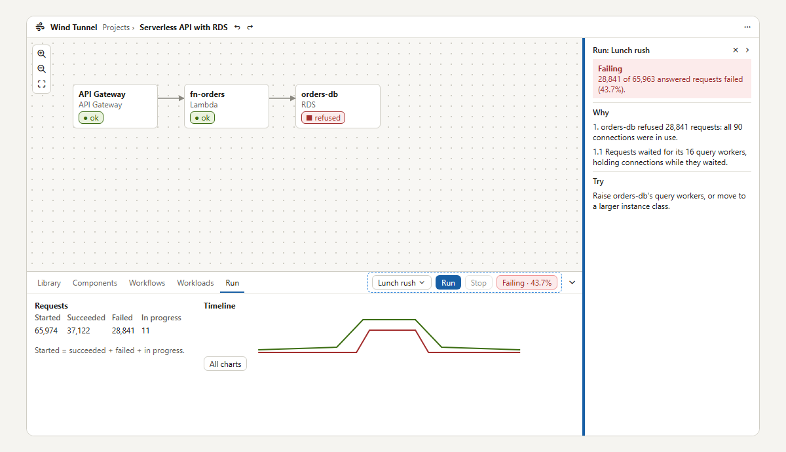
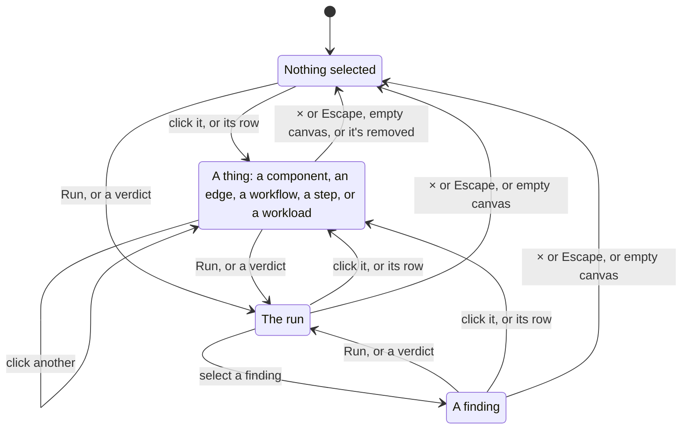
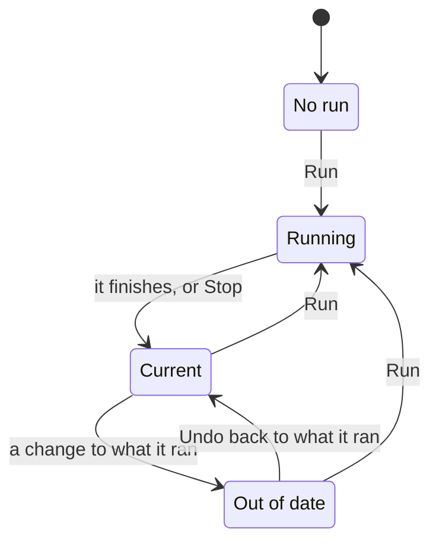
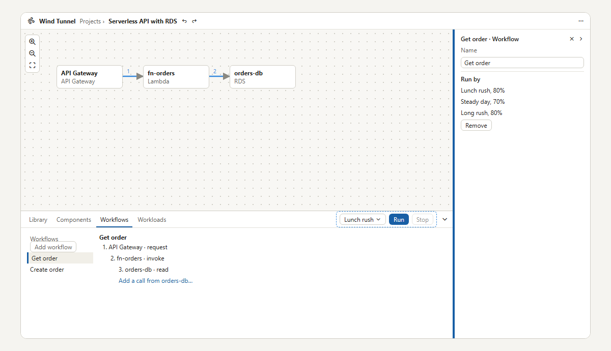
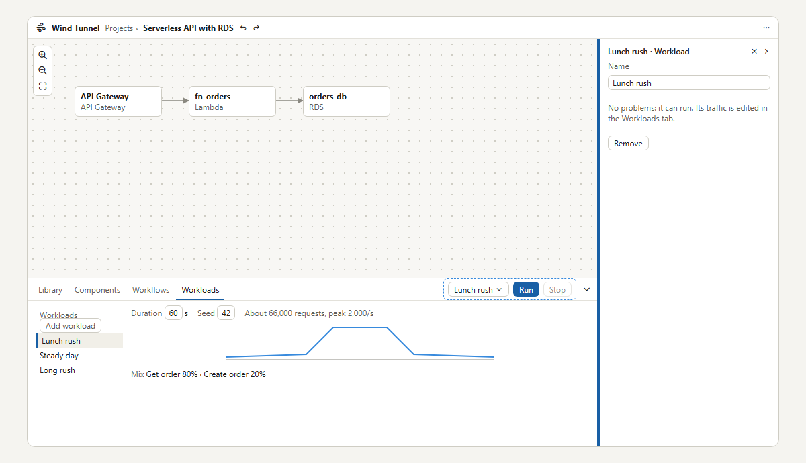

# User experience

Wind Tunnel exists so a developer can describe their own system, run real-world traffic through it, and learn *why* it behaves as it does. This page is the design of the project screen, where all of that happens: what it's for, how it looks, the rules every part of it follows, and the reasons behind them. It's written for a person deciding what to build or changing what's there.

**Status.** M7 ("Canvas-first", [#188](https://github.com/alanbickel/wind-tunnel/issues/188)) rebuilds the screen around the diagram. Today's screen has the shell (item 2, [#190](https://github.com/alanbickel/wind-tunnel/issues/190)): one top bar, the full-bleed canvas, the inspector over it, one surface that explains the run with Why and Try ([#242](https://github.com/alanbickel/wind-tunnel/issues/242)), and the dock under them, whose Run overlay holds the totals and charts ([#241](https://github.com/alanbickel/wind-tunnel/issues/241)); the later items are still to come. §2 and §5 were rewritten for [#246](https://github.com/alanbickel/wind-tunnel/issues/246) (2026-11-15): one job per region, and a map of the screen's states. Until its slices land, today's screen still has the floating panels, the run's controls in the top bar, and the run's explanation shown with nothing selected. The [user interface guide](../architecture/user-interface.md) describes the code as it is; this page describes where it's going, and [§11](#11-how-m7-builds-it) says in what order. The rules in §3 to §6 hold on both screens.

**What isn't here.** Exact wording of messages, the list of edit commands, and the field-by-field data each step needs. Those live in the code and its tests, and, for work not built yet, in the issue that builds it. The M6 version of this page, which went through every journey step by step and is still cited by the M6 Roadmap items and ADRs 0010, 0018, 0019, and 0021, is [kept at its last commit](https://github.com/alanbickel/wind-tunnel/blob/6ef2e1e9ace6a3cb9a419bc9187fa3c2b8869d38/docs/design/user-experience.md). A `§x.y` in a code comment, a test, or a guide is a section of that M6 version.

## 1. The modeling loop

Modeling is a loop, and a user goes round it many times in a sitting. **Describe** part of your system: a component and its settings, the path a request takes, the traffic it faces. **Check** that Wind Tunnel's picture matches the one in your head. **Run** it, and read what broke, where, and why. Then change something and go round again.

The loop is only as fast as its slowest step, so no step needs a reload, a separate screen, or a Save button. A feature that doesn't help one of the three steps waits.

## 2. The screen

*Sketch: [`mocks/project-screen.html`](mocks/project-screen.html) has the screen in each state of [§5](#5-selection-and-focus)'s map.*

The canvas fills the window. Around it are five regions, and each has one job:

- **The top bar** says where you are: the project's name (rename it there) after the breadcrumbs, Undo and Redo, and the ⋯ menu (the theme). Nothing about the run.
- **The banner**, under the top bar, is there only while something affects the whole project: a save that failed, with "Try again", or storage the browser may clear. A problem with one part of the project shows on that part instead (§3, principle 5).
- **The rail**, on the canvas's left edge, holds the canvas's view: zoom in, zoom out, and fit. Nothing else floats over the canvas.
- **The inspector** is a full-height column on the right, beside the canvas and the dock. It shows the selected thing, and with nothing selected, the project's overview ([§5](#5-selection-and-focus)). It collapses to a strip, and only the user collapses it.
- **The dock**, under the canvas, holds the project's lists and editors, and the run, in five tabs, in the order you go round the modeling loop: **Library** (the component types, to add one), **Components**, **Workflows**, **Workloads**, and **Run**. At the right end of its tab strip is the **run group**: the workload Run runs, Run and Stop (two buttons, so a late click on Stop can't start the next run), and the verdict ("Failing · 43.7%"). The dock folds down to its tab strip, and the run group stays.
- **The canvas** is your system: a box per component, an arrow per edge ([§4](#4-the-canvas)).

**Why one job per region.** Before [#246](https://github.com/alanbickel/wind-tunnel/issues/246), the run showed in two places (its explanation in the inspector, its totals in the dock), a workload opened from three, workflows were picked from two, four controls each closed a panel their own way, and opening a workload in the dock folded the inspector away. Each was reasonable alone; together you couldn't predict what a click would change. With one job each, what you're looking at depends only on what you chose, and §5 says how.

**Why the run's controls are in the dock.** Choosing a workload, editing it, and running it are one task, so they're in one place: the workload you pick in the Workloads tab is the one the run group names, beside Run. The run group stays when the dock folds, so Run and the verdict are always on screen.

**Why canvas-first.** The diagram is the user's system, the thing being built, and it's where an explanation lands best: "orders-db refused" means most on the orders-db box. On M6's screen the diagram has about a sixth of the window and says nothing after a run. [IcePanel](https://icepanel.io/) is the model for how this should feel: a full-bleed canvas, quiet chrome, and editing done on the picture rather than in forms.

**Narrow windows.** Below `--breakpoint-wide`, the top bar wraps, the canvas keeps a fixed height at the top, and the inspector and the dock become full-width sections below it, in that order, with the page scrolling as it does today. The run group moves to the top bar, whole, so Run is never scrolled out of sight; it's never split. Selecting still moves the focus to the inspector's heading, so nothing opens out of sight. [#245](https://github.com/alanbickel/wind-tunnel/issues/245) settles the layout at every window size.

## 3. Principles

Every part of the screen follows these. When a new feature seems to need an exception, that's a design question for the maintainer, not a local choice.

1. **The picture explains the run.** A run's results appear on the things they're about: a badge on the box, the finding beside it. Charts and tables are the evidence, a click away, not the first thing you read.
2. **One selection.** The screen has one selected thing or none, and every part reads the same one ([§5](#5-selection-and-focus)).
3. **Everything by keyboard, everything as text.** Whatever you can do by dragging on the canvas, you can do with a button and the keyboard, and whatever the canvas shows has a text version: the Components tab's lists, a workflow's outline, a profile's table. The canvas is the fast path, never the only one.
4. **Changes save as you make them, and each one can be undone** ([§6](#6-editing-and-saving)).
5. **Problems show where they are, and stop only what they break.** A workflow step that calls a removed component is marked on the step, counted on its workflow, and stops runs of the workloads that use it. Nothing else stops.
6. **Quiet by default.** Help, defaults, and their evidence are there on demand (an info control beside a setting), not printed under every field. Only the thing that needs attention gets color.
7. **One home, one meaning.** Each thing is reached from one place (a workflow from the Workflows tab, a workload from the Workloads tab), and other places link to it rather than repeat it. Each control means one thing wherever it appears: × clears the selection, and the chevron collapses or folds a region.

## 4. The canvas

**Boxes.** Each component is a card: an icon for its type, its name, and its type in words. After a run, the card gets a badge from the run's totals, telling three cases apart: it **refused** work (it turned requests away), its limits made work **wait**, or **ok** (neither). Each badge has its own shape as well as its color, so color is never the only signal, and the Components tab lists the same status. Once the run is out of date, the badges are drawn hollow: they're from an earlier version of the project.

**Arrows.** Edges belong to the architecture, so they're drawn, edited, and removed on their own, whether or not a workflow uses them. Drag from a box's handle to another box to connect them; from the keyboard, the inspector's "Connect to…" does the same. The canvas says how itself, with no control of its own: a handle's tooltip reads "Drag to another box to connect", and while the project has components but no edges, one line on the canvas says the same and goes once there's an edge. Drawing always makes an edge, whatever is selected. A workflow's calls go only along the edges that are there, in their direction (§7), so connecting is how the architecture says what can call what.

**Moving.** Boxes move by dragging, or with the arrow keys once one has the focus. Where a box sits is saved with the project, and a move is one undo step when it ends.

**Adding and removing.** The dock's Library tab lists the component types, each as a card with its icon and a line on what it's for, and it's the one place to add a component. Drag a card onto the canvas to place the box where you drop it; or click it, or press Enter on it, to place it in the next free spot. Either way the new box is selected, with its name field focused, since naming it is what comes next, and the dock stays on the Library. The Library is separate from the Components tab, which lists what's in the project: one is what you can add, the other is what you have. Removing a component takes it and its own edges, never workflow steps; the confirmation names the steps that call it, and those steps are then marked as calling a component that's gone.

## 5. Selection and focus

The screen has one selection, or none: a component, an edge, a workflow, a step, a workload, the run, or one of the run's findings. The screen holds it, above every region, so the canvas, the inspector, the dock's lists, and the run group all read the same one. It isn't saved, and it isn't an undo step.

**Focus and selection look different, because they are different.** The focus ring means the DOM focus: it's drawn on whatever has the focus, however it got there, and nothing else is ever a ring. The selection is a filled bar down the left edge of what's selected: a box, a row in one of the dock's lists, and the inspector itself, so one rule holds everywhere. A selected arrow has no left edge, so it's drawn thicker instead. Focus is where you are; the selection is what you act on.

**Tab on the canvas doesn't select**, because selecting moves the focus to the inspector's heading: selecting on focus would pull a keyboard user away before they reached the next box. Enter selects the focused box.

### What each selection shows

| Selected | Canvas | Inspector | Dock |
|---|---|---|---|
| Nothing | Nothing marked | The project's overview: its description, what it holds, its problems, and the latest run's verdict, which selects the run | Unchanged |
| Component | Marks the box | Its settings, then, after a run, **In this run**: its status, the findings that name it, and a link that selects the run | Its row in Components is marked |
| Edge | Thickens the arrow | Its latency, timeout, retry, and the steps that call along it | Its row in Components is marked |
| Workflow | Highlights the boxes and arrows it uses, fades the rest, numbers its calls | Its name, which workloads run it and how big a share of each, and Remove | Shows the Workflows tab, with its outline open |
| Step | Marks the step's box and the arrow its call arrives on | The step: what it calls, along which edge, and Remove | Shows the Workflows tab, with the step marked in the outline |
| Workload | Nothing | Its name, its problems, and Remove | Shows the Workloads tab, with its editor open. The run group picks it |
| The run | The badges, as always after a run | The run's explanation: the verdict in a sentence, Why, and Try | Shows the Run tab |
| A finding | Marks the boxes it names | The run's explanation, with the finding marked | Unchanged |

The inspector never shows a list or a whole editor, and the dock never shows one thing's settings: the inspector is for the one thing selected, the dock for the project's lists, the editors that need its width (a workflow's outline, a workload's profile and mix), and the run's evidence.

### The rules that move between states

1. **The selection alone decides what the inspector shows.** Nothing in the dock or the run group changes it.
2. **Only the user collapses the inspector or folds the dock.** Selecting, running, and removing never do. A selection that shows a dock tab unfolds the dock, and so does Run.
3. **A selection may show a dock tab, as the table says, and Run shows the Run tab. Switching tabs changes nothing else:** not the selection, not the inspector, not the run group. Each tab keeps its own state while another shows: its scroll, and what it has open (the Workflows tab keeps the workflow whose outline it shows, even once a box is selected instead).
4. **Run selects the run** and shows the Run tab, since pressing Run means "show me what happens". The verdict in the run group, and the overview's, select it again later. Clicking a box takes you back to the box.
5. **The run group picks the workload you select**, so Run runs what you're looking at. Picking in the run group changes only what Run runs, never the selection.
6. **The run group is one unit.** The workload, Run and Stop, and the verdict are always together, wherever the layout puts them.
7. **× clears the selection; the chevron collapses or folds.** The inspector's × (and Escape in it) clears the selection, so it shows the overview, and returns the focus to whatever made the selection. Its chevron collapses it to a strip, and the dock's chevron folds it to its tab strip. No control does both.

- **Selecting** moves the focus to the inspector's heading, except when you select from a row in one of the dock's lists, or a finding: then the focus stays where it is, since what you selected it for is beside it.
- **Clicking** a box, an arrow, or a row selects it; clicking the empty canvas clears the selection.
- **When the selected thing goes**, the selection clears and the focus moves to the nearest "Add" button ("Add component", or "Add workload"), since what made the selection may be gone too ([#95](https://github.com/alanbickel/wind-tunnel/issues/95)). Undoing the remove selects it again. When an Undo or Redo removes what had the focus, the focus moves to the Undo or Redo button just used.
- **A finding can name a component that's been removed since the run**, because the run keeps its own copy of the project (§9). Selecting that finding marks nothing, and the finding says the component isn't in the project any more.
- **A new run replaces the run**, so a selected finding of the old one becomes the new run.

### The map

The screen's state is four things, and each changes only as the rules above say:

| Part | Can be |
|---|---|
| The selection | Nothing, or one of the eight kinds in the table above |
| The inspector | Open or collapsed |
| The dock | Which tab shows, and folded or not. Library, Components, Workflows, and Workloads are always there; Run is there once a run has started |
| The run | None, running, current, or out of date |

They're independent, so any combination can happen, with two exceptions: the run, or a finding, can be selected only while there's a run, and the run group's verdict shows only once there is one. A collapsed inspector or a folded dock still holds what it shows, so opening it again shows the same thing.

How the selection moves:

How the run moves, and what each part shows ([§9](#9-runs-and-results) has the rest):

| The run | Run group | Run tab | Badges | The run's explanation |
|---|---|---|---|---|
| None | The workload, and Run, or why it can't run | Not there | None | Can't be selected |
| Running | The workload, Stop, and its progress | The run so far | From the last run, if there was one | "Running", with its progress |
| Current | The workload, Run, and the verdict | The totals and charts | Solid | The verdict, Why, and Try |
| Out of date | The same, the verdict marked "out of date" | The same, with a line saying so | Hollow | The same, opening with a line saying it's of an earlier version |

## 6. Editing and saving

How edits reach storage is [ADR-0019](../adr/0019-edit-projects-with-commands-and-save-each-change.md); the short version:

- **There's no Save button.** Each change is checked and saved as it's made.
- **A field holds a draft.** What you type stays in the field until it passes the field's checks (a range, a p99 at or above its median, a name nobody else uses), and becomes a change on Enter or when you leave the field. A draft that fails shows its message on the field and never reaches the project. Escape puts the saved value back.
- **The architecture must always be valid; workflows and workloads needn't be.** A component's settings and the edges can't be saved broken, and the screen's pickers and fields can't make them so. A workflow or a workload with a problem saves, shows the problem where it is, and stops only runs that need it (§3, principle 5).
- **A remove takes only what it owns.** Removing a component takes its edges; removing a step takes the calls under it; removing a workflow takes it out of the workloads' mixes.
- **Undo** takes back one saved change at a time, and says which ("Undo change orders-db's query workers"). A remove comes back whole, with what it took. A draft, the selection, and a run are never undo steps. The history lasts while the project is open.
- **If a save fails** (the browser's storage refused it), the top bar says so and offers "Try again", and the change stays on screen.

Names are unique where a user picks one by name: projects, workflows, workloads, and components of one type. They're compared ignoring case and the spaces around them.

## 7. Workflows

A workflow is the path one kind of request takes through your architecture: a tree of calls, each step calling one component with one action, and making its own calls in order while it holds that component's resources (a Lambda invocation keeps its concurrency slot while its database call runs). A component does nothing until a workflow calls it.

A workflow is edited on the canvas and in the dock's Workflows tab, side by side: the tab lists the workflows on its left, and shows the open one's outline on its right.

- **Pick a workflow** from the Workflows tab's list. Its boxes and arrows are highlighted and the rest of the diagram fades. Each call is numbered on its arrow, in the order the requests take them.
- **The player** steps through the path one call at a time, marking each step's box and arrow in turn, so you can watch a request travel.
- **Add a call by picking its edge.** A call goes only along an edge that's already there, from the caller to the component it calls ([ADR-0019](../adr/0019-edit-projects-with-commands-and-save-each-change.md#addendum-2026-11-12)). With a workflow selected, the edges leaving the boxes in its path offer to carry a new call; pick one to add it. If the target accepts more than one action (RDS takes `read` and `write`), a small popover asks which. If no edge leads where the call should go, connect the boxes first (§4): adding a call never adds an edge.
- **The outline** in the Workflows tab is the same tree as text, and the keyboard's way to do everything: each row selects its step, a grip drags it among its siblings (Move up and Move down do the same from the keyboard), and each step that can take a call has "Add a call from …". A row's component and action can be changed in place; the step keeps its place and its id.
- **Async work.** A step that enqueues a message has a second tree under it, the work done when a consumer takes the message off the queue. It's drawn dashed on the canvas and set off in the outline, and it's edited the same way ([ADR-0021](../adr/0021-edit-async-work-through-the-same-commands.md)).
- **Removing a step** takes the calls under it, and asks first if there are any.
- **A new workflow** starts from "Add workflow", in the Workflows tab: you name it and pick its first component, by clicking a box or from the draft's picker. It saves once that first step is complete, as one undo step; until then nothing is stored, and Escape drops it.

With a workflow selected, the inspector says which workloads run it, and how big a share of each.

## 8. Workloads

A workload is the traffic: which workflows run, in what mix, at what rate over time, for how long, from which random seed. Without one, nothing runs.

The workload editor lives in the dock's Workloads tab, because a workload is about time, and the dock is wide, which a rate-over-time curve needs; after a run, the run's own timeline is one tab along, so the target and what happened line up. The tab lists the workloads on its left, and shows the open one's editor on its right.

- **Opening one.** Selecting one in the Workloads tab opens it and picks it in the run group, so Run runs what you're looking at. Picking in the run group changes only what Run runs. "Add workload", in the tab, makes one at once (it's valid from the start: 60 s, seed 42, one point at 100 requests/s, and an empty mix), opens it, and focuses its name.
- **Duration and seed.** How long requests keep arriving, in simulated seconds, and the seed: the same seed always gives the same run, so changing it shows how much a result owes to luck.
- **The profile** is the target request rate over time, drawn as a line through its points: straight between them, level before the first and after the last. Drag a point to move it, click the line to add one, or select one and nudge it with the arrow keys. "As table" shows the same points as rows of time and rate, the version a screen reader reads, and as editable as the chart.
  - The points are always in time order, and no two share a time, since a line can't have two rates at one moment. Moving a point past its neighbor re-sorts it, rate and all.
  - A profile keeps at least one point.
  - **As built ([#184](https://github.com/alanbickel/wind-tunnel/issues/184)):** the table is the editor, and the chart above it is a read-only picture drawn from the saved points; dragging, clicking the line, and arrow-key nudging aren't built (only if the table proves slow for shaping a curve). A point is addressed by its time, not by a row number, because a change of time re-sorts the rows; the commands sort, and a field only refuses a negative number or a time another point has. "Add point" puts a point 10 s after the last, at its rate. Undo doesn't move the focus. [The workload editor guide](../architecture/workload-editor.md#the-profile) has the rest.
  - The run ends at the duration, marked on the chart. A point after it is allowed, drawn muted with a note: it still shapes the line before the end, and a user may want a short look at a long profile.
- **The mix** is the workflows the workload runs and their weights. Weights are relative: 80 and 20 mean four requests in five run the first. Each row shows its share, to a tenth of a percent, and the shares always add up to exactly 100.0%, the last tenths going to the largest remainders. A bar above the rows shows the split at a glance.
- **What this sends.** Under the mix, the editor adds it up: about how many requests the profile sends over the duration, how many each workflow gets, and the peak rate. Lunch rush says about 66,000, and a run of it starts 65,974: you can check that a workload says what you meant before you run it.
- **Problems.** An empty mix is the one problem a workload can have from the screen. It saves, shows on the mix, is marked in the run group's picker, and stops only that workload's runs.

Removing a workflow takes it out of every mix, and its confirmation names the workloads it leaves; Undo puts it back at its weights.

**Open for the workload item ([#178](https://github.com/alanbickel/wind-tunnel/issues/178)):** the profile chart is the first chart you can edit, and [ADR-0011](../adr/0011-draw-charts-with-recharts-behind-our-own-components.md) has every chart drawn with Recharts, which doesn't support dragging points. Whether that's Recharts with custom handles or our own SVG behind the same component boundary is that item's decision, and may need an addendum to ADR-0011.

## 9. Runs and results

- **Run** is in the run group, at the end of the dock's tab strip, beside the workload it runs. If the workload can't run, the reason is beside Run instead. While a run goes, the run group shows its progress; when it ends, the verdict: "Healthy", "Failing", and so on, with the share that failed.
- **The canvas shows the result** on each box, as badges (§4).
- **The inspector explains it.** Run selects the run, and the inspector shows the verdict in a sentence, then **Why**, the findings, and **Try**, the fixes they suggest. Selecting a finding marks the boxes it names. Selecting anything else shows that instead; the verdict, in the run group or in the project's overview, selects the run again. Findings are written by the detectors described in [findings.md](findings.md).
- **A component carries its part of the run.** After a run, its details end with **In this run**: its status, the findings that name it, and a link back to the run, so you can read why orders-db refused beside the settings you'd change.
- **The Run tab** holds the run's evidence: the totals, and the timeline (the whole run, requests that succeeded and failed over time, read-only for now) with the full set of charts behind it: requests per second, latency, work in progress and waiting per component, each with its table. The explanation is words, in the inspector; the evidence is numbers over time, in the dock.
- **A run keeps the project it ran** ([ADR-0018](../adr/0018-tie-a-run-to-the-model-it-ran.md)). Everything shown about a run is worded from its own copy, whatever has changed since. A run is current while the architecture, the workflows, and the workload it ran are unchanged; renaming the project, moving boxes, or editing another workload doesn't count, and undoing back to what ran makes it current again. Once it isn't, the verdict in the run group is marked "out of date", the badges go hollow, and the run's explanation opens with a line saying it's of an earlier version. Runs aren't stored: the screen keeps its latest until you leave.

## 10. What a screen reader hears

A change saves when its field is left, and what follows can show somewhere else on the screen. A sighted user sees it; a screen reader user hears it only if it's announced.

- **Status messages are announced politely**, without moving the focus: the run going out of date, a save that failed, a workload that can't run any more. Each comes from a live region that's on the page before its text changes, since many screen readers skip a region that appears with its text already in it.
- **A field's error is tied to its field** (`aria-invalid` and `aria-describedby`), so it's read whenever the field has the focus, and announced when you leave a field whose draft failed.
- **A save that works isn't announced**: the field shows it, and it's what you just did.
- **A remove is announced** ("Removed orders-db."), from a region beside the "Add" button the focus moves to, since nothing at the new focus says what went.
- **The canvas is never the only way.** The Components tab (each component with its type and status, and each connection), the workflow outline, and the profile table carry everything the canvas shows (§3, principle 3). Each row selects what it names, as clicking it on the canvas does.

## 11. How M7 builds it

The [Roadmap](https://github.com/alanbickel/wind-tunnel/issues/32)'s M7 items, in order, cut over in place: the app works after every PR, and there's no feature flag, since there are no outside users yet. Each item updates the architecture guides it changes.

1. **This design** ([#188](https://github.com/alanbickel/wind-tunnel/issues/188)).
2. **The shell:** the full-bleed canvas, the top bar, and the inspector, holding today's Details and Run content unchanged. §2, §3.
3. **Node cards:** icon, name, type, and the run's badges, hollow when out of date. §4, §9.
4. **Select a finding:** marks its boxes on the canvas. §5, §9.
5. **The workload editor** in the dock ([#178](https://github.com/alanbickel/wind-tunnel/issues/178)), its sub-issues rewritten against §8 before they start. §8.
6. **Workflows on the canvas** ([#197](https://github.com/alanbickel/wind-tunnel/issues/197)): the highlighted path with the rest faded, numbered calls, and adding a call by picking its edge. §7.
7. **The timeline dock:** the run over time, read-only, with the full charts behind it. §9.
8. **The player:** steps through a workflow's path one call at a time, after the timeline dock so the two can share a playback model. §7.

The screen's view state ([#246](https://github.com/alanbickel/wind-tunnel/issues/246)) comes before the timeline dock, since the timeline is one of the dock's tabs. It reworks §2's regions and §5's rules in small slices, each listed on #246: the screen's state held in one place first, with no visible change, then the run as a selection with the run group in the dock, the dock's tabs, the floating panels' removal, the full-height inspector, and the connect hint.

## 12. Not yet

- **Point-in-time investigation.** A scrubber on the timeline that shows the boxes as they were at a moment, the start of playground-style exploration: drag to 31 s and see orders-db refusing. It builds on the read-only timeline; until then, the badges show the whole run.
- **Labels on the arrows** after a run (the rate along an edge, its share of failures). The run's metrics are kept per component, not per edge, so they'd need per-edge totals first.
- **Groups** on the canvas, such as an account or a Region drawn as a dashed boundary. They're a picture only, since nothing in the model is grouped.
- **Patterns in the Library:** a few components already connected, such as an API in front of a function and its database, added in one go.
- **Comparing a run with the one before**, and saying what changed since the run. Both need a comparison of two models. In the Roadmap's Not scheduled.
- **A "take this fix" control** on a finding's fix, which needs a fix to name its component, setting, and value. Also Not scheduled.
- **A "new random seed" control**, worth adding once runs can be compared.

## The mocks

[`mocks/project-screen.html`](mocks/project-screen.html) is the sketch this page shows: one page with a switcher for each state in [§5](#5-selection-and-focus)'s map, from an empty project to a run that's out of date, a folded dock, and a narrow window. Run `npm run dev` and open `/docs/design/mocks/project-screen.html` to use it; GitHub shows HTML as source. Its PNGs are three of its states, taken with `#<state>` on the URL, which opens it on that state. It's dated (2026-11-15) and isn't kept in step with the app or with this page, which is the authority where they differ.

The earlier sketches, of #188's screen and its workflow and workload editors, were removed when #246 replaced them, so that only one sketch says how the screen looks. They're in the history at [`f1314b1`](https://github.com/alanbickel/wind-tunnel/tree/f1314b1/docs/design/mocks).
