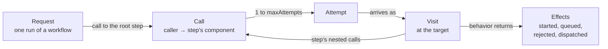

# Glossary

The terms used throughout the code and docs, a line or two each, with the type that holds them. For how they work together, follow the links to the guides.

## What a project describes

See [The domain model](architecture/domain-model.md). The types are in [`project.ts`](../src/domain/model/project.ts).

| Term | Meaning | In code |
|---|---|---|
| **Project** | Everything a user models: one architecture, its workflows, and its workloads. | `Project` |
| **Architecture** | The graph of components and edges: who can call whom. | `Architecture` |
| **Component** | One cloud service instance in the model, such as a Lambda function or a DynamoDB table. Its `type` picks the definition that simulates it, and its `config` sets its capacity. | `Component` |
| **Edge** | A connection that calls travel along, from caller to callee. It sets a call's one-way latency, its timeout, and its retry policy. | `Edge` |
| **Workflow** | What one request does, as a tree of steps laid over the architecture. Example: "Create order". | `Workflow` |
| **Step** | One node of a workflow: a call to a component with an action (`invoke`, `read`, `write`, `enqueue`). Its nested `calls` are made while it holds its resources. Its `async` step runs later, when a queue hands the message on. | `Step` |
| **Workload** | Which workflows run, in what mix, at what rate over time, for how long, and from which seed. Example: 80% browse and 20% checkout, ramping from 100 to 5,000 requests per second. | `Workload` |
| **Template** | A bundled starter project that teaches one lesson. | [`src/adapters/templates/`](../src/adapters/templates/) |

## What happens in a run

See [How the simulation engine works](architecture/simulation-engine.md). The runtime records are in [`runtime-records.ts`](../src/domain/engine/runtime-records.ts).

| Term | Meaning | In code |
|---|---|---|
| **Run** | One execution of a workload against a project. The same project, workload, and seed always give the same results. | `simulate`, `RunSimulation` |
| **Request** | One user's run of a workflow, from arrival to an answer or an error. Arrivals follow the workload's rate. In component code, `request` names the token a component holds; the engine passes a visit. | `UserRequest` |
| **Call** | A caller asking a step's component to do its work, along an edge. It makes one or more attempts, as the edge's retry policy allows. The user's call to the root step has no edge. | `Call` |
| **Attempt** | One try at a call. It is answered, rejected, or times out. A failed attempt is retried after a backoff if attempts remain. | `Attempt` |
| **Visit** | An attempt's stay at its target component, from arrival to finish. Components hold it while the work waits or runs. | `Visit` |
| **Effect** | What a component tells the engine after the engine calls it: `started`, `queued`, `rejected`, or `dispatched`. Components never schedule anything themselves ([ADR-0006](adr/0006-components-return-effects-to-the-engine.md)). | `Effect` |
| **Event** | Two kinds, named apart. `ScheduledWork` is what the engine puts on its own queue; a `SimulationEvent` is what it reports to observers such as the metrics collector. A type ending in `Event` is always one the observer sees. | `ScheduledWork`, `SimulationEvent` |
| **Tick** | A moment, every `tickMs` (one simulated second by default), when the engine reports every component's state. Ticks don't go through the event queue. | `MetricsTickEvent`, `TickSampler` |

How the runtime nouns nest: a request makes a call to its workflow's root step, each call makes attempts, each attempt becomes a visit at its target, and the visit's step makes the nested calls.

## How a component type plugs in

See [Component definitions](architecture/component-definitions.md).

| Term | Meaning | In code |
|---|---|---|
| **Definition** | Describes one component type, such as `lambda`: its config schema, the actions it accepts, and how to build its behavior. Adding a type means writing a definition and registering it; the engine doesn't change. | `ComponentDefinition` |
| **Registry** | The component types the engine can simulate, looked up by `type`. | `ComponentRegistry`, `createAwsComponentRegistry` |
| **Behavior** | One component's state during one run, built by its definition. The engine calls it as visits arrive and finish, and it returns effects. Built from the behavior primitives `RateLimit`, `ConcurrencyLimit`, `Queue`, and `ServiceTime`. | `ComponentBehavior` |

## Results and storage

See [How metrics work](architecture/metrics.md) and [The application layer and persistence](architecture/application-layer.md).

| Term | Meaning | In code |
|---|---|---|
| **Snapshot** | Metrics for one window of simulated time, closed at each tick: per component (counts, latencies, limits, gauges, counters) and per workflow (outcomes, latency). A run's totals use the same shape. | `MetricsSnapshot` |
| **Limit** | A cap a component enforces, which it declares so the metrics can report its use: a *concurrency* limit holds slots (RDS `connections`), and a *rate* limit is a token bucket (API Gateway `requestRate`). `peak / limit` reaches 1 when the limit is exhausted ([ADR-0014](adr/0014-components-report-their-limits.md)). | `LimitGauge`, `LimitUse` |
| **Drawdown, flow** | A rate limit's use is its *drawdown*: tokens missing from a full bucket. Its *flow* is tokens taken per second against the refill rate; above the rate, the bucket drains. | `RateLimitUse.peak`, `takenPerSec` |
| **In progress / unfinished** | The remainders that make totals add up. A request is *in progress* when it started and hasn't been answered; work at a component is *unfinished* when it arrived and is still running or waiting. | `requestsInProgress`, `unfinishedWork` |
| **Run analysis** | What a run's snapshots add up to, computed once for both the browser and the CLI: totals, per-second counts, and (from M5) findings. | [`application/run-analysis/`](../src/application/run-analysis/) |
| **Record** | A domain project plus what the engine doesn't use: timestamps, `source`, and `layout`. Use cases and ports work with records ([ADR-0008](adr/0008-ports-exchange-project-records.md)). | `ProjectRecord` |
| **Document** | A project as stored or exported: versioned JSON with a `schemaVersion`, and times in seconds. Only the persistence adapter reads or writes documents; `loadProject` turns one into a record. | [`project-document-v1.ts`](../src/adapters/persistence/project-document-v1.ts) |
