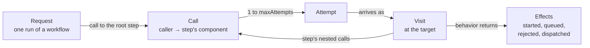

# Glossary

The terms used throughout the code and docs, a line or two each, with the type that holds them. For how they work together, follow the links to the guides.

## What a project describes

See [The domain model](architecture/domain-model.md). The types are in [`project.ts`](../src/domain/model/project.ts).

| Term | Meaning | In code |
|---|---|---|
| **Project** | Everything a user models: one architecture, its workflows, and its workloads. | `Project` |
| **Architecture** | The graph of components and edges: who can call whom. | `Architecture` |
| **Component** | One cloud service instance in the model, such as a Lambda function or a DynamoDB table. Its `type` picks the definition that simulates it, and its `config` sets its capacity. | `Component` |
| **Edge** | A connection that calls travel along, from caller to callee. It sets a call's one-way latency, its timeout, and its retry policy. | `Edge` |
| **Workflow** | What one request does, as a tree of steps laid over the architecture. Example: "Create order". | `Workflow` |
| **Step** | One node of a workflow: a call to a component with an action (`invoke`, `read`, `write`, `enqueue`). Its nested `calls` are made while it holds its resources. Its `async` step runs later, when a queue hands the message on. | `Step` |
| **Workload** | Which workflows run, in what mix, at what rate over time, for how long, and from which seed. Example: 80% browse and 20% checkout, ramping from 100 to 5,000 requests per second. | `Workload` |
| **Template** | A bundled starter project that teaches one lesson. | [`src/adapters/templates/`](../src/adapters/templates/) |

## What happens in a run

See [How the simulation engine works](architecture/simulation-engine.md). The runtime records are in [`runtime-records.ts`](../src/domain/engine/runtime-records.ts).

| Term | Meaning | In code |
|---|---|---|
| **Run** | One execution of a workload against a project. The same project, workload, and seed always give the same results. | `simulate`, `RunSimulation` |
| **Request** | One user's run of a workflow, from arrival to an answer or an error. Arrivals follow the workload's rate. In component code, `request` names the token a component holds; the engine passes a visit. | `UserRequest` |
| **Call** | A caller asking a step's component to do its work, along an edge. It makes one or more attempts, as the edge's retry policy allows. The user's call to the root step has no edge. | `Call` |
| **Attempt** | One try at a call. It is answered, rejected, or times out. A failed attempt is retried after a backoff if attempts remain. | `Attempt` |
| **Visit** | An attempt's stay at its target component, from arrival to finish. Components hold it while the work waits or runs. | `Visit` |
| **Effect** | What a component tells the engine after the engine calls it: `started`, `queued`, `rejected`, or `dispatched`. Components never schedule anything themselves ([ADR-0006](adr/0006-components-return-effects-to-the-engine.md)). | `Effect` |
| **Event** | Two kinds, named apart. `ScheduledWork` is what the engine puts on its own queue; a `SimulationEvent` is what it reports to observers such as the metrics collector. A type ending in `Event` is always one the observer sees. | `ScheduledWork`, `SimulationEvent` |
| **Tick** | A moment, every `tickMs` (one simulated second by default), when the engine reports every component's state. Ticks don't go through the event queue. | `MetricsTickEvent`, `TickSampler` |

How the runtime nouns nest: a request makes a call to its workflow's root step, each call makes attempts, each attempt becomes a visit at its target, and the visit's step makes the nested calls.

## How a component type plugs in

See [Component definitions](architecture/component-definitions.md).

| Term | Meaning | In code |
|---|---|---|
| **Definition** | Describes one component type, such as `lambda`: its config schema, the actions it accepts, and how to build its behavior. Adding a type means writing a definition and registering it; the engine doesn't change. | `ComponentDefinition` |
| **Registry** | The component types the engine can simulate, looked up by `type`. | `ComponentRegistry`, `createAwsComponentRegistry` |
| **Behavior** | One component's state during one run, built by its definition. The engine calls it as visits arrive and finish, and it returns effects. Built from the behavior primitives `RateLimit`, `ConcurrencyLimit`, `Queue`, and `ServiceTime`. | `ComponentBehavior` |

## Results and storage

See [How metrics work](architecture/metrics.md) and [The application layer and persistence](architecture/application-layer.md).

| Term | Meaning | In code |
|---|---|---|
| **Snapshot** | Metrics for one window of simulated time, closed at each tick: per component (counts, latencies, limits, gauges, counters) and per workflow (outcomes, latency). A run's totals use the same shape. | `MetricsSnapshot` |
| **Limit** | A cap a component enforces, which it declares so the metrics can report its use: a *concurrency* limit holds slots (RDS `connections`), and a *rate* limit is a token bucket (API Gateway `requestRate`). It's *exhausted* when every slot is held, or the bucket has less than one token left ([ADR-0014](adr/0014-components-report-their-limits.md)). | `LimitGauge`, `LimitUse` |
| **Rejection reason** | Why a component rejected a request, e.g. `too-many-connections`; with the component's ID, it's a failure's *cause*. Each type lists every reason it may reject with; a reason means something only within its type ([ADR-0016](adr/0016-component-types-list-every-rejection-reason.md)). `timeout` is the engine's, never a component's. | `rejectionReasons`, `RejectedEffect.reason`, `TIMEOUT_REASON` |
| **Refuses, makes work wait, holds** | What a limit does once it's exhausted, as its component declares. One that *refuses* rejects the next request with a reason (RDS `connections`: `too-many-connections`); every token bucket refuses. One that *makes work wait* queues it inside the component (RDS `queryWorkers`, SQS `consumerConcurrency`). Waiting work *holds* another of the component's limits if it keeps a slot of it while it waits: a query waiting for an RDS worker keeps its connection ([ADR-0015](adr/0015-findings-come-from-registered-detectors.md)). | `WhenFull`, `LimitUse.whenFull` |
| **Backlog** | Messages waiting in a queue for a consumer: work waiting for a limit that holds nothing while it waits (SQS `consumerConcurrency`). A message is *accepted* when the queue takes it, then *waiting* in the backlog, *being delivered* by a consumer, or *delivered*. A backlog still waiting when a finished run ends is a warning. | `ComponentMetrics.queueDepth`, `asyncSucceeded` |
| **Failed delivery** | A queue's delivery whose `async` work failed, such as fn-writer's call refused by orders-db. The message goes back to the backlog and is tried again, so no request fails. Counted per attempt, with its cause, as a failed request is ([ADR-0017](adr/0017-count-failed-async-deliveries-by-cause.md)), and noted at the component that refused it by the *failed-deliveries* finding. | `ComponentMetrics.asyncFailed`, `asyncFailures` |
| **Drawdown, flow** | A rate limit's use is its *drawdown*: tokens missing from a full bucket. Its *flow* is tokens taken per second against the refill rate; above the rate, the bucket drains. | `RateLimitUse.peak`, `takenPerSec` |
| **In progress / unfinished** | The remainders that make totals add up. A request is *in progress* when it started and hasn't been answered; work at a component is *unfinished* when it arrived and is still running or waiting. | `requestsInProgress`, `unfinishedWork` |
| **Run analysis** | What a run's snapshots add up to, computed once for both the browser and the CLI: totals, per-second counts, and findings. | [`application/run-analysis/`](../src/application/run-analysis/) |
| **Finding** | One thing a run did that the developer should know about: what, where, when, why, and what would fix it, in sentences whose numbers reconcile with the totals. A *failure* when requests failed, a *warning* when work finished later than the project's own timeout allows, a backlog outlasted the run, or a delivery failed in a finished run's last second, otherwise a *note* ([guide](architecture/finding-detectors.md)). | `Finding`, `Severity` |
| **Verdict** | What a run comes to, always given before the findings: *failing*, *degraded*, or *healthy* ("so far" until the run ends), its request counts, and, unless failing, the refusing limits that ran out and refused though no request failed (*no headroom*), then the limit closest to refusing work among the rest. | `Verdict`, `RefusingLimits`, `Headroom` |
| **Detector** | A rule that reads a run and returns findings, such as *failed-requests*. Registered in a list, never branching on a component's type ([ADR-0015](adr/0015-findings-come-from-registered-detectors.md)). | `Detector`, `createDetectors`, `findRun` |
| **Statement, phrasebook** | What a finding or the verdict says, as a typed value: a kind and the numbers, components, and times its sentence quotes. A *phrasebook* words a statement in its *long* form, a whole sentence, or its *short* form, a clause that reads after "but"; each detector registers the phrases for its statements ([guide](architecture/finding-detectors.md#how-a-finding-is-worded)). | `Statement`, `Phrase`, `Phrasebook`, `createPhrasebook` |
| **Cause note** | A note that says why another finding happened, such as the full RDS query workers behind refused connections. It names what it explains (a component, and optionally one of its limits), and `findRun` shows it beneath every finding that matches ([guide](architecture/finding-detectors.md#how-a-cause-note-is-linked)). | `Finding.explains`, `Finding.causedBy`, `linkCauses` |
| **Record** | A domain project plus what the engine doesn't use: timestamps, `source`, and `layout`. Use cases and ports work with records ([ADR-0008](adr/0008-ports-exchange-project-records.md)). | `ProjectRecord` |
| **Document** | A project as stored or exported: versioned JSON with a `schemaVersion`, and times in seconds. Only the persistence adapter reads or writes documents; `loadProject` turns one into a record. | [`project-document-v1.ts`](../src/adapters/persistence/project-document-v1.ts) |
